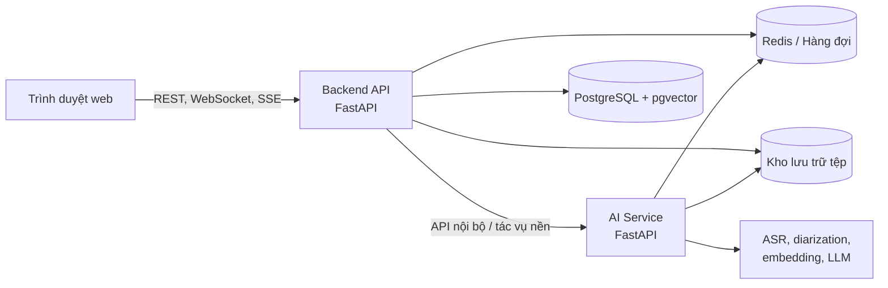

# Đề xuất đề tài đồ án tốt nghiệp

**Tên tiếng Việt:** Hệ thống phiên âm, tóm tắt và hỏi đáp nội dung cuộc họp  
**Tên tiếng Anh:** Meeting Transcription, Summarization, and Question Answering System

**Sinh viên:** Nguyễn Phương Linh  
**MSSV:** 20224871  
**Lớp:** IT1-02 — **Mã lớp:** 767789  
**Ngày lập:** Hà Nội, ngày 21 tháng 10 năm 2026

## 1. Product Requirements Document

### 1.1. Bài toán

Sau mỗi cuộc họp, người tham gia thường phải nghe lại bản ghi, hoàn thiện biên bản, tổng hợp các quyết định và xác định công việc cần thực hiện. Việc này mất nhiều thời gian và dễ bỏ sót thông tin. Khi số lượng cuộc họp tăng, việc tìm lại một nội dung đã trao đổi cũng trở nên khó khăn.

Đề tài xây dựng một ứng dụng web xử lý nội dung cuộc họp. Người dùng có thể ghi âm trực tiếp hoặc tải lên một tệp âm thanh. Hệ thống chuyển lời nói thành văn bản, xác định các lượt nói, tạo bản tóm tắt và cho phép đặt câu hỏi về nội dung cuộc họp. Mỗi câu trả lời phải kèm đoạn transcript và mốc thời gian dùng làm căn cứ để người dùng kiểm tra lại.

### 1.2. Mục tiêu

- Tạo transcript từ cuộc họp trực tiếp hoặc tệp âm thanh có sẵn.
- Chia transcript theo từng lượt nói, kèm mốc thời gian và nhãn người nói.
- Tạo bản tóm tắt gồm nội dung chính, quyết định và các công việc cần thực hiện.
- Cho phép hỏi đáp trên nội dung của từng cuộc họp bằng RAG và cung cấp trích dẫn.
- Hỗ trợ tìm kiếm, hiệu chỉnh transcript và xuất biên bản ở các định dạng thông dụng.
- Đánh giá kết quả trên dữ liệu cuộc họp tiếng Việt bằng các chỉ số phù hợp.

### 1.3. Người dùng mục tiêu

Sản phẩm hướng đến sinh viên, giảng viên, nhóm dự án và các nhóm nghiệp vụ cần ghi lại, tổng hợp và tra cứu nội dung cuộc họp. Đồ án tập trung vào xử lý nội dung cuộc họp. Các chức năng đăng ký, đăng nhập, thanh toán và quản trị người dùng không phải là use case chính.

### 1.4. Use case chính

| Mã | Chức năng | Kết quả |
|---|---|---|
| UC-01 | Ghi âm trên trình duyệt; gửi âm thanh theo từng đoạn; phiên âm và cập nhật nội dung trong khi cuộc họp diễn ra. | Transcript có nội dung, mốc thời gian và nhãn người nói. |
| UC-02 | Tải tệp âm thanh; kiểm tra tệp; xử lý nền; cho phép theo dõi tiến độ, sửa transcript và đổi tên người nói. | Transcript hoàn chỉnh từ tệp đã tải lên. |
| UC-03 | Đọc transcript và tổng hợp nội dung chính, quyết định, công việc, người phụ trách và thời hạn khi có. | Bản tóm tắt và danh sách công việc. |
| UC-04 | Tìm các đoạn transcript liên quan đến câu hỏi và dùng chúng để tạo câu trả lời. | Câu trả lời kèm đoạn transcript và mốc thời gian làm căn cứ. |
| UC-05 | Tìm cuộc họp theo tiêu đề hoặc transcript; xuất nội dung theo nhu cầu. | Tệp TXT, DOCX, JSON, VTT hoặc SRT. |

### 1.5. Yêu cầu chức năng

- Mỗi đoạn transcript có thời gian bắt đầu, kết thúc, nội dung và nhãn người nói.
- Tệp âm thanh được kiểm tra định dạng, kích thước, thời lượng và khả năng giải mã.
- Phiên âm, tóm tắt và lập chỉ mục RAG chạy ở chế độ nền, có tiến độ và lỗi rõ ràng.
- Người dùng có thể sửa transcript, đổi tên người nói và mở đúng vị trí từ trích dẫn.
- Bản tóm tắt và chỉ mục RAG gắn với phiên bản transcript để tránh dùng kết quả cũ.
- Câu trả lời chỉ dùng dữ liệu của cuộc họp hiện tại; trích dẫn sai phải bị loại bỏ.

### 1.6. Yêu cầu chất lượng

- **Độ chính xác:** dùng WER/CER cho phiên âm, DER cho người nói, Recall@k cho truy hồi và tỷ lệ trích dẫn hợp lệ.
- **Hiệu năng:** transcript được cập nhật theo lượt nói; tác vụ AI có tiến độ, timeout và thời gian phản hồi được đo.
- **Độ tin cậy:** tác vụ nền có retry giới hạn, không tạo kết quả trùng và không thất bại im lặng.
- **Bảo mật:** dữ liệu từng cuộc họp được tách biệt; nội dung nhạy cảm không được ghi trực tiếp vào log.
- **Kiểm thử:** yêu cầu chính có tiêu chí chấp nhận và test case; chất lượng phần mềm tham chiếu ISO/IEC 25010.

### 1.7. Sản phẩm bàn giao

- Ứng dụng web thực hiện năm use case chính.
- Backend API và AI Service đều được xây dựng bằng FastAPI.
- Cơ sở dữ liệu, hàng đợi tác vụ và kho lưu trữ tệp phục vụ môi trường thử nghiệm.
- Bộ dữ liệu kiểm thử gồm một số cuộc họp tiếng Việt và kết quả đánh giá các thành phần AI.
- Mã nguồn, tài liệu cài đặt, tài liệu sử dụng, đặc tả API và báo cáo kết quả.

### 1.8. Ngoài phạm vi

Đồ án không tập trung vào quản lý tài khoản, thanh toán, lịch họp doanh nghiệp, mạng xã hội nội bộ, huấn luyện mô hình nền từ đầu hoặc thay thế hoàn toàn bước kiểm tra biên bản của con người.

## 2. System Architecture

### 2.1. Kiến trúc tổng thể

Hệ thống gồm giao diện web và hai dịch vụ FastAPI. Backend API quản lý dữ liệu và nghiệp vụ cuộc họp. AI Service xử lý âm thanh và chạy mô hình AI. Việc tách hai dịch vụ cho phép phần AI sử dụng GPU hoặc mở rộng độc lập. Tác vụ dài được đưa vào hàng đợi; frontend nhận tiến độ qua SSE hoặc WebSocket.

### 2.2. Thành phần chính

| Thành phần | Trách nhiệm |
|---|---|
| Frontend Next.js/React | Thu âm, tải tệp, hiển thị tiến độ, xem và sửa transcript, xem tóm tắt, đặt câu hỏi và tải biên bản. |
| Backend API FastAPI | Quản lý cuộc họp, transcript, bản tóm tắt, công việc, phiên chat, tìm kiếm và xuất tệp; kiểm tra dữ liệu đầu vào và điều phối tác vụ AI. |
| AI Service FastAPI | Chuẩn hóa âm thanh, phát hiện tiếng nói, nhận dạng lời nói, phân tách người nói, tạo tóm tắt, embedding và câu trả lời. |
| PostgreSQL + pgvector | Lưu dữ liệu nghiệp vụ và vector của các đoạn transcript; tìm các đoạn có nội dung gần với câu hỏi. |
| Redis và hàng đợi | Quản lý tác vụ nền, trạng thái xử lý, retry, khóa ngắn hạn và truyền sự kiện tiến độ. |
| Kho lưu trữ tệp | Lưu âm thanh gốc, tệp trung gian và các tệp biên bản đã xuất. |

### 2.3. Luồng phiên âm

Với cuộc họp trực tiếp, trình duyệt gửi các đoạn âm thanh nhỏ đến Backend. AI Service chuẩn hóa âm thanh, bỏ qua đoạn im lặng, nhận dạng lời nói và xác định lượt nói. Kết quả được lưu và gửi về giao diện. Với tệp tải lên, Backend lưu tệp và tạo tác vụ nền; khi hoàn thành, hệ thống cập nhật trạng thái rồi tạo tóm tắt và chỉ mục RAG.

### 2.4. Luồng tóm tắt

Backend lấy transcript theo thứ tự thời gian. Nếu nội dung dài, transcript được chia thành các phần phù hợp với giới hạn của mô hình. AI Service tạo tóm tắt có cấu trúc; Backend kiểm tra kết quả và lưu cùng phiên bản transcript đã sử dụng.

### 2.5. Luồng hỏi đáp RAG

Backend chia transcript thành các chunk có liên kết đến segment gốc. AI Service tạo embedding và Backend lưu vector vào pgvector.

Khi có câu hỏi, hệ thống thực hiện các bước:

1. Tạo embedding cho câu hỏi.
2. Tìm các chunk gần nhất trong đúng cuộc họp.
3. Lấy thêm các segment liền trước và liền sau để đủ ngữ cảnh.
4. Gửi câu hỏi và phần ngữ cảnh sang AI Service để tạo câu trả lời.
5. Kiểm tra các trích dẫn trước khi trả kết quả cho người dùng.

Nếu transcript không có thông tin phù hợp, hệ thống phải thông báo rõ thay vì tạo câu trả lời không có căn cứ.

### 2.6. Dữ liệu cốt lõi

- `Meeting`: thông tin cuộc họp và trạng thái xử lý.
- `AudioFile`: vị trí lưu tệp, định dạng, dung lượng và thời lượng.
- `TranscriptSegment`: mốc thời gian, người nói, nội dung và độ tin cậy.
- `MeetingSummary`: nội dung tóm tắt và phiên bản transcript tương ứng.
- `ActionItem`: công việc, người phụ trách, thời hạn và trạng thái.
- `TranscriptChunkEmbedding`: vector và danh sách segment tạo thành chunk.
- `ChatSession`, `ChatMessage`, `Citation`: lịch sử hỏi đáp và bằng chứng đi kèm.

### 2.7. Triển khai và kiểm thử

Các thành phần được đóng gói bằng Docker. AI Service chạy bằng CPU trong môi trường phát triển và có thể dùng GPU khi đánh giá hiệu năng. Kiểm thử gồm unit test, integration test, contract test giữa hai dịch vụ, end-to-end test cho năm use case và bộ đánh giá AI. Mỗi request hoặc tác vụ có mã theo dõi; các số liệu chính gồm thời gian phản hồi, thời gian chờ, thời gian suy luận và tỷ lệ lỗi.
