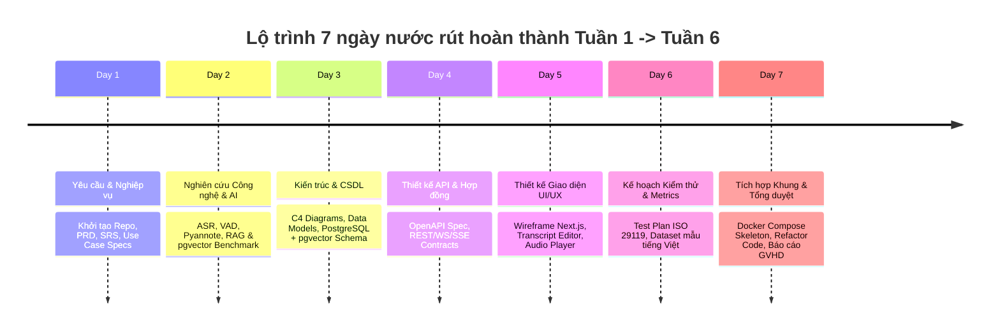

# Kế Hoạch Nước Rút Bù Tiến Độ ĐATN Cử Nhân (Tuần 1 — Tuần 6 Trong 7 Ngày)

**Đề tài:** Hệ thống phiên âm, tóm tắt và hỏi đáp nội dung cuộc họp  
*(Meeting Transcription, Summarization, and Question Answering System)*  
**Sinh viên:** Nguyễn Phương Linh — MSSV: 20224871 — Lớp: IT1-02 (Mã lớp: 767789)  
**Giảng viên hướng dẫn:** Thầy Cao Tuấn Dũng — Trường CNTT&TT (Đại học Bách Khoa Hà Nội)  
**Căn cứ kế hoạch:** Phiếu giao nhiệm vụ ĐATN (`NguyenPhuongLinh_PGNV_ĐATN.xlsx`) & Bản đề xuất đề tài (`de-xuat-de-tai-tro-ly-cuoc-hop-ai.md`).

---

## 1. Bối Cảnh & Mục Tiêu Của Kế Hoạch Nước Rút

Do thay đổi đề tài giữa chừng vào **Tuần 6** (trong tổng số 17 tuần của học kỳ tốt nghiệp), bạn cần hoàn thành dồn toàn bộ khối lượng công việc của **Tuần 1 đến Tuần 6** trong vòng **7 ngày liên tục** để:
1. Kịp tiến độ báo cáo và bảo vệ đề cương / tiến độ giữa kỳ với GVHD (Thầy Cao Tuấn Dũng).
2. Xây dựng nền móng tài liệu kỹ thuật hoàn chỉnh (SRS, Architecture, API Specs, Database ERD, Test Plan, Dataset Benchmark) phục vụ cho viết quyển khóa luận sau này.
3. Tái cấu trúc (refactor) mã nguồn cho hệ thống, lược bỏ các phần rườm rà ngoài phạm vi, chỉ tập trung hoàn thiện 5 use cases cốt lõi (UC-01 đến UC-05) với giao diện mới hiện đại, tinh giản.
4. Khởi tạo một GitHub repository độc lập, sạch sẽ, chuẩn chỉ từ commit history đến cấu trúc thư mục.

---

## 2. Cấu Trúc Repository Mới Trên GitHub & Vị Trí Lưu Docs

### 2.1. Đề xuất tên Repository
* Tên gợi ý: `meeting-voice-assistant` hoặc `hust-meeting-ai-agent` hoặc `meeting-intelligence-system`.
* Visibility: `Private` trong quá trình phát triển (hoặc `Public` nếu GVHD yêu cầu mã nguồn mở).

### 2.2. Sơ đồ cây thư mục đề xuất cho Repository mới

Toàn bộ tài liệu kỹ thuật của đồ án sẽ được quản lý tập trung trong thư mục `/docs` ở root repo, chia theo từng giai đoạn chuẩn kỹ thuật phần mềm:

```text
meeting-intelligence-system/
├── .github/
│   ├── workflows/             # CI/CD pipeline (linting, pytest, typecheck)
│   └── pull_request_template.md
├── docs/                      # TOÀN BỘ TÀI LIỆU CỦA ĐỒ ÁN LƯU TẠI ĐÂY
│   ├── 00-administrative/     # Giấy tờ hành chính (PGNV, Đề xuất đề tài)
│   │   ├── phieu-giao-nhiem-vu-datn.pdf
│   │   └── de-xuat-de-tai-chi-tiet.md
│   ├── 01-requirements/       # Tuần 1-2: Phân tích nghiệp vụ & Yêu cầu
│   │   ├── prd.md             # Product Requirements Document
│   │   ├── srs.md             # Software Requirements Specification (IEEE 830 / ISO 25010)
│   │   ├── use-cases.md       # Chi tiết 5 Use Cases (UC-01 -> UC-05) + Flow
│   │   └── traceability-matrix.md # Ma trận truy vết yêu cầu - kiểm thử
│   ├── 02-research-tech/      # Tuần 2-4: Khảo sát & Nghiên cứu công nghệ
│   │   ├── tech-stack-justification.md # So sánh, luận giải chọn FastAPI, Next.js, pgvector
│   │   ├── asr-diarization-survey.md   # Nghiên cứu Whisper, VAD, Pyannote tiếng Việt
│   │   └── rag-evaluation-framework.md # Thiết kế cơ chế RAG có trích dẫn (Faithfulness)
│   ├── 03-architecture/       # Tuần 3-6: Kiến trúc hệ thống
│   │   ├── system-architecture.md      # C4 Model (Context, Container, Component)
│   │   ├── sequence-diagrams.md        # Luồng Realtime, Upload, RAG, Export
│   │   └── security-threat-model.md    # Mô hình bảo mật OWASP, phân quyền dữ liệu
│   ├── 04-design/             # Tuần 3-6: Thiết kế chi tiết
│   │   ├── database-erd.md    # Thiết kế CSDL (PostgreSQL + pgvector schema)
│   │   ├── api-specification.yaml # Đặc tả OpenAPI 3.0 (Backend API & AI Service)
│   │   └── ui-ux-design-system.md # Nguyên lý thiết kế giao diện & wireframe luồng
│   ├── 05-testing/            # Tuần 5-6: Kế hoạch kiểm thử & Đánh giá
│   │   ├── test-plan.md       # Kế hoạch kiểm thử chuẩn ISO/IEC/IEEE 29119
│   │   └── evaluation-metrics.md # Định nghĩa chỉ số đo WER, DER, ROUGE, Recall@k
│   └── 06-thesis-report/      # Bản thảo quyển báo cáo ĐATN (theo mẫu SoICT HUST)
│       ├── chapter-1-introduction.md
│       ├── chapter-2-state-of-the-art.md
│       ├── chapter-3-system-analysis-design.md
│       ├── chapter-4-implementation.md
│       └── chapter-5-evaluation-conclusion.md
├── backend-api/               # Dịch vụ Backend nghiệp vụ (FastAPI)
│   ├── app/
│   │   ├── api/v1/endpoints/  # Meetings, Transcripts, Summaries, Chat, Exports
│   │   ├── core/              # Config, security, database session
│   │   ├── models/            # SQLAlchemy models
│   │   ├── schemas/           # Pydantic schemas (Request/Response)
│   │   ├── services/          # Business logic, Task coordinator
│   │   └── workers/           # Celery / Redis task workers
│   ├── tests/
│   ├── Dockerfile
│   └── requirements.txt
├── ai-service/                # Dịch vụ xử lý AI & Audio chuyên biệt (FastAPI)
│   ├── app/
│   │   ├── core/
│   │   ├── pipelines/         # ASR (Whisper), Diarization (Pyannote), VAD
│   │   ├── rag/               # Chunking, Vector embedding, Retrieval, LLM Generator
│   │   └── routers/
│   ├── tests/
│   ├── Dockerfile
│   └── requirements.txt
├── frontend/                  # Giao diện ứng dụng người dùng (Next.js 14+ / React)
│   ├── src/
│   │   ├── app/               # App Router (meetings, live-record, editor, chat)
│   │   ├── components/        # UI components (Audio wave, Transcript timeline, Chat window)
│   │   ├── hooks/             # WebSocket/SSE audio streaming hooks
│   │   └── lib/               # API clients, utils
│   ├── public/
│   └── package.json
├── data/                      # Thư mục dữ liệu kiểm thử (Không commit tệp audio lớn)
│   ├── sample_audio/          # Audio tiếng Việt demo (3-5 tệp ngắn, có ground-truth)
│   └── ground_truth/          # Transcript và QA chuẩn đối sánh
├── docker-compose.yml         # Khởi chạy toàn bộ hệ thống (App, Postgres, Redis, MinIO)
├── .env.example
├── LICENSE
└── README.md                  # Giới thiệu dự án, kiến trúc tổng quan & hướng dẫn cài đặt
```

---

## 3. Kế Hoạch 7 Ngày "Bắt Kịp Tiến Độ" (Tuần 1 — Tuần 6)

Để hoàn tất khối lượng 6 tuần trong 7 ngày mà vẫn đảm bảo chất lượng học thuật và mã nguồn có thể chạy được, mỗi ngày bạn sẽ giải quyết trọn vẹn một mảng cốt lõi theo thứ tự:



---

### Ngày 1: Nghiên Cứu Bài Toán, Xác Định Phạm Vi & Đặc Tả Yêu Cầu (Khối lượng Tuần 1 - Tuần 2)
> **Mục tiêu:** Định hình ranh giới dự án, xác lập 5 use cases chuẩn mực, thiết lập GitHub repo và văn kiện yêu cầu.

* **Đầu việc cần làm:**
  1. Khởi tạo Git repo mới `meeting-intelligence-system`, thiết lập file `.gitignore`, cấu trúc thư mục như mục 2.2.
  2. Bóc tách phạm vi dự án: Xác định rõ ranh giới đề tài ĐATN, tập trung vào bài toán cốt lõi xử lý nội dung cuộc họp, không lan man vào các tính năng phụ trợ (quản trị phân quyền phức tạp, thanh toán, v.v.), chuẩn hóa 5 Use Case chính (UC-01 -> UC-05) theo bản đề xuất đề tài.
  3. Lập bảng ma trận truy vết yêu cầu (Requirement Traceability Matrix - RTM) để đối chiếu giữa Yêu cầu người dùng <-> Thiết kế chức năng <-> Test cases.
* **Tài liệu (Docs) phải tạo:**
  * `docs/00-administrative/de-xuat-de-tai-chi-tiet.md`: Chuyển bản đề xuất đề tài sang markdown của repo mới.
  * `docs/01-requirements/prd.md`: Mô tả mục tiêu, đối tượng người dùng, tuyên ngôn giá trị sản phẩm.
  * `docs/01-requirements/srs.md`: Đặc tả yêu cầu phần mềm theo mẫu IEEE 830 kết hợp chất lượng ISO/IEC 25010 (Functional & Non-Functional Requirements: độ chính xác, hiệu năng, an toàn, bảo mật).
  * `docs/01-requirements/use-cases.md`: Chi tiết 5 Use Case: Trigger, Pre-conditions, Post-conditions, Main flow, Alternative flows, Exception flows.
  * `docs/01-requirements/traceability-matrix.md`: Bảng liên kết từ Use Case ID đến các Module và Test Scenario.

---

### Ngày 2: Nghiên Cứu Công Nghệ & Luận Giải Lựa Chọn Mô Hình AI (Khối lượng Tuần 2 - Tuần 4)
> **Mục tiêu:** Cung cấp cơ sở khoa học và kỹ thuật cho đồ án tốt nghiệp, chuẩn bị nội dung cho Chương 2 của báo cáo.

* **Đầu việc cần làm:**
  1. Phân tích và so sánh các công nghệ nhận dạng tiếng nói (ASR): OpenAI Whisper, Faster-Whisper, VinAI PhoWhisper; đưa ra tiêu chí lựa chọn phù hợp với tiếng Việt, tài nguyên CPU/GPU và độ trễ.
  2. Nghiên cứu cơ chế Voice Activity Detection (Silero VAD / WebRTC VAD) và Speaker Diarization (Pyannote-audio): Cách xử lý overlap speech, phân tách lượt nói theo mốc thời gian.
  3. Nghiên cứu kiến trúc RAG chuyên sâu cho nội dung hội thoại: Kỹ thuật chunking theo lượt nói (Speaker turn chunking), kết hợp ngữ cảnh liền trước/sau (Window retrieval), embedding model hỗ trợ đa ngôn ngữ/tiếng Việt, và vector search với pgvector (Cosine similarity / HNSW index).
  4. Lựa chọn LLM cho tóm tắt và trích xuất Action Items (GPT-4o-mini / Claude 3.5 Haiku / Qwen2.5 / Gemini) kèm thiết kế prompt dạng structured output (JSON Schema).
* **Tài liệu (Docs) phải tạo:**
  * `docs/02-research-tech/tech-stack-justification.md`: Bảng so sánh toàn bộ Tech Stack (Frontend Next.js, Backend FastAPI, PostgreSQL + pgvector, Redis, Docker) kèm ưu nhược điểm và lý do lựa chọn.
  * `docs/02-research-tech/asr-diarization-survey.md`: Tổng quan thuật toán, mô hình ASR và Diarization, thách thức khi xử lý tiếng Việt hội thoại (tiếng ồn, ngắt lời, tiếng địa phương).
  * `docs/02-research-tech/rag-evaluation-framework.md`: Phương pháp truy hồi RAG trên dữ liệu cuộc họp, phương pháp gắn Citation (mốc giây bắt đầu/kết thúc và segment ID) và tiêu chí chống Hallucination (Faithfulness).

---

### Ngày 3: Thiết Kế Kiến Trúc Hệ Thống & CSDL Chi Tiết (Khối lượng Tuần 3 - Tuần 5)
> **Mục tiêu:** Hoàn thiện sơ đồ kiến trúc chuẩn C4 và cơ sở dữ liệu quan hệ kết hợp vector storage.

* **Đầu việc cần làm:**
  1. Vẽ sơ đồ kiến trúc tổng thể C4 Model (Context, Container, Component Diagrams) mô tả luồng tương tác giữa Web Browser, Backend API, AI Service, PostgreSQL, Redis và File Storage.
  2. Xây dựng Sequence Diagrams cho 4 luồng nghiệp vụ phức tạp:
     * Luồng 1: Real-time Live Audio Streaming (Browser -> WebSocket -> VAD -> ASR -> SSE Broadcast).
     * Luồng 2: Asynchronous File Upload & Background Processing (Upload -> Redis Queue -> Worker -> Diarization + ASR -> Summary + Vector Indexing).
     * Luồng 3: Context-aware Meeting RAG Chatbot with Precise Citations.
     * Luồng 4: Transcript Versioning & Re-indexing when user edits text/speaker name.
  3. Thiết kế CSDL quan hệ chuẩn hóa: Bảng `meetings`, `audio_files`, `transcript_segments`, `meeting_summaries`, `action_items`, `transcript_embeddings` (vector column), `chat_sessions`, `chat_messages`, `citations`.
* **Tài liệu (Docs) phải tạo:**
  * `docs/03-architecture/system-architecture.md`: Bao gồm các biểu đồ Mermaid C4 Context & Container.
  * `docs/03-architecture/sequence-diagrams.md`: Sơ đồ tuần tự cho cả 4 luồng nghiệp vụ chính.
  * `docs/04-design/database-erd.md`: Sơ đồ ERD (Mermaid Entity-Relationship Diagram), định nghĩa kiểu dữ liệu chi tiết, khóa ngoại, chỉ mục (B-tree, HNSW index cho embedding).
  * `docs/03-architecture/security-threat-model.md`: Đánh giá rủi ro an toàn thông tin: Cô lập dữ liệu giữa các cuộc họp, sanitize đầu vào, bảo mật API token và audio file storage.

---

### Ngày 4: Thiết Kế Giao Tiếp API & Định Nghĩa Schema (Khối lượng Tuần 4 - Tuần 6)
> **Mục tiêu:** Xây dựng bản đặc tả giao tiếp hợp đồng (Contract-first) giữa Frontend và hai dịch vụ Backend.

* **Đầu việc cần làm:**
  1. Thiết kế chi tiết RESTful API endpoints cho `backend-api`:
     * Meetings CRUD & Audio upload endpoints.
     * Transcript management: Get, Edit segments, Rename speaker.
     * Summary & Action items: Trigger, Get, Update action item status.
     * RAG Chat: Create session, Send query, Stream response with citations.
     * Export: Export to TXT, DOCX, JSON, SRT/VTT.
  2. Thiết kế Internal API & Queue Message Schemas giữa `backend-api` và `ai-service`:
     * Task payload gửi vào Redis queue (Audio path, language, diarization config).
     * Tiến độ gửi qua Redis Pub/Sub hoặc Event stream.
  3. Định nghĩa WebSocket/SSE Event Protocol cho tính năng hiển thị trực tiếp transcript.
* **Tài liệu (Docs) phải tạo:**
  * `docs/04-design/api-specification.yaml`: File OpenAPI 3.0 / Swagger đầy đủ endpoints, request body, response codes, error schemas.
  * `docs/04-design/api-communication-guide.md`: Tài liệu tóm tắt quy ước đặt tên endpoint, chuẩn mã lỗi (HTTP Status Codes, Error Response JSON chuẩn RFC 7807), và giao thức SSE/WebSocket.

---

### Ngày 5: Thiết Kế Giao Diện UI/UX & Kế Hoạch Thay Đổi Frontend (Khối lượng Tuần 4 - Tuần 6)
> **Mục tiêu:** Định hình phong cách thiết kế giao diện hiện đại, tinh giản (Clean Minimalist), tập trung vào sự tiện dụng và chuyên nghiệp cho người dùng cuộc họp.

* **Đầu việc cần làm:**
  1. Định hình Design System mới: Clean Minimalist, tone màu hiện đại (Slate / Neutral / Indigo), font chữ dễ đọc khi duyệt văn bản dài (Inter / Be Vietnam Pro).
  2. Phác thảo Wireframes cho các màn hình then chốt:
     * **Dashboard / Meeting List:** Lọc theo trạng thái xử lý, ngày họp, tìm kiếm full-text.
     * **Live Meeting Room:** Nút ghi âm, visualizer sóng âm realtime, hiển thị transcript tức thời theo từng lượt nói người dùng.
     * **Upload & Progress Tracker:** Kéo thả tệp âm thanh, thanh tiến độ xử lý nền (VAD -> ASR -> Diarization -> Summary).
     * **Meeting Detail / Transcript Studio:** Màn hình chia 2 cột:
       * Cột trái: Trình phát audio đồng bộ với transcript, cho phép click vào từng câu để nghe lại, inline-editing để sửa lỗi chính tả và đổi tên speaker.
       * Cột phải: Tab Tóm tắt nội dung chính & Danh sách công việc (Action Items có checkbox); Tab Trợ lý hỏi đáp AI (RAG Chatbot với thẻ trích dẫn nhấp vào nhảy ngay đến mốc audio tương ứng).
* **Tài liệu (Docs) phải tạo:**
  * `docs/04-design/ui-ux-design-system.md`: Hướng dẫn thành phần UI, layout grid, bảng màu, typography, và mô tả tương tác người dùng cho 4 màn hình chính.

---

### Ngày 6: Xây Dựng Kế Hoạch Kiểm Thử & Bộ Dữ Liệu Đánh Giá (Khối lượng Tuần 5 - Tuần 6)
> **Mục tiêu:** Thiết lập khung đánh giá khoa học chuẩn ĐATN theo ISO/IEC/IEEE 29119 và ISO/IEC 25010.

* **Đầu việc cần làm:**
  1. Xây dựng Test Plan: Phạm vi kiểm thử đơn vị (Unit Test), kiểm thử tích hợp (Integration Test), kiểm thử API hợp đồng (Contract Test) và kiểm thử chấp nhận người dùng (E2E / UAT).
  2. Chuẩn bị bộ dữ liệu thử nghiệm (Dataset):
     * Thu thập / chuẩn bị 3-5 đoạn ghi âm cuộc họp tiếng Việt thực tế (thời lượng 5 - 20 phút/đoạn, có 2-4 người tham gia trao đổi, có tiếng ồn nhẹ).
     * Tạo file Ground-truth Transcript (nội dung chữ chuẩn và nhãn người nói chính xác).
     * Tạo bộ 15-20 câu hỏi đánh giá RAG (kèm câu trả lời chuẩn và đoạn trích dẫn làm bằng chứng).
  3. Định nghĩa bộ công thức đo lường:
     * Phiên âm: WER = (S + D + I) / N, CER.
     * Phân tách người nói: Diarization Error Rate (DER).
     * Tóm tắt: ROUGE-1, ROUGE-2, ROUGE-L và Human Evaluation (độ trung thực, độ bao phủ thông tin).
     * Hỏi đáp RAG: Recall@k, Hit Rate, Faithfulness score (tỷ lệ trích dẫn chính xác).
* **Tài liệu (Docs) phải tạo:**
  * `docs/05-testing/test-plan.md`: Kế hoạch kiểm thử toàn diện theo ISO 29119.
  * `docs/05-testing/evaluation-metrics.md`: Chi tiết phương pháp luận đo đạc, công thức và công cụ tự động (JiWER, DeepEval / Ragas).
  * `docs/05-testing/dataset-specification.md`: Bản đặc tả bộ dữ liệu đánh giá (thông số kỹ thuật âm thanh, ngữ cảnh cuộc họp, metadata).

---

### Ngày 7: Tích Hợp Khung Mã Nguồn, Chạy Thử Môi Trường & Báo Cáo GVHD (Kết thúc Sprint)
> **Mục tiêu:** Khởi động thành công bộ khung Skeleton của repo mới bằng Docker Compose và hoàn thiện hồ sơ báo cáo tiến độ tuần 1-6.

* **Đầu việc cần làm:**
  1. Sao chép và chọn lọc các module hữu ích cho repo mới:
     * Sao chép core logic của Whisper/Faster-whisper, Pyannote diarization, pgvector database schema.
     * Làm sạch mã nguồn, loại bỏ các file thừa, dead code, logic authentication/payment không liên quan.
  2. Cấu hình Docker Compose: `postgres` (kèm pgvector extension), `redis`, `backend-api` (FastAPI), `ai-service` (FastAPI), `frontend` (Next.js).
  3. Chạy kiểm thử tự động ban đầu (Smoke test): Tạo 1 meeting mẫu qua API, kiểm tra kết nối CSDL và Redis queue hoạt động thông suốt.
  4. Đóng gói bộ tài liệu Tuần 1-6 thành bản Báo cáo tiến độ (Progress Report) để gửi và báo cáo trực tiếp với Thầy Cao Tuấn Dũng.
* **Tài liệu (Docs) phải tạo:**
  * `README.md` tại root repo: Tổng quan dự án, hướng dẫn cài đặt với Docker Compose, tóm tắt kiến trúc.
  * `docs/00-administrative/bao-cao-tien-do-tuan-1-den-6.md`: Bản tổng hợp tất cả kết quả đã hoàn thành trong 6 tuần để nộp GVHD.

---

## 4. Bảng Đối Chiếu Các Đầu Việc Cần Làm Theo 5 Khối Công Việc (Work Packages) Của PGNV

Dưới đây là bảng đối chiếu trực tiếp với các nội dung trong Phiếu giao nhiệm vụ ĐATN để bạn tiện theo dõi và tích chọn khi hoàn thành:

| Nhóm nội dung (PGNV) | Tuần theo kế hoạch gốc | Trạng thái sau 7 ngày | Đầu việc & Sản phẩm bàn giao cụ thể |
|---|---|---|---|
| **Nội dung 1: Tìm hiểu tổng quan bài toán** | Tuần 1 - 2 | **Hoàn thành 100%** | • Khảo sát nhu cầu lập biên bản & tra cứu cuộc họp.<br>• Phân tích điểm mạnh/hạn chế của Otter.ai, FPT.AI, Zoom AI.<br>• Tài liệu PRD, SRS, Use Case Specs (5 use cases chính).<br>• Xác định tiêu chí chấp nhận và chỉ số đo lường. |
| **Nội dung 2: Tìm hiểu công nghệ liên quan** | Tuần 2 - 4 | **Hoàn thành 100%** | • Báo cáo khảo sát & so sánh ASR (Whisper/Faster-Whisper), VAD, Diarization.<br>• Khảo sát RAG với pgvector và LLM prompt engineering.<br>• Tài liệu luận giải kiến trúc FastAPI + Next.js + Docker. |
| **Nội dung 3: Phân tích & Thiết kế hệ thống** | Tuần 3 - 6 | **Hoàn thành 100%** | • Sơ đồ kiến trúc C4 Model & 4 Sequence Diagrams.<br>• Thiết kế CSDL PostgreSQL + pgvector (ERD, DDL script).<br>• Đặc tả OpenAPI 3.0 cho Backend API & AI Service.<br>• Bản thiết kế UI/UX Wireframe & Design System.<br>• Tài liệu phân tích an toàn bảo mật (Threat model). |
| **Nội dung 4: Xây dựng chương trình** | Tuần 5 - 13 | **Hoàn thành 25% (Khởi động)** | • Repo GitHub mới được thiết lập chuẩn mực.<br>• Khung dự án (Scaffolding/Skeleton) chạy được qua Docker Compose.<br>• Module kết nối DB, Redis, và các DTO/Schemas cơ bản sẵn sàng để code nghiệp vụ từ Tuần 7. |
| **Nội dung 5: Thử nghiệm & Đánh giá** | Tuần 11 - 15 | **Hoàn thành khung chuẩn bị** | • Test Plan toàn diện theo ISO 29119.<br>• Bộ dữ liệu mẫu tiếng Việt ban đầu kèm Ground-truth.<br>• Script tính toán WER/CER và RAG Faithfulness khung. |

---

## 5. Hướng Dẫn Từng Bước Khởi Tạo Repo Mới & Đẩy Lên GitHub

Bạn hãy thực hiện các bước terminal sau để khởi tạo repository mới độc lập:

```bash
# 1. Tạo thư mục cho dự án mới ở ngoài thư mục hiện tại
cd /Users/plxg/workspace
mkdir meeting-intelligence-system
cd meeting-intelligence-system

# 2. Khởi tạo Git repository
git init -b main

# 3. Tạo cấu trúc thư mục như hướng dẫn
mkdir -p docs/{00-administrative,01-requirements,02-research-tech,03-architecture,04-design,05-testing,06-thesis-report}
mkdir -p backend-api/app/{api/v1/endpoints,core,models,schemas,services,workers}
mkdir -p ai-service/app/{core,pipelines,rag,routers}
mkdir -p frontend/src/{app,components,hooks,lib}
mkdir -p data/{sample_audio,ground_truth}

# 4. Di chuyển các tài liệu đề tài vào thư mục hành chính
cp docs/thesis/de-xuat-de-tai-tro-ly-cuoc-hop-ai.md docs/00-administrative/
cp docs/thesis/ke-hoach-nuoc-rut-tuan-1-den-6.md docs/00-administrative/

# 5. Tạo file .gitignore chuẩn cho Python & Node.js
cat << "GITIGNORE_EOF" > .gitignore
# Python
__pycache__/
*.py[cod]
*$py.class
*.env
.venv/
venv/
ENV/

# Node.js
node_modules/
.next/
out/
build/
dist/
*.log

# Audio & Vector test data (large files)
*.wav
*.mp3
*.m4a
*.tar.gz
*.pth
*.bin

# OS
.DS_Store
Thumbs.db
GITIGNORE_EOF

# 6. Commit ban đầu và đẩy lên GitHub (sau khi tạo repo trên GitHub)
git add .
git commit -m "chore: initial project structure and documentation roadmap for graduation thesis"
# git remote add origin git@github.com:<your-username>/meeting-intelligence-system.git
# git push -u origin main
```

---

## 6. Lời Khuyên Dành Riêng Cho Báo Cáo Với GVHD (Thầy Cao Tuấn Dũng)

Khi bạn gặp và báo cáo với Thầy Cao Tuấn Dũng về việc đổi đề tài và tiến độ:
1. **Thành thật và chủ động:** Trình bày rõ: *"Em đã cân nhắc kỹ và nhận thấy đề tài Trợ lý Cuộc họp AI có tính ứng dụng thực tiễn cao hơn, đồng thời giải quyết bài toán kỹ thuật trọn vẹn từ xử lý tín hiệu âm thanh, nhận dạng tiếng nói, đến tóm tắt và RAG có trích dẫn. Dù đổi đề tài ở Tuần 6 nhưng em đã dồn toàn lực hoàn thành trọn vẹn toàn bộ hồ sơ kỹ thuật của Tuần 1 đến Tuần 6 trong tuần vừa rồi."*
2. **Cho thầy xem cấu trúc tài liệu chuyên nghiệp:** Mở GitHub repo, chỉ cho thầy xem thư mục `/docs` được tổ chức bài bản theo chuẩn IEEE / ISO (PRD, SRS, C4 Architecture, OpenAPI, ERD, Test Plan). Thầy hướng dẫn sẽ đánh giá rất cao tính kỷ luật và phương pháp luận kỹ thuật phần mềm của bạn.
3. **Demo khung kiến trúc (Skeleton):** Nếu có thể, chạy `docker-compose up` để chứng minh hệ thống đã có bộ khung Backend FastAPI, AI Service, Database Postgres+pgvector và Redis sẵn sàng bước vào giai đoạn cài đặt chuyên sâu (Tuần 7 trở đi).
