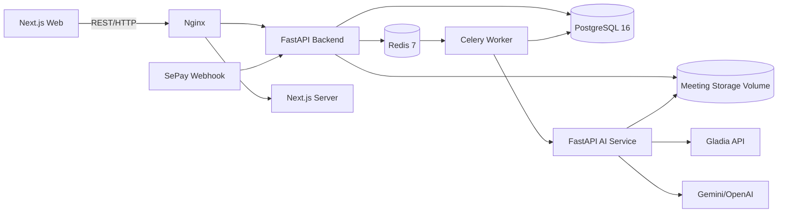

# ĐẶC TẢ YÊU CẦU PHẦN MỀM (SRS)

**Sản phẩm:** Meeting Voice Assistant  
**Phiên bản tài liệu:** 3.0  
**Ngày đối chiếu code:** 17/11/2026  
**Nguồn chuẩn:** code trong `frontend`, `backend-api`, `ai-service`, `docker-compose*.yml`

## 1. Mục đích và phạm vi

Tài liệu này mô tả đúng phạm vi hiện đã có trong code: quản lý tài khoản và dự án, tiếp nhận tệp ghi âm, xử lý nền bằng Gladia, tạo tóm tắt bằng Gemini/OpenAI, biên tập transcript, hỏi đáp có trích dẫn, xuất biên bản, chia sẻ bằng token và thanh toán VietQR/SePay.

Hệ thống là ứng dụng web API-first, triển khai được trên một máy AWS EC2 CPU bằng Docker Compose. GPU không phải yêu cầu vận hành vì ASR và LLM chính được gọi qua dịch vụ đám mây.

### 1.1. Trạng thái dùng trong tài liệu

| Trạng thái | Ý nghĩa |
|---|---|
| `Implemented` | Có code và có interface sử dụng được |
| `Partial` | Có code nhưng còn giới hạn được nêu rõ |
| `Experimental` | Chỉ dùng thử, không thuộc tiêu chí nghiệm thu production |
| `Planned` | Chưa có code, không được coi là chức năng hiện tại |

### 1.2. Ngoài phạm vi phiên bản hiện tại

- Phiên âm streaming thực bằng nhà cung cấp ASR thời gian thực (giao diện WebSocket mô phỏng đã bị xóa).
- Thu hồi link chia sẻ, mật khẩu link, thời hạn link và nhật ký truy cập.
- Cookie HttpOnly thay cho `localStorage`.
- Tìm kiếm xuyên nhiều cuộc họp trong một project.
- Object storage S3; bản hiện tại dùng Docker named volume trên một máy.
- HTTPS tự cấp phát; cần domain/chứng chỉ hoặc reverse proxy TLS bên ngoài.

## 2. Tác nhân và hệ thống ngoài

| Tác nhân | Vai trò |
|---|---|
| Người dùng | Đăng ký, quản lý dự án/cuộc họp, biên tập và khai thác kết quả |
| Owner dự án | Quản lý dự án và thành viên |
| Editor dự án | Xem/sửa tài nguyên dự án theo các interface đã hỗ trợ |
| Viewer dự án | Xem tài nguyên dự án |
| Khách có share token | Xem cuộc họp theo token hợp lệ |
| Gladia API v2 | ASR tiếng Việt, diarization và timestamp |
| Gemini hoặc OpenAI | Sinh tóm tắt và câu trả lời RAG |
| SePay | Gửi webhook giao dịch ngân hàng |
| VietQR | Hiển thị QR chuyển khoản |

## 3. Bối cảnh hệ thống

## 4. Yêu cầu chức năng

### 4.1. Xác thực và hồ sơ

| ID | Yêu cầu | Interface | Trạng thái |
|---|---|---|---|
| FR-AUTH-01 | Đăng ký bằng email, họ tên và mật khẩu | `POST /api/v1/auth/register` | Implemented |
| FR-AUTH-02 | Đăng nhập và nhận access/refresh JWT | `POST /api/v1/auth/login` | Implemented |
| FR-AUTH-03 | Đổi refresh token lấy cặp token mới | `POST /api/v1/auth/refresh` | Implemented |
| FR-AUTH-04 | Lấy tài khoản hiện tại | `GET /api/v1/auth/me` | Implemented |
| FR-USER-01 | Cập nhật họ tên/avatar | `PATCH /api/v1/users/me` | Implemented |
| FR-USER-02 | Đổi mật khẩu sau khi xác thực mật khẩu cũ; mọi token cũ mất hiệu lực, trả token mới | `POST /api/v1/users/me/change-password` | Implemented |
| FR-AUTH-05 | Tự refresh access token trong frontend | — | Planned |

Mật khẩu được hash bằng bcrypt. Access token mang claim `tv` (token_version); refresh token dùng một lần, dùng lại sẽ thu hồi cả chuỗi. Frontend đang lưu token trong `localStorage`; đây là giới hạn bảo mật đã biết, chưa dùng cookie HttpOnly.

### 4.2. Dự án và thành viên

| ID | Yêu cầu | Interface | Trạng thái |
|---|---|---|---|
| FR-PROJ-01 | Tạo, liệt kê, xem, sửa và xóa dự án | `/api/v1/projects` | Implemented |
| FR-PROJ-02 | Mời người dùng đã đăng ký bằng email | `POST /api/v1/projects/{id}/members` | Implemented |
| FR-PROJ-03 | Đổi vai trò hoặc xóa thành viên | `PATCH/DELETE /api/v1/projects/{id}/members/{user_id}` | Implemented |
| FR-PROJ-04 | Liên kết cuộc họp với dự án | `POST /api/v1/projects/{id}/meetings/{meeting_id}` | Implemented |
| FR-PROJ-05 | Lọc dashboard theo các cuộc họp thuộc dự án | `GET /api/v1/projects/{id}` | Implemented |

Vai trò dự án gồm `owner`, `editor`, `viewer`. Owner được tạo thành membership đầu tiên khi tạo dự án.

### 4.3. Cuộc họp và tiếp nhận âm thanh

| ID | Yêu cầu | Interface | Trạng thái |
|---|---|---|---|
| FR-MTG-01 | Tạo (cần đăng nhập), liệt kê meeting của mình, tìm theo tiêu đề, lọc trạng thái | `/api/v1/meetings` | Implemented |
| FR-MTG-02 | Sửa tiêu đề và soft-delete (trạng thái do hệ thống quản lý, client không gán được) | `/api/v1/meetings/{id}` | Implemented |
| FR-AUD-01 | Nhận `.wav`, `.mp3`, `.m4a`, `.aac`, `.flac`, `.ogg`, `.webm`, `.mp4`; kiểm tra magic bytes | `POST /api/v1/audio/upload` | Implemented |
| FR-AUD-02 | Gắn file vào cuộc họp có quyền EDIT | `POST /api/v1/meetings/{id}/audio` | Implemented |
| FR-AUD-03 | Lưu file theo `storage_key` sinh từ ID (không ghi đè), ghi job + outbox cùng transaction | PostgreSQL, Redis/Celery | Implemented |
| FR-AUD-04 | Phát audio bằng URL ký HMAC 10 phút, hỗ trợ tua bằng HTTP Range | `GET /api/v1/meetings/{id}/audio/stream-url`, `.../audio/stream` | Implemented |
| FR-AUD-05 | Giới hạn upload `MAX_UPLOAD_MB` (kiểm tra khi stream, xóa file dở) và 500 MB ở Nginx | `client_max_body_size` | Implemented |
| FR-AUD-06 | Đo thời lượng bằng `ffprobe`, từ chối file không có audio hoặc dài hơn giới hạn gói | Bước `transcribe` | Implemented |

### 4.4. ASR, diarization và xử lý nền

| ID | Yêu cầu | Interface | Trạng thái |
|---|---|---|---|
| FR-AI-01 | Worker gửi `storage_key` (không phải đường dẫn tuyệt đối) sang AI Service, nhận `provider_job_id` ngay | `POST /audio/transcribe` | Implemented |
| FR-AI-02 | Worker poll kết quả bằng Celery retry/countdown, không giữ request HTTP dài | `GET /audio/transcribe/{provider_job_id}` | Implemented |
| FR-AI-03 | Chuẩn hóa utterance thành speaker, start/end, text | `GladiaAudioPipeline` | Implemented |
| FR-AI-04 | Thay toàn bộ segment trong một transaction, tăng `transcript_revision` | Pipeline | Implemented |
| FR-AI-05 | Ghi usage theo thời lượng đã đo, một lần cho mỗi file audio, chỉ khi xử lý thành công | `meeting_quota_usage_events` | Implemented |
| FR-AI-06 | Báo lỗi thực thay vì dữ liệu demo khi provider lỗi hoặc thiếu key | `failed` + `failure_reason` | Implemented |
| FR-AI-07 | Engine `mock` chỉ ở `ENVIRONMENT=development`, kết quả gắn `is_demo` | `AUDIO_PIPELINE_ENGINE` | Implemented |

#### Quy trình xử lý (FR-PROC)

| ID | Yêu cầu | Trạng thái |
|---|---|---|
| FR-PROC-01 | Máy trạng thái `draft → uploaded → transcribing → summarizing → ready`, hoặc `failed` kèm `failure_stage`, `failure_reason`; chuyển trạng thái sai bị từ chối (409) | Implemented |
| FR-PROC-02 | Trạng thái `failed` hiển thị lý do và cho phép thử lại (`POST /meetings/{id}/reprocess`) | Implemented |
| FR-PROC-03 | Task chỉ được gửi lên broker qua transactional outbox; mất Redis không làm mất công việc | Implemented |
| FR-PROC-04 | Mọi bước idempotent; lỗi tạm thời retry tối đa 3 lần với backoff luỹ thừa; hết lượt thì job và meeting `failed` | Implemented |

Nếu thiếu `GLADIA_API_KEY`, meeting kết thúc `failed` với lý do "ASR provider not configured", không có transcript và không tính quota. Kiểm thử E2E thật bắt buộc phải điền key và xác minh transcript khớp file đầu vào.

### 4.5. Ghi âm trong trình duyệt

| ID | Yêu cầu | Interface | Trạng thái |
|---|---|---|---|
| FR-REC-01 | Thu microphone bằng `MediaRecorder`, tạm dừng/tiếp tục | `/live` | Implemented |
| FR-REC-02 | Khi dừng, upload file WebM để xử lý batch | Audio upload | Implemented |
| FR-REC-03 | Hiển thị transcript thật trong lúc đang nói | — | Planned |

Từ “trực tiếp” trong UI nghĩa là thu microphone trực tiếp, sau đó xử lý batch khi người dùng bấm dừng.

### 4.6. Transcript Studio

| ID | Yêu cầu | Interface | Trạng thái |
|---|---|---|---|
| FR-TR-01 | Đọc segment theo thứ tự thời gian | `GET /api/v1/meetings/{id}/transcript` | Implemented |
| FR-TR-02 | Sửa nội dung hoặc nhãn người nói | `PATCH /api/v1/meetings/{id}/transcript/segments/{segment_id}` | Implemented |
| FR-TR-03 | Đổi tên một speaker trên toàn cuộc họp | `POST .../transcript/rename-speaker` | Implemented |
| FR-TR-04 | Xóa một hoặc nhiều segment | `POST .../transcript/delete-segments` | Implemented |
| FR-TR-05 | Đồng bộ timeline/audio và nhảy tới citation | Frontend | Implemented |
| FR-TR-06 | Sau chỉnh sửa, summary và chỉ mục chuyển `stale`; chỉ mục tự dựng lại, summary chỉ tạo lại khi người dùng yêu cầu | Event `TranscriptEdited` | Implemented |
| FR-TR-07 | Thao tác hàng loạt (`update_text`, `replace_text`, `rename_speaker`, `reassign_speaker`, `delete_segments`, `split_segment`, `merge_segments`) kèm xem trước | `POST .../transcript/operations`, `operations:preview` | Implemented |

#### Phiên bản và hoàn tác (FR-REV)

| ID | Yêu cầu | Trạng thái |
|---|---|---|
| FR-REV-01 | Mỗi lần sửa tạo một change set (người thực hiện: user hoặc agent, trước/sau từng segment) và tăng `transcript_revision`; segment có `version` | Implemented |
| FR-REV-02 | `expected_revision` lệch revision hiện tại trả 409 `TRANSCRIPT_REVISION_CONFLICT`; bắt buộc với chỉnh sửa của agent | Implemented |
| FR-REV-03 | Hoàn tác một change set bằng change set mới; từ chối nếu đã hoàn tác hoặc có chỉnh sửa muộn hơn chạm cùng segment | Implemented |

### 4.7. Tóm tắt và action item

| ID | Yêu cầu | Interface | Trạng thái |
|---|---|---|---|
| FR-SUM-01 | Bước `summarize` gọi AI Service sau ASR | `POST /llm/summarize` | Implemented |
| FR-SUM-02 | Upsert executive summary, key points; thay action item `source=ai`, giữ `source=user` | PostgreSQL | Implemented |
| FR-SUM-03 | Đọc summary/action items | `GET /api/v1/meetings/{id}/summary`, `/action-items` | Implemented |
| FR-SUM-04 | Cập nhật mô tả, người phụ trách, trạng thái action item | `PATCH /api/v1/meetings/{id}/action-items/{id}` | Implemented |
| FR-SUM-05 | Tạo lại summary theo yêu cầu, trạng thái `none/pending/ready/stale/failed` | `POST /api/v1/meetings/{id}/summary:regenerate` | Implemented |

Nếu thiếu LLM key hoặc provider lỗi, `summary_status = failed` và không có nội dung giả; transcript vẫn dùng được.

### 4.8. Hỏi đáp RAG có trích dẫn

| ID | Yêu cầu | Interface | Trạng thái |
|---|---|---|---|
| FR-RAG-01 | Lưu lịch sử theo (cuộc họp, người dùng), riêng tư trong meeting chia sẻ | `GET /api/v1/meetings/{id}/chat/messages` | Implemented |
| FR-RAG-02 | Truy hồi hybrid (pgvector cosine + full-text, hợp nhất RRF) lọc theo meeting trong SQL | `RetrievalService` | Implemented |
| FR-RAG-03 | Backend chỉ gửi top-k đoạn cho AI Service; trả lời kèm segment, speaker, start/end, quote | `POST /api/v1/meetings/{id}/chat`, `POST /rag/answer` | Implemented |
| FR-RAG-04 | Nhấn citation để tua audio | Frontend | Implemented |
| FR-RAG-05 | Vector index bền vững trong pgvector (HNSW + GIN), dựng bởi job `index` | `transcript_chunks` | Implemented |
| FR-RAG-06 | Gói Free giới hạn số câu hỏi mỗi tháng (`features.rag_questions`) | 402 `RAG_QUESTION_LIMIT` | Implemented |

Khi AI Service lỗi, hệ thống trả 503 `AI_UNAVAILABLE` và lưu tin nhắn trợ lý `status=error`; không bao giờ trình bày kết quả tìm từ khoá như câu trả lời.

### 4.9. Xuất biên bản

| ID | Yêu cầu | Interface | Trạng thái |
|---|---|---|---|
| FR-EXP-01 | Xuất TXT, SRT, VTT, JSON và DOCX qua registry renderer | `GET /api/v1/meetings/{id}/exports/{format}` | Implemented |
| FR-EXP-02 | Định dạng khả dụng theo gói của chủ meeting (Free: TXT, JSON) | 402 `PLAN_FEATURE_REQUIRED` | Implemented |

### 4.10. Chia sẻ

| ID | Yêu cầu | Interface | Trạng thái |
|---|---|---|---|
| FR-SHARE-01 | Creator tạo token viewer/editor | `POST /api/v1/meetings/{id}/share` | Implemented |
| FR-SHARE-02 | Đọc metadata cuộc họp bằng query `share` | `GET /api/v1/meetings/{id}?share=` | Implemented |
| FR-SHARE-03 | Áp quyền token thống nhất qua `MeetingAccessPolicy` cho mọi route con (transcript, summary, chat, export, audio) | Ma trận kiểm thử 26 route × 7 vai trò | Implemented |
| FR-SHARE-04 | Thu hồi/hết hạn link | — | Planned |

Share token cho VIEW hoặc EDIT, không bao giờ cho MANAGE hoặc dùng công cụ ghi của trợ lý.

### 4.11. Gói cước, quota và thanh toán

| ID | Yêu cầu | Interface | Trạng thái |
|---|---|---|---|
| FR-PLAN-01 | Seed và liệt kê Free/Pro/Business | `GET /api/v1/plans` | Implemented |
| FR-PLAN-02 | Xem subscription và usage | `GET /api/v1/plans/my-subscription` | Implemented |
| FR-PLAN-03 | Tạo đơn và URL VietQR | `POST /api/v1/payments/checkout` | Implemented |
| FR-PLAN-04 | Poll trạng thái đơn | `GET /api/v1/payments/orders/{order_code}` | Implemented |
| FR-PLAN-05 | Nhận webhook SePay, idempotent theo giao dịch | `POST /api/v1/payments/sepay/webhook` | Implemented |
| FR-PLAN-06 | Chặn upload trước khi lưu file khi hết quota (402) | `AudioService` | Implemented |
| FR-PLAN-07 | Chu kỳ Free lăn 30 ngày; kích hoạt gói trả phí chèn dòng subscription mới, gói cũ `replaced`, lịch sử được giữ | `SubscriptionService` | Implemented |
| FR-PLAN-08 | Webhook: thiếu/sai key trả 401; khóa order `FOR UPDATE`; từ chối order hết hạn; tiền lưu `Numeric(12,2)` | `PaymentService` | Implemented |

Usage được ghi nhận khi xử lý thành công theo thời lượng đã đo; một upload mới bị từ chối ngay khi quota đã hết.

### 4.12. Trợ lý cuộc họp (Meeting Assistant)

| ID | Yêu cầu | Interface | Trạng thái |
|---|---|---|---|
| FR-AGENT-01 | Công cụ đọc (overview, tìm kiếm, đọc segment, tìm văn bản, tóm tắt) thực thi với quyền của người dùng | `/internal/agent/v1/meetings/{id}/...` | Implemented |
| FR-AGENT-02 | Công cụ ghi chỉ tạo **đề xuất** (`agent_actions`) kèm xem trước; không thay đổi dữ liệu | `POST .../agent-actions` | Implemented |
| FR-AGENT-03 | Người dùng duyệt (có thể sửa trước), từ chối; đề xuất hết hạn sau 30 phút hoặc khi revision đã đổi (409) | `POST /api/v1/meetings/{id}/agent-actions/{id}:approve`, `:reject` | Implemented |
| FR-AGENT-04 | Thay đổi do agent hiển thị trong lịch sử với `actor_type=agent` và hoàn tác được | `GET .../transcript/change-sets` | Implemented |
| FR-AGENT-05 | Tạo tài liệu (DOCX, email, SRT, Markdown) lưu thành artifact; liệt kê, tải, xóa (MANAGE) | `/api/v1/meetings/{id}/artifacts` | Implemented |
| FR-AGENT-06 | Xác thực hai lớp: `X-Service-Token` + token ủy quyền (`aud=agent`, 5 phút, phạm vi một meeting); sai phạm vi 403 | `get_agent_context` | Implemented |
| FR-AGENT-07 | Stream phản hồi bằng SSE: `token`, `tool_start`, `tool_end`, `proposal`, `citation`, `done`, `error` | `POST /api/v1/meetings/{id}/assistant/turns` | Implemented |
| FR-AGENT-08 | Gói Pro/Business dùng công cụ ghi và artifact; gói Free và Guest chỉ hỏi đáp thuần | `features.agent_tools` | Implemented |

Giới hạn an toàn: tối đa 200 thao tác mỗi đề xuất, giới hạn đệ quy đồ thị 8 bước, nội dung transcript luôn được bao trong thẻ `<transcript>` và coi là dữ liệu không tin cậy.

## 5. Yêu cầu phi chức năng

### 5.1. Bảo mật

- NFR-SEC-01: Secret production không được commit; `SECRET_KEY`, mật khẩu PostgreSQL và webhook key phải đến từ `.env` trên máy chủ.
- NFR-SEC-02: Nginx chỉ công khai cổng ứng dụng; PostgreSQL, Redis, backend và AI Service không public trong production Compose.
- NFR-SEC-03: Webhook SePay phải kiểm tra `Authorization`/API key bằng so sánh hằng thời gian; thiếu hoặc sai key trả 401.
- NFR-SEC-04: Microphone trên domain ngoài `localhost` bắt buộc HTTPS do yêu cầu secure context của trình duyệt.
- NFR-SEC-05: Trước production công khai phải chuyển token trình duyệt sang cookie HttpOnly.
- NFR-SEC-06: Production từ chối khởi động nếu `SECRET_KEY`, `SEPAY_WEBHOOK_API_KEY`, `AI_SERVICE_TOKEN` là giá trị mặc định hoặc ngắn hơn 32 ký tự, hoặc `CORS_ORIGINS` chứa `*`.
- NFR-SEC-07: AI Service chỉ nhận request có `X-Service-Token` và chỉ đọc file trong `STORAGE_ROOT`; không nhận đường dẫn hay URL tuỳ ý.
- NFR-SEC-08: Mọi route theo meeting kiểm tra quyền qua `MeetingAccessPolicy`; agent không bao giờ vượt quyền của người dùng mà nó thay mặt.

### 5.2. Tin cậy và vận hành

- NFR-REL-01: PostgreSQL, Redis, Backend, AI Service, Frontend và Nginx có healthcheck trong production Compose.
- NFR-REL-02: Container restart tự động; dữ liệu PostgreSQL, Redis và audio nằm trên named volume.
- NFR-REL-03: Backend production dừng startup khi seed dữ liệu thất bại; schema do Alembic quản lý (`alembic upgrade head` trước khi chạy).
- NFR-REL-06: Không bao giờ hiển thị hoặc lưu nội dung do hệ thống bịa ra trong luồng production; mọi lỗi provider phải đến UI dưới dạng trạng thái `failed` hoặc lỗi rõ ràng.
- NFR-REL-07: Nhật ký JSON có `request_id` và `user_id`; `X-Request-ID` được chuyển sang AI Service; mỗi lần gọi LLM ghi độ trễ và số token.
- NFR-REL-04: Worker chỉ khởi động sau Backend và AI Service healthy.
- NFR-REL-05: Cần backup PostgreSQL và `meeting_storage`; chưa có job backup tự động trong repo.

### 5.3. Hiệu năng

- Upload tối đa 500 MB qua Nginx.
- Worker concurrency mặc định là 2; trên EC2 ít RAM có thể giảm còn 1.
- AI Service chạy một Uvicorn worker để tránh nhân đôi bộ nhớ embedding model.
- Không cam kết latency cố định cho Gladia/Gemini vì phụ thuộc mạng và quota provider.

### 5.4. Khả dụng và tương thích

- Frontend: Next.js 14, React 18, trình duyệt hiện đại.
- Backend/AI: Python 3.12, FastAPI, PostgreSQL 16 + pgvector, Redis 7.
- Triển khai tham chiếu: Ubuntu 22.04/24.04 EC2, Docker Engine và Compose v2.

## 6. Mô hình dữ liệu mức khái niệm

| Nhóm | Bảng |
|---|---|
| Người dùng/dự án | `users`, `refresh_tokens`, `projects`, `project_members`, `project_meetings` |
| Cuộc họp | `meetings`, `audio_files`, `transcript_segments`, `transcript_chunks` |
| Xử lý nền | `processing_jobs`, `outbox_events` |
| Lịch sử chỉnh sửa | `transcript_change_sets`, `transcript_segment_changes` |
| AI | `meeting_summaries`, `action_items`, `agent_conversations`, `agent_messages`, `agent_actions`, `meeting_artifacts` |
| Thương mại | `plan_configs`, `subscriptions`, `meeting_quota_usage_events`, `payment_orders`, `sepay_webhook_events` |

Schema chi tiết nằm tại [database-erd.md](../04-design/database-erd.md).

## 7. Tiêu chí nghiệm thu E2E

Một lần nghiệm thu full E2E chỉ đạt khi:

1. Đăng ký và đăng nhập thành công bằng account mới.
2. Tạo dự án, upload một audio thật và liên kết được với dự án.
3. Celery xử lý task; transcript hiển thị nội dung khớp audio, không phải chuỗi fallback demo.
4. Summary và action item sinh từ nội dung audio thật.
5. Sửa segment, đổi speaker, xóa segment và tải lại trang vẫn giữ dữ liệu.
6. Hỏi đáp trả lời có citation hợp lệ; nhấn citation tua được audio.
6a. Với gói Pro: nhờ trợ lý đổi tên người nói, duyệt đề xuất, xác minh transcript đã đổi, summary chuyển `stale`, chỉ mục dựng lại, hoàn tác về đúng văn bản cũ, rồi tạo và mở biên bản DOCX.
7. Xuất ít nhất DOCX, JSON và SRT mở được.
8. Tạo link viewer và mở trên cửa sổ ẩn danh.
9. Tạo VietQR; gửi webhook SePay sandbox/thật và subscription được nâng cấp.
10. `docker compose ps` báo các container production healthy và dữ liệu còn sau restart.

Nếu dùng `AUDIO_PIPELINE_ENGINE=mock` hoặc thiếu provider key, chỉ được tính là smoke test hạ tầng, không phải full E2E AI.

## 8. Truy vết

- Use case: [use-cases.md](use-cases.md)
- Ma trận yêu cầu–code–test: [traceability-matrix.md](traceability-matrix.md)
- Kiến trúc: [system-architecture.md](../03-architecture/system-architecture.md)
- Runbook triển khai: [huong-dan-trien-khai-ec2-va-chay-end-to-end.md](../deployment/huong-dan-trien-khai-ec2-va-chay-end-to-end.md)
