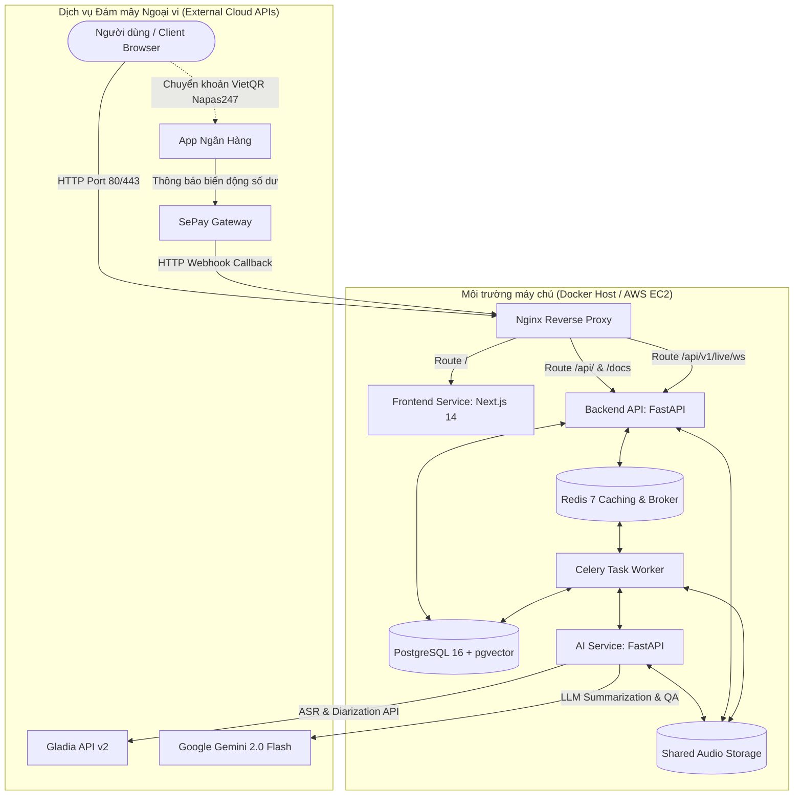

# ĐẶC TẢ YÊU CẦU PHẦN MỀM (SOFTWARE REQUIREMENTS SPECIFICATION - SRS)

**Dự án:** Hệ thống Trợ lý Giọng nói, Phiên âm, Tóm tắt và Hỏi đáp Cuộc họp Thông minh (Meeting Voice Assistant & Intelligence Platform)  
**Tiêu chuẩn áp dụng:** IEEE Std 830-1998 và ISO/IEC/IEEE 29148:2018  
**Phiên bản:** 2.1  
**Ngày cập nhật:** 2026-11-16  
**Tác giả:** Nguyễn Phương Linh (MSSV: 20224871)

---

## 1. Giới thiệu (Introduction)

### 1.1. Mục đích (Purpose)
Tài liệu này đặc tả toàn bộ các yêu cầu chức năng, yêu cầu phi chức năng, giao diện ngoại vi, mô hình dữ liệu và ràng buộc thiết kế của hệ thống **Meeting Voice Assistant**. Tài liệu đóng vai trò là cơ sở kỹ thuật chuẩn mực cho:
- **Đội ngũ phát triển (Software & AI Engineers):** Xây dựng, hiện thực hóa các microservices (`backend-api`, `ai-service`, `frontend`, `celery-worker`).
- **Đội ngũ kiểm thử (QA/QC):** Thiết kế kế hoạch kiểm thử (Test Plan), kịch bản kiểm thử tự động (Unit & Integration Tests) và kiểm thử chấp nhận (UAT).
- **Hội đồng chấm Đồ án tốt nghiệp & Giảng viên hướng dẫn:** Đánh giá khối lượng công việc, tính hoàn thiện của kiến trúc phần mềm và kết quả đạt được của đề tài.

### 1.2. Phạm vi sản phẩm (Scope)
Hệ thống **Meeting Voice Assistant** là một nền tảng Web độc lập chuyên sâu cho quản lý, phiên âm, phân tích và khai phá tri thức cuộc họp:
- **Tiếp nhận âm thanh toàn diện:** Thu âm trực tiếp qua WebSocket theo thời gian thực hoặc tải lên tệp ghi âm sẵn có đa định dạng (`.wav`, `.mp3`, `.m4a`, `.mp4`, `.flac`, `.ogg`, `.webm`, `.aac`).
- **Xử lý âm thanh AI đám mây (API-first Cloud ASR):** Điều phối Gladia API v2 tích hợp sẵn bóc tách tiếng Việt độ chính xác cao và phân tách người nói (Speaker Diarization) với chi phí thấp, vận hành mượt mà trên môi trường CPU không cần GPU vật lý chuyên dụng.
- **Không gian biên tập biên bản (Transcript Studio):** Trình phát âm thanh hỗ trợ tua mốc thời gian (timeline scrubbing qua HTTP Range request) đồng bộ hóa làm nổi bật văn bản theo mốc phát; chỉnh sửa câu chữ, tách gộp phân đoạn, đổi tên người phát biểu đồng loạt.
- **Tóm tắt điều hành & Trích xuất công việc (AI Summarization & Action Items):** Ứng dụng mô hình ngôn ngữ lớn thế hệ mới (Google Gemini 2.0 Flash / OpenAI) để trích xuất tóm tắt điều hành (Executive Summary), các luận điểm chính (Key Points), và danh sách việc cần làm (Action Items) có người chịu trách nhiệm và trạng thái rõ ràng.
- **Trợ lý hỏi đáp RAG với trích dẫn âm thanh (RAG QA with Audio Citations):** Truy vấn tri thức cuộc họp thông qua tìm kiếm kết hợp (Hybrid Search: Dense Vector Embedding `multilingual-e5-small` + Lexical Search với Reciprocal Rank Fusion), cung cấp câu trả lời có trích dẫn chính xác nhãn người nói, mốc thời gian giây (`start_time`, `end_time`) và đoạn trích dẫn đối chứng, kèm cơ chế tìm kiếm dự phòng khi AI service ngoại tuyến.
- **Xuất biên bản đa định dạng:** Hỗ trợ kết xuất báo cáo cuộc họp sang TXT, Markdown (.md), Microsoft Word (.docx), PDF và JSON.
- **Hợp tác & Không gian làm việc nhóm (Workspace & Project Management):** Tổ chức cuộc họp theo từng dự án, phân quyền cộng tác thành viên (Owner, Editor, Viewer), chia sẻ cuộc họp an toàn qua đường link có mã token bảo mật.
- **Hệ thống thương mại hóa & Thanh toán tự động (Subscription & VietQR Payments):** Quản lý 3 tầng gói cước (Free, Pro, Unlimited), theo dõi và kiểm soát hạn mức thời lượng ghi âm (Quota Tracking), tích hợp cổng thanh toán VietQR động theo chuẩn Napas247 và xử lý Webhook tự động từ SePay để kích hoạt gói cước tức thì.

### 1.3. Thuật ngữ và chữ viết tắt (Definitions and Acronyms)

| Thuật ngữ / Viết tắt | Tên đầy đủ | Định nghĩa kỹ thuật trong hệ thống |
|---|---|---|
| **ASR** | Automatic Speech Recognition | Công nghệ nhận diện và chuyển đổi giọng nói thành chuỗi văn bản có dấu. |
| **VAD** | Voice Activity Detection | Thuật toán phát hiện phân đoạn âm thanh chứa tiếng người nói, loại bỏ khoảng lặng. |
| **Diarization** | Speaker Diarization | Kỹ thuật phân tách và định danh "Ai nói vào thời điểm nào" trong cuộc họp. |
| **WER** | Word Error Rate | Tỷ lệ lỗi nhận dạng từ ngữ: `(Insertions + Deletions + Substitutions) / Total Words`. |
| **DER** | Diarization Error Rate | Tỷ lệ lỗi gán nhãn thời gian và người nói: `(Missed + False Alarm + Speaker Error) / Total Time`. |
| **RAG** | Retrieval-Augmented Generation | Kỹ thuật kết hợp truy xuất ngữ cảnh từ CSDL vector với LLM để trả lời chính xác, tránh ảo giác (hallucination). |
| **RRF** | Reciprocal Rank Fusion | Thuật toán kết hợp và xếp hạng ứng viên từ tìm kiếm ngữ nghĩa vector và tìm kiếm từ khóa truyền thống: `Score = Σ 1 / (60 + r)`. |
| **pgvector** | PostgreSQL Vector Extension | Tiện ích mở rộng mã nguồn mở cho PostgreSQL hỗ trợ lưu trữ vector và chỉ mục HNSW/IVFFlat. |
| **RBAC** | Role-Based Access Control | Cơ chế kiểm soát truy cập dựa trên vai trò của người dùng (Owner, Editor, Viewer). |
| **VietQR** | Vietnam National QR Code | Chuẩn thanh toán chuyển khoản liên ngân hàng 24/7 theo quy định của Ngân hàng Nhà nước Việt Nam. |
| **SePay** | SePay Payment Gateway Service | Dịch vụ trung gian thanh toán cung cấp Webhook tự động nhận diện biến động số dư ngân hàng theo thời gian thực. |
| **Quota** | Quota Limit & Usage | Hạn mức thời lượng xử lý âm thanh tối đa theo từng chu kỳ gói cước người dùng đăng ký. |

### 1.4. Tài liệu tham khảo (References)
- IEEE Std 830-1998: *IEEE Recommended Practice for Software Requirements Specifications*.
- ISO/IEC/IEEE 29148:2018: *Systems and software engineering - Life cycle processes - Requirements engineering*.
- Tài liệu nội bộ dự án:
  - `docs/01-requirements/prd.md` (Product Requirements Document).
  - `docs/01-requirements/use-cases.md` (Use Case Specifications).
  - `docs/03-architecture/system-architecture.md` (Kiến trúc hệ thống C4 Model).
  - `docs/04-design/database-erd.md` (Thiết kế cơ sở dữ liệu PostgreSQL + pgvector).
  - `docs/deployment/huong-dan-trien-khai-ec2-va-chay-end-to-end.md` (Hướng dẫn triển khai AWS EC2).

---

## 2. Mô tả chung (Overall Description)

### 2.1. Tổng quan sản phẩm (Product Perspective)
Hệ thống là một giải pháp web phân tán module hóa (Microservices), bao gồm 6 thành phần chính chạy đồng bộ qua Docker Compose:

1. **Frontend Service (Next.js 14 & TailwindCSS):** Giao diện Single Page Application (SPA), rendering Server-Side và Client Components, quản lý xác thực bằng React Context, phát audio waveform và chat RAG trực tuyến.
2. **Backend API (FastAPI - Python 3.12):** Quản lý xác thực JWT, ủy quyền RBAC, nghiệp vụ dự án, tiếp nhận và phát luồng audio, điều phối giao dịch thanh toán VietQR và xử lý Webhook SePay.
3. **AI Service (FastAPI - Python 3.12):** Đóng gói pipeline xử lý âm thanh Gladia API v2, pipeline RAG Hybrid Search với mô hình `multilingual-e5-small`, và bộ sinh văn bản tóm tắt/hỏi đáp qua Gemini 2.0 Flash / OpenAI.
4. **Celery Worker (Python 3.12):** Xử lý các tác vụ nền tốn thời gian (Pass 2 Audio Ingestion, Diarization, LLM Summarization) thông qua hàng đợi Redis.
5. **PostgreSQL 16 + pgvector:** Lưu trữ dữ liệu quan hệ (Users, Projects, Meetings, Transcripts, Summaries, Action Items, Subscriptions, Payments) và vector embedding.
6. **Redis 7:** Hàng đợi thông điệp (Message Broker) cho Celery và bộ nhớ đệm cache session.

### 2.2. Đặc điểm người dùng (User Classes and Characteristics)

| Nhóm người dùng | Mô tả vai trò & Trách nhiệm | Yêu cầu kỹ năng | Tần suất sử dụng |
|---|---|---|---|
| **Chủ cuộc họp (Meeting Owner)** | Người khởi tạo cuộc họp (ghi âm hoặc upload file), quản lý toàn quyền dữ liệu cuộc họp, tái tạo tóm tắt, tạo link chia sẻ và phân quyền cho người khác. | Cơ bản (sử dụng trình duyệt, thao tác tải tệp). | Hàng ngày hoặc sau mỗi cuộc họp. |
| **Cộng tác viên - Người sửa (Editor)** | Được cấp quyền Editor qua liên kết chia sẻ hoặc trong dự án nhóm. Có quyền nghe đối soát audio, chỉnh sửa văn bản gỡ băng, đổi tên speaker, cập nhật trạng thái Action Items, xuất biên bản. | Cơ bản (nghe âm thanh, rà soát và hiệu chỉnh văn bản). | Khi được phân công biên tập biên bản. |
| **Cộng tác viên - Người xem (Viewer)** | Được cấp quyền Viewer. Có quyền nghe phát lại âm thanh, đọc biên bản và tóm tắt, tra cứu hỏi đáp nội dung qua Trợ lý RAG (chỉ đọc, không được sửa đổi). | Cơ bản (đọc báo cáo, đặt câu hỏi chatbot). | Thường xuyên khi tra cứu nội dung họp. |
| **Chủ dự án (Project Owner)** | Người tạo Không gian làm việc / Dự án, mời thành viên tham gia, phân quyền quản trị dự án và gom nhóm các cuộc họp theo phòng ban/dự án. | Cơ bản (quản lý nhóm, phân chia công việc). | Hàng tuần / Hàng tháng. |
| **Quản trị hệ thống (Admin)** | Quản lý hạ tầng máy chủ, cấu hình biến môi trường API keys, giám sát hàng đợi Celery, bảo trì CSDL và theo dõi doanh thu thanh toán. | Nâng cao (quản trị Linux, Docker, AWS EC2, CSDL). | Định kỳ theo lịch vận hành. |

### 2.3. Môi trường vận hành (Operating Environment)
- **Phía máy trạm (Client):** Trình duyệt web hiện đại hỗ trợ HTML5 Audio, Web Audio API, MediaStream Recording API và WebSocket (Google Chrome 110+, Mozilla Firefox 115+, Microsoft Edge 110+, Safari 16+).
- **Phía máy chủ (Server EC2):**
  - Hệ điều hành: Ubuntu 22.04 LTS x86_64 hoặc ARM64.
  - Phần cứng tối thiểu: 2 vCPU, 4 GB RAM, 30 GB SSD (Khuyến nghị `t3.large` 2 vCPU 8 GB RAM hoặc `t3.xlarge` 4 vCPU 16 GB RAM để chạy đồng thời vector embeddings và nhiều worker).
  - Runtime: Docker Engine 24.0+, Docker Compose v2.20+.
  - Băng thông mạng: Đảm bảo tối thiểu 10 Mbps đường truyền ra Internet để gọi Gladia API và Gemini API.

### 2.4. Ràng buộc thiết kế và triển khai (Design and Implementation Constraints)
- **Kiến trúc Không GPU (CPU-First Architecture):** Toàn bộ hệ thống được thiết kế để vận hành hoàn hảo trên các máy chủ CPU tiêu chuẩn trên AWS EC2, tận dụng tối đa Gladia Cloud ASR và Gemini Cloud LLM.
- **Tiêu chuẩn mã nguồn (SOLID & Clean Code):** Sử dụng đầy đủ type annotations (Python Type Hints & TypeScript), docstring chuẩn Google-style cho mọi hàm và phương thức public, cấu trúc module phi tập trung (Decoupled Services).
- **An toàn bảo mật:** Tuyệt đối không lưu trữ mật khẩu dạng rõ (sử dụng thuật toán băm Passlib bcrypt/Argon2); mã hóa xác thực JWT với thời gian sống có hạn; kiểm tra mã chữ ký xác thực Webhook của SePay trước khi xử lý giao dịch.
- **Tính tự phục hồi & Fallback:** Hệ thống bắt buộc có cơ chế fallback xử lý tác vụ nền (In-process Async Task) nếu Celery broker bị ngắt quãng, và cơ chế Fallback Lexical Search khi AI Service tạm thời không phản hồi.

---

## 3. Yêu cầu chức năng cụ thể (Specific Functional Requirements)

### 3.1. Module 1: Quản lý người dùng, Xác thực & Phân quyền (Authentication & RBAC)

##### FR-01: Đăng ký và Đăng nhập tài khoản
- **Mã Use Case:** UC-01
- **API Endpoint:** `POST /api/v1/auth/register`, `POST /api/v1/auth/login`
- **Mô tả:**
  - Hệ thống cho phép người dùng đăng ký tài khoản mới bằng Email, Mật khẩu (tối thiểu 8 ký tự) và Họ tên.
  - Mật khẩu được băm an toàn bằng thuật toán bcrypt trước khi lưu trữ vào bảng `users`.
  - Khi đăng nhập thành công, hệ thống cấp phát cặp mã xác thực JSON Web Token: `access_token` (thời hạn 60 phút) và `refresh_token` (thời hạn 30 ngày).
  - Tự động gán người dùng mới vào gói cước mặc định `Free` (hạn mức 60 phút/tháng).
- **Ngoại lệ:** Email đã tồn tại trong hệ thống -> Trả về lỗi `HTTP 409 CONFLICT` kèm thông điệp "Email đã được đăng ký".

##### FR-02: Quản lý hồ sơ và Cấp phát lại mã xác thực (Profile & Refresh Token)
- **Mã Use Case:** UC-01, UC-S01
- **API Endpoint:** `GET /api/v1/auth/me`, `POST /api/v1/auth/refresh`, `PATCH /api/v1/users/me`
- **Mô tả:**
  - Người dùng truy xuất thông tin cá nhân, gói cước hiện tại và quyền hạn vai trò.
  - Cho phép cập nhật Họ tên hiển thị và đường dẫn ảnh đại diện (`avatar_url`).
  - Hỗ trợ endpoint làm mới token mà không làm gián đoạn phiên làm việc của người dùng khi `access_token` hết hạn.

---

### 3.2. Module 2: Quản lý Không gian làm việc & Dự án (Projects & Workspaces)

##### FR-03: Khởi tạo dự án và Quản lý thành viên nhóm
- **Mã Use Case:** UC-02
- **API Endpoint:** `POST /api/v1/projects`, `GET /api/v1/projects`, `POST /api/v1/projects/{id}/members`
- **Mô tả:**
  - Người dùng có thể tạo một hoặc nhiều Dự án (Workspace) để gom nhóm các phiên họp chuyên đề.
  - Người tạo mặc nhiên có vai trò `owner` của dự án.
  - Chủ dự án có quyền mời thêm thành viên qua email và chỉ định vai trò (`editor` hoặc `viewer`).
  - Danh sách dự án hiển thị trực tiếp trên thanh điều hướng và bộ lọc dashboard.

##### FR-04: Phân nhóm cuộc họp vào dự án
- **Mã Use Case:** UC-02, UC-03
- **API Endpoint:** `POST /api/v1/projects/{id}/meetings`, `GET /api/v1/projects/{id}/meetings`
- **Mô tả:**
  - Khi tạo hoặc upload cuộc họp, người dùng có thể gán cuộc họp trực tiếp vào một dự án cụ thể.
  - Thành viên trong dự án có thể truy cập danh sách toàn bộ các cuộc họp thuộc dự án đó tùy theo quyền hạn được phân cấp.

---

### 3.3. Module 3: Tiếp nhận tệp âm thanh & Truyền phát (Audio Ingestion & Streaming)

##### FR-05: Tải lên tệp ghi âm cuộc họp (Batch Audio Upload)
- **Mã Use Case:** UC-03
- **API Endpoint:** `POST /api/v1/audio/upload`, `POST /api/v1/audio/meetings/{meeting_id}/upload`
- **Mô tả:**
  - Hỗ trợ upload tệp âm thanh hoặc video từ máy tính với dung lượng tối đa 500 MB.
  - Các định dạng tệp được hỗ trợ: `.wav`, `.mp3`, `.m4a`, `.mp4`, `.aac`, `.flac`, `.ogg`, `.webm`.
  - Tệp được lưu trữ an toàn trong thư mục cấu hình `STORAGE_ROOT` (`/tmp/meeting_storage`).
  - Hệ thống tạo bản ghi `AudioFileModel`, cập nhật trạng thái cuộc họp thành `processing`, đồng thời gửi tác vụ `process_audio_task` vào Celery Worker (kèm cơ chế Async Task dự phòng).
- **Ngoại lệ:** Tệp không đúng định dạng âm thanh -> Trả về lỗi `HTTP 400 BAD REQUEST` liệt kê danh sách định dạng hợp lệ.

##### FR-06: Truyền phát âm thanh với hỗ trợ HTTP Range (Audio Timeline Scrubbing)
- **Mã Use Case:** UC-06
- **API Endpoint:** `GET /api/v1/audio/{meeting_id}/stream`, `GET /api/v1/audio/{meeting_id}/playback`
- **Mô tả:**
  - Backend cung cấp luồng streaming âm thanh hỗ trợ tiêu chuẩn `HTTP Range Requests` (Status Code 206 Partial Content).
  - Cho phép người dùng tua nhanh, tua lùi mượt mà trên thanh tiến trình (Waveform Player) mà không cần tải lại toàn bộ tệp từ đầu.

---

### 3.4. Module 4: Xử lý ASR & Phân tách người nói (Speech-to-Text & Diarization)

##### FR-07: Điều phối xử lý âm thanh trọn gói qua Gladia API v2
- **Mã Use Case:** UC-04
- **API Endpoint:** `POST /audio/process` (AI Service nội bộ)
- **Mô tả:**
  - Khi nhận yêu cầu xử lý từ Celery Worker, AI Service tải tệp âm thanh từ bộ nhớ chia sẻ và gửi đến Gladia API v2.
  - Cấu hình Gladia nhận diện tiếng Việt (`language=vi`), bật tính năng phân tách giọng người nói (`diarization=true`).
  - Kết quả trả về gồm danh sách các phân đoạn: nhãn người nói (`SPEAKER_00`, `SPEAKER_01`...), mốc thời gian bắt đầu (`start`), mốc kết thúc (`end`), chuỗi văn bản gỡ băng (`text`), và danh sách từ ngữ (`words`).
  - Backend lưu từng phân đoạn vào bảng `transcript_segments` theo thứ tự `sequence_order`.

##### FR-08: Cơ chế dự phòng ngoại tuyến (Offline Mock Pipeline)
- **Mã Use Case:** UC-04
- **Mô tả:**
  - Trong trường hợp không có kết nối Internet hoặc chưa cấu hình `GLADIA_API_KEY`, hệ thống tự động chuyển sang chế độ Mock Pipeline để đảm bảo toàn bộ luồng ứng dụng vẫn hoạt động và phục vụ kiểm thử end-to-end mà không bị dừng đột ngột.

---

### 3.5. Module 5: Ghi âm & Phiên âm trực tiếp qua WebSocket (Live Real-time ASR)

##### FR-09: Thu âm và Phiên âm trực tiếp qua WebSocket
- **Mã Use Case:** UC-05
- **WebSocket Endpoint:** `WS /api/v1/live/ws`
- **Mô tả:**
  - Frontend thu âm trực tiếp từ microphone của người dùng bằng Web Audio API với tần số mẫu 16 kHz.
  - Truyền tải liên tục các khối nhị phân âm thanh (audio chunks) tới WebSocket server.
  - Backend phân tích các khối âm thanh và gửi trả lại các gói JSON chứa trạng thái phiên âm theo thời gian thực: `{"speaker": "SPEAKER_00", "text": "...", "is_final": true}`.
  - Cho phép người dùng dừng phiên ghi âm để lưu cuộc họp thành phiên hoàn chỉnh.

---

### 3.6. Module 6: Không gian biên tập biên bản (Transcript Studio)

##### FR-10: Hiệu chỉnh phân đoạn và Đổi tên người phát biểu đồng loạt
- **Mã Use Case:** UC-06
- **API Endpoint:** `PUT /api/v1/meetings/{id}/transcripts/{segment_id}`, `PUT /api/v1/meetings/{id}/transcripts/speakers/rename`
- **Mô tả:**
  - Người dùng có quyền Editor/Owner có thể chỉnh sửa trực tiếp nội dung từng câu thoại.
  - Hỗ trợ đổi tên hiển thị của người nói (ví dụ: đổi nhãn `SPEAKER_00` thành `Anh Hoàng - PM`).
  - Tùy chọn đổi tên đồng loạt cho phép áp dụng nhãn tên mới cho tất cả các phân đoạn thoại của speaker đó trong toàn bộ cuộc họp chỉ bằng 1 thao tác.

##### FR-11: Thêm mới và Xóa phân đoạn hội thoại
- **Mã Use Case:** UC-06
- **API Endpoint:** `POST /api/v1/meetings/{id}/transcripts`, `DELETE /api/v1/meetings/{id}/transcripts/{segment_id}`
- **Mô tả:**
  - Cho phép bổ sung phân đoạn thoại bị bỏ sót hoặc xóa bỏ các phân đoạn tạp âm không cần thiết.
  - Tự động sắp xếp lại chỉ mục `sequence_order` của toàn bộ các câu thoại trong cuộc họp.

---

### 3.7. Module 7: Tóm tắt điều hành & Trích xuất nhiệm vụ (Summarization & Action Items)

##### FR-12: Tự động trích xuất Tóm tắt điều hành và Luận điểm chính
- **Mã Use Case:** UC-07
- **API Endpoint:** `GET /api/v1/meetings/{id}/summaries`, `POST /rag/summarize` (AI Service)
- **Mô tả:**
  - Sau khi hoàn tất phiên âm, hệ thống gửi toàn bộ văn bản hội thoại đến mô hình Google Gemini 2.0 Flash (hoặc OpenAI GPT-4o-mini).
  - Mô hình sinh tóm tắt điều hành có cấu trúc:
    - `executive_summary`: Tóm tắt cô đọng 2-4 đoạn văn về mục đích và kết quả cuộc họp.
    - `key_points`: Danh sách các luận điểm chính đã thống nhất.
  - Lưu trữ vào bảng `meeting_summaries`.

##### FR-13: Trích xuất và Quản lý danh mục công việc (Action Items)
- **Mã Use Case:** UC-07
- **API Endpoint:** `GET /api/v1/meetings/{id}/summaries/action-items`, `POST /api/v1/meetings/{id}/summaries/action-items`, `PATCH /api/v1/meetings/{id}/summaries/action-items/{item_id}`
- **Mô tả:**
  - Tự động phát hiện các cam kết, nhiệm vụ phát sinh từ nội dung thảo luận.
  - Mỗi Action Item bao gồm: `description` (nội dung việc), `assignee` (người được giao), `status` (`pending` hoặc `completed`), và `due_date` (hạn hoàn thành nếu có).
  - Người dùng có thể đánh dấu hoàn thành nhiệm vụ ngay trên giao diện danh sách việc.

##### FR-14: Tái tạo tóm tắt thông minh (Regenerate AI Summary)
- **Mã Use Case:** UC-S02
- **API Endpoint:** `POST /api/v1/meetings/{id}/regenerate-summary`
- **Mô tả:**
  - Cho phép người dùng yêu cầu AI đọc lại toàn bộ bản gỡ băng (sau khi đã được con người chỉnh sửa, sửa tên người nói) để sinh lại một bản tóm tắt và danh sách việc mới chính xác hơn.

---

### 3.8. Module 8: Trợ lý hỏi đáp RAG với trích dẫn mốc thời gian (RAG QA with Citations)

##### FR-15: Truy vấn RAG kết hợp đa tầng (Hybrid Search RRF)
- **Mã Use Case:** UC-08
- **API Endpoint:** `POST /api/v1/meetings/{id}/chat`, `POST /rag/query` (AI Service)
- **Mô tả:**
  - Người dùng đặt câu hỏi tự nhiên về nội dung cuộc họp (ví dụ: *"Ai chịu trách nhiệm phần kiểm thử hiệu năng và hạn chót là khi nào?"*).
  - Hệ thống sử dụng mô hình Embedding `intfloat/multilingual-e5-small` để mã hóa câu hỏi và tìm kiếm các phân đoạn tương đồng ngữ nghĩa kết hợp với tìm kiếm từ khóa FTS.
  - Áp dụng thuật toán Reciprocal Rank Fusion (RRF) để chọn ra Top-K phân đoạn ngữ cảnh liên quan nhất.

##### FR-16: Phản hồi kèm trích dẫn âm thanh có thể đối chứng (Verifiable Audio Citations)
- **Mã Use Case:** UC-08
- **Mô tả:**
  - Gemini 2.0 Flash phân tích ngữ cảnh và sinh câu trả lời kèm mảng trích dẫn `citations`:
    - `segment_id`: ID phân đoạn gốc.
    - `speaker_label`: Người phát biểu.
    - `start_time` / `end_time`: Mốc giây bắt đầu và kết thúc của lời nói.
    - `quote`: Câu trích dẫn trực tiếp từ băng ghi âm.
  - Trên giao diện Chatbot, mỗi trích dẫn hiển thị thành một Badge thời gian có thể bấm vào để tua ngay đến đoạn âm thanh đó.

##### FR-17: Cơ chế tìm kiếm dự phòng khi ngoại tuyến (Fallback Local Search)
- **Mã Use Case:** UC-08
- **Mô tả:**
  - Nếu AI Service hoặc LLM Cloud gặp sự cố kết nối, Backend API tự động kích hoạt thuật toán tìm kiếm từ khóa cục bộ (`_fallback_search`), trích xuất các câu thoại phù hợp nhất mà không làm sập giao diện chat của người dùng.

---

### 3.9. Module 9: Xuất biên bản cuộc họp đa định dạng (Multi-format Export)

##### FR-18: Xuất biên bản ra các định dạng tài liệu chuẩn
- **Mã Use Case:** UC-09
- **API Endpoint:** `GET /api/v1/meetings/{id}/exports/{format}` (Hỗ trợ `txt`, `md`, `docx`, `pdf`, `json`)
- **Mô tả:**
  - Kết xuất toàn diện thông tin cuộc họp: Tiêu đề, Thời gian, Người tham gia, Tóm tắt điều hành, Danh sách luận điểm, Danh mục việc cần làm và toàn bộ kịch bản hội thoại có đánh dấu người nói.
  - Định dạng `.docx` được định dạng chuẩn văn phòng chuyên nghiệp bằng thư viện `python-docx`.
  - Định dạng `.md` và `.txt` tối ưu cho lưu trữ ghi chú.
  - Định dạng `.json` phục vụ tích hợp API và sao lưu dữ liệu có cấu trúc.

---

### 3.10. Module 10: Chia sẻ cuộc họp & Phân quyền qua Link (Shareable Link & Token RBAC)

##### FR-19: Sinh token chia sẻ bảo mật và Phân quyền truy cập
- **Mã Use Case:** UC-10
- **API Endpoint:** `POST /api/v1/meetings/{id}/share`, `GET /api/v1/meetings/share/{token}`
- **Mô tả:**
  - Chủ cuộc họp có thể bật/tắt tính năng chia sẻ cuộc họp qua đường dẫn.
  - Hệ thống sinh một chuỗi mã ngẫu nhiên bảo mật an toàn 64 ký tự (`share_token`).
  - Thiết lập quyền hạn cho liên kết: `viewer` (chỉ xem, nghe và chat hỏi đáp) hoặc `editor` (được quyền chỉnh sửa biên bản).
  - Người nhận link có thể truy cập trực tiếp mà không cần tài khoản hoặc có thể đăng nhập để lưu vào danh sách của mình.

---

### 3.11. Module 11: Quản lý gói cước & Hạn mức thời lượng (Subscription & Quota Tracking)

##### FR-20: Cấu hình phân tầng 3 gói cước dịch vụ
- **Mã Use Case:** UC-11
- **API Endpoint:** `GET /api/v1/plans`
- **Mô tả:**
  - Hệ thống duy trì cấu hình 3 gói cước định sẵn trong bảng `plan_configs`:
    1. **Gói Miễn Phí (Free):** 0 VNĐ/tháng, hạn mức 60 phút ghi âm, tối đa 5 cuộc họp, xuất file TXT/JSON.
    2. **Gói Chuyên Nghiệp (Pro):** 99.000 VNĐ/tháng, hạn mức 600 phút (10 giờ) ghi âm, không giới hạn số cuộc họp, đầy đủ định dạng xuất Word/PDF, ưu tiên hàng đợi xử lý.
    3. **Gói Vô Hạn (Unlimited):** 299.000 VNĐ/tháng, không giới hạn thời lượng ghi âm, cộng tác nhóm và hỗ trợ chuyên biệt.

##### FR-21: Khấu trừ và Kiểm soát hạn mức thời lượng (Quota Enforcement)
- **Mã Use Case:** UC-11
- **API Endpoint:** `GET /api/v1/plans/my/quota`
- **Mô tả:**
  - Mỗi khi một cuộc họp hoàn tất xử lý âm thanh, hệ thống ghi nhận một bản ghi `MeetingQuotaUsageModel` lưu trữ số giây thời lượng thực tế của file âm thanh.
  - Tính tổng thời lượng người dùng đã tiêu thụ trong chu kỳ 30 ngày gần nhất.
  - Hiển thị thanh tiến trình sử dụng hạn mức (QuotaBadge) trực quan trên giao diện người dùng.
  - Nếu người dùng gói Free sử dụng vượt quá 60 phút, hệ thống từ chối tải lên tệp mới và hiển thị modal gợi ý nâng cấp gói cước Pro.

---

### 3.12. Module 12: Thanh toán nâng cấp tự động qua VietQR / SePay Webhook (Automated Payments)

##### FR-22: Tạo đơn thanh toán và Sinh mã VietQR động Napas247
- **Mã Use Case:** UC-12
- **API Endpoint:** `POST /api/v1/payments/create-order`, `GET /api/v1/payments/orders/{order_code}`
- **Mô tả:**
  - Người dùng chọn gói cước muốn nâng cấp (ví dụ: Gói Pro - 99.000 VNĐ).
  - Hệ thống tạo bản ghi `PaymentOrderModel` với mã đơn hàng duy nhất dạng `DHxxxxxx`, thời hạn thanh toán là 30 phút.
  - Tự động sinh link ảnh VietQR động chuẩn Napas247: `https://qr.sepay.vn/img?acc={STK}&bank={BANK}&amount={TIEN}&des={MA_DON_HANG}`.
  - Frontend hiển thị modal chứa mã QR kèm hướng dẫn quét bằng bất kỳ ứng dụng ngân hàng nào (MBBank, Vietcombank, Techcombank...).

##### FR-23: Xử lý Webhook SePay và Kích hoạt gói cước tức thì
- **Mã Use Case:** UC-12
- **API Endpoint:** `POST /api/v1/payments/webhook`
- **Mô tả:**
  - Khi người dùng hoàn tất chuyển khoản thành công, SePay gửi một HTTP POST request (Webhook) chứa thông tin giao dịch đến endpoint `/api/v1/payments/webhook`.
  - Backend kiểm tra khóa bảo mật `Authorization: Apikey <SEPAY_WEBHOOK_API_KEY>`.
  - Tự động bóc tách mã đơn hàng từ nội dung chuyển khoản (`content` hoặc `code`).
  - Khớp với đơn hàng trong bảng `payment_orders`: cập nhật trạng thái đơn thành `completed`, ghi nhận thời gian `paid_at`.
  - Kích hoạt hoặc gia hạn bản ghi `SubscriptionModel` tương ứng cho người dùng thêm 30 ngày sử dụng gói mới.
  - Toàn bộ tiến trình kích hoạt diễn ra hoàn toàn tự động trong chưa đầy 1 giây mà không cần con người can thiệp thủ công.

---

## 4. Yêu cầu phi chức năng (Non-Functional Requirements)

### 4.1. Hiệu năng và Thời gian đáp ứng (Performance & Latency)
- **NFR-01 (Tốc độ xử lý ASR & Diarization):** Thời gian xử lý âm thanh qua Gladia API không vượt quá 20% thời lượng thực tế của bản ghi (ví dụ: tệp ghi âm 10 phút xử lý xong trong dưới 2 phút).
- **NFR-02 (Độ trễ hỏi đáp RAG):** Thời gian phản hồi câu hỏi RAG kèm trích dẫn âm thanh từ khi người dùng bấm gửi không vượt quá 2.5 giây đối với mô hình Gemini 2.0 Flash.
- **NFR-03 (Phát luồng âm thanh tức thì):** Độ trễ bắt đầu phát âm thanh khi tua mốc thời gian không vượt quá 300ms nhờ cơ chế HTTP Range partial content.
- **NFR-04 (Xử lý Webhook thanh toán):** Thời gian xử lý và đối soát Webhook SePay đến khi kích hoạt gói cước thành công không vượt quá 1.0 giây.

### 4.2. Độ chính xác & Chất lượng AI (Accuracy & Intelligence Quality)
- **NFR-05 (Độ chính xác phiên âm tiếng Việt):** Đạt tỷ lệ lỗi từ (WER) dưới 12% trên các bản ghi âm đàm thoại rõ ràng trong điều kiện văn phòng tiêu chuẩn.
- **NFR-06 (Độ chính xác phân tách người nói):** Đạt tỷ lệ lỗi người nói (DER) dưới 15% trong các cuộc họp có từ 2 đến 5 người tham gia.
- **NFR-07 (Độ tin cậy của trích dẫn RAG):** 100% câu trả lời có trích dẫn phải liên kết chính xác tới phân đoạn thoại thực tế có tồn tại trong CSDL.

### 4.3. An toàn, Bảo mật & Toàn vẹn dữ liệu (Security & Data Integrity)
- **NFR-08 (Bảo mật xác thực & Truyền thông):** 
  - Toàn bộ kết nối ra bên ngoài qua Nginx bắt buộc sử dụng giao thức HTTPS và WSS (TLS 1.3).
  - Mật khẩu người dùng được băm bằng thuật toán bcrypt với salt ngẫu nhiên.
  - Secret key của JWT có độ dài tối thiểu 256-bit entropy.
- **NFR-09 (Bảo vệ chống gian lận thanh toán):** Xác thực nghiêm ngặt API Key trên Header của SePay Webhook; chỉ xác nhận đơn hàng khi số tiền chuyển khoản (`transfer_amount`) khớp chính xác hoặc lớn hơn số tiền trên đơn hàng.
- **NFR-10 (Cách ly dữ liệu):** Người dùng chỉ được xem và thao tác trên các cuộc họp do mình tạo ra, thuộc dự án mình tham gia, hoặc được chia sẻ hợp lệ qua `share_token`.

### 4.4. Tính sẵn sàng & Độ tin cậy (Availability & Reliability)
- **NFR-11 (Độ sẵn sàng hệ thống):** Cam kết tỷ lệ hoạt động (Uptime) tối thiểu 99.5% trong môi trường vận hành AWS EC2.
- **NFR-12 (Tự động khởi động & Phục hồi):** Tất cả các container Docker (`meeting_postgres`, `meeting_redis`, `meeting_backend_api`, `meeting_celery_worker`, `meeting_ai_service`, `meeting_frontend`, `meeting_nginx`) được thiết lập chính sách `restart: always`.

---

## 5. Yêu cầu giao diện ngoại vi (External Interface Requirements)

### 5.1. Giao diện người dùng (User Interface - UI)
- Xây dựng giao diện Clean Minimalist theo chuẩn thiết kế hiện đại, tông màu tối ưu cho đọc văn bản dài.
- Tương thích tốt trên màn hình máy tính (Desktop/Laptop 1280px trở lên) và máy tính bảng (Tablet 768px trở lên).
- Các trang chính:
  1. `MeetingsDashboard` (`/`): Danh sách cuộc họp, lọc dự án, modal upload audio, QuotaBadge.
  2. `MeetingDetailPage` (`/meetings/[id]`): Transcript Studio, Audio Timeline Scrubbing, Tab Tóm tắt, Danh sách Action Items, Trợ lý Chat RAG, Export Dropdown, Share Modal.
  3. `LiveMeetingPage` (`/live`): Ghi âm và phiên âm trực tuyến qua WebSocket.
  4. `AuthPages` (`/login`, `/register`): Đăng nhập, đăng ký tài khoản.
  5. `PricingModal & VietQRModal`: Bảng giá 3 gói cước và cửa sổ thanh toán chuyển khoản quét mã VietQR tự động.

### 5.2. Giao diện phần mềm ngoại vi (Software Interfaces & Cloud Services)
- **Gladia API v2:** Giao tiếp qua REST API HTTPS (`https://api.gladia.io/v2/pre-recorded`), xác thực bằng `x-gladia-key`.
- **Google Gemini API:** Giao tiếp qua Google Generative AI REST API (`gemini-2.0-flash`), xác thực bằng `x-goog-api-key`.
- **SePay Payment Service:** Tiếp nhận Webhook callback HTTPS POST từ SePay (`https://my.sepay.vn`), sinh ảnh mã QR Napas247 qua `https://qr.sepay.vn/img`.
- **PostgreSQL 16 + pgvector:** Giao tiếp qua async connection pool bằng thư viện `asyncpg` và `SQLAlchemy 2.0`.
- **Redis 7:** Giao tiếp qua giao thức RESP (Redis Serialization Protocol) phục vụ Celery broker và cache.

---

## 6. Mô hình dữ liệu & Cấu trúc CSDL (Database Schema Requirements)

Hệ thống quản lý 14 bảng dữ liệu quan hệ kết hợp vector trong PostgreSQL:
1. `users`: Thông tin tài khoản người dùng, email, mật khẩu băm, vai trò.
2. `projects`: Danh mục không gian làm việc / dự án nhóm.
3. `project_members`: Thành viên và vai trò trong từng dự án (owner, editor, viewer).
4. `project_meetings`: Liên kết nhiều-nhiều giữa cuộc họp và dự án.
5. `meetings`: Thực thể cuộc họp, tiêu đề, trạng thái, thời lượng, token chia sẻ.
6. `audio_files`: Thông tin tệp ghi âm, đường dẫn lưu trữ, kích thước, định dạng MIME.
7. `transcript_segments`: Phân đoạn lời thoại, nhãn người nói, mốc giây start/end, nội dung văn bản.
8. `meeting_summaries`: Bản tóm tắt điều hành và danh sách luận điểm chính.
9. `action_items`: Danh mục công việc phát sinh, người phụ trách, hạn hoàn thành, trạng thái.
10. `chat_sessions`: Phiên hội thoại hỏi đáp RAG theo từng cuộc họp.
11. `chat_messages`: Tin nhắn hỏi đáp, vai trò (user/assistant), mảng trích dẫn âm thanh (citations).
12. `plan_configs`: Cấu hình 3 gói cước dịch vụ (Free, Pro, Unlimited), giá tiền, hạn mức thời lượng.
13. `subscriptions`: Trạng thái gói cước đang kích hoạt của từng người dùng, ngày bắt đầu, ngày hết hạn.
14. `meeting_quota_usage_events`: Nhật ký tiêu thụ hạn mức thời lượng ghi âm của người dùng.
15. `payment_orders`: Đơn hàng thanh toán nâng cấp gói cước, mã đơn, số tiền, trạng thái.
16. `sepay_webhook_events`: Nhật ký lưu vết toàn bộ payload webhook từ SePay phục vụ đối soát.

---

## 7. Phụ lục & Ma trận xác nhận yêu cầu (Verification Matrix)

Mọi yêu cầu chức năng (FR-01 đến FR-23) đều được kiểm chứng thông qua các bộ kiểm thử tự động (Pytest) và quy trình kiểm thử người dùng (Manual End-to-End Testing):

| Mã FR | Tên yêu cầu chức năng | Tệp Code hiện thực | Kịch bản kiểm thử (Test File) |
|---|---|---|---|
| **FR-01** | Đăng ký & Đăng nhập JWT | `services/auth_service.py` | `tests/test_auth.py` |
| **FR-02** | Quản lý Profile & Refresh Token | `endpoints/auth.py`, `endpoints/users.py` | `tests/test_auth.py` |
| **FR-03** | Khởi tạo dự án & Mời thành viên | `endpoints/projects.py`, `services/project_service.py` | Integration Test Suite |
| **FR-04** | Gán cuộc họp vào dự án | `endpoints/projects.py`, `models/project.py` | Integration Test Suite |
| **FR-05** | Tải lên tệp ghi âm cuộc họp | `endpoints/audio.py`, `services/audio_service.py` | Integration Test Suite |
| **FR-06** | Truyền phát audio HTTP Range | `endpoints/audio.py` | Browser Manual Scrubbing Test |
| **FR-07** | ASR & Diarization qua Gladia | `pipelines/gladia.py`, `workers/celery_worker.py` | `tests/test_gladia_pipeline.py` |
| **FR-08** | Offline Mock Pipeline | `pipelines/gladia.py` | `tests/test_gladia_pipeline.py` |
| **FR-09** | Ghi âm & Phiên âm Live WebSocket | `endpoints/live_ws.py` | WebSocket Unit & Live Test |
| **FR-10** | Hiệu chỉnh transcript & Đổi tên speaker | `endpoints/transcripts.py`, `services/transcript_service.py` | Integration Test Suite |
| **FR-11** | Thêm/Xóa phân đoạn thoại | `endpoints/transcripts.py` | Integration Test Suite |
| **FR-12** | Tóm tắt Executive Summary | `rag/generator.py`, `routers/rag.py` | `tests/test_summary_generator.py` |
| **FR-13** | Quản lý Action Items | `endpoints/summaries.py` | `tests/test_summary_generator.py` |
| **FR-14** | Tái tạo tóm tắt thông minh | `endpoints/meetings.py` | Integration Test Suite |
| **FR-15** | RAG Hybrid Search RRF | `rag/retriever.py`, `routers/rag.py` | `tests/test_retriever.py` |
| **FR-16** | Trích dẫn âm thanh đối chứng | `rag/generator.py`, `services/chat_service.py` | `tests/test_chat.py` |
| **FR-17** | Fallback tìm kiếm từ khóa | `services/chat_service.py` | `tests/test_chat.py` |
| **FR-18** | Xuất biên bản DOCX/PDF/TXT/MD/JSON | `endpoints/exports.py`, `services/export_service.py` | `tests/test_exports.py` |
| **FR-19** | Sinh link chia sẻ & Phân quyền Token | `endpoints/meetings.py`, `services/meeting_service.py` | Integration Test Suite |
| **FR-20** | Cấu hình 3 tầng gói cước | `services/plan_service.py`, `endpoints/plans.py` | `tests/test_payments.py` |
| **FR-21** | Quản lý & Chặn vượt hạn mức Quota | `services/quota_service.py` | Integration Test Suite |
| **FR-22** | Tạo đơn hàng & Sinh VietQR động | `services/payment_service.py`, `endpoints/payments.py` | `tests/test_payments.py` |
| **FR-23** | Xử lý Webhook SePay & Kích hoạt gói | `endpoints/payments.py`, `services/payment_service.py` | `tests/test_payments.py` |
