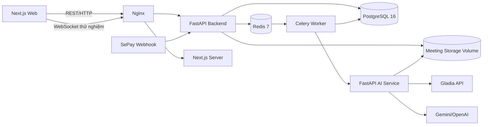

# ĐẶC TẢ YÊU CẦU PHẦN MỀM (SRS)

**Sản phẩm:** Meeting Voice Assistant  
**Phiên bản tài liệu:** 2.0  
**Ngày đối chiếu code:** 16/11/2026  
**Nguồn chuẩn:** code trong `frontend`, `backend-api`, `ai-service`, `docker-compose*.yml`

## 1. Mục đích và phạm vi

Tài liệu này mô tả đúng phạm vi hiện đã có trong code: quản lý tài khoản và dự án, tiếp nhận tệp ghi âm, xử lý nền bằng Gladia, tạo tóm tắt bằng Gemini/OpenAI, biên tập transcript, hỏi đáp có trích dẫn, xuất biên bản, chia sẻ bằng token và thanh toán VietQR/SePay.

Hệ thống là ứng dụng web API-first, triển khai được trên một máy AWS EC2 CPU bằng Docker Compose. GPU không phải yêu cầu vận hành vì ASR và LLM chính được gọi qua dịch vụ đám mây.

### 1.1. Trạng thái dùng trong tài liệu

| Trạng thái | Ý nghĩa |
|---|---|
| `Implemented` | Có code và có interface sử dụng được |
| `Partial` | Có code nhưng còn giới hạn được nêu rõ |
| `Experimental` | Chỉ dùng thử, không thuộc tiêu chí nghiệm thu production |
| `Planned` | Chưa có code, không được coi là chức năng hiện tại |

### 1.2. Ngoài phạm vi phiên bản hiện tại

- Phiên âm streaming thực bằng nhà cung cấp ASR thời gian thực.
- Đồng bộ lại summary/RAG tự động sau khi sửa transcript.
- Lưu vector embedding bền vững bằng pgvector; retriever hiện tính embedding trên tập segment được gửi vào request.
- Thu hồi link chia sẻ, mật khẩu link, thời hạn link và nhật ký truy cập.
- Refresh token tự động phía trình duyệt.
- Alembic migration versioned; startup hiện dùng SQLAlchemy `create_all`.
- Object storage S3; bản hiện tại dùng Docker named volume trên một máy.
- HTTPS tự cấp phát; cần domain/chứng chỉ hoặc reverse proxy TLS bên ngoài.

## 2. Tác nhân và hệ thống ngoài

| Tác nhân | Vai trò |
|---|---|
| Người dùng | Đăng ký, quản lý dự án/cuộc họp, biên tập và khai thác kết quả |
| Owner dự án | Quản lý dự án và thành viên |
| Editor dự án | Xem/sửa tài nguyên dự án theo các interface đã hỗ trợ |
| Viewer dự án | Xem tài nguyên dự án |
| Khách có share token | Xem cuộc họp theo token hợp lệ |
| Gladia API v2 | ASR tiếng Việt, diarization và timestamp |
| Gemini hoặc OpenAI | Sinh tóm tắt và câu trả lời RAG |
| SePay | Gửi webhook giao dịch ngân hàng |
| VietQR | Hiển thị QR chuyển khoản |

## 3. Bối cảnh hệ thống

## 4. Yêu cầu chức năng

### 4.1. Xác thực và hồ sơ

| ID | Yêu cầu | Interface | Trạng thái |
|---|---|---|---|
| FR-AUTH-01 | Đăng ký bằng email, họ tên và mật khẩu | `POST /api/v1/auth/register` | Implemented |
| FR-AUTH-02 | Đăng nhập và nhận access/refresh JWT | `POST /api/v1/auth/login` | Implemented |
| FR-AUTH-03 | Đổi refresh token lấy cặp token mới | `POST /api/v1/auth/refresh` | Implemented |
| FR-AUTH-04 | Lấy tài khoản hiện tại | `GET /api/v1/auth/me` | Implemented |
| FR-USER-01 | Cập nhật họ tên/avatar | `PATCH /api/v1/users/me` | Implemented |
| FR-USER-02 | Đổi mật khẩu sau khi xác thực mật khẩu cũ | `POST /api/v1/users/me/password` | Implemented |
| FR-AUTH-05 | Tự refresh access token trong frontend | — | Planned |

Mật khẩu được hash bằng Passlib/bcrypt. Frontend đang lưu token trong `localStorage`; đây là giới hạn bảo mật đã biết, chưa dùng cookie HttpOnly.

### 4.2. Dự án và thành viên

| ID | Yêu cầu | Interface | Trạng thái |
|---|---|---|---|
| FR-PROJ-01 | Tạo, liệt kê, xem, sửa và xóa dự án | `/api/v1/projects` | Implemented |
| FR-PROJ-02 | Mời người dùng đã đăng ký bằng email | `POST /api/v1/projects/{id}/members` | Implemented |
| FR-PROJ-03 | Đổi vai trò hoặc xóa thành viên | `PATCH/DELETE /api/v1/projects/{id}/members/{user_id}` | Implemented |
| FR-PROJ-04 | Liên kết cuộc họp với dự án | `POST /api/v1/projects/{id}/meetings/{meeting_id}` | Implemented |
| FR-PROJ-05 | Lọc dashboard theo các cuộc họp thuộc dự án | `GET /api/v1/projects/{id}` | Implemented |

Vai trò dự án gồm `owner`, `editor`, `viewer`. Owner được tạo thành membership đầu tiên khi tạo dự án.

### 4.3. Cuộc họp và tiếp nhận âm thanh

| ID | Yêu cầu | Interface | Trạng thái |
|---|---|---|---|
| FR-MTG-01 | Tạo, liệt kê, tìm theo tiêu đề, lọc trạng thái | `/api/v1/meetings` | Implemented |
| FR-MTG-02 | Sửa tiêu đề/trạng thái và soft-delete | `/api/v1/meetings/{id}` | Implemented |
| FR-AUD-01 | Nhận `.wav`, `.mp3`, `.m4a`, `.aac`, `.flac`, `.ogg`, `.webm`, `.mp4` | `POST /api/v1/audio/upload` | Implemented |
| FR-AUD-02 | Gắn file vào cuộc họp đã tạo | `POST /api/v1/audio/meetings/{id}/upload` | Implemented |
| FR-AUD-03 | Lưu file vào volume và đẩy Celery task | Redis/Celery | Implemented |
| FR-AUD-04 | Phát audio và hỗ trợ tua bằng HTTP Range | `GET /api/v1/audio/{id}/stream` | Implemented |
| FR-AUD-05 | Giới hạn kích thước upload 500 MB ở Nginx | `client_max_body_size` | Implemented |

Khi upload thành công, trạng thái cuộc họp được đặt thành `processing` trước khi dispatch task để frontend có thể polling đúng.

### 4.4. ASR, diarization và xử lý nền

| ID | Yêu cầu | Interface | Trạng thái |
|---|---|---|---|
| FR-AI-01 | Worker gửi đường dẫn audio chung sang AI Service | `POST /audio/process` | Implemented |
| FR-AI-02 | AI Service upload file lên Gladia và polling kết quả | Gladia v2 | Implemented |
| FR-AI-03 | Chuẩn hóa utterance thành speaker, start/end, text | `GladiaAudioPipeline` | Implemented |
| FR-AI-04 | Ghi segment và duration vào PostgreSQL | Celery worker | Implemented |
| FR-AI-05 | Ghi nhận usage theo thời lượng cho tài khoản sở hữu | `meeting_quota_usage` | Implemented |
| FR-AI-06 | Báo lỗi thực thay vì dữ liệu demo khi provider lỗi | — | Planned |

Nếu thiếu `GLADIA_API_KEY`, AI Service cố ý trả transcript demo. Chế độ này chỉ dành cho phát triển; kiểm thử E2E thật bắt buộc phải điền key và xác minh transcript khớp file đầu vào.

### 4.5. Ghi âm trong trình duyệt

| ID | Yêu cầu | Interface | Trạng thái |
|---|---|---|---|
| FR-REC-01 | Thu microphone bằng `MediaRecorder`, tạm dừng/tiếp tục | `/live` | Implemented |
| FR-REC-02 | Khi dừng, upload file WebM để xử lý batch | Audio upload | Implemented |
| FR-REC-03 | Hiển thị transcript thật trong lúc đang nói | — | Planned |
| FR-REC-X01 | Nhận chunk qua WebSocket và sinh segment mô phỏng | `WS /api/v1/live/ws` | Experimental |

Trang `/live` hiện không kết nối WebSocket. Từ “trực tiếp” trong UI nghĩa là thu microphone trực tiếp, sau đó xử lý batch khi người dùng bấm dừng.

### 4.6. Transcript Studio

| ID | Yêu cầu | Interface | Trạng thái |
|---|---|---|---|
| FR-TR-01 | Đọc segment theo thứ tự thời gian | `GET /api/v1/transcripts/{meeting_id}` | Implemented |
| FR-TR-02 | Sửa nội dung hoặc nhãn người nói | `PATCH /api/v1/transcripts/segments/{segment_id}` | Implemented |
| FR-TR-03 | Đổi tên một speaker trên toàn cuộc họp | `POST /api/v1/transcripts/{meeting_id}/rename-speaker` | Implemented |
| FR-TR-04 | Xóa một hoặc nhiều segment | `POST /api/v1/transcripts/{meeting_id}/delete-segments` | Implemented |
| FR-TR-05 | Đồng bộ timeline/audio và nhảy tới citation | Frontend | Implemented |
| FR-TR-06 | Đồng bộ summary/index sau chỉnh sửa | — | Planned |

### 4.7. Tóm tắt và action item

| ID | Yêu cầu | Interface | Trạng thái |
|---|---|---|---|
| FR-SUM-01 | Worker gọi AI Service sau ASR | `POST /rag/summarize` | Implemented |
| FR-SUM-02 | Lưu executive summary, key points, action items | PostgreSQL | Implemented |
| FR-SUM-03 | Đọc summary/action items | `GET /api/v1/summaries/{meeting_id}` | Implemented |
| FR-SUM-04 | Cập nhật mô tả, người phụ trách, trạng thái action item | `PATCH /api/v1/summaries/action-items/{id}` | Implemented |
| FR-SUM-05 | Nút regenerate summary | — | Planned |

Nếu thiếu LLM key hoặc provider lỗi, generator trả nội dung fallback. Nội dung fallback không được dùng để đánh giá chất lượng AI.

### 4.8. Hỏi đáp RAG có trích dẫn

| ID | Yêu cầu | Interface | Trạng thái |
|---|---|---|---|
| FR-RAG-01 | Lưu lịch sử chat theo cuộc họp | `GET /api/v1/chat/{meeting_id}/messages` | Implemented |
| FR-RAG-02 | Truy hồi kết hợp lexical và multilingual E5 | `POST /rag/query` | Implemented |
| FR-RAG-03 | Trả lời kèm segment, speaker, start/end và quote | `POST /api/v1/chat/{meeting_id}` | Implemented |
| FR-RAG-04 | Nhấn citation để tua audio | Frontend | Implemented |
| FR-RAG-05 | Vector index bền vững trong pgvector | — | Planned |

### 4.9. Xuất biên bản

| ID | Yêu cầu | Interface | Trạng thái |
|---|---|---|---|
| FR-EXP-01 | Xuất TXT, SRT, VTT, JSON và DOCX | `GET /api/v1/exports/{meeting_id}/{format}` | Implemented |
| FR-EXP-02 | Interface tương thích query `type` | `GET /api/v1/meetings/{id}/export?type=` | Implemented |

### 4.10. Chia sẻ

| ID | Yêu cầu | Interface | Trạng thái |
|---|---|---|---|
| FR-SHARE-01 | Owner tạo token viewer/editor | `POST /api/v1/meetings/{id}/share` | Implemented |
| FR-SHARE-02 | Đọc metadata cuộc họp bằng query `share` | `GET /api/v1/meetings/{id}?share=` | Implemented |
| FR-SHARE-03 | Áp quyền token thống nhất cho transcript/chat/audio/export | — | Partial |
| FR-SHARE-04 | Thu hồi/hết hạn link | — | Planned |

Không được mô tả share token hiện tại như một cơ chế RBAC production hoàn chỉnh. Một số interface tài nguyên con chưa kiểm tra token theo cùng một seam.

### 4.11. Gói cước, quota và thanh toán

| ID | Yêu cầu | Interface | Trạng thái |
|---|---|---|---|
| FR-PLAN-01 | Seed và liệt kê Free/Pro/Business | `GET /api/v1/plans` | Implemented |
| FR-PLAN-02 | Xem subscription và usage | `GET /api/v1/plans/my-subscription` | Implemented |
| FR-PLAN-03 | Tạo đơn và URL VietQR | `POST /api/v1/payments/checkout` | Implemented |
| FR-PLAN-04 | Poll trạng thái đơn | `GET /api/v1/payments/orders/{order_code}` | Implemented |
| FR-PLAN-05 | Nhận webhook SePay, idempotent theo giao dịch | `POST /api/v1/payments/sepay/webhook` | Implemented |
| FR-PLAN-06 | Chặn upload trước khi vượt quota | — | Partial |

Usage được ghi nhận sau xử lý, nhưng việc từ chối một upload mới khi quota đã hết chưa được nối vào interface upload.

## 5. Yêu cầu phi chức năng

### 5.1. Bảo mật

- NFR-SEC-01: Secret production không được commit; `SECRET_KEY`, mật khẩu PostgreSQL và webhook key phải đến từ `.env` trên máy chủ.
- NFR-SEC-02: Nginx chỉ công khai cổng ứng dụng; PostgreSQL, Redis, backend và AI Service không public trong production Compose.
- NFR-SEC-03: Webhook SePay phải kiểm tra `Authorization`/API key khi cấu hình.
- NFR-SEC-04: Microphone trên domain ngoài `localhost` bắt buộc HTTPS do yêu cầu secure context của trình duyệt.
- NFR-SEC-05: Trước production công khai phải hoàn thiện FR-SHARE-03 và chuyển token trình duyệt sang cookie HttpOnly.

### 5.2. Tin cậy và vận hành

- NFR-REL-01: PostgreSQL, Redis, Backend, AI Service, Frontend và Nginx có healthcheck trong production Compose.
- NFR-REL-02: Container restart tự động; dữ liệu PostgreSQL, Redis và audio nằm trên named volume.
- NFR-REL-03: Backend production dừng startup khi khởi tạo database thất bại.
- NFR-REL-04: Worker chỉ khởi động sau Backend và AI Service healthy.
- NFR-REL-05: Cần backup PostgreSQL và `meeting_storage`; chưa có job backup tự động trong repo.

### 5.3. Hiệu năng

- Upload tối đa 500 MB qua Nginx.
- Worker concurrency mặc định là 2; trên EC2 ít RAM có thể giảm còn 1.
- AI Service chạy một Uvicorn worker để tránh nhân đôi bộ nhớ embedding model.
- Không cam kết latency cố định cho Gladia/Gemini vì phụ thuộc mạng và quota provider.

### 5.4. Khả dụng và tương thích

- Frontend: Next.js 14, React 18, trình duyệt hiện đại.
- Backend/AI: Python 3.12, FastAPI, PostgreSQL 16 + pgvector, Redis 7.
- Triển khai tham chiếu: Ubuntu 22.04/24.04 EC2, Docker Engine và Compose v2.

## 6. Mô hình dữ liệu mức khái niệm

| Nhóm | Bảng |
|---|---|
| Người dùng/dự án | `users`, `projects`, `project_members`, `project_meetings` |
| Cuộc họp | `meetings`, `audio_files`, `transcript_segments` |
| AI | `summaries`, `action_items`, `chat_sessions`, `chat_messages` |
| Thương mại | `plan_configs`, `subscriptions`, `meeting_quota_usage_events`, `payment_orders`, `sepay_webhook_events` |

Schema chi tiết nằm tại [database-erd.md](../04-design/database-erd.md).

## 7. Tiêu chí nghiệm thu E2E

Một lần nghiệm thu full E2E chỉ đạt khi:

1. Đăng ký và đăng nhập thành công bằng account mới.
2. Tạo dự án, upload một audio thật và liên kết được với dự án.
3. Celery xử lý task; transcript hiển thị nội dung khớp audio, không phải chuỗi fallback demo.
4. Summary và action item sinh từ nội dung audio thật.
5. Sửa segment, đổi speaker, xóa segment và tải lại trang vẫn giữ dữ liệu.
6. Chat trả lời có citation hợp lệ; nhấn citation tua được audio.
7. Xuất ít nhất DOCX, JSON và SRT mở được.
8. Tạo link viewer và mở trên cửa sổ ẩn danh.
9. Tạo VietQR; gửi webhook SePay sandbox/thật và subscription được nâng cấp.
10. `docker compose ps` báo các container production healthy và dữ liệu còn sau restart.

Nếu dùng `AUDIO_PIPELINE_ENGINE=mock` hoặc thiếu provider key, chỉ được tính là smoke test hạ tầng, không phải full E2E AI.

## 8. Truy vết

- Use case: [use-cases.md](use-cases.md)
- Ma trận yêu cầu–code–test: [traceability-matrix.md](traceability-matrix.md)
- Kiến trúc: [system-architecture.md](../03-architecture/system-architecture.md)
- Runbook triển khai: [huong-dan-trien-khai-ec2-va-chay-end-to-end.md](../deployment/huong-dan-trien-khai-ec2-va-chay-end-to-end.md)
