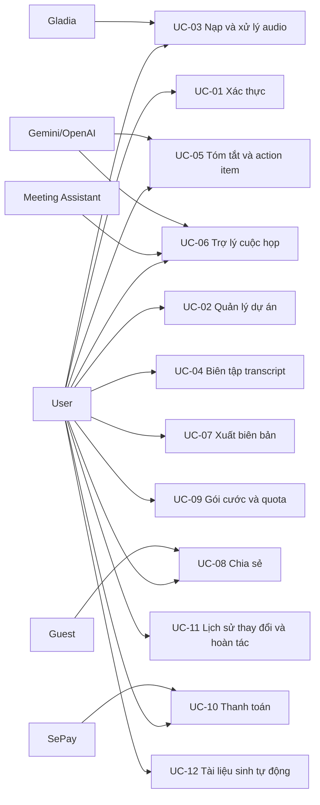

# ĐẶC TẢ USE CASE HIỆN HÀNH

**Phiên bản:** 3.0 — đối chiếu code ngày 17/11/2026 (sau các Phase 1–5 của `07-improvement-plan`)

## 1. Tác nhân và phạm vi

| Tác nhân | Mô tả |
|---|---|
| User | Người dùng đã đăng ký |
| Project Owner | User sở hữu dự án |
| Project Editor | Thành viên có quyền chỉnh sửa dự án |
| Project Viewer | Thành viên chỉ xem |
| Guest | Người có share token, không có tài khoản |
| Meeting Assistant | Agent trong ai-service, luôn hành động **thay mặt** một User đã đăng nhập |
| Gladia | Hệ thống ASR/diarization ngoài |
| Gemini/OpenAI | Hệ thống LLM ngoài |
| SePay | Hệ thống gửi webhook giao dịch |

## 2. Use case chính

### UC-01 — Đăng ký, đăng nhập và duy trì phiên

- **Tác nhân:** User.
- **Tiền điều kiện:** Email chưa tồn tại đối với đăng ký; tài khoản active đối với đăng nhập.
- **Luồng chính:**
  1. User nhập email, họ tên và mật khẩu.
  2. Backend validate dữ liệu, hash mật khẩu (bcrypt), tạo user và gói Free mặc định.
  3. Backend trả access token, refresh token và hồ sơ.
  4. Frontend lưu token và gọi `/auth/me`; khi gặp `401` frontend tự gọi refresh (single-flight) rồi thử lại một lần.
- **Ngoại lệ:** email trùng; sai mật khẩu; token sai/hết hạn; refresh token đã dùng (bị thu hồi cả chuỗi).
- **Hậu điều kiện:** user có phiên JWT hợp lệ. Đổi mật khẩu làm mọi token cũ mất hiệu lực.
- **Giới hạn:** token vẫn nằm trong `localStorage`.

### UC-02 — Quản lý dự án và thành viên

- **Tác nhân:** Project Owner, Editor, Viewer.
- **Tiền điều kiện:** đã đăng nhập.
- **Luồng chính:**
  1. User tạo project; hệ thống tạo membership `owner`.
  2. Owner/Editor mời một user đã đăng ký bằng email.
  3. Owner đổi vai trò hoặc xóa thành viên.
  4. User liên kết meeting vào project; user chọn project để xem các meeting đã liên kết.
- **Ngoại lệ:** email chưa đăng ký; thành viên đã tồn tại; role không đủ; owner tự rời dự án; **user không có quyền EDIT trên meeting được liên kết**.
- **Hậu điều kiện:** membership và project-meeting link được lưu trong PostgreSQL.

### UC-03 — Tải lên và xử lý tệp ghi âm

- **Tác nhân chính:** User (bắt buộc đăng nhập).
- **Tác nhân phụ:** Celery, Gladia, Gemini/OpenAI.
- **Tiền điều kiện:** file thuộc định dạng cho phép, không vượt `MAX_UPLOAD_MB`; còn quota thời lượng; Redis, Worker, AI Service hoạt động.
- **Luồng chính:**
  1. User chọn file (tạo meeting mới hoặc đính vào meeting mình có quyền EDIT).
  2. Backend kiểm tra extension và magic bytes, kiểm tra quota (402 nếu hết), lưu file theo `storage_key` sinh từ ID, đặt meeting `uploaded`, ghi `processing_job` và `outbox_event` trong **cùng transaction**.
  3. Relay đọc outbox mỗi 2 giây và gửi task `run_processing_job` lên Redis.
  4. Bước `transcribe`: `ffprobe` đo thời lượng và kiểm tra giới hạn gói; gửi file cho AI Service (`POST /audio/transcribe` trả `provider_job_id` ngay); worker poll `GET /audio/transcribe/{id}` bằng Celery retry/countdown; khi xong thay toàn bộ segments, tăng `transcript_revision`.
  5. Sự kiện `TranscriptReplaced` tạo hai job độc lập `summarize` và `index` (embedding + pgvector). Meeting thành `ready` khi cả hai kết thúc; quota được tính một lần theo thời lượng đã đo.
  6. Frontend polling đến khi `ready` hoặc `failed`.
- **Ngoại lệ:** file không hỗ trợ/giả extension/quá lớn (400/413); hết quota (402); thiếu key provider; Gladia lỗi hoặc quá `transcription_max_wait_seconds`; audio dài hơn giới hạn gói.
- **Luồng lỗi:** meeting chuyển `failed` với `failure_stage` và `failure_reason`, **không** có transcript/summary giả và **không** tính quota. UI hiển thị lý do và nút "Thử lại" (`POST /meetings/{id}/reprocess`). Lỗi tạm thời (transport, 5xx) được retry tối đa 3 lần với backoff luỹ thừa.
- **Hậu điều kiện:** meeting có audio, transcript, summary, chỉ mục tìm kiếm. Chạy lại cùng một job là idempotent.
- **Lưu ý nghiệm thu:** engine `mock` chỉ có ở `ENVIRONMENT=development`; meeting xử lý bằng mock có `is_demo=true` và UI gắn nhãn "Dữ liệu mẫu".

### UC-04 — Biên tập Transcript Studio

- **Tác nhân:** User có quyền EDIT (creator, Owner/Editor của project liên kết, hoặc Guest có share token `editor`).
- **Tiền điều kiện:** meeting có transcript.
- **Luồng chính:**
  1. Frontend đọc `GET /meetings/{id}/transcript` (kèm `version` của từng segment và `transcript_revision` của meeting).
  2. User sửa text, đổi speaker trên toàn meeting hoặc xóa segment; mỗi thao tác đi qua `TranscriptEditor` và tạo một **change set**.
  3. Với thay đổi nhiều bước, client gọi `POST /meetings/{id}/transcript/operations:preview` để xem diff, rồi `POST .../operations` (có thể kèm `expected_revision`). Các thao tác: `update_text`, `replace_text`, `rename_speaker`, `reassign_speaker`, `delete_segments`, `split_segment`, `merge_segments`.
  4. User phát/tua audio; segment tương ứng được đồng bộ theo timestamp.
- **Ngoại lệ:** segment không tồn tại (404/422); thao tác không làm thay đổi gì (`NO_CHANGES`); revision cũ (409 `TRANSCRIPT_REVISION_CONFLICT`); viewer gọi thao tác ghi (403).
- **Hậu điều kiện:** transcript lưu bền vững, lịch sử ghi lại trước/sau; summary và chỉ mục chuyển `stale` và chỉ mục tự được dựng lại (debounce vài giây).

### UC-05 — Xem tóm tắt, quản lý action item và tạo lại tóm tắt

- **Tác nhân:** User.
- **Tiền điều kiện:** UC-03 hoàn thành.
- **Luồng chính:**
  1. Frontend đọc `GET /meetings/{id}/summary` và `/action-items`.
  2. User xem executive summary, key points; cập nhật mô tả, assignee, trạng thái action item.
  3. Khi transcript đã sửa, `summary_status = stale` và UI hiển thị banner "Tóm tắt đã cũ". User bấm "Tạo lại" → `POST /meetings/{id}/summary:regenerate`; tóm tắt không bao giờ tự sinh lại.
- **Ngoại lệ:** meeting chưa `ready` (409); LLM key thiếu hoặc LLM lỗi → `summary_status = failed` (transcript vẫn dùng được).
- **Hậu điều kiện:** summary được upsert; action item do AI sinh (`source=ai`) được thay thế, action item do người dùng tạo hoặc sửa (`source=user`) được giữ nguyên.

### UC-06 — Trợ lý cuộc họp (Meeting Assistant)

- **Tác nhân:** User (chính), Meeting Assistant (thay mặt User), Guest (chỉ hỏi đáp).
- **Tiền điều kiện:** meeting có transcript và chỉ mục (hỏi đáp); gói có `agent_tools` (Pro/Business) để dùng công cụ ghi và tài liệu.
- **Ba nhóm ý định:**
  - **(a) Hỏi đáp có trích dẫn** — luôn khả dụng. Gói Free và Guest dùng đường hỏi đáp thuần (truy hồi hybrid trong backend, ai-service chỉ nhận top-k đoạn), giới hạn `rag_questions` mỗi tháng với gói Free.
  - **(b) Chỉnh sửa theo luồng đề xuất → duyệt → áp dụng** — sửa transcript, action item, tạo lại tóm tắt.
  - **(c) Sinh tài liệu** — biên bản DOCX, email, phụ đề SRT, tài liệu Markdown; lưu thành artifact (UC-12).
- **Luồng chính:**
  1. User gửi tin nhắn qua `POST /meetings/{id}/assistant/turns`; backend lưu tin nhắn, cấp **token ủy quyền** (5 phút, phạm vi đúng một meeting) và gọi `POST /agent/turn` của ai-service.
  2. Agent dùng công cụ đọc (`get_meeting_overview`, `search_transcript`, `read_segments`, `find_text`, `get_summary`). Mỗi công cụ là một HTTP call tới `/internal/agent/v1` được thực thi **với quyền của User**.
  3. Với yêu cầu sửa, agent tra cứu để lấy `segment_id` thật rồi tạo **đề xuất** (`propose_*`). Backend kiểm tra, tính xem trước diff và lưu `agent_actions` ở trạng thái `proposed`; **chưa có gì bị thay đổi**.
  4. Câu trả lời, hoạt động công cụ và thẻ đề xuất được stream về UI qua SSE (`token`, `tool_start`, `tool_end`, `proposal`, `citation`, `done`, `error`).
  5. User duyệt, sửa trước khi duyệt, hoặc từ chối. Duyệt chạy đúng lệnh `TranscriptEditor.apply` như UI (`actor_type=agent`) với `base_revision` của đề xuất.
- **Ngoại lệ:** đề xuất quá 30 phút (`PROPOSAL_EXPIRED`) hoặc transcript đã đổi (`PROPOSAL_STALE`, 409) → yêu cầu trợ lý làm lại; viewer không tạo được đề xuất (403); gói Free gọi công cụ ghi/tài liệu (402); vượt giới hạn câu hỏi (402); chỉ mục chưa sẵn sàng (409, hỏi đáp thuần); AI Service lỗi (SSE `error`, tin nhắn trợ lý `status=error`).
- **Hậu điều kiện:** hội thoại riêng theo (meeting, user). Mọi thay đổi do trợ lý có thể xem và hoàn tác ở UC-11. Với Guest, trợ lý không bao giờ dùng công cụ ghi.

### UC-07 — Xuất biên bản đa định dạng

- **Tác nhân:** User hoặc Guest có quyền xem.
- **Tiền điều kiện:** meeting tồn tại và người gọi có quyền VIEW.
- **Luồng chính:** User chọn TXT, SRT, VTT, JSON hoặc DOCX; backend dựng `MeetingDocument` một lần, chọn renderer từ registry và trả attachment.
- **Ngoại lệ:** định dạng không hỗ trợ (422); định dạng không nằm trong gói của **chủ meeting** (402 `PLAN_FEATURE_REQUIRED`).
- **Hậu điều kiện:** trình duyệt tải file về máy.

### UC-08 — Chia sẻ cuộc họp bằng token

- **Tác nhân:** Meeting creator, Guest.
- **Tiền điều kiện:** creator đã đăng nhập.
- **Luồng chính:**
  1. Creator gọi `POST /meetings/{id}/share?permission=viewer|editor`.
  2. Backend sinh/reuse token và trả đường dẫn.
  3. Guest mở `/meetings/{id}?share={token}`.
  4. Frontend gắn `share` vào **mọi** request thuộc meeting (transcript, summary, chat, export, audio).
- **Ngoại lệ:** token sai; user không phải creator; viewer token dùng cho thao tác EDIT.
- **Hậu điều kiện:** Guest xem (hoặc sửa nếu token `editor`) theo `MeetingAccessPolicy`; token không bao giờ cho quyền MANAGE hoặc dùng công cụ ghi của trợ lý.

### UC-09 — Xem gói cước và quota

- **Tác nhân:** User.
- **Tiền điều kiện:** đã đăng nhập.
- **Luồng chính:** frontend đọc danh sách plan (`free`, `pro`, `business`) và `/plans/my-subscription`; hiển thị plan, limit, used và remaining của chu kỳ hiện tại.
- **Quy tắc:** gói Free lăn theo chu kỳ 30 ngày tính từ lúc đăng ký (đặt lại hạn mức lười, khi truy cập); gói trả phí hết hạn thì về Free.
- **Ngoại lệ:** upload khi remaining bằng 0 trả 402 trước khi lưu file.
- **Hậu điều kiện:** quota chỉ bị trừ khi xử lý thành công, theo thời lượng đo bằng `ffprobe`, mỗi file audio tối đa một lần.

### UC-10 — Thanh toán VietQR và kích hoạt gói

- **Tác nhân:** User, SePay.
- **Tiền điều kiện:** thông tin ngân hàng và webhook key đã cấu hình.
- **Luồng chính:**
  1. User chọn plan trả phí.
  2. Backend tạo payment order (mã `MVA` + 10 ký tự hex, hết hạn sau 30 phút), nội dung chuyển khoản và VietQR URL.
  3. Frontend polling order status (chỉ chủ đơn xem được).
  4. User chuyển khoản đúng số tiền/nội dung.
  5. SePay gửi webhook; backend xác thực API key (thiếu/sai → 401), ghi event theo transaction ID (cổng idempotency), khóa order `FOR UPDATE`, kiểm tra hết hạn và số tiền.
  6. Backend hoàn tất order, chèn dòng subscription mới (gói cũ chuyển `replaced`); frontend nhận `completed`.
- **Ngoại lệ:** webhook sai/thiếu key; thiếu transaction ID (400); thiếu order code; thiếu tiền (`partial_amount`); order hết hạn (`expired_order`); webhook trùng (`duplicate`).
- **Hậu điều kiện:** plan mới có hiệu lực từ thời điểm thanh toán; lịch sử subscription được giữ.

### UC-11 — Xem lịch sử thay đổi và hoàn tác

- **Tác nhân:** User có quyền xem (xem lịch sử) hoặc EDIT (hoàn tác).
- **Tiền điều kiện:** transcript đã có ít nhất một thay đổi.
- **Luồng chính:**
  1. User mở ngăn "Lịch sử thay đổi" → `GET /meetings/{id}/transcript/change-sets`.
  2. Mỗi mục cho biết ai thay đổi (Người dùng hay Trợ lý), tóm tắt, thời điểm; mở rộng để xem diff trước/sau từng segment.
  3. User bấm "Hoàn tác" (hoặc nút trên thông báo sau khi duyệt) → `POST .../change-sets/{id}/revert`; hệ thống áp dụng phép nghịch đảo thành **change set mới**.
- **Ngoại lệ:** đã hoàn tác (409 `ALREADY_REVERTED`); có chỉnh sửa muộn hơn chạm vào cùng segment (409 `TRANSCRIPT_REVERT_CONFLICT`); viewer (403).
- **Hậu điều kiện:** văn bản trở về đúng trạng thái trước đó; lịch sử vẫn đầy đủ; summary và chỉ mục chuyển `stale`.

### UC-12 — Quản lý tài liệu sinh tự động (Artifacts)

- **Tác nhân:** User; Meeting Assistant tạo thay mặt User.
- **Tiền điều kiện:** gói Pro hoặc Business; quyền VIEW trên meeting.
- **Luồng chính:**
  1. User yêu cầu trợ lý "tạo biên bản docx" hoặc "soạn email gửi action items".
  2. Backend dựng tài liệu (DOCX chuẩn từ `MeetingDocument`, hoặc DOCX/Markdown từ nội dung Markdown), lưu dưới `artifacts/{meeting_id}/{id}.{ext}` kèm `source_revision`.
  3. Tab "Tài liệu" liệt kê; User tải xuống (`GET .../artifacts/{id}/download`).
  4. Chỉ creator của meeting (quyền MANAGE) xóa được artifact.
- **Ngoại lệ:** thiếu `content_markdown` cho `email_draft`/`custom_md` (422); nội dung quá 200.000 ký tự (422); gói Free (402).
- **Hậu điều kiện:** tài liệu là dữ liệu dẫn xuất, không làm thay đổi cuộc họp nên không cần duyệt.

## 3. Use case phụ

### UC-S01 — Ghi âm microphone rồi xử lý batch

User mở `/live`, cấp quyền microphone, ghi/tạm dừng/tiếp tục và bấm dừng. Frontend tạo file WebM rồi thực hiện UC-03. HTTPS là bắt buộc khi chạy trên domain ngoài `localhost`. Use case này không hiển thị transcript thật trong lúc ghi.

### UC-S02 — Cập nhật hồ sơ và đổi mật khẩu

User cập nhật họ tên/avatar hoặc đổi mật khẩu sau khi nhập đúng mật khẩu cũ (`POST /users/me/change-password`, trả token mới).

### UC-S03 — Tìm kiếm và lọc meeting

Backend hỗ trợ query `search` và `status`; danh sách luôn giới hạn trong meeting người dùng tạo hoặc truy cập qua project.

### UC-S04 — Phát lại theo timeline/citation

User nhấn segment hoặc citation để `SpeakerTimeline` seek audio đến mốc bắt đầu tương ứng. Audio phát qua URL ký HMAC hết hạn sau 10 phút.

### UC-S05 — Theo dõi task đang xử lý

Dashboard hiển thị meeting đang ở trạng thái xử lý; trang chi tiết polling mỗi 4 giây đến khi `ready` hoặc `failed`, và tiếp tục khi tóm tắt/chỉ mục đang dựng lại.

## 4. Ma trận quyền mục tiêu (`MeetingAccessPolicy`)

Quyền cao nhất trong các nguồn được cấp sẽ thắng. Agent luôn hành động **với quyền của chính User** và không dùng được share token.

| Chức năng | Creator | Owner/Editor project | Viewer project | Guest `viewer` | Guest `editor` | Agent (thay User) |
|---|---|---|---|---|---|---|
| Xem meeting, transcript, summary, audio, export | Có | Có | Có | Có | Có | Theo quyền của User |
| Hỏi đáp có trích dẫn | Có | Có | Có | Có (không công cụ) | Có (không công cụ) | Có |
| Sửa transcript, action item, tạo lại tóm tắt, upload thêm | Có | Có | Không | Không | Có (không upload: cần tài khoản) | Chỉ đề xuất; User duyệt mới áp dụng |
| Tạo tài liệu (artifact) | Có (gói Pro+) | Có (gói Pro+) | Có (gói Pro+) | Không | Không | Có (gói Pro+) |
| Xóa artifact, xóa meeting, tạo share link | Có | Không | Không | Không | Không | Không |
| Hoàn tác thay đổi | Có | Có | Không | Không | Có | Không (chỉ User thao tác) |
| Liên kết meeting vào project | Cần EDIT trên meeting **và** owner/editor project | | | | | Không |
| Meeting không có creator (dữ liệu cũ) | Không ai có quyền MANAGE | | | | | |

Meeting đã xóa mềm không tồn tại với bất kỳ ai (404).
