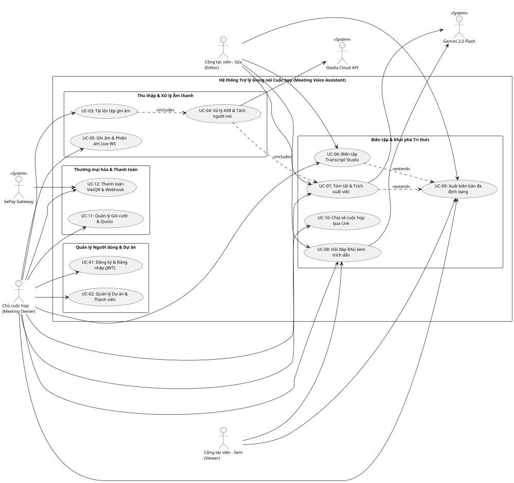

# ĐẶC TẢ CÁC USE CASE (USE CASE SPECIFICATIONS)

**Dự án:** Hệ thống Trợ lý Giọng nói, Phiên âm, Tóm tắt và Hỏi đáp Cuộc họp Thông minh (Meeting Voice Assistant)  
**Tiêu chuẩn áp dụng:** Cockburn Standard & UML 2.5 (Resource-based Access Control via Share Link & Workspace RBAC)  
**Phiên bản:** 2.1  
**Ngày cập nhật:** 2026-11-16  
**Tác giả:** Nguyễn Phương Linh (MSSV: 20224871)

---

## 1. Tổng quan hệ thống và sơ đồ Use Case (System Overview & Use Case Diagram)

### 1.1. Danh mục tác nhân (Actors)

| Tác nhân (Actor) | Phân loại | Mô tả vai trò và quyền hạn trong hệ thống |
|---|---|---|
| **Người dùng vãng lai (Guest User)** | Primary Actor | Người dùng chưa đăng nhập, chỉ có thể xem trang giới thiệu, đăng ký tài khoản mới, hoặc truy cập cuộc họp được chia sẻ ở chế độ chỉ xem qua Share Link. |
| **Chủ cuộc họp (Meeting Owner)** | Primary Actor | Người trực tiếp tạo cuộc họp (thu âm trực tiếp hoặc tải tệp âm thanh lên). Có toàn quyền quản lý, chỉnh sửa câu chữ, đổi tên người nói, yêu cầu tóm tắt lại, xóa cuộc họp, sinh mã VietQR nâng cấp gói cước, và quản lý liên kết chia sẻ (Shareable Link). |
| **Cộng tác viên - Người sửa (Editor)** | Primary Actor | Người nhận liên kết chia sẻ hoặc thành viên dự án với quyền Chỉnh sửa (Edit): nghe đối soát audio, chỉnh sửa văn bản gỡ băng, đổi tên speaker, cập nhật Action Items và xuất biên bản. |
| **Cộng tác viên - Người xem (Viewer)** | Primary Actor | Người nhận liên kết chia sẻ hoặc thành viên dự án với quyền Xem (View): nghe phát lại âm thanh, đọc biên bản và tóm tắt, tra cứu hỏi đáp nội dung qua Trợ lý RAG (chế độ chỉ đọc). |
| **Chủ dự án (Project Owner)** | Primary Actor | Người khởi tạo Không gian làm việc / Dự án, mời thành viên, phân quyền vai trò (Owner, Editor, Viewer) và quản lý toàn bộ các cuộc họp thuộc dự án. |
| **Hệ thống AI Âm thanh (Gladia API)** | Supporting Actor (System) | Dịch vụ đám mây chuyên sâu đảm nhiệm nhận dạng tiếng Việt (ASR) và phân tách người nói (Speaker Diarization). |
| **Mô hình Ngôn ngữ Lớn (Gemini / OpenAI)** | Supporting Actor (System) | Mô hình ngôn ngữ tiếp nhận toàn văn biên bản để sinh tóm tắt điều hành, trích xuất việc cần làm và sinh câu trả lời RAG có trích dẫn. |
| **Cổng thanh toán SePay (SePay Gateway)** | Supporting Actor (System) | Dịch vụ thanh toán trung gian nhận diện biến động số dư ngân hàng và gửi tín hiệu Webhook tức thì để kích hoạt gói cước. |
| **Bộ lập lịch ngầm (Celery & Redis Worker)** | Supporting Actor (System) | Hàng đợi và tiến trình chạy nền điều phối chuỗi xử lý tải tệp âm thanh, gọi Gladia API, tóm tắt Gemini và lưu trữ CSDL. |

---

### 1.2. Sơ đồ Use Case tổng thể (System Use Case Diagram)

---

### 1.3. Ma trận phân quyền Actor - Use Case

| Mã Use Case | Tên Use Case | Chủ cuộc họp (Owner) | Người sửa (Editor) | Người xem (Viewer) | Hệ thống ngoại vi / AI |
|---|---|:---:|:---:|:---:|:---:|
| **UC-01** | Đăng ký & Đăng nhập (JWT) | Có quyền | Có quyền | Có quyền | Cấp phát JWT Tokens |
| **UC-02** | Quản lý Không gian làm việc & Dự án | Toàn quyền tạo/mời | Thành viên sửa | Thành viên xem | Cơ sở dữ liệu quan hệ |
| **UC-03** | Tải lên tệp ghi âm cuộc họp | Toàn quyền tạo | Không | Không | Lưu trữ Storage, Enqueue Celery |
| **UC-04** | Xử lý ASR & Phân tách người nói | Tự động kích hoạt | Không | Không | Thực thi Gladia API v2 & Celery |
| **UC-05** | Ghi âm & Phiên âm trực tiếp qua WebSocket | Toàn quyền tạo | Không | Không | WebSocket Streaming & VAD |
| **UC-06** | Biên tập biên bản (Transcript Studio) | Toàn quyền sửa | Có quyền sửa | Chỉ xem | Tua âm thanh HTTP Range |
| **UC-07** | Tóm tắt điều hành & Action Items | Toàn quyền | Sửa & Đổi trạng thái | Chỉ xem | Gemini 2.0 Flash / OpenAI |
| **UC-08** | Hỏi đáp RAG kèm trích dẫn âm thanh | Toàn quyền hỏi | Toàn quyền hỏi | Toàn quyền hỏi | Multilingual E5 + Gemini Flash |
| **UC-09** | Xuất biên bản cuộc họp đa định dạng | Toàn quyền xuất | Toàn quyền xuất | Toàn quyền xuất | python-docx / File Exporters |
| **UC-10** | Chia sẻ cuộc họp & Phân quyền qua Link | Toàn quyền bật/tắt | Không | Không | Cấp phát & Kiểm tra Share Token |
| **UC-11** | Quản lý gói cước & Kiểm soát Quota | Xem & Nâng cấp | Xem hạn mức | Xem hạn mức | CSDL Plan & Quota Tracking |
| **UC-12** | Thanh toán VietQR & Xử lý Webhook SePay | Tạo đơn & Quét QR | Không | Không | Cổng thanh toán SePay Webhook |

---

## 2. Đặc tả chi tiết 12 Use Cases chính (Primary Use Cases)

---

### 2.1. UC-01: Đăng ký, Đăng nhập & Xác thực người dùng (User Authentication)

#### 2.1.1. Thông tin tổng quan (Metadata)
- **Use Case ID:** UC-01
- **Tên Use Case:** Đăng ký, Đăng nhập và Xác thực người dùng
- **Tác nhân chính (Primary Actor):** Người dùng (Chủ cuộc họp, Editor, Viewer)
- **Tác nhân phụ (Supporting Actor):** Hệ thống Xác thực JWT Backend API
- **Mục tiêu:** Cung cấp định danh số an toàn, bảo vệ tài nguyên cuộc họp và thiết lập hạn mức gói cước tương ứng.

#### 2.1.2. Điều kiện (Conditions)
- **Tiền điều kiện:** Người dùng có trình duyệt kết nối Internet truy cập vào ứng dụng web.
- **Hậu điều kiện (Thành công):** Người dùng được cấp cặp token JWT (`access_token`, `refresh_token`), trạng thái đăng nhập được lưu tại Frontend context, người dùng được tự động gán gói Free nếu là tài khoản mới.

#### 2.1.3. Luồng sự kiện (Flow of Events)
##### Luồng chính (Main Success Scenario):
1. Người dùng chọn Đăng ký hoặc Đăng nhập trên thanh điều hướng.
2. Với Đăng ký: Người dùng nhập Họ tên, Email hợp lệ và Mật khẩu (tối thiểu 8 ký tự).
3. Backend kiểm tra tính duy nhất của Email, băm mật khẩu bằng bcrypt và tạo bản ghi `UserModel`.
4. Gán gói cước mặc định `Free` (hạn mức 60 phút) cho người dùng mới.
5. Với Đăng nhập: Người dùng nhập Email và Mật khẩu.
6. Backend đối soát mã băm bcrypt; nếu trùng khớp, tạo mã `access_token` (60 phút) và `refresh_token` (30 ngày).
7. Trả về thông tin hồ sơ người dùng kèm JWT tokens. Frontend lưu token an toàn và chuyển hướng về Dashboard.

##### Luồng phụ & Rẽ nhánh:
- **3a. Email đã tồn tại khi đăng ký:** Hệ thống trả về lỗi HTTP 409 Conflict "Email đã được đăng ký", nhắc người dùng chuyển sang trang Đăng nhập.
- **6a. Sai mật khẩu khi đăng nhập:** Hệ thống trả về lỗi HTTP 401 Unauthorized "Email hoặc mật khẩu không chính xác".
- **6b. Access token hết hạn:** Frontend tự động gọi endpoint `/api/v1/auth/refresh` với `refresh_token` để nhận access token mới mà không cần đăng nhập lại.

---

### 2.2. UC-02: Quản lý Không gian làm việc & Dự án nhóm (Project & Workspace Management)

#### 2.2.1. Thông tin tổng quan
- **Use Case ID:** UC-02
- **Tên Use Case:** Quản lý Không gian làm việc và Dự án nhóm
- **Tác nhân chính:** Chủ dự án (Project Owner)
- **Tác nhân phụ:** Các thành viên dự án (Editor, Viewer)
- **Mục tiêu:** Tổ chức, phân loại các cuộc họp theo phòng ban/dự án và chia sẻ quyền truy cập nội bộ trong nhóm làm việc.

#### 2.2.2. Luồng sự kiện
##### Luồng chính:
1. Người dùng đăng nhập nhấn "Tạo dự án mới" trên thanh ProjectSelector ở Dashboard.
2. Nhập Tên dự án (ví dụ: "Phát triển Tính năng AI") và Mô tả dự án.
3. Backend tạo bản ghi `ProjectModel` với `owner_id` là ID người dùng hiện tại, đồng thời thêm bản ghi `ProjectMemberModel` vai trò `owner`.
4. Chủ dự án có thể bấm "Mời thành viên", nhập Email đồng nghiệp và gán vai trò (`editor` hoặc `viewer`).
5. Khi tạo cuộc họp mới, người dùng chọn dự án tương ứng từ dropdown ProjectSelector.
6. Mọi thành viên trong dự án có thể xem danh sách cuộc họp của dự án và làm việc chung.

##### Luồng phụ:
- **4a. Mời người chưa có tài khoản:** Hệ thống ghi nhận lời mời tạm thời, người dùng được tự động thêm vào dự án ngay sau khi đăng ký tài khoản với email đó.

---

### 2.3. UC-03: Tải lên & Tiếp nhận tệp ghi âm cuộc họp (Batch Audio Upload)

#### 2.3.1. Thông tin tổng quan
- **Use Case ID:** UC-03
- **Tên Use Case:** Tải lên và tiếp nhận tệp ghi âm cuộc họp
- **Tác nhân chính:** Chủ cuộc họp (Meeting Owner)
- **Tác nhân phụ:** Bộ nhớ lưu trữ `StorageService`, Celery Task Worker, Redis Queue
- **Mục tiêu:** Tiếp nhận tệp âm thanh có sẵn từ các nền tảng (Zoom, Google Meet, MS Teams, ghi âm điện thoại), kiểm tra tính hợp lệ và đẩy vào hàng đợi xử lý ngầm.

#### 2.3.2. Luồng sự kiện
##### Luồng chính:
1. Người dùng bấm "Tải lên bản ghi" trên Dashboard.
2. Chọn hoặc kéo thả tệp âm thanh/video (hỗ trợ WAV, MP3, M4A, MP4, FLAC, AAC, OGG, WEBM; kích thước tối đa 500 MB).
3. Nhập tiêu đề cuộc họp (nếu để trống, hệ thống tự lấy tên tệp làm tiêu đề).
4. Frontend gửi yêu cầu tạo cuộc họp `POST /api/v1/meetings`, nhận về `meeting_id`.
5. Frontend gửi tệp qua multipart request `POST /api/v1/audio/meetings/{meeting_id}/upload`.
6. Backend lưu tệp vào thư mục `/tmp/meeting_storage/{meeting_id}/recording.ext`, tạo bản ghi `AudioFileModel`.
7. Đổi trạng thái cuộc họp thành `processing`, gửi tác vụ `process_audio_task` vào Celery qua Redis.
8. Frontend tự động điều hướng người dùng tới trang Studio cuộc họp (`/meetings/{meeting_id}`) và hiển thị trạng thái đang xử lý kèm biểu tượng tiến trình.

##### Luồng phụ & Ngoại lệ:
- **2a. Định dạng tệp không được hỗ trợ (.exe, .pdf...):** Hệ thống từ chối tải lên và hiển thị thông báo lỗi danh sách định dạng được chấp nhận.
- **2b. Hết hạn mức thời lượng ghi âm (Quota Exceeded):** Nếu tổng thời lượng đã dùng chạm giới hạn gói cước, hệ thống ngăn tải lên và hiển thị Modal gợi ý nâng cấp gói cước Pro.
- **7a. Celery Worker tạm thời ngoại tuyến:** Backend tự động kích hoạt `asyncio.create_task` chạy coroutine `_async_process_audio` ngầm trong tiến trình để đảm bảo cuộc họp vẫn được xử lý mà không bị kẹt.

---

### 2.4. UC-04: Xử lý ASR & Phân tách người nói qua Gladia API (ASR & Speaker Diarization)

#### 2.4.1. Thông tin tổng quan
- **Use Case ID:** UC-04
- **Tên Use Case:** Xử lý ASR và phân tách người nói qua Gladia API
- **Tác nhân chính:** Bộ điều phối Celery Worker (Hệ thống ngầm)
- **Tác nhân phụ:** AI Service, Gladia API v2 Cloud
- **Mục tiêu:** Chuyển đổi toàn bộ âm thanh thành chuỗi văn bản tiếng Việt có dấu, gán chính xác từng mốc thời gian và định danh nhãn người nói (`SPEAKER_00`, `SPEAKER_01`...).

#### 2.4.2. Luồng sự kiện
##### Luồng chính:
1. Celery Worker nhận tác vụ `process_audio_task` chứa `meeting_id` và đường dẫn file âm thanh.
2. Worker gọi API nội bộ `POST /audio/process` của `ai-service`.
3. AI Service tải tệp âm thanh và gửi yêu cầu tới Gladia API v2 với tham số `language="vi"` và `diarization=true`.
4. Gladia API xử lý âm thanh trên cụm máy chủ đám mây, bóc tách giọng nói và gom cụm vector đặc trưng giọng nói (voice embeddings).
5. Gladia trả về danh sách phân đoạn thoại kèm nhãn speaker, mốc giây bắt đầu (`start`), kết thúc (`end`) và nội dung câu thoại (`text`).
6. AI Service gửi kết quả về Celery Worker.
7. Worker lưu từng phân đoạn vào bảng `transcript_segments` theo đúng thứ tự `sequence_order`.
8. Tự động chuyển tiếp toàn bộ transcript sang bước Tóm tắt và trích xuất Action Items (UC-07).

##### Luồng phụ:
- **3a. Chưa cấu hình API Key hoặc mất mạng Internet:** AI Service tự động kích hoạt chế độ `Mock Pipeline`, sinh dữ liệu hội thoại mẫu chuẩn tiếng Việt để hệ thống không bị gián đoạn và luôn hoàn thành chu trình kiểm thử.

---

### 2.5. UC-05: Ghi âm & Phiên âm trực tiếp qua WebSocket (Live Real-time ASR)

#### 2.5.1. Thông tin tổng quan
- **Use Case ID:** UC-05
- **Tên Use Case:** Ghi âm và phiên âm trực tiếp qua WebSocket
- **Tác nhân chính:** Chủ cuộc họp (Meeting Owner)
- **Tác nhân phụ:** Trình duyệt Web Audio API, WebSocket Server Backend API
- **Mục tiêu:** Thu âm trực tiếp phiên họp đang diễn ra và hiển thị bản gỡ băng theo thời gian thực (Real-time Live Streaming).

#### 2.5.2. Luồng sự kiện
##### Luồng chính:
1. Người dùng bấm "Ghi âm trực tiếp" trên thanh điều hướng (`/live`).
2. Trình duyệt yêu cầu quyền truy cập Microphone và người dùng bấm "Cho phép".
3. Người dùng bấm nút "Bắt đầu cuộc họp trực tiếp".
4. Frontend thiết lập kết nối WebSocket với Backend tại `ws://<host>/api/v1/live/ws`.
5. Frontend thu nhận luồng âm thanh PCM 16 kHz qua Web Audio API, đóng gói thành các audio chunks và gửi liên tục qua WebSocket.
6. Backend nhận audio chunk, phân tích tiếng nói và gửi trả lại các gói JSON chứa nhãn người nói và nội dung văn bản trực tiếp.
7. Giao diện hiển thị trực quan các câu thoại đang được bóc tách theo thời gian thực kèm sóng âm thanh dao động.
8. Người dùng bấm "Kết thúc cuộc họp".
9. Frontend đóng kết nối WebSocket, Backend lưu trữ bản ghi âm và bản gỡ băng hoàn chỉnh thành một cuộc họp chính thức, chuyển hướng sang giao diện Transcript Studio.

---

### 2.6. UC-06: Biên tập biên bản trong Transcript Studio (Transcript Studio Editing)

#### 2.6.1. Thông tin tổng quan
- **Use Case ID:** UC-06
- **Tên Use Case:** Biên tập biên bản trong Transcript Studio
- **Tác nhân chính:** Chủ cuộc họp (Owner), Người sửa (Editor)
- **Tác nhân phụ:** Trình duyệt Waveform Audio Player, Backend Streaming API
- **Mục tiêu:** Cho phép con người rà soát đối soát âm thanh gốc, sửa chữa câu từ sai sót và định danh tên người nói thực tế.

#### 2.6.2. Luồng sự kiện
##### Luồng chính:
1. Người dùng truy cập trang chi tiết cuộc họp (`/meetings/{id}`).
2. Hệ thống tải dữ liệu phân đoạn lời thoại và hiển thị thành danh sách theo dòng thời gian.
3. Người dùng bấm nút "Play" trên thanh phát âm thanh:
   - Backend phát luồng âm thanh qua HTTP Range partial content.
   - Khi thanh phát chạy đến giây `t`, câu thoại tương ứng tự động được làm nổi bật viền xanh (active highlight).
   - Người dùng bấm vào bất kỳ câu thoại nào, thanh phát lập tức nhảy (seek) đến đúng mốc giây bắt đầu của câu đó.
4. **Sửa câu chữ:** Người dùng nhấp đúp vào nội dung câu thoại, chỉnh sửa lỗi từ và bấm Enter/Lưu -> Gọi API `PUT /api/v1/meetings/{id}/transcripts/{segment_id}`.
5. **Đổi tên người phát biểu:** Người dùng nhấp vào nhãn người nói (ví dụ `SPEAKER_00`), nhập tên mới (ví dụ `Chị Lan - Kế toán`) và chọn "Đổi tên cho toàn bộ cuộc họp" -> Gọi API `PUT /api/v1/meetings/{id}/transcripts/speakers/rename`.
6. Toàn bộ các câu nói của người đó trong cuộc họp được cập nhật tức thì.

---

### 2.7. UC-07: Tóm tắt điều hành & Trích xuất việc cần làm (AI Summarization & Action Items)

#### 2.7.1. Thông tin tổng quan
- **Use Case ID:** UC-07
- **Tên Use Case:** Tóm tắt điều hành và trích xuất việc cần làm
- **Tác nhân chính:** Hệ thống điều phối ngầm (Celery Worker) / Người dùng yêu cầu tạo lại
- **Tác nhân phụ:** Google Gemini 2.0 Flash / OpenAI GPT-4o-mini
- **Mục tiêu:** Tự động hóa hoàn toàn khâu soạn thảo biên bản họp, cô đọng nội dung và không bỏ sót các cam kết công việc.

#### 2.7.2. Luồng sự kiện
##### Luồng chính:
1. Sau khi hoàn thành phiên âm, Worker gửi toàn văn hội thoại tới endpoint `POST /rag/summarize` của AI Service.
2. AI Service gửi prompt chuyên sâu yêu cầu Gemini 2.0 Flash trích xuất thông tin theo định dạng JSON chuẩn gồm:
   - `executive_summary`: Đoạn văn tóm tắt tổng thể mục đích, bối cảnh và kết luận phiên họp.
   - `key_points`: Danh sách 3-7 luận điểm thảo luận then chốt.
   - `action_items`: Mảng các công việc phát sinh gồm nội dung việc (`description`), người được giao phụ trách (`assignee`), trạng thái (`status=pending`).
3. Dữ liệu được lưu vào bảng `meeting_summaries` và `action_items`.
4. Người dùng mở tab "Tóm tắt" trên giao diện để đọc bản tóm tắt và quản lý danh sách việc.
5. Khi hoàn thành một công việc, người dùng bấm vào checkbox để cập nhật trạng thái thành `completed` (`PATCH /api/v1/meetings/{id}/summaries/action-items/{item_id}`).

##### Luồng phụ:
- **UC-S02 (Tái tạo tóm tắt thông minh):** Sau khi con người đã hiệu chỉnh văn bản hoặc đổi tên người nói, người dùng bấm nút "Tái tạo tóm tắt" -> Hệ thống kích hoạt Gemini đọc lại bản gỡ băng mới nhất và cập nhật đè bản tóm tắt mới.

---

### 2.8. UC-08: Hỏi đáp nội dung cuộc họp kèm trích dẫn âm thanh (RAG QA with Citations)

#### 2.8.1. Thông tin tổng quan
- **Use Case ID:** UC-08
- **Tên Use Case:** Hỏi đáp nội dung cuộc họp kèm trích dẫn âm thanh
- **Tác nhân chính:** Người dùng (Owner, Editor, Viewer)
- **Tác nhân phụ:** Bộ truy vấn lai `MeetingRetriever` (E5 Embedding + RRF), Google Gemini 2.0 Flash
- **Mục tiêu:** Cung cấp trợ lý đàm thoại thông minh giải đáp mọi thắc mắc về nội dung cuộc họp, có trích dẫn mốc thời gian minh bạch để đối chứng âm thanh gốc.

#### 2.8.2. Luồng sự kiện
##### Luồng chính:
1. Người dùng mở tab "Trợ lý hỏi đáp" (AssistantChatPane) tại trang cuộc họp.
2. Nhập câu hỏi (ví dụ: *"Ai chịu trách nhiệm phần báo cáo tài chính và thời hạn chót là khi nào?"*).
3. Backend tạo bản ghi `ChatMessageModel` (role `user`), tải toàn bộ phân đoạn thoại và lịch sử chat gần nhất.
4. Gửi yêu cầu truy vấn đến AI Service `POST /rag/query`.
5. AI Service thực hiện Hybrid Retrieval:
   - Mã hóa câu hỏi thành vector bằng mô hình `intfloat/multilingual-e5-small`.
   - Tính toán độ tương đồng Cosine kết hợp chấm điểm từ khóa và xếp hạng bằng Reciprocal Rank Fusion (RRF).
   - Chọn ra Top-5 phân đoạn ngữ cảnh khớp nhất.
6. Gửi ngữ cảnh và câu hỏi vào Gemini 2.0 Flash với prompt yêu cầu đính kèm mảng trích dẫn `citations`.
7. Trả về câu trả lời có cấu trúc kèm các trích dẫn: `segment_id`, `speaker_label`, `start_time`, `end_time`, `quote`.
8. Backend lưu câu trả lời vào CSDL (role `assistant`).
9. Giao diện Chatbot hiển thị câu trả lời dạng Markdown, các mốc trích dẫn hiển thị thành Badge màu tím (ví dụ: `[SPEAKER_01 @ 01:45 - 02:10]`).
10. Người dùng nhấp vào Badge trích dẫn, trình phát âm thanh lập tức tua đến đúng mốc 01:45 để người dùng nghe lại bằng chứng âm thanh gốc.

##### Luồng phụ:
- **4a. AI Service ngoại tuyến:** Backend tự động chuyển sang thuật toán `_fallback_search`, trích xuất các câu thoại chứa từ khóa phù hợp nhất kèm trích dẫn để phản hồi ngay cho người dùng mà không báo lỗi 500.

---

### 2.9. UC-09: Xuất biên bản cuộc họp đa định dạng (Multi-format Document Export)

#### 2.9.1. Thông tin tổng quan
- **Use Case ID:** UC-09
- **Tên Use Case:** Xuất biên bản cuộc họp đa định dạng
- **Tác nhân chính:** Người dùng (Owner, Editor, Viewer)
- **Tác nhân phụ:** Dịch vụ kết xuất `ExportService`, Thư viện `python-docx`
- **Mục tiêu:** Tải xuống biên bản cuộc họp hoàn chỉnh để lưu trữ, in ấn hoặc gửi báo cáo qua email.

#### 2.9.2. Luồng sự kiện
##### Luồng chính:
1. Người dùng bấm vào nút "Xuất biên bản" (ExportDropdown) ở góc trên giao diện cuộc họp.
2. Chọn một trong các định dạng mong muốn:
   - **Microsoft Word (.docx):** Báo cáo văn phòng chuẩn có tiêu đề, bảng tóm tắt, danh sách việc cần làm và toàn bộ kịch bản lời thoại.
   - **Markdown (.md):** Tài liệu văn bản thuần tương thích ghi chú Obsidian / Notion.
   - **Text (.txt):** Tệp văn bản đơn giản.
   - **PDF (.pdf):** Bản in tài liệu cố định định dạng.
   - **JSON (.json):** Dữ liệu có cấu trúc đầy đủ mốc giây phục vụ tích hợp hệ thống khác.
3. Backend tổng hợp dữ liệu từ các bảng `meetings`, `meeting_summaries`, `action_items`, `transcript_segments`.
4. Sinh tệp và trả về luồng tải xuống (File Attachment Download) với tên tệp chuẩn hóa (ví dụ: `Bien_ban_hop_Du_an_AI.docx`).
5. Trình duyệt tự động lưu tệp về máy tính người dùng.

---

### 2.10. UC-10: Chia sẻ cuộc họp & Phân quyền qua Link (Shareable Link & Token RBAC)

#### 2.10.1. Thông tin tổng quan
- **Use Case ID:** UC-10
- **Tên Use Case:** Chia sẻ cuộc họp và phân quyền qua Link
- **Tác nhân chính:** Chủ cuộc họp (Meeting Owner)
- **Tác nhân phụ:** Người nhận link (Editor, Viewer)
- **Mục tiêu:** Chia sẻ nhanh chóng nội dung cuộc họp cho các bên liên quan mà không cần quy trình cấp tài khoản phức tạp.

#### 2.10.2. Luồng sự kiện
##### Luồng chính:
1. Chủ cuộc họp bấm nút "Chia sẻ" trên thanh công cụ.
2. Bật công tắc "Kích hoạt liên kết chia sẻ".
3. Chọn quyền hạn cho liên kết:
   - **Quyền xem (Viewer):** Người nhận link chỉ có thể nghe âm thanh, đọc biên bản và hỏi đáp trợ lý RAG.
   - **Quyền chỉnh sửa (Editor):** Người nhận link được phép sửa câu chữ, đổi tên speaker, cập nhật việc cần làm và xuất biên bản.
4. Hệ thống sinh mã token an toàn 64 ký tự và hiển thị đường link dạng: `https://<domain>/meetings/shared/{share_token}`.
5. Chủ cuộc họp bấm "Sao chép liên kết" và gửi cho đồng nghiệp qua chat/email.
6. Người nhận mở link trên trình duyệt, hệ thống kiểm tra token và hiển thị không gian cuộc họp tương ứng với quyền hạn đã cấu hình.

##### Luồng phụ:
- **2a. Thu hồi quyền truy cập:** Chủ cuộc họp tắt công tắc chia sẻ -> Mã token bị vô hiệu hóa, bất kỳ ai truy cập qua link cũ sẽ nhận thông báo lỗi không có quyền truy cập.

---

### 2.11. UC-11: Quản lý gói cước & Kiểm soát hạn mức (Subscription & Quota Tracking)

#### 2.11.1. Thông tin tổng quan
- **Use Case ID:** UC-11
- **Tên Use Case:** Quản lý gói cước và kiểm soát hạn mức thời lượng
- **Tác nhân chính:** Người dùng
- **Tác nhân phụ:** Dịch vụ hạn mức `QuotaService`, `PlanService`
- **Mục tiêu:** Kiểm soát mức tiêu thụ tài nguyên âm thanh công bằng và thúc đẩy chuyển đổi người dùng sang gói trả phí.

#### 2.11.2. Luồng sự kiện
##### Luồng chính:
1. Người dùng quan sát thấy biểu tượng `QuotaBadge` trên thanh tiêu đề ứng dụng (ví dụ: hiển thị `Đã dùng 35 / 60 phút`).
2. Nhấp vào QuotaBadge để mở Bảng giá dịch vụ (PricingModal).
3. Giao diện hiển thị chi tiết so sánh giữa 3 gói cước:
   - **Gói Miễn Phí (Free):** 0 đ/tháng, 60 phút ghi âm, tối đa 5 cuộc họp.
   - **Gói Chuyên Nghiệp (Pro):** 99.000 đ/tháng, 600 phút (10 giờ), không giới hạn số cuộc họp, ưu tiên xử lý.
   - **Gói Vô Hạn (Unlimited):** 299.000 đ/tháng, không giới hạn thời lượng, hợp tác nhóm toàn diện.
4. Mỗi khi người dùng xử lý xong một cuộc họp, hệ thống tự động cộng dồn thời lượng vào bản ghi `MeetingQuotaUsageModel`.
5. Khi người dùng đạt tới 90% hạn mức, thanh tiến trình chuyển sang màu vàng cảnh báo.
6. Khi người dùng dùng hết 100% hạn mức, hệ thống khóa tính năng tải lên cuộc họp mới và hiển thị thông báo mời nâng cấp lên Gói Pro.

---

### 2.12. UC-12: Thanh toán nâng cấp gói cước tự động qua VietQR / SePay (Automated Payments)

#### 2.12.1. Thông tin tổng quan
- **Use Case ID:** UC-12
- **Tên Use Case:** Thanh toán nâng cấp gói cước tự động qua VietQR và SePay Webhook
- **Tác nhân chính:** Người dùng (Khách hàng nâng cấp)
- **Tác nhân phụ:** App Ngân hàng cá nhân, Cổng thanh toán SePay Webhook, Backend API
- **Mục tiêu:** Tự động hóa 100% quy trình thu tiền qua chuyển khoản ngân hàng 24/7 và kích hoạt gói cước ngay lập tức mà không cần xác nhận thủ công.

#### 2.12.2. Luồng sự kiện
##### Luồng chính:
1. Người dùng mở Bảng giá (PricingModal) và bấm nút "Nâng cấp ngay" tại Gói Pro (99.000 VNĐ).
2. Backend tạo đơn hàng `PaymentOrderModel` với mã đơn dạng `DHxxxxxx`, hạn thanh toán 30 phút.
3. Frontend hiển thị cửa sổ thanh toán (VietQRModal) chứa mã QR động VietQR Napas247 được sinh từ SePay:
   - Ngân hàng thụ hưởng: MBBank
   - Số tài khoản: 0987654321
   - Tên chủ tài khoản: NGUYEN PHUONG LINH
   - Số tiền: 99.000 VNĐ
   - Nội dung chuyển khoản: `DHxxxxxx`
4. Người dùng mở ứng dụng ngân hàng bất kỳ trên điện thoại và quét mã QR.
5. Ứng dụng ngân hàng tự động điền đúng số tài khoản, số tiền và nội dung `DHxxxxxx`. Người dùng bấm Xác nhận chuyển khoản.
6. Tiền vào tài khoản ngân hàng -> SePay nhận diện biến động số dư và gửi ngay một HTTP POST Webhook tới `https://<domain>/api/v1/payments/webhook`.
7. Backend kiểm tra `Authorization: Apikey <SEPAY_WEBHOOK_API_KEY>`, bóc tách mã đơn `DHxxxxxx`.
8. Backend đối soát số tiền nhận được >= số tiền đơn hàng:
   - Cập nhật trạng thái đơn hàng thành `completed`.
   - Tạo hoặc gia hạn bản ghi `SubscriptionModel` cho người dùng thêm 30 ngày sử dụng gói Pro.
9. Frontend đang thăm dò trạng thái đơn hàng nhận được kết quả `completed`, tự động đóng cửa sổ QR và hiển thị thông báo: *"Chúc mừng bạn đã nâng cấp thành công lên Gói Chuyên Nghiệp (Pro)!"*.
10. Toàn bộ hạn mức mới (600 phút) được nạp vào tài khoản tức thì.

##### Luồng phụ & Rẽ nhánh:
- **3a. Người dùng hủy bỏ hoặc không thanh toán:** Đơn hàng tự động hết hạn sau 30 phút (`status=expired`).
- **6a. Kẻ gian gửi Webhook giả mạo:** Header không có đúng `SEPAY_WEBHOOK_API_KEY` -> Backend từ chối ngay lập tức với mã lỗi HTTP 401 Unauthorized.
- **8a. Chuyển thiếu tiền:** Backend ghi nhận nhật ký cảnh báo và giữ đơn hàng ở trạng thái chờ kiểm tra, không tự động kích hoạt gói.

---

## 3. Đặc tả các Use Cases phụ trợ (Secondary Use Cases)

### 3.1. UC-S01: Cập nhật hồ sơ cá nhân (User Profile Update)
- **Tác nhân:** Người dùng đã đăng nhập.
- **Luồng sự kiện:** Người dùng vào trang Cài đặt cá nhân (`/settings/profile`), cập nhật Họ và tên hiển thị, dán link ảnh đại diện mới, hoặc đổi mật khẩu tài khoản. Bấm "Lưu thay đổi", hệ thống gọi API `PATCH /api/v1/users/me` và cập nhật giao diện.

### 3.2. UC-S02: Tái tạo tóm tắt thông minh (Regenerate AI Summary)
- **Tác nhân:** Chủ cuộc họp (Owner), Người sửa (Editor).
- **Luồng sự kiện:** Khi bản gỡ băng có nhiều sửa đổi lớn (đổi tên người phát biểu, sửa lỗi từ ngữ quan trọng), người dùng bấm nút "Tái tạo tóm tắt" tại tab Tóm tắt. Hệ thống gọi `POST /api/v1/meetings/{id}/regenerate-summary`, kích hoạt lại Gemini 2.0 Flash để tạo ra bản tóm tắt và danh sách việc mới nhất.

### 3.3. UC-S03: Tìm kiếm & Lọc danh mục cuộc họp (Search & Filter Meetings)
- **Tác nhân:** Người dùng trên Dashboard.
- **Luồng sự kiện:** Người dùng nhập từ khóa tìm kiếm trên thanh search box để lọc theo tiêu đề cuộc họp; chọn lọc theo trạng thái (Tất cả, Đang xử lý, Hoàn thành); hoặc chọn một dự án từ ProjectSelector để lọc các cuộc họp theo từng nhóm làm việc.
