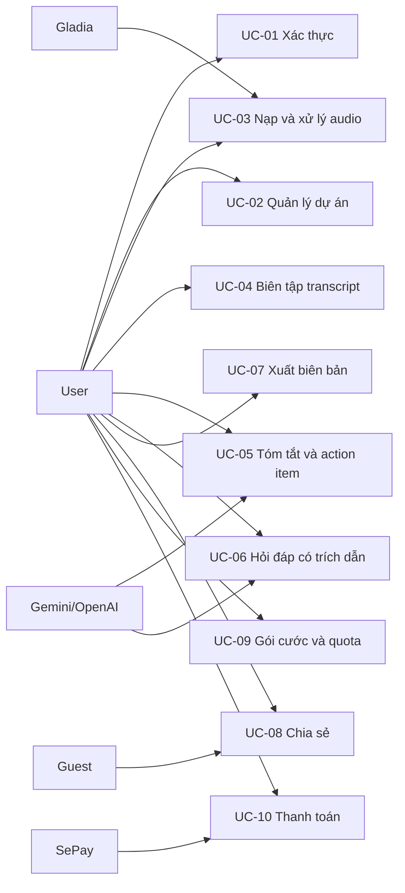

# ĐẶC TẢ USE CASE HIỆN HÀNH

**Phiên bản:** 2.0 — đối chiếu code ngày 16/11/2026

## 1. Tác nhân và phạm vi

| Tác nhân | Mô tả |
|---|---|
| User | Người dùng đã đăng ký |
| Project Owner | User sở hữu dự án |
| Project Editor | Thành viên có quyền chỉnh sửa dự án |
| Project Viewer | Thành viên chỉ xem |
| Guest | Người có share token |
| Gladia | Hệ thống ASR/diarization ngoài |
| Gemini/OpenAI | Hệ thống LLM ngoài |
| SePay | Hệ thống gửi webhook giao dịch |

## 2. Use case chính

### UC-01 — Đăng ký, đăng nhập và duy trì phiên

- **Tác nhân:** User.
- **Tiền điều kiện:** Email chưa tồn tại đối với đăng ký; tài khoản active đối với đăng nhập.
- **Luồng chính:**
  1. User nhập email, họ tên và mật khẩu.
  2. Backend validate dữ liệu, hash mật khẩu, tạo user và gói Free mặc định.
  3. Backend trả access token, refresh token và hồ sơ.
  4. Frontend lưu token và gọi `/auth/me`.
- **Ngoại lệ:** email trùng; sai mật khẩu; token sai/hết hạn.
- **Hậu điều kiện:** user có phiên JWT hợp lệ.
- **Giới hạn:** frontend chưa tự gọi refresh token và đang dùng `localStorage`.

### UC-02 — Quản lý dự án và thành viên

- **Tác nhân:** Project Owner, Editor, Viewer.
- **Tiền điều kiện:** đã đăng nhập.
- **Luồng chính:**
  1. User tạo project; hệ thống tạo membership `owner`.
  2. Owner/Editor mời một user đã đăng ký bằng email.
  3. Owner đổi vai trò hoặc xóa thành viên.
  4. User chọn project để xem các meeting đã liên kết.
- **Ngoại lệ:** email chưa đăng ký; thành viên đã tồn tại; role không đủ; owner tự rời dự án.
- **Hậu điều kiện:** membership và project-meeting link được lưu trong PostgreSQL.

### UC-03 — Tải lên và xử lý tệp ghi âm

- **Tác nhân chính:** User.
- **Tác nhân phụ:** Celery, Gladia, Gemini/OpenAI.
- **Tiền điều kiện:** file thuộc định dạng cho phép; Redis, Worker và AI Service hoạt động.
- **Luồng chính:**
  1. User tạo meeting và chọn file.
  2. Nếu đang chọn project, frontend liên kết meeting với project.
  3. Backend validate phần mở rộng, lưu file vào shared volume và đặt meeting thành `processing`.
  4. Backend gửi `process_audio_task` qua Redis.
  5. Worker gọi AI Service; AI Service upload file lên Gladia, polling và chuẩn hóa utterance.
  6. Worker lưu transcript segments.
  7. Worker gọi `/rag/summarize`, lưu summary/action items, duration và quota usage.
  8. Worker đặt meeting thành `completed`; frontend polling và hiển thị kết quả.
- **Ngoại lệ:** file không hỗ trợ; Gladia/LLM lỗi; task không được worker nhận; volume không chia sẻ đúng.
- **Hậu điều kiện:** meeting có audio, transcript và kết quả AI.
- **Lưu ý nghiệm thu:** fallback demo khi thiếu key chỉ là smoke test, không phải kết quả AI thật.

### UC-04 — Biên tập Transcript Studio

- **Tác nhân:** User có quyền chỉnh sửa.
- **Tiền điều kiện:** meeting có transcript.
- **Luồng chính:**
  1. Frontend đọc `/transcripts/{meeting_id}`.
  2. User sửa text; frontend gọi `PATCH /transcripts/segments/{segment_id}`.
  3. User đổi speaker trên toàn meeting; frontend gọi `POST /transcripts/{meeting_id}/rename-speaker`.
  4. User xóa segment; frontend gửi danh sách ID tới `POST /transcripts/{meeting_id}/delete-segments`.
  5. User phát/tua audio; segment tương ứng được đồng bộ theo timestamp.
- **Ngoại lệ:** segment không tồn tại; nội dung rỗng; audio mất khỏi volume.
- **Hậu điều kiện:** transcript sửa được lưu bền vững.
- **Giới hạn:** summary và RAG index không tự tái tạo sau sửa.

### UC-05 — Xem tóm tắt và quản lý action item

- **Tác nhân:** User.
- **Tiền điều kiện:** UC-03 hoàn thành.
- **Luồng chính:**
  1. Frontend đọc summary và action item theo meeting ID.
  2. User xem executive summary và key points.
  3. Client có thể cập nhật mô tả, assignee hoặc trạng thái action item qua interface PATCH.
- **Ngoại lệ:** meeting vẫn processing; LLM key thiếu; LLM trả JSON không hợp lệ.
- **Hậu điều kiện:** nội dung đã lưu được hiển thị lại sau reload.

### UC-06 — Hỏi đáp cuộc họp có trích dẫn

- **Tác nhân:** User.
- **Tiền điều kiện:** meeting có transcript.
- **Luồng chính:**
  1. Frontend tải lịch sử bằng `GET /chat/{meeting_id}/messages`.
  2. User gửi `query` bằng `POST /chat/{meeting_id}`.
  3. Backend lấy segments và lịch sử gần nhất rồi gọi AI Service `/rag/query`.
  4. Retriever xếp hạng lexical + embedding; generator tạo câu trả lời.
  5. Backend lưu câu hỏi/câu trả lời và trả citations.
  6. User nhấn citation để phát audio từ `start_time`.
- **Ngoại lệ:** transcript rỗng; AI Service không truy cập được; provider key thiếu.
- **Hậu điều kiện:** chat history được lưu theo meeting.

### UC-07 — Xuất biên bản đa định dạng

- **Tác nhân:** User.
- **Tiền điều kiện:** meeting tồn tại.
- **Luồng chính:** User chọn TXT, SRT, VTT, JSON hoặc DOCX; backend đọc meeting, transcript, summary/action items, render file và trả attachment.
- **Ngoại lệ:** format không hỗ trợ; meeting không tồn tại.
- **Hậu điều kiện:** trình duyệt tải file về máy.

### UC-08 — Chia sẻ cuộc họp bằng token

- **Tác nhân:** Meeting creator, Guest.
- **Tiền điều kiện:** creator đã đăng nhập.
- **Luồng chính:**
  1. Creator gọi `POST /meetings/{id}/share?permission=viewer|editor`.
  2. Backend sinh/reuse token và trả đường dẫn.
  3. Guest mở `/meetings/{id}?share={token}`.
  4. Frontend truyền token khi đọc metadata meeting.
- **Ngoại lệ:** token sai; user không phải creator; viewer token được dùng cho thao tác editor.
- **Hậu điều kiện:** Guest mở được metadata cuộc họp.
- **Giới hạn:** kiểm tra token chưa được áp đồng nhất cho mọi tài nguyên con; chưa đủ tiêu chuẩn chia sẻ công khai production.

### UC-09 — Xem gói cước và quota

- **Tác nhân:** User.
- **Tiền điều kiện:** đã đăng nhập.
- **Luồng chính:** frontend đọc danh sách plan và `/plans/my-subscription`; hiển thị plan, limit, used và remaining.
- **Ngoại lệ:** subscription thiếu; hệ thống tạo/khôi phục gói mặc định theo logic quota.
- **Hậu điều kiện:** user thấy hạn mức hiện tại.
- **Giới hạn:** upload chưa bị chặn ở boundary khi remaining bằng 0.

### UC-10 — Thanh toán VietQR và kích hoạt gói

- **Tác nhân:** User, SePay.
- **Tiền điều kiện:** thông tin ngân hàng và webhook key đã cấu hình.
- **Luồng chính:**
  1. User chọn plan trả phí.
  2. Backend tạo payment order, nội dung chuyển khoản và VietQR URL.
  3. Frontend polling order status.
  4. User chuyển khoản đúng số tiền/nội dung.
  5. SePay gửi webhook; backend xác thực key, tìm order, kiểm tra số tiền và xử lý idempotent.
  6. Backend hoàn tất order, kích hoạt subscription; frontend nhận trạng thái `completed`.
- **Ngoại lệ:** webhook sai key; thiếu order code; thiếu tiền; order hết hạn; webhook trùng.
- **Hậu điều kiện:** plan mới được kích hoạt.

## 3. Use case phụ

### UC-S01 — Ghi âm microphone rồi xử lý batch

User mở `/live`, cấp quyền microphone, ghi/tạm dừng/tiếp tục và bấm dừng. Frontend tạo file WebM rồi thực hiện UC-03. HTTPS là bắt buộc khi chạy trên domain ngoài `localhost`. Use case này không hiển thị transcript thật trong lúc ghi.

### UC-S02 — Cập nhật hồ sơ và đổi mật khẩu

User cập nhật họ tên/avatar hoặc đổi mật khẩu sau khi nhập đúng mật khẩu cũ.

### UC-S03 — Tìm kiếm và lọc meeting

Backend hỗ trợ query `search` và `status`; dashboard hiện lọc danh sách đã tải ở phía client theo tiêu đề/trạng thái.

### UC-S04 — Phát lại theo timeline/citation

User nhấn segment hoặc citation để `SpeakerTimeline` seek audio đến mốc bắt đầu tương ứng.

### UC-S05 — Theo dõi task đang xử lý

Dashboard hiển thị meeting `processing`; trang chi tiết polling mỗi 4 giây đến khi trạng thái đổi.

## 4. Interface thử nghiệm, không phải use case nghiệm thu

`WS /api/v1/live/ws` có protocol `start` → binary chunks → `end`, nhưng backend chỉ sinh câu transcript mô phỏng và frontend hiện không kết nối interface này. Chỉ sử dụng cho thử nghiệm kết nối WebSocket; không gọi đây là live ASR.

## 5. Ma trận quyền ở mức hiện tại

| Chức năng | Owner | Editor | Viewer | Guest token |
|---|---:|---:|---:|---:|
| Quản lý project | Có | Một phần | Xem | Không |
| Liên kết meeting vào project | Có | Có | Không | Không |
| Tạo share link | Creator | Không | Không | Không |
| Xem metadata meeting | Có | Có | Có | Có |
| Tài nguyên con transcript/chat/audio/export | Có | Có | Có | Chưa đồng nhất |

Ma trận trên mô tả code hiện tại, không phải mô hình quyền mục tiêu. Hạng mục hoàn thiện authorization được ghi trong runbook/phần việc còn lại.
