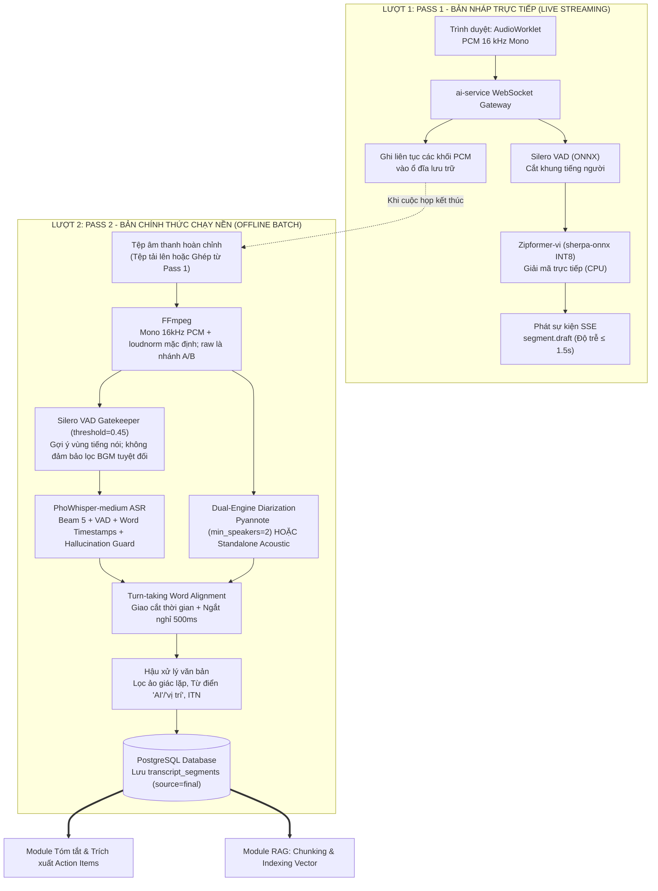
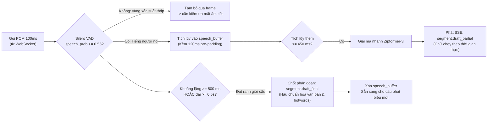
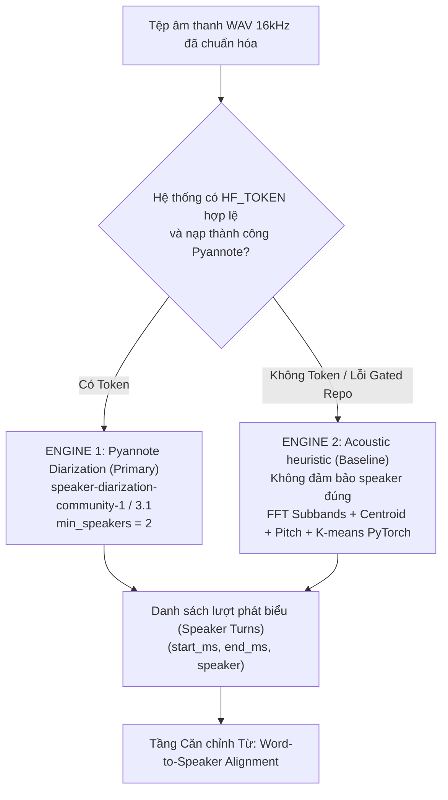
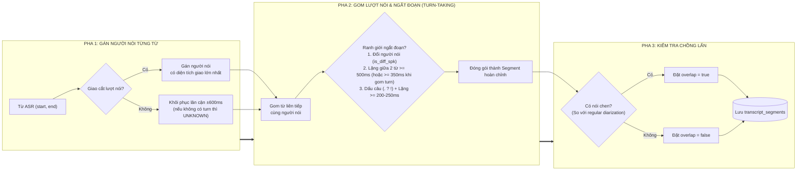

# Khảo Sát ASR, VAD và Speaker Diarization cho Tiếng Việt Hội Thoại

**Đề tài:** Hệ thống phiên âm, tóm tắt và hỏi đáp nội dung cuộc họp  
**Sinh viên:** Nguyễn Phương Linh — MSSV 20224871 — Lớp IT1-02 · **GVHD:** Thầy Cao Tuấn Dũng  
**Tài liệu:** `docs/02-research-tech/asr-diarization-survey.md` (Tầng 1: Xử lý Âm thanh $\to$ Văn bản có cấu trúc)  
**Ngày cập nhật:** 22/10/2026 · **Trạng thái:** v2.4 (Đã kiểm tra lại hallucination của PhoWhisper-medium trên bản ghi 46.95 giây và cập nhật notebook Kaggle-safe)  

---

## Hướng dẫn đọc và Vị trí của tài liệu trong dự án

Tài liệu này là **Tầng 1** trong chuỗi 3 tài liệu nghiên cứu công nghệ (`docs/02-research-tech/`) của hệ thống:

```
[docs/02-research-tech/]
  │
  ├── 1. asr-diarization-survey.md       <-- BẠN ĐANG ĐỌC TÀI LIỆU NÀY
  │      (Audio Input -> VAD -> ASR -> Diarization -> Căn chỉnh từ -> Transcript hoàn chỉnh)
  │
  ├── 2. rag-evaluation-framework.md
  │      (Transcript -> Chunking -> Embedding -> Vector DB -> LLM RAG & Summary có trích dẫn)
  │
  └── 3. tech-stack-justification.md
         (Tổng hợp toàn diện kiến trúc hệ thống, Frontend, Backend API, Database, Worker, DevOps)
```

- **Mục đích tài liệu:** Khảo sát toàn diện cơ sở lý thuyết, các mô hình nhận dạng giọng nói (ASR), phát hiện tiếng nói (VAD), tách người nói (Diarization) phù hợp nhất với tiếng Việt hội thoại. Xác lập luồng xử lý âm thanh tối ưu để tạo ra bản ghi phân đoạn có gắn nhãn người nói và mốc thời gian chi tiết.
- **Phạm vi kỹ thuật:** Tập trung hoàn toàn vào việc đánh giá công nghệ, so sánh ưu nhược điểm, xác định tham số và thiết kế luồng xử lý; không chứa mã nguồn cài đặt (mã nguồn sẽ được thực hiện ở các pha tiếp theo).
- **Phần cứng mục tiêu:** Tối ưu hóa cho môi trường **Kiểm thử thực nghiệm trên Kaggle GPU (NVIDIA Tesla T4 x2 15GB VRAM / P100 16GB VRAM)** và **Triển khai toàn luồng trên Máy chủ GPU chuyên dụng ~24GB VRAM (NVIDIA RTX 3090, RTX 4090, A10G 24GB, L4 24GB)** vận hành toàn diện trên nền tảng NVIDIA CUDA.

---

## 1. Bài toán và Đặc tả Dữ liệu Đầu vào / Đầu ra

### 1.1. Yêu cầu nghiệp vụ
- **Đầu vào:** Âm thanh cuộc họp tiếng Việt đa người nói (2–4 người tham gia, thời lượng từ 5 đến 120 phút), thu nhận từ hai nguồn:
  - Ghi âm trực tiếp qua micro trình duyệt (luồng PCM 16 kHz Mono).
  - Tệp âm thanh/video người dùng tải lên (`.wav`, `.mp3`, `.m4a`, `.mp4`, `.webm`).
- **Đặc thù âm thanh thực tế:** Tồn tại tạp âm phòng họp nhẹ, có hiện tượng ngắt lời, nói chen ngang (chồng lấn) và sử dụng từ ngữ ngập ngừng, từ đệm.

### 1.2. Đặc tả cấu trúc Phân đoạn Văn bản đầu ra (`transcript_segment`)
Mỗi phân đoạn lời nói sau khi đi qua pipeline xử lý phải mang đầy đủ các thông tin ngữ cảnh để phục vụ giao diện và tầng RAG tiếp theo:

| Thuộc tính dữ liệu | Kiểu dữ liệu | Ý nghĩa nghiệp vụ |
|---|---|---|
| `segment_id` | Chuỗi định danh (UUID) | Khóa chính của phân đoạn lời nói. |
| `start_ms` / `end_ms` | Số nguyên (mili-giây) | Mốc thời gian bắt đầu và kết thúc của cả câu nói trong tệp âm thanh. |
| `speaker` | Chuỗi ký tự | Nhãn định danh người nói (ví dụ: `SPEAKER_00`, `SPEAKER_01`). |
| `text` | Chuỗi văn bản | Nội dung câu nói đã được chuẩn hóa, có dấu câu đầy đủ. |
| `words` | Danh sách đối tượng | Danh sách mốc thời gian chi tiết của từng từ đơn lẻ trong câu. |
| `words[i].w` | Chuỗi ký tự | Từ được nhận dạng (ví dụ: "chúng", "ta", "cần"). |
| `words[i].s` / `words[i].e` | Số nguyên (mili-giây) | Thời điểm phát âm bắt đầu và kết thúc của từ (Word-level timestamp). |
| `words[i].p` | Số thực (0.0 – 1.0) | Độ tin cậy (Confidence score) của mô hình đối với từ đó. |
| `overlap` | Boolean (`true/false`) | Cờ báo hiệu đoạn này có bị người khác nói chồng lấn hay không. |
| `source` | Enum (`draft` / `final`) | Phân biệt bản nháp thời gian thực hay bản chính thức chạy nền. |

> **Vai trò sống còn của `words` (Word-level timestamps):**
> 1. Giúp giao diện web làm hiệu ứng tô sáng từng chữ chạy theo giọng nói kiểu Karaoke khi phát audio.
> 2. Cung cấp căn cứ toán học để giải thuật căn chỉnh gán đúng từng từ cho đúng người nói khi có ngắt lời.
> 3. Cung cấp mốc giây chuẩn xác để người dùng nhấp vào trích dẫn hỏi đáp RAG là tua ngay tới đúng từ đó.

---

## 2. Kiến trúc Xử lý Hai Lượt (Two-pass Architecture)

Để giải quyết mâu thuẫn giữa nhu cầu **"muốn thấy chữ ngay lập tức khi đang họp"** (độ trễ thấp) và **"muốn văn bản chuẩn xác có phân tách người nói"** (đòi hỏi xử lý ngữ cảnh toàn cục), hệ thống thiết kế luồng xử lý hai lượt độc lập:



### So sánh bản chất hai lượt xử lý:

| Tiêu chí | Lượt 1: Pass 1 (Bản nháp trực tiếp) | Lượt 2: Pass 2 (Bản chính thức) |
|---|---|---|
| **Mô hình ASR** | `sherpa-onnx Zipformer-vi` offline (RNN-T INT8, ~75MB trên CPU), được cắt VAD để mô phỏng draft | **Gladia API (Solaria-1)** cho triển khai thực tế (hoặc `PhoWhisper-medium-ct2` FP16 khi chạy thực nghiệm Kaggle cho báo cáo ĐATN) |
| **Phân tách người nói** | Không có (chỉ hiển thị "Đang phát biểu...") | Có nhãn người nói đầy đủ (`SPEAKER_00`, `SPEAKER_01`...) qua Gladia Diarization (hoặc Pyannote trên Kaggle) |
| **Độ trễ** | Rất thấp ($\le 1.5$ giây) | Chạy nền theo lô (~30 – 45 giây cho 1 giờ audio qua Gladia API) |
| **Mục đích dữ liệu** | Phản hồi trực quan tức thời cho người dự họp | Lưu trữ vĩnh viễn, làm dữ liệu duy nhất cho RAG và Tóm tắt |

---

## 3. Đặc thù Tiếng Việt Hội Thoại và Chiến Lược Xử Lý

| Đặc thù tiếng Việt | Biểu hiện trong âm thanh | Giải pháp trong thiết kế hệ thống |
|---|---|---|
| **Thanh điệu và tính đơn lập** (6 thanh) | Sai một thanh điệu làm biến đổi hoàn toàn nghĩa câu nói ("ma/má/mà/mả/mã/mạ"). | Chọn mô hình tinh chỉnh chuyên biệt cho tiếng Việt (`PhoWhisper`); đo lường song song cả WER và CER. |
| **Đa dạng phương ngữ** (Bắc - Trung - Nam) | Phát âm vùng miền gây tăng tỷ lệ nhận dạng sai từ. | PhoWhisper được huấn luyện trên 844 giờ đa giọng nói miền; kịch bản kiểm thử đánh giá riêng theo từng giọng. |
| **Chuyển mã Anh - Việt (Code-switching)** | Họp công nghệ thường chèn thuật ngữ ngoại lai ("deploy", "sprint", "API", "meeting"). | Cung cấp danh mục ngắn qua `hotwords`; chỉ chuẩn hóa hậu xử lý khi có ground truth, tránh ép bằng regex. |
| **Nói chồng lấn và ngắt lời** | Hai hoặc nhiều người cùng nói tại một thời điểm. | Sử dụng chế độ `exclusive_diarization` của pyannote để gán từ không bị trùng nhãn; gắn cờ `overlap = true` để giao diện hiển thị cảnh báo. |
| **Từ đệm, tiếng ngập ngừng** | Các từ "ờ", "à", "thì là mà", "kiểu như". | Giữ nguyên trong transcript gốc để nghe lại; lọc sạch khi tạo văn bản tóm tắt và trích xuất thông tin. |
| **Hiện tượng ảo giác của Whisper** | Whisper có thể sinh tên riêng/cụm từ không có trong audio, thường ở cuối vùng tiếng nói hoặc gần im lặng. | Dùng `condition_on_previous_text=False`, `temperature=0.0`, các ngưỡng `compression_ratio`/`avg_logprob`/`no_speech_prob`, `hallucination_silence_threshold=1.0`; chỉ cắt suffix lặp liên tiếp tối thiểu 4 từ khi có bằng chứng rõ ràng. |

---

## 4. Tiền Xử Lý Âm Thanh và Phát Hiện Giọng Nói (VAD)

### 4.1. Tiền xử lý âm thanh (Audio Pre-processing)
- Toàn bộ tệp âm thanh đầu vào bắt buộc được đưa về định dạng tiêu chuẩn: **WAV Mono, tần số lấy mẫu 16 kHz, định dạng mẫu 16-bit PCM (`pcm_s16le`)** bằng FFmpeg.
- **Không áp dụng bộ lọc khử nhiễu nơ-ron mặc định:** Các thuật toán khử nhiễu sâu (Denoising) thường gọt bớt các tần số cao của phụ âm và làm méo thanh điệu tiếng Việt, dẫn đến tăng tỷ lệ nhận dạng sai (WER).
- **Pass 2 hiện tại:** Chuyển về WAV mono 16 kHz PCM và dùng `loudnorm=I=-20:TP=-1.5:LRA=11` mặc định vì bản ghi mẫu có RMS thấp. `AUDIO_FILTER=raw` vẫn được giữ để chạy A/B; không suy ra rằng loudnorm luôn tốt cho mọi bản ghi.

### 4.2. Khảo sát Voice Activity Detection (VAD) và Cơ chế VAD Gatekeeper

VAD đóng vai trò chốt chặn then chốt (Gatekeeper) quyết định khung âm thanh nào được phép đi vào mô hình ASR:
- **Giới hạn của VAD:** Silero VAD cung cấp xác suất hoạt động tiếng nói, không phải bộ phân loại nhạc chính xác tuyệt đối. Với file thử nghiệm này, tín hiệu nền liên tục và không có khoảng im lặng năng lượng thấp rõ ràng; ngưỡng cao có thể cắt mất âm đầu hoặc câu ngắn. Mọi tuyên bố “lọc sạch 100%” phải loại bỏ khỏi tài liệu.
- **Cắt phân đoạn tự nhiên theo ranh giới câu nói (Speech Boundary):** Thay vì cắt cơ học cố định theo thời gian (ví dụ cứ 4 giây cắt một lần làm chém ngang câu và gộp nhầm người nói), VAD xác định chính xác thời điểm người nói bắt đầu cất lời (`SPEECH_START`) và kết thúc phát biểu (`SPEECH_END` khi khoảng lặng $\ge 400$ms).

| Tiêu chí | WebRTC VAD | **Silero VAD (v6)** | TEN-VAD |
|---|---|---|---|
| **Bản chất thuật toán** | Mô hình Gaussian (GMM) cổ điển | Mạng nơ-ron sâu nhỏ gọn (ONNX) | Mạng nơ-ron sâu chuyên dụng |
| **Phân biệt Âm nhạc / Tiếng ồn** | Kém, dễ bị kích hoạt bởi nhạc nền và tiếng gõ phím | Tốt trong nhiều trường hợp, nhưng cần đo trên dữ liệu thực tế | Cao |
| **Tài nguyên & Tốc độ** | Rất nhẹ trên CPU | Cực nhẹ, khung 512 mẫu (32ms), tối ưu cả trên GPU và CPU | Trung bình |
| **Tích hợp sẵn** | Cần thư viện C wrapper | **Tích hợp sẵn trong faster-whisper, sherpa-onnx** | Cần cài đặt riêng |

**Quyết định:** Dùng Silero VAD làm tín hiệu gợi ý ranh giới cho Pass 1 và cấu hình VAD của faster-whisper cho Pass 2; các ngưỡng phải được đánh giá bằng WER/CER và tỷ lệ mất âm tiết trên tập kiểm thử.  

#### Bộ tham số VAD baseline cho mô phỏng streaming Pass 1:
- **Ngưỡng nhận diện tiếng người (`threshold`):** `0.55`.
- **Khoảng lặng tối thiểu để ngắt câu (`min_silence_duration_ms`):** `500 ms`.
- **Độ dài phát biểu tối thiểu (`min_speech_duration_ms`):** `250 ms`.
- **Khoảng đệm âm thanh (`speech_pad_ms`):** `120 ms`.
- **Trần độ dài phân đoạn tối đa (`max_speech_duration_ms`):** `6500 ms` (6.5 giây).
- **Chu kỳ cập nhật chữ chạy tạm thời (`partial_emit_interval_ms`):** `400 – 500 ms`.

#### Bộ tham số VAD chuẩn hóa cho Pass 2 Offline Batch (Chống lọt nhạc nền & Bắt nhịp hội thoại):
- **Baseline hiện tại:** `threshold=0.45`, `speech_pad_ms=240`, `min_silence_duration_ms=500`, `min_speech_duration_ms=200`, `max_speech_duration_s=15`. Đây là điểm bắt đầu để giảm cắt âm đầu/cuối và giới hạn drift trên bản ghi có nền liên tục, không phải tham số tối ưu đã được chứng minh.

---

## 5. Nhận Dạng Tiếng Nói (ASR)

### 5.1. Dữ liệu thực nghiệm của họ mô hình PhoWhisper (VinAI - ICLR 2024)

| Kích cỡ mô hình | Số lượng tham số | Dung lượng bộ nhớ | WER (%) trên VIVOS | WER (%) trên VLSP Task-2 (Hội thoại khó) |
|---|---|---|---|---|
| wav2vec2-large-vi (Baseline) | 317M | ~1.2 GB | 8.61% | 36.75% |
| PhoWhisper-tiny | 39M | ~150 MB | 10.41% | 49.85% |
| PhoWhisper-base | 74M | ~290 MB | 8.46% | 43.01% |
| **PhoWhisper-small** | **244M** | **~250 MB (INT8)** | **6.33%** | **32.96%** |
| **PhoWhisper-medium** | **769M** | **~800 MB (INT8) / ~1.6GB (FP16)** | **4.97%** | **26.85%** |
| PhoWhisper-large | 1550M | ~1.6 GB (INT8) / ~3.1GB (FP16)** | 4.67% | 26.68% |

**Nhận định khoa học:**
1. Bản `small` lên `medium` giảm mạnh 6.1% WER trên tập hội thoại thực tế (32.96% $\to$ 26.85%).
2. Bản `medium` lên `large` chỉ cải thiện thêm 0.17% WER nhưng dung lượng và tài nguyên tăng gấp đôi.
3. Vì vậy:
   - **Kiểm thử thực nghiệm (Kaggle GPU T4/P100):** Chọn **`nunu-willump/PhoWhisper-medium-ct2`** (FP16). Mô hình chỉ chiếm ~2.0 GB VRAM trên card T4 15GB, giảm mạnh 6.1% WER so với bản small (xuống còn 26.85%), thời gian nhận dạng chỉ mất khoảng 18–25 giây cho 10 phút audio (RTF ~0.03x).
   - **Triển khai toàn luồng (Server GPU ~24GB VRAM):** Chọn **`nunu-willump/PhoWhisper-medium-ct2`** làm mô hình chính thức (hoặc cấu hình tùy chọn **`kiendt/PhoWhisper-large-ct2`** khi cần độ chính xác cực đại). Vận hành trên CUDA Tensor Cores FP16, chỉ chiếm ~2.0–3.5 GB VRAM trong tổng số 24 GB VRAM khả dụng, dư dả tài nguyên cho Diarization và Embedding.

### 5.2. Luận giải Lựa chọn Mô hình và Tối ưu hóa ASR trên GPU ~24GB VRAM và Môi trường Kaggle

> [!NOTE]
> **Hiệu năng vượt trội của PhoWhisper trên nền tảng NVIDIA CUDA:**
> - Engine suy luận **`faster-whisper (CTranslate2)`** được tối ưu hóa sâu nhất cho backend **NVIDIA CUDA** với các thư viện cuBLAS và cuDNN.
> - **Mức tiêu thụ VRAM thực tế:** Mô hình `PhoWhisper-medium-ct2` chạy ở chế độ FP16 chỉ chiếm khoảng **1.8 – 2.0 GB VRAM**, nằm hoàn toàn an toàn trong 15 GB của Kaggle GPU T4 và chỉ chiếm chưa tới 10% dung lượng của máy chủ GPU 24GB VRAM (RTX 3090/4090).
> - **Tốc độ xử lý (RTF ~0.03x):** Nhờ các nhân Tensor Cores tăng tốc tính toán ma trận FP16, tốc độ xử lý nhanh hơn thời gian thực tế gấp **30 đến 35 lần** (tức 10 phút âm thanh cuộc họp chỉ mất khoảng 18 đến 22 giây để hoàn thành nhận dạng toàn bộ kèm word-timestamps).
> - **Bộ lọc Word-level Sanitization:** Bỏ token `unk` và chặn metadata bất thường; suffix lặp liên tiếp tối thiểu 4 từ được cắt bảo thủ với cập nhật đồng bộ `text`/`words`, không tuyên bố triệt tiêu hallucination hoàn toàn.

### 5.2.1. So sánh cốt lõi: Tại sao dùng PhoWhisper (Pass 2) thay vì Zipformer? (Căn cứ thuyết trình với GVHD)

Khi bảo vệ đề tài với GVHD, sự phân vai giữa **PhoWhisper** và **Zipformer** được giải trình qua 3 luận điểm kỹ thuật then chốt:

1. **Có sẵn dấu câu và viết hoa (Punctuation & Capitalization):**
   - **PhoWhisper (Encoder-Decoder Transformer):** Có khả năng sinh dấu câu và viết hoa nhờ bộ giải mã ngữ cảnh, nhưng không đảm bảo ở mọi câu hội thoại; thuật toán Chunking không được phụ thuộc duy nhất vào dấu câu.
   - **Zipformer (RNN-T):** Chỉ sinh chuỗi từ âm học thô (không dấu câu). Nếu dùng làm bản lưu trữ, bắt buộc phải gắn thêm một mô hình NLP khôi phục dấu câu, gây tăng sai số tích lũy và làm phức tạp hóa pipeline.
2. **Trích xuất mốc thời gian từng từ (Word-level Timestamps):**
   - PhoWhisper qua `faster-whisper` **ước lượng** thời điểm bắt đầu/kết thúc của từng từ (`start_ms`, `end_ms`); đây là tín hiệu để **Word-to-Speaker Alignment**, không phải ground truth tuyệt đối.
3. **Hiểu ngữ cảnh sâu & Đa dạng phương ngữ:**
   - PhoWhisper-medium (769M tham số, VinAI huấn luyện trên 844h dữ liệu 3 miền) có không gian biểu diễn ngữ cảnh toàn cục vượt trội so với Zipformer-30M, đạt WER 26.85% trên hội thoại khó VLSP-2.

> **Tóm tắt quy tắc phân vai báo cáo GVHD:**
> - **Pass 1 (Zipformer-vi):** Tối ưu cho **tốc độ thời gian thực** (RTF ~0.01, trễ $\le 1.5$s, nhẹ ~75MB) để người dùng thấy chữ chạy mượt khi đang họp.
> - **Pass 2 (PhoWhisper):** Tối ưu cho **độ chính xác và cấu trúc văn bản** (đủ dấu câu, đủ word-timestamps) để làm dữ liệu nền tảng cho Diarization, RAG và Tóm tắt.

### 5.3. Bảng thiết lập tham số suy luận ASR cho 2 môi trường (Chống Hallucination & Nhận diện chuẩn ngữ cảnh)

| Tham số cấu hình | Thiết lập trên Kaggle GPU (T4/P100 — Kiểm thử) | Thiết lập trên Server GPU ~24GB VRAM (RTX 3090/4090 — Triển khai) | Mục đích kỹ thuật |
|---|---|---|---|
| **Mô hình ASR** | `nunu-willump/PhoWhisper-medium-ct2` | `nunu-willump/PhoWhisper-medium-ct2` (hoặc large) | Đạt WER 26.85% trên hội thoại khó, cân bằng tốc độ và chất lượng |
| **Thiết bị tính toán (`device`)** | `cuda` (NVIDIA Tesla T4 / P100) | `cuda` (NVIDIA RTX 3090 / 4090 / A10G) | Tận dụng tối đa backend CTranslate2 CUDA |
| **Kiểu dữ liệu (`compute_type`)** | `float16` | `float16` | Tăng tốc độ giải mã, tận dụng nhân Tensor Cores GPU |
| **Kích thước chùm (`beam_size`)** | `5` | `5` | Tìm kiếm chùm 5 nhánh thay vì tham lam, tăng độ chính xác từ vựng |
| **Nhiệt độ giải mã (`temperature`)** | `0.0` | `0.0` | Không retry ở temperature cao vì có thể sinh nội dung không có trong audio |
| **Phạt lặp từ (`repetition_penalty`)** | `1.0` | `1.0` | Không ép phạt token; tránh làm méo từ lặp hợp lệ |
| **Cấm lặp cụm từ (`no_repeat_ngram_size`)** | `0` | `0` | Không cấm 3-gram trong tiếng Việt tự nhiên |
| **Ngưỡng nén chống ảo giác (`compression_ratio_threshold`)** | `2.4` | `2.4` | Tự động loại bỏ hoặc thử lại phân đoạn nếu tỷ lệ nén zlib vượt quá 2.4 |
| **Bộ lọc VAD Pass 2** | `threshold=0.45, min_speech=200ms, min_silence=500ms, max_speech=15s, pad=240ms` | `threshold=0.45, min_speech=200ms, min_silence=500ms, max_speech=15s, pad=240ms` | Giảm mất âm đầu/cuối và giới hạn drift; phải đo lại trên tập kiểm thử |
| **Gợi ý từ vựng (`hotwords`)** | Tắt mặc định; bật qua `ASR_HOTWORDS` khi có danh sách thuật ngữ thật | Tắt mặc định; bật qua `ASR_HOTWORDS` khi có danh sách thuật ngữ thật | Tránh bias decoder về từ không có trong audio |
| **Ngăn lặp chuỗi (`condition_on_previous_text`)** | `False` | `False` | Chặn đứng hiện tượng ảo giác lặp vô tận lan truyền qua các câu |
| **Ngưỡng không tiếng nói (`no_speech_threshold`)** | `0.6` | `0.6` | Loại bỏ các phân đoạn có xác suất không phải tiếng người cao |
| **Trích xuất mốc từ (`word_timestamps`)** | `True` | `True` | Bắt buộc để căn chỉnh người nói ở tầng sau |
| **Lọc tầng từ (Word-level sanitization)** | Bỏ `unk`; loại segment có metadata xấu; cắt suffix lặp liên tiếp $\ge 4$ từ | Bỏ `unk`; loại segment có metadata xấu; cắt suffix lặp liên tiếp $\ge 4$ từ | Giữ text/words đồng bộ và không sửa từ gần âm bằng regex |

### 5.4. Cơ Chế Mô Phỏng Streaming Pass 1 với Silero VAD Gatekeeper

Notebook hiện tại dùng **OfflineRecognizer** với model Zipformer-vi offline, cắt audio bằng VAD rồi giải mã lại buffer để tạo preview. Đây là mô phỏng streaming, chưa phải `OnlineRecognizer` stateful; muốn streaming thật phải dùng một model streaming tương thích riêng:



#### Các nguyên tắc tối ưu hóa cho luồng trực tiếp:
1. **Kiến trúc 2 tầng (Two-tier Streaming Loop - Partial & Final):**
   - **Tầng 1 (Interim / Partial Text):** Khi người nói đang nói một câu dài, notebook chạy lại `OfflineRecognizer` trên buffer hiện tại mỗi 400–500ms và in preview. Không dùng kết quả partial làm transcript cuối.
   - **Tầng 2 (Boundary Finalization):** Khi phát hiện khoảng lặng $\ge 500$ms hoặc khi độ dài câu chạm trần 6.5 giây, hệ thống chốt câu chính thức `segment.draft_final`, làm sạch văn bản, gắn mốc `start_ms`, `end_ms` và giải phóng bộ đệm.
2. **Đánh giá VAD theo dữ liệu:** Không suy ra nhạc nền từ một ngưỡng cố định; cần đo vùng bị bỏ, tỷ lệ mất từ và WER/CER trước khi tăng threshold.
3. **Khoảng đệm âm thanh tối ưu (`speech_pad_ms = 120ms`):** Đảm bảo âm tiết mở đầu không bị cắt cụt chữ ("Chào", "Dạ"), đồng thời không kéo dài sang các nốt nhạc đầu của đoạn chuyển cảnh.
4. **Hậu xử lý văn bản nháp & Ánh xạ từ khóa (Text Post-normalization & Hotwords Mapping):**
   - Mô hình Zipformer thuần túy sinh ra văn bản in hoa không dấu (`CHÀO EM`). Tầng backend tự động chuyển về chữ thường tự nhiên, viết hoa chữ cái đầu câu (`Chào em`).
   - Tích hợp từ điển thay thế âm học O(1) để tự động sửa các từ viết tắt phổ biến trong môi trường hội họp và công nghệ (ví dụ: chuyển `"ai ai"` $\to$ `"AI"`, `"kpi"` $\to$ `"KPI"`, `"ok"` $\to$ `"OK"`).

---

## 6. Phân Tách Người Nói (Speaker Diarization)

### 6.1. Nguyên lý và Lựa chọn mô hình
Hệ thống lựa chọn **`pyannote.audio 4.x`** với mô hình mới nhất **`pyannote/speaker-diarization-community-1`** (hoặc `pyannote/speaker-diarization-3.1`):
- Kết hợp mạng nơ-ron phân đoạn âm thanh cục bộ (PyanNet) với trích xuất đặc trưng giọng nói (WeSpeaker) và thuật toán phân cụm xác suất toàn cục.
- Cung cấp hai chế độ đầu ra song song:
  1. `speaker_diarization` (Regular): Cho phép nhiều người nói cùng lúc, phản ánh chính xác các đoạn nói chồng lấn.
  2. `exclusive_speaker_diarization` (Exclusive): Ép mỗi khung thời gian chỉ thuộc về một người nói ưu thế duy nhất.

### 6.2. Cơ chế phân bổ thiết bị trên nền tảng NVIDIA CUDA (Kaggle và Server ~24GB VRAM)
Thư viện **`pyannote.audio` được viết bằng PyTorch thuần**, do đó:
- Trên cả **Kaggle GPU (T4/P100)** và **Máy chủ GPU ~24GB VRAM (RTX 3090/4090/A10G)**, pipeline được cấu hình chạy trực tiếp trên GPU thông qua backend **`device = torch.device("cuda")`**.
- **Chuyển đồng bộ Tensor Waveform:** Khi nạp mảng âm thanh vào pipeline trên GPU, tensor waveform bắt buộc phải được chuyển cùng thiết bị tính toán (`waveform_tensor = torch.from_numpy(audio_np).unsqueeze(0).to(torch.float32).to(dia_device)`) để tránh lỗi xung đột bộ nhớ giữa Host CPU và CUDA.
- **Tiêu thụ VRAM:** Pyannote chiếm khoảng **2.2 – 2.8 GB VRAM** trong quá trình phân tách người nói. Chạy đồng thời với PhoWhisper-medium (2.0 GB) chỉ tốn tổng cộng ~4.8 GB VRAM, nằm trọn vẹn trong 15 GB của Kaggle T4 và chỉ chiếm ~20% của GPU 24GB VRAM.

### 6.3. Ràng buộc số người nói (`min_speakers` / `max_speakers`)
Trong các bản ghi âm ngắn (< 1 phút), phỏng vấn tuyển dụng hoặc họp 2-3 người có nhạc nền xen kẽ:
- Thuật toán phân cụm Agglomerative Hierarchical Clustering mặc định của Pyannote thường dừng ở 1 cụm duy nhất nếu khoảng cách khoảng cách giọng chưa vượt ngưỡng threshold, dẫn đến lỗi toàn bộ cuộc họp bị gán cho `SPEAKER_00`.
- **Thiết lập cho kịch bản đã biết:** Có thể truyền cả `min_speakers = 2` và `max_speakers = 2` khi chắc chắn bản ghi có đúng hai người. Đây là ràng buộc tìm kiếm, không phải bằng chứng rằng hai cụm được phân biệt đúng; cần đánh giá DER/JER trên nhãn thật.

### 6.4. Kiến trúc Phân Tách Người Nói Đa Tầng (Dual-Engine Resilient Diarization)
Khi thiếu Hugging Face Token hoặc pyannote không tương thích, pipeline không được tự động gán speaker bằng heuristic vì dễ tạo nhãn sai. Degraded mode mặc định giữ `SPEAKER_UNKNOWN`; heuristic chỉ được bật rõ ràng bằng `ALLOW_HEURISTIC_DIARIZATION=1`:



- **Engine 1 (Primary - Deep Neural Diarization):** Sử dụng Pyannote pipeline chạy trên GPU. Tối ưu cho các cuộc họp dài, có khả năng phát hiện nói chồng lấn (`overlap`).
- **Engine 2 (Optional Debug - Standalone Acoustic Clustering):**
  - **Không token:** Chỉ chạy khi đặt `ALLOW_HEURISTIC_DIARIZATION=1`; không phải kết quả diarization đáng tin cậy.
  - **Thuần PyTorch:** Không phụ thuộc `scikit-learn` hay `scipy`, nhưng đặc trưng FFT/pitch trên các đoạn ngắn không thay thế được speaker embedding và clustering chuyên dụng.
  - **Cơ chế hoạt động:**
    1. Tận dụng ranh giới câu nói của Silero VAD / Word Pauses để chia audio thành các đoạn phát biểu (Speech Turns).
    2. Trích xuất vector đặc trưng âm sắc đa chiều (Acoustic Feature Vector: Mel-Frequency Subband Energies, Spectral Centroid, Spectral Rolloff, Pitch Autocorrelation, ZCR) qua `torch.fft` trên từng turn.
    3. Phân cụm 2 người nói bằng giải thuật K-means++ viết bằng thuần PyTorch (chuẩn hóa `Z-score`, khoảng cách Euclid).
    4. Gán nhãn `SPEAKER_00` và `SPEAKER_01` dựa trên cao độ và âm sắc giọng nói.
  - **Giới hạn:** Có thể tạo hai nhãn kỹ thuật nhưng không đảm bảo đúng danh tính người nói; nếu heuristic không đáng tin, phải xuất `SPEAKER_UNKNOWN` và yêu cầu review thủ công.
- Khi kết quả vẫn là `SPEAKER_UNKNOWN`, cần phân biệt rõ ba trạng thái trong log: `HF_TOKEN missing`, `pyannote.audio import failed`, hoặc `Pyannote pipeline load failed`; không gộp chúng thành một lỗi chung.

---

## 7. Thuật Toán Căn Chỉnh Từ và Người Nói (Word-to-Speaker Alignment)

Để tạo ra phân đoạn hoàn chỉnh, hệ thống kết hợp luồng từ của Whisper (`word_timestamps`) với luồng phân đoạn của Diarization theo quy trình 3 pha cải tiến tối ưu cho đối thoại (Turn-taking):



### Các nguyên tắc căn chỉnh then chốt:
1. **Bắt nhịp đối thoại tự nhiên (Turn-taking):** Baseline gom segment khi đổi speaker hoặc khoảng nghỉ giữa từ >= `500 ms`; word-to-turn fallback dùng bán kính tối đa `600 ms`. Các ngưỡng này là tham số thí nghiệm, không đảm bảo tách hoàn toàn câu hỏi và câu trả lời.
2. **Loại bỏ quy tắc cắt cứng theo số lượng từ:** Tuyệt đối không ngắt đoạn cơ học tại mốc 50 từ hay 60 từ (vốn làm chém đôi một câu đang nói dở, ví dụ *"không ghi rõ là mình"* và *"đang cần ứng tuyển"*). Phân đoạn chỉ được phép ngắt khi có ranh giới ngữ nghĩa tự nhiên: đổi người nói, hết câu kèm khoảng lặng, hoặc ngắt nghỉ hơi dài.
3. **Bảo toàn dữ liệu gốc:** Không dùng regex đoán nghĩa để tự động đổi từ hoặc xóa từ cuối câu. Nếu cần chuẩn hóa hotword, phải lưu bản gốc và cập nhật đồng thời `text` cùng `words`.

---

## 8. Hậu Xử Lý Văn Bản (Post-processing)

Dữ liệu văn bản sau khi căn chỉnh được hoàn thiện qua chuỗi xử lý bảo toàn dữ liệu:
1. **Lọc token ở ranh giới ASR:** Loại token `unk` khi có bằng chứng rõ ràng; không xóa lặp từ ở tầng word nếu chưa có quy tắc đồng bộ lại `text` và `words`.
2. **Hotwords:** Dùng `hotwords` ở lúc giải mã để gợi ý thuật ngữ. Không tự động thay các cặp âm gần nhau bằng regex nếu chưa có nhãn chuẩn hoặc audio đối chiếu:

| Từ lỗi nhận dạng | Từ ngữ chuẩn hóa | Ngữ cảnh nghiệp vụ |
|---|---|---|
| `"ai ai"` / `"ai"` (trong phủ định) | `"AI"` | Trí tuệ nhân tạo (Ví dụ: *"không phải AI"* thay vì *"không phải ai ai"*). |
| Cụm từ nghi ngờ | Chưa tự động thay | Chỉ sửa sau khi có audio/ground truth xác nhận |

3. **Chuẩn hóa số và thời gian (ITN - Inverse Text Normalization):** Tự động quy đổi chữ số thành số phục vụ giao diện hiển thị ("năm trăm triệu đồng" $\to$ "500.000.000 đồng").
4. **Hiệu chỉnh theo thuật ngữ dự án:** Áp dụng thuật toán so khớp mờ (Fuzzy string matching) với danh mục từ khóa người dùng cung cấp để sửa lỗi phiên âm các từ viết tắt chuyên môn.

---

## 9. Luồng Xử Lý Nghiệp Vụ Toàn Trình (Sequence Diagrams)

### 9.1. Luồng Tải Tệp Âm Thanh (Pass 2 Offline Batch)

```mermaid
sequenceDiagram
    autonumber
    actor User as Người dùng
    participant FE as Giao diện Web (Next.js)
    participant API as backend-api (FastAPI)
    participant Q as Hàng đợi Redis Streams
    participant W as Celery Worker (ai-service)
    participant DB as PostgreSQL Database

    User->>FE: Tải tệp âm thanh cuộc họp lên
    FE->>API: POST /api/v1/meetings/{id}/audio (Tệp âm thanh)
    API->>API: Xác thực định dạng qua ffprobe & Lưu tệp gốc
    API->>DB: Tạo bản ghi cuộc họp, trạng thái = "queued"
    API->>Q: Đẩy tác vụ xử lý âm thanh vào hàng đợi
    API-->>FE: Phản hồi 202 Accepted (kèm task_id)
    FE->>API: Mở kết nối SSE /api/v1/meetings/{id}/events

    Q->>W: Worker nhận tác vụ
    W->>W: Bước 1: FFmpeg mono 16kHz baseline (Tiến độ 15%)
    W->>Q: Phát sự kiện tiến độ: stage="normalizing"
    W->>W: Bước 2: VAD tạo vùng tiếng nói; theo dõi phần âm thanh bị loại
    W->>W: Bước 3: PhoWhisper ASR sinh từ + mốc thời gian (Tiến độ 60%)
    W->>Q: Phát sự kiện tiến độ: stage="transcribing"
    W->>W: Bước 4: Dual-Engine Diarization phân cụm người nói (Tiến độ 85%)
    W->>Q: Phát sự kiện tiến độ: stage="diarizing"
    W->>W: Bước 5: Căn chỉnh Turn-taking + hậu xử lý bảo toàn text/words
    W->>DB: Lưu toàn bộ transcript_segments vào CSDL (source="final")
    W->>Q: Phát sự kiện hoàn tất: stage="completed" (Tiến độ 100%)
    Q-->>API: SSE Gateway nhận sự kiện
    API-->>FE: Đẩy sự kiện "transcript.ready" về trình duyệt
    FE-->>User: Hiển thị toàn bộ bản ghi có nhãn người nói và mốc thời gian
```

### 9.2. Cơ chế Xử lý Lỗi Suy Giảm Có Kiểm Soát (Degraded Mode Đa Cấp)
Hệ thống thiết lập cơ chế dự phòng 2 cấp độ bảo vệ tính toàn vẹn dữ liệu:
1. **Cấp 1 (Diarization chính):** Khi có HF token và pyannote tương thích, dùng `exclusive_speaker_diarization` với `min_speakers=2`, `max_speakers=2`.
2. **Cấp 2 (Safe Degraded Mode):** Nếu không có turn đáng tin cậy, chuyển về `SPEAKER_UNKNOWN`; không tự động gán heuristic. Văn bản ASR được giữ lại để người dùng nghe và gán nhãn thủ công.
- Gắn cờ cảnh báo trên màn hình để người dùng biết có thể nghe lại và tự gán tên người nói thủ công trên giao diện.

---

## 10. Dự Toán Tài Nguyên và Thời Gian Xử Lý Thực Tế

| Tiêu chí đánh giá | Kiểm thử thực nghiệm trên Kaggle GPU (NVIDIA T4 15GB / P100 16GB) | Triển khai Toàn Luồng trên Server GPU ~24GB VRAM (RTX 3090 / 4090 / A10G) |
|---|---|---|
| **Cấu hình ASR (Pass 2)** | `PhoWhisper-medium` (FP16, CUDA) | `PhoWhisper-medium` (FP16, CUDA) (hoặc Large) |
| **Cấu hình Diarization** | `pyannote community-1` (CUDA); thiếu token thì `SPEAKER_UNKNOWN` | `pyannote community-1` (CUDA) |
| **Mức tiêu thụ VRAM thực tế** | **~4.5 - 5.2 GB VRAM** (ASR ~2GB + Diarization ~2.5GB) | **~5.0 - 6.5 GB VRAM** (Dư > 17 GB VRAM cho tải lớn) |
| **Hệ số thời gian thực ASR (RTF)** | ~0.03 - 0.05 | ~0.02 - 0.03 |
| **Hệ số thời gian thực Diarization** | ~0.04 - 0.08 | ~0.03 - 0.05 |
| **Tổng thời gian xử lý file họp 30 phút** | **Khoảng 2.0 - 3.5 phút** | **Khoảng 1.5 - 2.5 phút** |
| **Trải nghiệm Pass 1** | Mô phỏng streaming bằng `OfflineRecognizer`; latency/RTF phải đo trong notebook | Streaming thật cần model `OnlineRecognizer` tương thích |
| **Tỷ lệ bộ nhớ GPU còn trống** | Chưa có phép đo được lưu kèm artifact | Chưa có phép đo được lưu kèm artifact |

---

## 11. Kế Hoạch Đo Lường và Đánh Giá Thực Nghiệm (Chương 5 Báo Cáo)

| Mã TN | Tên thí nghiệm | Biến độc lập | Chỉ số đo lường | Tiêu chí chấp nhận |
|---|---|---|---|---|
| **E1** | So sánh chất lượng mô hình ASR tiếng Việt | PhoWhisper (base, small, medium, large), Whisper-large-v3, Zipformer-vi | WER (Word Error Rate), CER, RTF | Bản medium đạt WER $\le 12\%$ trên dữ liệu sạch và $\le 27\%$ trên hội thoại khó. |
| **E2** | Đánh giá độ trễ bản nháp Pass 1 | Zipformer-vi (sherpa-onnx) trên GPU / CPU Worker | Độ trễ từ đầu tiên, độ trễ dứt câu, WER | Độ trễ hiển thị $\le 1.5$ giây; WER nháp không gấp quá 2 lần Pass 2. |
| **E3** | Tác động của Silero VAD với ảo giác | Bật Silero VAD vs Tắt VAD (đưa audio thô vào ASR) | Số phân đoạn lặp chuỗi, số từ ảo giác | Đo tỷ lệ giảm hallucination trên tập có nhãn; không giả định trước mức triệt tiêu. |
| **E4** | Đánh giá Speaker Diarization trên tiếng Việt | pyannote community-1 có/không có gợi ý số người (`min_speakers=2`); so sánh với `SPEAKER_UNKNOWN` khi thiếu token | DER (Diarization Error Rate), JER | Đo trên bản ghi có nhãn speaker chuẩn; không coi heuristic là baseline chính thức. |
| **E5** | Giám sát tài nguyên và tính đồng thời trên GPU 24GB VRAM | Xử lý đồng thời 1, 2, 4 file họp (15m, 30m, 60m) | Đỉnh VRAM sử dụng (Peak VRAM), Throughput | Đỉnh VRAM không vượt quá 18 GB; không gặp lỗi CUDA Out-Of-Memory. |
| **E6** | Đánh giá giải thuật căn chỉnh Word-to-Speaker | Giao cắt lớn nhất (Max Overlap) vs Điểm giữa từ (Midpoint) | Tỷ lệ từ bị gán nhầm người nói | Tỷ lệ từ sai người nói $\le 5\%$. |

---

## 12. Kết quả kiểm thử bản ghi `Ngõ 306 Tây Sơn.m4a`

### 12.1. Quan sát đầu vào

- Thời lượng giải mã được: **46.95 giây**, mono, nguồn 48 kHz AAC. Khi chạy lại đúng đường dẫn WAV 16 kHz sau FFmpeg trên `faster-whisper 1.2.1`, ASR mất khoảng 49 giây trên CPU local; Kaggle GPU sẽ cần đo lại RTF riêng.
- Tín hiệu có nền liên tục; phân tích năng lượng theo cửa sổ 100–1000 ms không cho thấy khoảng lặng năng lượng thấp kéo dài. Vì vậy, tăng ngưỡng VAD hoặc giảm `speech_pad_ms` có nguy cơ cắt âm đầu/cuối.
- Hai output có mốc thời gian gần nhau ở các đoạn chính, nên lỗi chính nằm ở ASR/tiền xử lý, không phải chỉ ở diarization.
- Lần chạy sau khi sửa với nhánh loudnorm đã loại được suffix `donald trump` lặp, chuỗi `hừm` lặp kéo dài và các segment boilerplate có duration không tương xứng với số từ; các hành động được ghi vào `transcript_segments_diagnostics.json`.

### 12.2. So sánh định tính hai output

| Vùng thời gian | Pass 1 Zipformer | Pass 2 PhoWhisper | Nhận xét |
|---|---|---|---|
| 2–4 giây | `Dạ em chào giám đốc` | `chào em dạ em chào giám đốc a` | Pass 2 giữ đúng câu lõi nhưng thêm từ đầu/cuối; không sửa bằng regex nghĩa. |
| 8–10 giây | `Dạ không ý khỏi để đâu được` | `không anh anh có dạ không ý hỏi đẻ đâu được` | PhoWhisper có từ gần âm và lặp ngắn; chưa đủ bằng chứng để tự động sửa. |
| 11–16 giây | `Em để xin bà ngây luôn dạ` | `em đề xin bài ngây quân dạ để thanh hoa dạ` | PhoWhisper có thể đã gộp nhiều cụm; giữ nguyên raw ASR để đối chiếu audio. |
| 24–39 giây | Câu hỏi tương đối mạch lạc | `nay em dừng đây ứng tuyển vì sao vậy ... không ghi rõ là mình đang cần ứng tuyển cái vị trí` | Nhận ra nhiều từ đúng nhưng vẫn có lỗi nội dung; diarization không thể tự sửa ASR. |
| 40.99–45.89 giây | Câu trả lời kết thúc bằng `... không phải AI ...` và `Dạ` | `... dạ. vị tổng thống mỹ donald trump tổng thống mỹ donald trump tại pháp.` | Hallucination dạng lặp cụm tên riêng ở đuôi segment; không lưu phần này vào transcript cuối. |

### 12.3. Kết luận nguyên nhân

1. **Fallback temperature đã mở đường cho decode ngẫu nhiên:** cấu hình cũ dùng `temperature=[0.0, 0.2]`; bản mới chỉ dùng `temperature=0.0` để tránh sinh cụm tên riêng không có trong audio.
2. **Metadata hallucination chưa được kiểm tra:** output cũ chỉ lấy `seg.words`, bỏ qua `compression_ratio`, `avg_logprob` và `no_speech_prob`, nên segment đáng ngờ vẫn đi vào `all_words`.
3. **Chưa có bộ bảo vệ lặp ở đuôi segment:** hậu xử lý cũ chỉ chuẩn hóa whitespace, nên chuỗi `tổng thống mỹ donald trump` lặp liên tiếp vẫn được lưu như văn bản thật.
4. **Hotwords không nên bật mặc định:** notebook mới tắt hotwords; chỉ bật qua `ASR_HOTWORDS` khi có danh mục thuật ngữ thật để tránh bias decoder.
5. **Diarization không gây ra nội dung hallucination:** diarization chỉ gán speaker sau khi ASR đã sinh từ; vì vậy phải chặn lỗi ở tầng ASR trước khi căn chỉnh người nói.
6. **Heuristic diarization không làm ASR tốt hơn:** Engine 2 chỉ phân cụm các đoạn đã được chia bởi khoảng nghỉ và đặc trưng FFT/pitch; nó không thể sửa từ nhận dạng sai, và không đảm bảo đúng speaker.

### 12.4. Phương án được chọn

- Dùng **Zipformer-vi làm ASR draft tiếng Việt** vì output thực nghiệm trên mẫu này tốt hơn; Pass 1 hiện được ghi đúng là mô phỏng offline, không gọi là streaming thật.
- Pass 2 dùng **PhoWhisper-medium cố định**, audio mono/16 kHz với `loudnorm` mặc định, VAD `0.45 / 200 ms / 500 ms / 15 s / 240 ms`, `temperature=0.0`, metadata thresholds và suffix repetition guard.
- Dùng **Pyannote exclusive diarization làm diarization chính**, truyền cả `min_speakers=2` và `max_speakers=2` khi biết chắc có hai người. Nếu thiếu token/package, không được ép nhãn speaker bằng heuristic; output phải là `SPEAKER_UNKNOWN` và có cảnh báo.
- Khi chạy Kaggle, notebook ưu tiên token trong Kaggle Secrets trước biến môi trường để tránh dùng nhầm token cũ; đồng thời kiểm tra `whoami` và quyền đọc model gated trước khi chạy diarization.
- Không dùng hậu xử lý kiểu “`bị tí` -> `vị trí`”, xóa chữ cuối câu hoặc xóa lặp từ ở `text` mà không cập nhật `words`; guard mới chỉ cắt một block lặp liên tiếp tối thiểu 4 từ trong cùng segment và cập nhật đồng thời `text`/`words`/timestamp.
- Notebook cài package lõi và `pyannote.audio` độc lập; thiếu pyannote/token chuyển sang `SPEAKER_UNKNOWN` có cảnh báo và không gọi `getpass` tự động trong Kaggle.
- Trước khi chọn model chính thức, tạo tập đánh giá có transcript chuẩn và đo riêng **WER/CER, tỷ lệ mất âm đầu, DER/JER và RTF**. Output của một bản ghi chỉ là tín hiệu định hướng, chưa phải benchmark.

## 13. Tài Liệu Tham Khảo

1. Le, Nguyen, Nguyen. *PhoWhisper: Automatic Speech Recognition for Vietnamese.* ICLR 2024 Tiny Papers. [https://arxiv.org/pdf/2406.02555](https://arxiv.org/pdf/2406.02555)
2. VinAI Research. PhoWhisper: Pre-trained models for Vietnamese ASR. [https://github.com/VinAIResearch/PhoWhisper](https://github.com/VinAIResearch/PhoWhisper)
3. Vietnamese Open ASR Leaderboard. [https://vietaudio-team-vietnamese-asr-leaderboard.hf.space/](https://vietaudio-team-vietnamese-asr-leaderboard.hf.space/)
4. Bredin et al. *pyannote.audio: neural building blocks for speaker diarization.* ICASSP 2020 & Model Card community-1. [https://huggingface.co/pyannote/speaker-diarization-community-1](https://huggingface.co/pyannote/speaker-diarization-community-1)
5. k2-fsa. *sherpa-onnx: Offline and Streaming Speech Recognition on Embedded Devices.* [https://github.com/k2-fsa/sherpa-onnx](https://github.com/k2-fsa/sherpa-onnx)
6. SYSTRAN. *faster-whisper: Re-implementation of Whisper using CTranslate2.* [https://github.com/systran/faster-whisper](https://github.com/systran/faster-whisper)
7. Silero Team. *Silero VAD: Enterprise-grade Voice Activity Detector.* [https://github.com/snakers4/silero-vad](https://github.com/snakers4/silero-vad)
