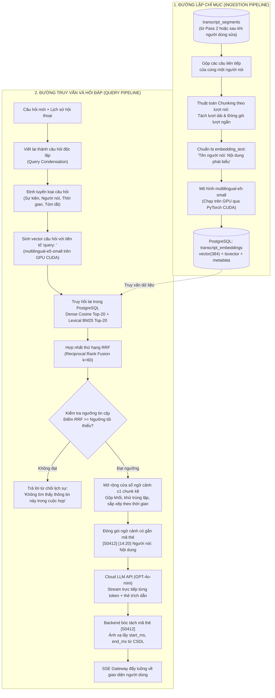
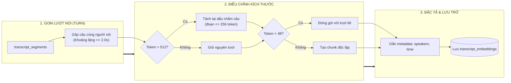
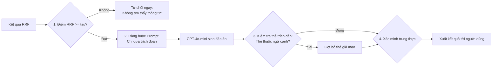
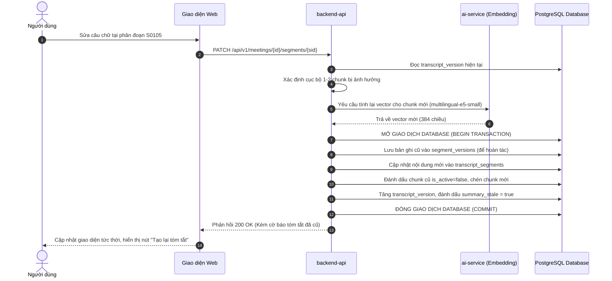

# Khung RAG và Tóm Tắt Cuộc Họp: Truy Hồi, Trích Dẫn, Chống Ảo Giác và Đánh Giá

**Đề tài:** Hệ thống phiên âm, tóm tắt và hỏi đáp nội dung cuộc họp  
**Sinh viên:** Nguyễn Phương Linh — MSSV 20224871 — Lớp IT1-02 · **GVHD:** Thầy Cao Tuấn Dũng  
**Tài liệu:** `docs/02-research-tech/rag-evaluation-framework.md` (Tầng 2: Từ Bản ghi $\to$ Hỏi đáp & Tóm tắt có cấu trúc)  
**Ngày cập nhật:** 22/10/2026 · **Trạng thái:** Hoàn thiện v2.2 (Chuẩn hóa GPU ~24GB VRAM & Cloud LLM API — Tập trung Nghiên cứu, Công nghệ & Luồng xử lý)  

---

## Hướng dẫn đọc và Vị trí của tài liệu trong dự án

Tài liệu này là **Tầng 2** trong chuỗi 3 tài liệu nghiên cứu công nghệ (`docs/02-research-tech/`) của hệ thống:

```
[docs/02-research-tech/]
  │
  ├── 1. asr-diarization-survey.md
  │      (Audio Input -> VAD -> ASR -> Diarization -> Căn chỉnh từ -> Transcript hoàn chỉnh)
  │
  ├── 2. rag-evaluation-framework.md     <-- BẠN ĐANG ĐỌC TÀI LIỆU NÀY
  │      (Transcript -> Chunking -> Embedding -> Vector DB -> LLM RAG & Summary có trích dẫn)
  │
  └── 3. tech-stack-justification.md
         (Tổng hợp toàn diện kiến trúc hệ thống, Frontend, Backend API, Database, Worker, DevOps)
```

- **Mục đích tài liệu:** Nghiên cứu và thiết lập giải pháp toàn diện cho tầng Hỏi đáp (RAG) và Tóm tắt biên bản cuộc họp dựa trên dữ liệu văn bản phân đoạn từ Tầng 1 (`transcript_segments`). Đảm bảo câu trả lời đạt 3 tiêu chuẩn cốt lõi: (1) tuyệt đối trung thực với nội dung cuộc họp, (2) có trích dẫn mốc giây âm thanh chính xác, (3) tự động từ chối khi thông tin không tồn tại.
- **Phạm vi kỹ thuật:** Tập trung hoàn toàn vào nguyên lý khoa học, phân tích ưu nhược điểm của các giải pháp chunking, embedding, truy hồi lai, cấu trúc dữ liệu và luồng nghiệp vụ; không chứa mã nguồn cài đặt (mã nguồn thuộc các pha phát triển sau).
- **Phần cứng mục tiêu:** Tối ưu hóa cho môi trường **Server GPU ~24GB VRAM (kết hợp Kaggle GPU khi kiểm thử)** cho tầng Embedding (`multilingual-e5-small`) kết hợp **Cloud LLM API ngoài** (OpenAI GPT-4o-mini / Gemini / Claude qua Adapter), kiên quyết không tự host LLM cục bộ để tối ưu chi phí và độ chính xác.

---

## 1. Mục tiêu và Đặc thù của RAG trên Hội Thoại Cuộc Họp

### 1.1. Mục tiêu hệ thống
Cho phép người dùng tương tác tự nhiên với nội dung cuộc họp thông qua giao diện chat trực tuyến:
1. **Truy vấn sự kiện và quyết định:** Nhanh chóng tìm kiếm các thỏa thuận, deadline, ngân sách đã chốt.
2. **Xác định người nói (Attribution):** Trả lời chính xác ai là người đưa ra ý kiến hoặc nhận việc.
3. **Trích dẫn có thể kiểm chứng (Verifiable Citations):** Mọi khẳng định đều gắn nhãn thời gian, người dùng nhấp chuột là tua ngay đoạn ghi âm đến đúng từ đó.
4. **Từ chối có kiểm soát (Controlled Abstention):** Tránh hiện tượng mô hình tự suy diễn thông tin bên ngoài cuộc họp.

### 1.2. So sánh RAG Văn bản Tài liệu thông thường và RAG Hội thoại

| Đặc thù hội thoại cuộc họp | Thách thức kỹ thuật | Giải pháp kiến trúc của đề tài |
|---|---|---|
| **Đơn vị tự nhiên là Lượt nói (Turn)** | Không có đoạn văn hay tiêu đề rõ ràng; cắt theo số ký tự cố định sẽ chém ngang câu nói. | **Chunking theo lượt nói kết hợp đóng gói** (Speaker-Turn Chunking) ở mục 3. |
| **Hiện tượng đại từ và tỉnh lược** | Người tham dự hay nói: "Cái đó làm xong chưa?", "Anh ấy bảo hoãn rồi". Tách rời câu sẽ mất nghĩa. | **Truy hồi theo cửa sổ** (Window Retrieval $\pm 1$ chunk) để gom ngữ cảnh trước và sau (mục 5). |
| **Người nói là thông tin quan trọng** | Câu hỏi thường gặp: "Ai phụ trách thiết kế?", "Ông Nam nói gì về ngân sách?". | Đưa nhãn người nói vào siêu dữ liệu và nhúng trực tiếp vào chuỗi văn bản tạo vector embedding. |
| **Thời gian là bằng chứng** | Người dùng cần biết câu nói diễn ra lúc nào trong buổi họp. | Lưu trữ `start_ms`, `end_ms` ở từng phân đoạn; liên kết thẻ trích dẫn với bản ghi CSDL (mục 6). |
| **Sai số tiềm ẩn từ tầng ASR** | Một số thuật ngữ có thể bị gõ sai dấu hoặc thiếu ngắt câu. | Áp dụng **Truy hồi lai (Hybrid Search)**: kết hợp vector ngữ nghĩa với tìm kiếm từ khóa toàn văn (Full-Text Search). |
| **Rủi ro tấn công qua dữ liệu** | Người nói có thể vô tình hoặc cố ý nói các câu gây hiểu nhầm cho bot. | Đóng gói trích đoạn trong các thẻ phân tách XML (`<excerpts>`), chỉ thị LLM coi đó là dữ liệu quan sát thụ động. |

---

## 2. Kiến trúc Hai Luồng: Lập Chỉ Mục (Ingestion) và Truy Vấn (Query)



---

## 3. Thuật Toán Chunking Theo Lượt Nói (Speaker-Turn Chunking)

### 3.1. Nguyên lý phân đoạn thích ứng
Không chia cắt văn bản theo số lượng ký tự cơ học (như cắt đều 500 ký tự) vì sẽ làm đứt mạch câu nói và trộn lẫn phát biểu của các thành viên. Hệ thống áp dụng giải thuật **Speaker-Turn Chunking**:



### 3.2. Bảng tham số chuẩn hóa cho tiếng Việt
- **Độ dài mục tiêu (`target_tokens = 256`):** Kích thước lý tưởng giúp mô hình embedding nắm trọn vẹn ngữ nghĩa một ý hoàn chỉnh.
- **Trần tối đa (`max_tokens = 512`):** Giới hạn cứng tránh làm loãng vector ngữ nghĩa.
- **Sàn tối thiểu (`min_tokens = 48`):** Gom các câu phản hồi quá ngắn vào ngữ cảnh hội thoại xung quanh.
- **Khoảng lặng ngắt lượt (`turn_gap_s = 2.0s`):** Khoảng cách tối đa để ghép hai câu nói liên tiếp của cùng một người thành một lượt phát biểu.

---

## 4. Nghiên Cứu Lựa Chọn Công Nghệ: Embedding, CSDL Vector & LLM

### 4.1. Khảo sát Mô hình Embedding

| Mô hình | Số tham số | Kích thước vector | Tài nguyên & Tốc độ | Khả năng tiếng Việt | Đánh giá áp dụng |
|---|---|---|---|---|---|
| **multilingual-e5-small** | **118M** | **384 dims** | **Siêu nhẹ (~120MB INT8, ~470MB FP32), chạy cực nhanh trên GPU CUDA (< 5ms)** | Rất tốt (huấn luyện đa ngữ chất lượng cao) | **Lựa chọn chính thức cho toàn hệ thống (Server 24GB VRAM & Kaggle)** |
| paraphrase-multilingual-MiniLM-L12-v2 | 118M | 384 dims | Nhẹ (~470MB), tốc độ tương đương | Tốt (câu ngắn) | Phương án dự phòng tương thích vector(384) |
| BGE-M3 | 600M | 1024 dims | Nặng (~1.5GB VRAM), hỗ trợ đa vector (dense + sparse) | Tốt | Phương án đối chứng nghiên cứu |

> [!NOTE]
> **Tối ưu hóa Embedding trên nền tảng NVIDIA CUDA:**
> - Mô hình `multilingual-e5-small` chạy trên nền tảng PyTorch / sentence-transformers với backend CUDA.
> - Kích thước vector 384 chiều khớp hoàn hảo 100% với kiểu dữ liệu `vector(384)` của bảng CSDL `transcript_embeddings`.
> - Trên GPU CUDA, mô hình chỉ chiếm khoảng **400 – 450 MB VRAM**, thời gian tính toán vector cho mỗi chunk chỉ mất từ **3 đến 5 mili-giây**, giúp lập chỉ mục toàn bộ cuộc họp 1 tiếng (khoảng 300 chunks) chỉ trong vòng chưa tới 1.5 giây.

### 4.2. Cơ sở Dữ liệu và Lưu trữ Vector (PostgreSQL + pgvector)

#### Bảng đặc tả cấu trúc lưu trữ `transcript_embeddings`:

| Tên trường | Kiểu dữ liệu | Vai trò và Mục đích kỹ thuật |
|---|---|---|
| `chunk_id` | `UUID` (Khóa chính) | Định danh duy nhất cho mỗi khối văn bản. |
| `meeting_id` | `UUID` (Khóa ngoại) | Liên kết với cuộc họp; trường bắt buộc trong mọi điều kiện lọc. |
| `seq` | `INT` | Số thứ tự xuất hiện của chunk theo dòng thời gian. |
| `segment_ids` | `UUID[]` (Mảng UUID) | Danh sách các phân đoạn lời nói cấu thành chunk (**căn cứ tạo trích dẫn**). |
| `start_ms` / `end_ms` | `INT` (mili-giây) | Mốc thời gian bắt đầu và kết thúc của chunk trong file âm thanh. |
| `speakers` | `TEXT[]` (Mảng Text) | Danh sách tên người nói tham gia trong chunk này. |
| `text` | `TEXT` | Nội dung văn bản hiển thị cho người đọc. |
| `embedding_text` | `TEXT` | Văn bản kèm nhãn người nói dùng để tính vector (có tiền tố `passage: `). |
| `embedding` | `vector(384)` | Vector ngữ nghĩa 384 chiều của mô hình `multilingual-e5-small`. |
| `tsv` | `tsvector` | Cột từ khóa sinh tự động qua `to_tsvector('simple', text)` phục vụ tìm kiếm toàn văn. |
| `transcript_version` | `INT` | Phiên bản bản ghi phục vụ cơ chế cập nhật không khóa. |
| `is_active` | `BOOLEAN` | Đánh dấu chunk đang có hiệu lực (`true`) hay đã bị sửa (`false`). |

#### Cơ chế tìm kiếm trong một cuộc họp vs Xuyên cuộc họp:
- **Hỏi đáp trong MỘT cuộc họp (`WHERE meeting_id = $1`):** Một cuộc họp 1–2 giờ chỉ có từ 150 đến 400 chunks. PostgreSQL thực hiện **quét chính xác tuần tự (Exact Sequential Scan)** tính khoảng cách Cosine trong vòng **dưới 5 mili-giây** trên CPU/GPU. Phương pháp này đem lại **độ hồi quy (Recall) đạt 100% tuyệt đối**, không bị mất dấu thông tin như các thuật toán xấp xỉ.
- **Tìm kiếm xuyên NHIỀU cuộc họp:** Sử dụng chỉ mục **HNSW** (`vector_cosine_ops`, tham số `m = 16, ef_construction = 64`) để tìm kiếm nhanh trên kho dữ liệu hàng vạn chunk.

### 4.3. Quy trình Truy hồi Lai (Hybrid Search) kết hợp Reciprocal Rank Fusion (RRF)
Không chỉ dựa vào vector ngữ nghĩa, hệ thống kết hợp song song hai luồng tìm kiếm để khắc phục triệt để các trường hợp ASR nhận dạng sai từ viết tắt hoặc số liệu:

```
[Câu hỏi người dùng]
        │
        ├────────────────────────────────┬────────────────────────────────┐
        ▼                                                                 ▼
[1. LUỒNG DENSE COSINE]                                          [2. LUỒNG LEXICAL FULL-TEXT]
- Nhúng vector câu hỏi (multilingual-e5-small)                  - Tách từ khóa câu hỏi ('ngân | sách | quý | 4')
- Tính khoảng cách Cosine <=> trên cột embedding               - So khớp @@ trên cột tsvector (FTS simple)
- Lấy Top-20 ứng viên ngữ nghĩa tương đồng                      - Lấy Top-20 ứng viên khớp từ khóa chính xác
        │                                                                 │
        └────────────────────────────────┬────────────────────────────────┘
                                         ▼
                 [3. HỢP NHẤT THỨ HẠNG BẰNG RRF (k = 60)]
                 - Tính điểm kết hợp cho mỗi chunk d:
                   Score(d) = Σ [ 1 / (60 + rank_m(d)) ]
                 - Sắp xếp điểm RRF từ cao xuống thấp
                 - Giữ lại Top-5 chunk có điểm cao nhất
```

### 4.4. Nghiên cứu Lựa chọn Mô hình Ngôn ngữ Lớn (LLM)
- **Quyết định kiến trúc:** **Bắt buộc và duy nhất sử dụng Cloud LLM API thông qua Adapter đa nhà cung cấp, thử nghiệm chính với `GPT-4o-mini`** (kết hợp hỗ trợ Google Gemini 1.5/2.0 Flash và Anthropic Claude 3.5 Haiku).
- **Luận cứ kỹ thuật và lý do không tự host LLM:**
  1. *Giải phóng tài nguyên phần cứng:* Việc tự host một mô hình LLM mã nguồn mở (như Qwen-7B/14B hay Llama-3-8B qua vLLM/Ollama) sẽ ngốn từ 10 đến 18 GB VRAM. Điều này sẽ làm cạn kiệt bộ nhớ của GPU 24GB VRAM, gây nghẽn tiến trình ASR theo lô và Diarization, triệt tiêu khả năng xử lý đồng thời nhiều phòng họp.
  2. *Chất lượng tiếng Việt và Structured Outputs:* `GPT-4o-mini` hỗ trợ tính năng **Structured Outputs** với khả năng ép kiểu JSON Schema đạt độ chính xác 100% tuyệt đối (không bị lỗi parsing JSON biên bản họp, trích xuất Action Items chuẩn xác).
  3. *Hiệu quả chi phí và độ trễ:* Chi phí API cực kỳ rẻ (khoảng $0.15 cho 1 triệu input tokens), tốc độ phản hồi từ đầu tiên (TTFT) rất nhanh (~1–1.5 giây), không mất chi phí duy trì cụm GPU khổng lồ riêng biệt cho LLM inference.
  4. *Tính linh hoạt không bị Vendor lock-in:* Lớp trừu tượng `LLMProvider` trong backend cho phép chuyển đổi sang `Claude 3.5 Haiku` hoặc `Gemini 1.5/2.0 Flash` chỉ bằng việc đổi biến cấu hình môi trường `.env`.

---

## 5. Kỹ Thuật Mở Rộng Ngữ Cảnh (Window Retrieval $\pm 1$)

Khi Top-$k$ chunk được chọn qua giải thuật RRF, hệ thống không đưa rời rạc các chunk vào LLM mà kích hoạt kỹ thuật **Window Retrieval**:
1. Với mỗi chunk trúng tuyển (ví dụ vị trí thứ `14`), hệ thống tự động nạp thêm chunk liền trước (`13`) và chunk liền sau (`15`).
2. Gộp các cửa sổ bị gối đầu (ví dụ trúng cả chunk `14` và `15` thì tạo thành đoạn hội thoại liên tục từ `13` đến `16`).
3. Sắp xếp toàn bộ các phân đoạn theo đúng **trục thời gian thực tế** của cuộc họp.
4. *Tác dụng:* Giúp LLM nắm bắt được đầy đủ ngữ cảnh của các đại từ thay thế (*"nó"*, *"vấn đề đó"*, *"người phụ trách hôm qua"*) mà không làm phình to số lượng token gửi đi.

---

## 6. Cơ Chế Sinh Trích Dẫn Mốc Giây (Citation Mechanism)

### 6.1. Cấu trúc đóng gói ngữ cảnh đưa vào LLM
Mỗi phân đoạn lời nói trong ngữ cảnh được gắn một mã định danh rút gọn duy nhất:
```
<excerpts>
[S0105] (14:20-14:26) Nguyễn Văn A: Dự án cần bàn giao bản thử nghiệm trước ngày 15 tháng 11.
[S0106] (14:26-14:32) Trần Thị B: Bên kiểm thử cần ít nhất ba ngày để hoàn thành toàn bộ kịch bản.
[S0107] (14:32-14:38) Nguyễn Văn A: Vậy chúng ta chốt hạn đóng mã nguồn vào ngày 12 tháng 11.
</excerpts>
```

### 6.2. Nguyên tắc an toàn: "Không cho LLM tự tính mốc thời gian"
- Mô hình LLM rất dễ bịa đặt các con số thời gian nếu yêu cầu tự tính toán.
- Do đó, quy tắc prompt chỉ cho phép LLM chèn mã thẻ trích dẫn (ví dụ `[S0107]`) ngay sau câu khẳng định:
  > *"Thời hạn chốt đóng mã nguồn được thống nhất là ngày 12 tháng 11 [S0107]."*
- Khi backend nhận luồng stream có chứa mã thẻ `[S0107]`, hệ thống đối chiếu mã này với bảng tạm trong bộ nhớ để truy xuất chính xác `start_ms = 872000`, `end_ms = 878000`, `speaker = "Nguyễn Văn A"` trực tiếp từ CSDL PostgreSQL.
- Khi người dùng nhấp vào thẻ trích dẫn trên giao diện chat, trình phát âm thanh lập tức tua tới đúng giây thứ `870` và phát âm thanh, đồng thời cuộn văn bản và tô sáng câu nói tương ứng.

---

## 7. Bốn Lớp Phòng Vệ Chống Ảo Giác (Hallucination Prevention)



1. **Lớp 1 — Ngưỡng điểm truy hồi:** Nếu điểm của chunk đứng đầu không vượt qua ngưỡng tin cậy tối thiểu $\tau$, hệ thống lập tức từ chối trả lời mà không cần tốn chi phí gọi LLM sinh văn bản.
2. **Lớp 2 — Ràng buộc Prompt hệ thống:** Yêu cầu mô hình chỉ dựa vào trích đoạn, nếu không đủ cơ sở phải trả lời câu cố định: *"Tôi không tìm thấy thông tin này trong nội dung cuộc họp."*
3. **Lớp 3 — Hậu kiểm tra thẻ trích dẫn phía Server:** Backend xác thực mọi thẻ `[S...]` trong câu trả lời. Nếu phát hiện LLM tự ý sinh ra mã thẻ không có trong danh sách cung cấp, backend lập tức loại bỏ thẻ đó và ghi nhận lỗi vào log giám sát.
4. **Lớp 4 — Đánh giá mức độ trung thực (Faithfulness Check):** Áp dụng trong bộ công cụ kiểm thử tự động offline để đo lường tỷ lệ các câu khẳng định có bằng chứng thực tế chứng minh.

---

## 8. Tóm Tắt Cuộc Họp và Trích Xuất Action Items Có Cấu Trúc

### 8.1. Chiến lược theo thời lượng cuộc họp
- **Cuộc họp dưới 2.5 giờ ($\le$ 45.000 tokens):** Áp dụng chiến lược **Một lượt duy nhất (Single-pass)**. Toàn bộ bản ghi được đưa vào context window 128k của GPT-4o-mini để giữ trọn vẹn ngữ cảnh thảo luận.
- **Cuộc họp dài trên 2.5 giờ ($>$ 45.000 tokens):** Áp dụng chiến lược **Bản đồ hóa - Thu gọn (Map-Reduce)** chia nhỏ theo các khối 15.000 tokens có gối đầu 10%.

### 8.2. Đặc tả Cấu trúc Dữ liệu Biên bản Tóm tắt và Action Items

| Mục dữ liệu | Kiểu cấu trúc | Mô tả chi tiết | Bằng chứng liên kết |
|---|---|---|---|
| `title` | Chuỗi ký tự | Tiêu đề tóm tắt ngắn gọn của cuộc họp. | Không |
| `overview` | Đoạn văn bản | Tóm tắt tổng quan bối cảnh và mục tiêu buổi họp (80–120 từ). | Không |
| `key_points` | Danh sách mục | Các chủ đề và nội dung thảo luận cốt lõi. | Bắt buộc kèm `evidence_segment_ids` |
| `decisions` | Danh sách mục | Các quyết định đã được toàn thể thống nhất chốt lại. | Bắt buộc kèm `evidence_segment_ids` |
| `action_items` | Danh sách công việc | Đầu việc được phân công cụ thể gồm: công việc (`task`), người phụ trách (`assignee`), hạn hoàn thành (`deadline_text`), mức ưu tiên (`priority`). | Bắt buộc kèm `evidence_segment_ids` |
| `open_questions` | Danh sách câu hỏi | Các vấn đề còn tồn đọng hoặc chưa đạt được đồng thuận. | Kèm `evidence_segment_ids` |

*Điểm ưu việt:* Từng quyết định và từng đầu việc phân công đều mang mốc `evidence_segment_ids`, cho phép người dùng bấm trực tiếp vào đầu việc để nghe lại đoạn âm thanh giao việc thực tế.

---

## 9. Phiên Bản Hóa Transcript và Tái Lập Chỉ Mục Cục Bộ (Re-indexing)

Khi người dùng chỉnh sửa văn bản hoặc đổi tên người nói trên giao diện, hệ thống thực thi cập nhật theo nguyên tắc **Compute-then-Commit (Tính toán trước, Giao dịch sau)**:



---

## 10. Khung Đánh Giá Khoa Học (Evaluation Framework)

### 10.1. Phân tầng Bộ chỉ số đánh giá

| Tầng đánh giá | Câu hỏi nghiên cứu | Chỉ số đo lường chính |
|---|---|---|
| **L1. Truy hồi (Retrieval)** | Hệ thống có tìm đúng các đoạn âm thanh chứa thông tin? | **Recall@k**, **Hit@k**, **MRR** |
| **L2. Độ trung thực (Generation)** | Câu trả lời có đúng sự thật và không bịa đặt? | **Faithfulness**, **Answer Relevancy** |
| **L3. Độ chính xác trích dẫn** | Thẻ trích dẫn có trỏ đúng câu phát biểu chứng minh? | **Citation Precision**, **Timestamp Hit** |
| **L4. Khả năng từ chối** | Hệ thống có nhận biết được câu hỏi không có đáp án? | **Abstention Accuracy**, **False-Abstain Rate** |
| **L5. Chất lượng tóm tắt** | Bản tóm tắt có chuẩn xác và không bỏ sót việc? | **ROUGE-1/2/L** (với tokenizer tiếng Việt), **F1 Action Items** |
| **L6. Hiệu năng & Chi phí** | Tốc độ phản hồi và chi phí vận hành ra sao? | **TTFT** (Time to First Token), Chi phí trung bình/câu |

### 10.2. Kế hoạch Thí nghiệm Ablation Study (Chương 5 Báo Cáo)

| Mã | Mục tiêu thí nghiệm | Biến độc lập | Cố định | Chỉ số so sánh |
|---|---|---|---|---|
| **A1** | So sánh chiến lược Chunking | Cắt cố định (256, 512) vs Cắt theo câu vs **Speaker-Turn Chunking** | Mô hình embedding, $k=5$ | Recall@5, MRR |
| **A2** | So sánh mô hình Embedding | **multilingual-e5-small** vs Qwen3-Embedding-0.6B vs BGE-M3 | Phương pháp chunking, $k=5$ | Recall@5, Thời gian tính toán (ms) |
| **A3** | Giá trị của Truy hồi lai | Chỉ Dense Vector vs Chỉ Lexical FTS vs **Lai (RRF)** | Chunking, Embedding | Recall@5, Hit@5 |
| **A4** | Tác động của Reranker | Không dùng Reranker vs Dùng `bge-reranker-v2-m3` | Cấu hình A3 | Recall@3, Độ trễ tăng thêm (ms) |
| **A5** | Kích thước cửa sổ Window Retrieval | Cửa sổ $w = 0$ (không mở rộng) vs $w = 1$ ($\pm 1$ chunk) vs $w = 2$ | Bộ truy hồi cố định | Faithfulness, Số token ngữ cảnh |
| **A6** | So sánh mô hình LLM sinh câu trả lời | **GPT-4o-mini** vs Claude-3.5-Haiku vs Gemini-1.5-Flash | Cùng tập ngữ cảnh truy hồi | Faithfulness, Chi phí, Tốc độ sinh |
| **A7** | **Đo lường tác động của lỗi ASR tới RAG** | Transcript chuẩn người gõ (Gold) vs **Transcript tự động từ ASR** | Giữ nguyên mọi khâu RAG | Độ sụt giảm Recall@5 và Faithfulness |
| **A8** | Tối ưu hóa ngưỡng từ chối $\tau$ | Quét dải ngưỡng điểm $\tau$ từ 0.01 đến 0.05 | Tập câu hỏi có và không có đáp án | Abstention Accuracy vs False-Abstain |

> **Ý nghĩa khoa học của Thí nghiệm A7:**
> Thí nghiệm A7 giúp phân tách rõ ràng tỷ lệ lỗi: Bao nhiêu phần trăm là do nhận dạng giọng nói phiên âm sai từ vựng và bao nhiêu phần trăm là do thuật toán truy hồi. Đây là luận cứ thực nghiệm vững chắc để bảo vệ tính hoàn thiện của đề tài trước hội đồng.

---

## 11. Tài Liệu Tham Khảo

1. Wang et al. *Multilingual E5 Text Embeddings: Technical Report.* arXiv:2402.05672. [https://arxiv.org/abs/2402.05672](https://arxiv.org/abs/2402.05672)
2. Cormack, Clarke, Buettcher. *Reciprocal Rank Fusion outperforms Condorcet and individual Rank Learning Methods.* SIGIR 2009.
3. pgvector: Open-source vector similarity search for PostgreSQL. [https://github.com/pgvector/pgvector](https://github.com/pgvector/pgvector)
4. OpenAI. *Structured Outputs in the API Documentation.* [https://platform.openai.com/docs/guides/structured-outputs](https://platform.openai.com/docs/guides/structured-outputs)
5. Es et al. *Ragas: Automated Evaluation of Retrieval Augmented Generation.* EMNLP 2024. [https://arxiv.org/abs/2309.15217](https://arxiv.org/abs/2309.15217)
6. Lin. *ROUGE: A Package for Automatic Evaluation of Summaries.* ACL 2004.
