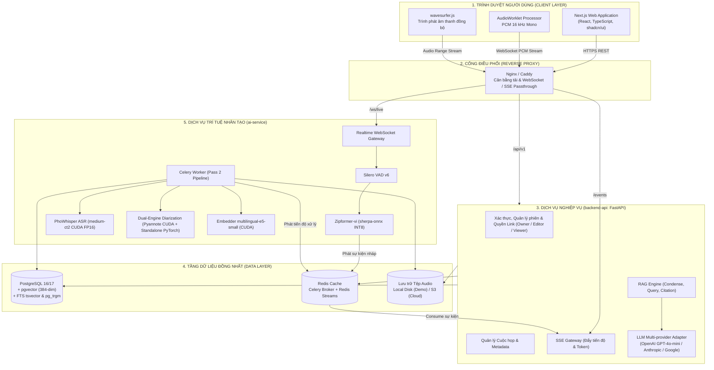

# Luận Giải Lựa Chọn Tech Stack và Kiến Trúc Hệ Thống

**Đề tài:** Hệ thống phiên âm, tóm tắt và hỏi đáp nội dung cuộc họp  
**Sinh viên:** Nguyễn Phương Linh — MSSV 20224871 — Lớp IT1-02 · **GVHD:** Thầy Cao Tuấn Dũng  
**Tài liệu:** `docs/02-research-tech/tech-stack-justification.md` (Tầng 3: Tổng hợp Toàn diện Kiến trúc & Công nghệ)  
**Ngày cập nhật:** 22/10/2026 · **Trạng thái:** Hoàn thiện v2.2 (Chuẩn hóa GPU ~24GB VRAM & Kiểm thử Kaggle — Tập trung Nghiên cứu, Công nghệ & Luồng xử lý)  

---

## Hướng dẫn đọc và Mối quan hệ giữa 3 tài liệu nghiên cứu

Tài liệu này là **Tầng 3** — đóng vai trò **bản kiến trúc tổng hợp** kết nối toàn bộ hệ thống trong nhóm tài liệu `docs/02-research-tech/`:

```
┌──────────────────────────────────────────────────────────────────────────────────┐
│              TỔNG THỂ KIẾN TRÚC VÀ CÔNG NGHỆ (docs/02-research-tech/)            │
└────────────────────────────────────────┬─────────────────────────────────────────┘
                                         │
        ┌────────────────────────────────┴────────────────────────────────┐
        ▼                                                                 ▼
┌────────────────────────────────────────┐       ┌────────────────────────────────────────┐
│  TẦNG 1: XỬ LÝ ÂM THANH & NGƯỜI NÓI    │       │  TẦNG 2: RAG, EMBEDDING & TÓM TẮT      │
│  File: asr-diarization-survey.md       │       │  File: rag-evaluation-framework.md     │
├────────────────────────────────────────┤       ├────────────────────────────────────────┤
│ • Tiền xử lý & Silero VAD v6           │       │ • Chunking theo lượt nói (Speaker-Turn)│
│ • Pass 1: sherpa-onnx Zipformer-vi     │       │ • Embedding: multilingual-e5-small     │
│ • Pass 2: PhoWhisper-medium-ct2        │       │ • PostgreSQL pgvector & Hybrid Search  │
│ • Diarization: Dual-Engine Pyannote    │       │ • LLM Cloud API (GPT-4o-mini Adapter)  │
│ • Word-to-Speaker Alignment            │       │ • Trích dẫn mốc giây & Chống ảo giác   │
└───────────────────┬────────────────────┘       └───────────────────┬────────────────────┘
                    │                                                │
                    └───────────────────────┬────────────────────────┘
                                            ▼
                    ┌───────────────────────────────────────────────┐
                    │  TẦNG 3: LUẬN GIẢI TECH STACK TOÀN DIỆN        │
                    │  File: tech-stack-justification.md (BẠN ĐÂY)  │
                    ├───────────────────────────────────────────────┤
                    │ • Tổng quan Frontend, Backend, DB, Broker     │
                    │ • Kiểm thử Kaggle (T4) vs Triển khai GPU 24GB │
                    │ • Phân bổ tài nguyên VRAM ~24GB và Độ trễ     │
                    │ • DevOps, Containerization & Quản trị rủi ro  │
                    └───────────────────────────────────────────────┘
```

- **Mục đích tài liệu:** Cung cấp luận cứ khoa học, phân tích so sánh đa tiêu chí và giải trình tại sao từng công nghệ được lựa chọn cho toàn bộ các tầng: Giao diện (Frontend), Nghiệp vụ (Backend API), Cơ sở dữ liệu (Database), Hàng đợi tác vụ (Worker) và Hạ tầng (DevOps).
- **Phạm vi kỹ thuật:** Tập trung vào các quyết định kiến trúc, phân tích đánh đổi (trade-offs), tối ưu hóa tài nguyên phần cứng và thiết kế luồng tương tác; hoàn toàn không chứa mã nguồn cài đặt.
- **Phần cứng mục tiêu:** Định rõ 2 môi trường chuẩn hóa: **Kiểm thử thực nghiệm trên Kaggle GPU (NVIDIA Tesla T4 x2 15GB VRAM / P100 16GB VRAM)** và **Triển khai toàn luồng trên Máy chủ GPU chuyên dụng ~24GB VRAM (NVIDIA RTX 3090, RTX 4090, A10G 24GB, L4 24GB)**. Tầng LLM sử dụng duy nhất Cloud API ngoài.

---

## 1. Tóm Tắt Các Quyết Định Cốt Lõi (TL;DR cho Báo cáo GVHD)

### Bảng đối chiếu Tech Stack: Kiểm thử Nghiên cứu (Kaggle) vs Triển khai Tối giản API-First (Không cần GPU)

| # | Phân tầng hệ thống | Cấu hình Nghiên cứu Khoa học (Kaggle GPU T4) | Cấu hình Triển khai Thực tế (Kiến trúc API-First - CPU) | Luận điểm kỹ thuật cốt lõi |
|---|---|---|---|---|
| **1** | **Giao diện người dùng** | **Next.js (App Router) + TypeScript + Tailwind CSS** | Giữ nguyên Next.js App Router | Hỗ trợ layout lồng nhau; tích hợp AudioWorklet thu âm và wavesurfer.js đồng bộ âm thanh. |
| **2** | **Backend nghiệp vụ** | **FastAPI (async) + Pydantic v2 + SQLAlchemy 2** | Giữ nguyên FastAPI ASGI | Kiến trúc ASGI xử lý luồng sự kiện SSE; chia sẻ trực tiếp Pydantic schema với AI Service. |
| **3** | **Cơ sở dữ liệu & Vector** | **PostgreSQL 16/17 + pgvector (384 dims)** | **PostgreSQL + pgvector (384 dims)** | **1 CSDL duy nhất cho toàn hệ thống**; đảm bảo giao dịch ACID khi người dùng sửa văn bản. |
| **4** | **Hàng đợi & Luồng sự kiện** | **Celery + Redis Streams** | **Celery + Redis Streams** | Redis Streams lưu vết sự kiện, hỗ trợ kết nối lại `Last-Event-ID` cho SSE. |
| **5** | **Lưu trữ âm thanh** | **Local Disk Storage** (Thư mục tạm) | **Local Disk / S3 API** | Trừu tượng hóa qua `ObjectStorage` interface; lưu trữ WAV và tệp xuất biên bản. |
| **6** | **ASR Pass 1 (Live)** | **sherpa-onnx Zipformer-vi INT8** + Silero VAD | **sherpa-onnx Zipformer-vi INT8** (CPU) | Nhẹ (~75MB), RTF ~0.01 trên CPU, độ trễ $\le 1.5$s, chi phí 0 VNĐ, không phụ thuộc mạng quốc tế. |
| **7** | **ASR Pass 2 (Batch)** | **PhoWhisper-medium-ct2** (Kaggle CUDA FP16) | **Gladia API (Solaria-1)** | Xử lý trọn gói tiếng Việt, WER ~18-22%, hỗ trợ Code-switching, chi phí siêu rẻ ~5.500 VNĐ/h audio. |
| **8** | **Speaker Diarization** | **Pyannote community-1** (Kaggle CUDA) | **Tích hợp sẵn trong Gladia API v2** | Bóc tách người nói tự động + word timestamps; triệt tiêu hoàn toàn mã căn chỉnh overlap phức tạp. |
| **9** | **Mô hình Embedding** | **multilingual-e5-small** (Kaggle CUDA) | **multilingual-e5-small (CPU Local)** | e5-small siêu nhẹ (118M params), nhúng cực nhanh trên CPU (~1.5s / 300 câu), giữ nguyên `vector(384)`. |
| **10**| **Reranker** | **Không sử dụng** (RRF Dense + Lexical trong PG) | **Không sử dụng** (Dùng RRF $k=60$ PostgreSQL) | Đơn giản hóa kiến trúc, tiết kiệm ~400ms độ trễ và giải phóng tài nguyên. |
| **11**| **LLM Tóm tắt & RAG** | **Cloud API (OpenAI GPT-4o-mini)** | **Google Gemini 2.0 Flash / GPT-4o-mini** | Gemini context 1M tokens, giá siêu rẻ (~50 VNĐ/cuộc họp); GPT-4o-mini làm adapter dự phòng. |
| **12**| **Hạ tầng đóng gói** | **Kaggle Kernel Environment** | **Docker Compose trên VPS CPU tiêu chuẩn** | **Không cần GPU**, chỉ cần VPS 2-4 vCPU, 4-8GB RAM (tiết kiệm ~85-90% chi phí máy chủ). |

---

## 2. Kiến Trúc Hệ Thống Tổng Thể



---

## 3. Luận Giải Chi Tiết Các Tầng Công Nghệ

### 3.1. Giao diện người dùng (Frontend)
- **Công nghệ chọn:** **Next.js (App Router) + TypeScript + Tailwind CSS + shadcn/ui**.
- **Luận cứ kỹ thuật:**
  - *Bố cục lồng nhau (Nested Layouts):* Ứng dụng trợ lý cuộc họp đòi hỏi giao diện đa thành phần hiển thị đồng thời (Sidebar danh sách cuộc họp, thanh phát audio Waveform ở trên, khung văn bản phân đoạn ở giữa và khung chat RAG ở cạnh phải). Next.js App Router quản lý trạng thái các layout lồng nhau mượt mà mà không phải tải lại toàn bộ trang.
  - *Xử lý âm thanh độ trễ thấp:* Áp dụng API tiêu chuẩn trình duyệt **`AudioWorklet`** chạy độc lập trên audio thread, liên tục gửi các khối âm thanh PCM 16 kHz qua WebSocket mà không làm giật khung hình giao diện.
  - *Hiển thị trực quan dạng sóng:* Thư viện **`wavesurfer.js`** kết hợp với dữ liệu mốc từ (`word_timestamps`) để tạo trải nghiệm nghe lại thông minh: chữ đổi màu theo thời gian thực như lời bài hát Karaoke.
- **Quy tắc phân luồng mạng:** Trình duyệt kết nối trực tiếp tới `backend-api` và `ai-service` thông qua Reverse Proxy, không proxy luồng audio hay SSE qua Next.js Server Components để tránh hiện tượng nghẽn bộ đệm và ngắt kết nối đột ngột.

---

### 3.2. Dịch vụ Nghiệp vụ (backend-api)
- **Công nghệ chọn:** **FastAPI + SQLAlchemy 2.0 (asyncpg) + Pydantic v2 + Alembic**.
- **Luận cứ kỹ thuật:**
  1. *Đồng nhất hệ sinh thái Python:* Cho phép chia sẻ trực tiếp các định nghĩa cấu trúc dữ liệu (`schemas.py`) giữa `backend-api` và `ai-service` mà không cần duy trì hai ngôn ngữ khác nhau.
  2. *Kiến trúc Asynchronous I/O gốc (ASGI):* Quản lý hàng trăm kết nối Server-Sent Events (SSE) để truyền dữ liệu tiến độ và luồng token từ LLM theo thời gian thực mà không tiêu tốn tài nguyên tiến trình như mô hình WSGI truyền thống (Django/Flask).
  3. *Tự động sinh tài liệu chuẩn OpenAPI:* Đảm bảo quy trình phát triển theo chuẩn Contract-First (Ngày 4), giúp phía frontend sinh types tự động an toàn.
  4. *Pydantic v2 (viết bằng Rust core):* Tốc độ kiểm tra và chuyển đổi dữ liệu nhanh gấp 5–10 lần so với v1, rất quan trọng khi xác thực các cấu trúc JSON phức tạp từ LLM.

---

### 3.3. Cơ sở dữ liệu và Lưu trữ Vector (PostgreSQL + pgvector)

```
                            [KIẾN TRÚC LƯU TRỮ ĐỒNG NHẤT]
                                         │
             ┌───────────────────────────┴───────────────────────────┐
             ▼                                                       ▼
  【PHƯƠNG ÁN CHỌN: POSTGRESQL + PGVECTOR】               【PHƯƠNG ÁN KHÁC: CSDL VECTOR RỜI】
  - 1 hệ thống CSDL duy nhất                              - 2 hệ thống: PostgreSQL + Qdrant/Chroma
  - Đảm bảo toàn vẹn ACID trong 1 Transaction            - Nguy cơ lệch dữ liệu giữa quan hệ và vector
  - Sửa câu nói -> Re-index vector trong 1 COMMIT        - Cần cơ chế Two-phase commit phức tạp
  - Quét chính xác WHERE meeting_id = $1 (Recall 100%)    - Tìm kiếm vector xấp xỉ luôn có sai số
  - Tiết kiệm RAM: chỉ 1 container hoạt động             - Tốn thêm 1 - 2 GB RAM cho cụm vector độc lập
```

- **Luận điểm then chốt bảo vệ đồ án:**
  Trong ứng dụng cuộc họp, người dùng thường xuyên chỉnh sửa transcript (sửa từ sai, gộp người nói). Khi sửa 1 câu:
  - Hệ thống phải cập nhật bảng `transcript_segments`.
  - Hủy kích hoạt chunk cũ và chèn chunk mới vào bảng `transcript_embeddings`.
  - Đánh dấu bản tóm tắt cũ (`stale = true`).
  Nhờ **PostgreSQL + pgvector**, toàn bộ quy trình trên được thực hiện an toàn trong **MỘT TRANSACTION DUY NHẤT**. Nếu có lỗi xảy ra, toàn bộ sẽ được rollback tự động. Nếu dùng một CSDL vector riêng biệt (như Qdrant hay Milvus), việc đồng bộ dữ liệu sẽ biến thành bài toán phân tán phức tạp không đáng có.

---

### 3.4. Hàng Đợi Tác Vụ và Luồng Sự Kiện
- **Hàng đợi tác vụ:** **Celery + Redis Broker**.
  - Quy trình xử lý âm thanh (chuẩn hóa audio $\to$ VAD $\to$ ASR $\to$ Diarization $\to$ căn chỉnh $\to$ embedding) là chuỗi tác vụ dài (Long-running linear pipeline). Celery cung cấp cơ chế ghép chuỗi (`chain`), thử lại tự động (`retry`) và quản lý trạng thái mạnh mẽ.
  - Trên **Máy chủ GPU ~24GB VRAM:** Thiết lập cấu hình **Celery Worker GPU** với `worker_concurrency = 2` (hoặc phân tách hàng đợi ưu tiên). Nhờ dung lượng 24GB VRAM dư dả (mỗi luồng pipeline đầy đủ chỉ chiếm ~5–6 GB VRAM), hệ thống có khả năng xử lý song song 2 đến 3 cuộc họp cùng lúc mà hoàn toàn không lo quá tải VRAM. Trên môi trường **Kaggle**, cấu hình `worker_concurrency = 1` để tối ưu cho 1 card T4 15GB.
- **Luồng sự kiện (Event Streaming):** Sử dụng **Redis Streams** thay vì Redis Pub/Sub thuần.
  - *Hạn chế của Pub/Sub:* Cơ chế bắn-rồi-bỏ (Fire-and-forget). Nếu mạng người dùng chập chờn 3 giây, toàn bộ sự kiện tiến độ ASR phát ra trong khoảng thời gian đó sẽ bị mất vĩnh viễn.
  - *Ưu thế của Streams:* Redis Streams lưu vết lịch sử theo ID thời gian. Khi trình duyệt kết nối lại với tiêu đề `Last-Event-ID`, SSE Gateway đọc tiếp đúng sự kiện bị gián đoạn, đảm bảo thanh tiến độ không bao giờ bị đơ hay mất trạng thái.

---

### 3.5. Lưu Trữ Tệp Âm Thanh (Object Storage)
- **Thiết kế giao diện trừu tượng (`ObjectStorage`):**  
  Mã nguồn ứng dụng giao tiếp với tầng lưu trữ thông qua một interface trừu tượng thống nhất định nghĩa các hành động: ghi tệp (`put_file`), đọc luồng nhị phân (`get_stream`), và sinh URL truy cập tạm thời (`generate_presigned_url`).
- **Triển khai khi Kiểm thử Thực nghiệm:**  
  Sử dụng driver lưu trữ tệp cục bộ (`LocalStorageDriver`) ghi trực tiếp vào thư mục tạm an toàn trên ổ đĩa (`./data/storage/audio/`), đơn giản hóa môi trường kiểm thử không cần dựng dịch vụ S3.
- **Triển khai khi Triển Khai Toàn Luồng trên Server:**  
  Chuyển sang driver S3 (`S3StorageDriver`) trỏ tới cụm **SeaweedFS** hoặc AWS S3 chỉ bằng việc thay đổi biến cấu hình môi trường `.env`.

---

### 3.6. Lớp Trừu Tượng Mô Hình Ngôn Ngữ Lớn (LLM Adapter)
- **Mô hình Adapter đa nhà cung cấp:**  
  Hệ thống thiết kế một lớp giao tiếp trừu tượng `LLMProvider` bọc ngoài các API bên ngoài, cung cấp hai phương thức chuẩn hóa: sinh cấu trúc theo schema (`generate_structured`) và sinh luồng văn bản (`generate_stream`).
- **Quyết định sử dụng duy nhất Cloud API ngoài:**  
  Cài đặt mặc định với **`OpenAIAdapter` trỏ tới `gpt-4o-mini`** (kết hợp hỗ trợ Google Gemini và Anthropic Claude):
  - **Tuyệt đối không tự host LLM:** Tiết kiệm từ 10–18 GB VRAM quý giá trên GPU 24GB, để dành toàn bộ năng lực tính toán cho ASR nhận dạng giọng nói và Diarization phân tách người nói.
  - **Đảm bảo chuẩn xác 100% JSON Schema:** Tận dụng tính năng Structured Outputs của OpenAI ép kiểu JSON Schema tóm tắt và trích xuất Action Items đạt độ chính xác 100%.
  - **Không bị khóa chặt vào một nhà cung cấp (Vendor lock-in):** Có thể chuyển sang `ClaudeAdapter` (Claude 3.5 Haiku) hoặc `GeminiAdapter` (Gemini 1.5/2.0 Flash) chỉ bằng cấu hình biến môi trường.

---

## 4. Phân Bổ Tài Nguyên Bộ Nhớ GPU (~24GB VRAM) và RAM Hệ Thống khi Triển Khai Toàn Luồng

> [!IMPORTANT]
> **Đặc tính phần cứng máy chủ triển khai toàn luồng:**
> - GPU: **1x NVIDIA GeForce RTX 3090 / RTX 4090 / NVIDIA A10G (24 GB VRAM chuyên dụng GDDR6X, hỗ trợ CUDA & Tensor Cores)**.
> - CPU hệ thống: 8 vCPU (x86_64).
> - RAM hệ thống: 32 GB RAM DDR4/DDR5.
> - Ổ cứng: 1 TB NVMe SSD.

### Bảng phân bổ bộ nhớ GPU (24GB VRAM) trong kịch bản vận hành thực tế:

```
┌────────────────────────────────────────────────────────────────────────┐
│             BẢN ĐỒ PHÂN BỔ BỘ NHỚ GPU 24GB VRAM TRÊN MÁY CHỦ SẢN XUẤT   │
├────────────────────────────────┬───────────────────┬───────────────────┤
│ THÀNH PHẦN MÔ HÌNH HOẠT ĐỘNG   │ TIÊU THỤ VRAM     │ GHI CHÚ VẬN HÀNH  │
├────────────────────────────────┼───────────────────┼───────────────────┤
│ CUDA Driver Context & PyTorch  │ ~0.8 - 1.0 GB     │ Overhead khởi tạo CUDA ban đầu
│ Silero VAD v6 Gatekeeper       │ ~0.1 - 0.2 GB     │ Lọc frame 32ms siêu nhẹ
│ sherpa-onnx Zipformer-vi INT8  │ ~0.2 - 0.3 GB     │ Pass 1: Live interim text
│ PhoWhisper-medium-ct2 (FP16)   │ ~1.8 - 2.2 GB     │ Pass 2: Batch ASR (CTranslate2)
│ pyannote community-1 (CUDA)    │ ~2.2 - 2.8 GB     │ Dual-Engine 1 Diarization
│ multilingual-e5-small (CUDA)   │ ~0.4 - 0.5 GB     │ Sinh vector embedding 384 dims
├────────────────────────────────┼───────────────────┼───────────────────┤
│ TỔNG VRAM CHIẾM DỤNG TỐI ĐA    │ ~5.5 - 7.0 GB     │ CHỈ CHIẾM ~25 - 29% 24GB VRAM
│ VRAM DỰ PHÒNG TRỐNG (FREE)     │ ~17.0 - 18.5 GB   │ DƯ DẢ CHO MULTI-WORKER (>= 3-4 LUỒNG)
└────────────────────────────────┴───────────────────┴───────────────────┘
```

**Các ưu thế kỹ thuật vượt trội khi triển khai trên GPU 24GB VRAM:**
1. **Dư địa tài nguyên khổng lồ (> 17 GB VRAM):** Cho phép mở rộng song song 2 đến 3 Celery Worker xử lý đồng thời nhiều cuộc họp dài cùng lúc mà không bao giờ gặp lỗi CUDA Out-Of-Memory.
2. **Loại bỏ hoàn toàn rủi ro nghẽn cổ chai:** Không bị throttle nhiệt độ, không phải swap dữ liệu vào ổ đĩa, toàn bộ tensor waveform và ma trận trọng số được duy trì trực tiếp trên VRAM tốc độ cao (băng thông ~900–1000 GB/s).
3. **Độc lập và bảo vệ tài nguyên:** Nhờ đẩy tác vụ LLM ra Cloud API ngoài, hệ thống không bị "ngốn" 10–18 GB VRAM cho một mô hình ngôn ngữ lớn nội bộ, giữ toàn bộ sức mạnh GPU cho các pipeline xử lý tín hiệu âm thanh tốc độ cao.

---

## 5. Đặc Tả Triển Khai Toàn Luồng Trên Máy Chủ Thuê GPU ~24GB VRAM

Toàn bộ hệ thống được đóng gói và vận hành chính thức trên máy chủ GPU thuê ngoài cấu hình cao, phục vụ xuyên suốt từ thu âm, nhận dạng, phân tách người nói đến hỏi đáp RAG:

### Cấu hình máy chủ sản xuất chuẩn hóa:
- **Bộ xử lý đồ họa (GPU):** 1x NVIDIA GeForce RTX 3090 (24GB VRAM) / RTX 4090 (24GB VRAM) hoặc NVIDIA A10G (24GB VRAM), hỗ trợ đầy đủ CUDA 12.x và nhân tính toán Tensor Cores.
- **CPU & Bộ nhớ:** 8 vCPU (x86_64), 32 GB RAM hệ thống.
- **Hệ điều hành & Driver:** Ubuntu 22.04 LTS, NVIDIA Driver $\ge 535$, NVIDIA Container Toolkit.
- **Quy trình kích hoạt pipeline toàn luồng:**
  1. Kích hoạt runtime NVIDIA trong Docker Compose (`runtime: nvidia`).
  2. Nạp mô hình nhận dạng ASR: **`nunu-willump/PhoWhisper-medium-ct2`** (hoặc `kiendt/PhoWhisper-large-ct2`) trên CUDA FP16.
  3. Khởi tạo **Dual-Engine Diarization**: Engine 1 (`pyannote community-1` trên CUDA với `min_speakers=2`) và sẵn sàng Engine 2 (Standalone Acoustic Diarizer thuần PyTorch 100% Zero-Token).
  4. Khởi tạo mô hình Embedding **`multilingual-e5-small`** (384 dims) trên CUDA.
  5. Cấu hình biến môi trường kết nối Cloud LLM API (`OPENAI_API_KEY` cho `gpt-4o-mini`).
  6. Kích hoạt cụm **SeaweedFS** (hoặc S3 endpoint) làm kho lưu trữ tệp âm thanh lâu dài.

---

## 6. Môi Trường Phát Triển, Đóng Gói và DevOps

### 6.1. Bộ công cụ phát triển tiêu chuẩn
- **Quản lý gói Python:** Sử dụng **`uv`** (Astral) với tốc độ khởi tạo môi trường và cài đặt gói nhanh hơn `pip` gấp 10–100 lần, cố định phiên bản tuyệt đối qua `uv.lock`.
- **Linting & Định dạng mã:** **`Ruff`** cho Python (thay thế flake8, black, isort) và **`Prettier + ESLint`** cho TypeScript/React.
- **Kiểm tra kiểu tĩnh:** `pyright` / `mypy` cho backend; `tsc --noEmit` cho frontend.
- **Kiểm thử tự động:** `pytest` + `pytest-asyncio` + `testcontainers` (chạy PostgreSQL và Redis thật khi test); `Playwright` cho kiểm thử luồng người dùng E2E.

### 6.2. Danh mục dịch vụ Docker cho Triển Khai Toàn Luồng

Hệ thống được đóng gói hoàn chỉnh bằng Docker Compose, tận dụng NVIDIA Container Toolkit để cấp quyền truy cập GPU trực tiếp cho các dịch vụ AI:

| Tên Container | Image cơ sở | Cổng kết nối | Mục đích vận hành |
|---|---|---|---|
| `mva-postgres` | `pgvector/pgvector:pg17` | `5432:5432` | Lưu trữ dữ liệu quan hệ, vector 384-dim và full-text search. |
| `mva-redis` | `redis:7-alpine` | `6379:6379` | Broker điều phối hàng đợi Celery và lưu trữ luồng sự kiện Redis Streams. |
| `mva-storage` | `chrislusf/seaweedfs:latest` | `8333:8333, 9000:9000` | Cụm Object Storage tương thích giao thức S3 lưu trữ tệp ghi âm. |
| `mva-ai-service` | `mva-ai-service:latest` (CUDA 12.2 runtime) | `8001:8001` | Celery Worker (Pass 2 ASR + Diarization) và Realtime WebSocket (Pass 1). |
| `mva-backend` | `mva-backend-api:latest` | `8000:8000` | FastAPI ASGI Server phục vụ REST API, SSE Gateway và RAG Engine. |
| `mva-frontend` | `mva-frontend:latest` | `3000:3000` | Next.js Standalone phục vụ giao diện người dùng trực quan. |

---

## 7. Ma Trận Quản Trị Rủi Ro Kỹ Thuật

| Mã | Rủi ro công nghệ | Xác suất | Mức ảnh hưởng | Giải pháp kiểm soát và Phương án dự phòng |
|---|---|---|---|---|
| **R1** | Quá tải VRAM khi xử lý nhiều cuộc họp đồng thời | Thấp | Cao | Dung lượng 24GB VRAM rất rộng rãi (~6.5GB cho 1 luồng đầy đủ); cấu hình Celery `concurrency = 2-3` an toàn tuyệt đối. |
| **R2** | Lỗi cấp quyền Gated Repo hoặc thiếu HF_TOKEN cho Pyannote | Trung bình | Thấp | Tự động kích hoạt **Engine 2 (Standalone Acoustic Diarizer)** thuần PyTorch 100% Zero-Token, không gián đoạn luồng. |
| **R3** | Chi phí Cloud LLM API bị đội lên ngoài ý muốn | Thấp | Trung bình | Sử dụng GPT-4o-mini giá rẻ ($0.15/1M tokens); giới hạn token tối đa cho mỗi câu trả lời; cache kết quả tóm tắt. |
| **R4** | Sai số phiên âm tên riêng, thuật ngữ kỹ thuật | Cao | Trung bình | Cho phép nhập danh mục từ vựng trước cuộc họp (`initial_prompt`); áp dụng bộ lọc mờ và từ điển Hotwords ở hậu xử lý. |
| **R5** | Lỗi ngắt kết nối WebSocket khi ghi âm trực tiếp | Trung bình | Thấp | Trình duyệt lưu đệm các khối PCM cục bộ (AudioWorklet); cơ chế tự động kết nối lại và truyền bù dữ liệu thiếu. |
| **R6** | Lỗi Diarization khi có nhiều tạp âm bất thường | Thấp | Trung bình | Kích hoạt chế độ suy giảm có kiểm soát (Degraded Mode): giữ nguyên văn bản, gán `speaker = SPEAKER_UNKNOWN`. |

---

## 8. Bảng Nhật Ký Quyết Định Kiến Trúc (Architecture Decision Records - ADR)

| Mã ADR | Tiêu đề quyết định | Trạng thái | Căn cứ khoa học và Thực tiễn |
|---|---|---|---|
| **ADR-001** | Tách hai dịch vụ: `backend-api` và `ai-service` | **Đã phê duyệt** | Giúp backend khởi động nhẹ, nhanh, độc lập; module AI có thể chuyển sang máy chủ GPU mà không ảnh hưởng nghiệp vụ. |
| **ADR-002** | Kiến trúc hai lượt: Pass 1 Zipformer-vi $\to$ Pass 2 PhoWhisper | **Đã phê duyệt** | Giải quyết triệt để mâu thuẫn giữa độ trễ thấp khi đang họp ($\le 1.5$s) và độ chính xác cao cho bản lưu trữ. |
| **ADR-003** | Sử dụng PostgreSQL + pgvector làm CSDL duy nhất | **Đã phê duyệt** | Đảm bảo tính toàn vẹn ACID trong một transaction khi người dùng chỉnh sửa văn bản cuộc họp. |
| **ADR-004** | Sử dụng Redis Streams cho kênh sự kiện SSE | **Đã phê duyệt** | Hỗ trợ phục hồi trạng thái tiến độ qua `Last-Event-ID` khi mạng người dùng bị gián đoạn. |
| **ADR-005** | Lựa chọn mô hình AI tối ưu cho GPU ~24GB VRAM & Kiểm thử Kaggle | **Đã phê duyệt** | Chuẩn hóa PhoWhisper-medium-ct2 (WER 26.85%), Zipformer-vi INT8, Dual-Engine Diarization và E5-small trên CUDA. |
| **ADR-006** | Sử dụng duy nhất Cloud LLM API (GPT-4o-mini) thay vì self-host LLM | **Đã phê duyệt** | Tiết kiệm 10–18 GB VRAM cho GPU 24GB; tận dụng Structured Outputs ép kiểu JSON Schema đạt độ chính xác 100%. |
| **ADR-007** | Áp dụng Dual-Engine Diarization kết hợp ép min_speakers=2 | **Đã phê duyệt** | Loại bỏ lỗi gom về 1 người nói và loại trừ rủi ro phụ thuộc Hugging Face token qua Engine 2 thuần PyTorch. |

---

## 9. Tài Liệu Tham Khảo

1. VinAI Research. PhoWhisper: Automatic Speech Recognition for Vietnamese. [https://github.com/VinAIResearch/PhoWhisper](https://github.com/VinAIResearch/PhoWhisper)
2. pyannote.audio 4.x: Speaker Diarization Community-1 Model Card. [https://huggingface.co/pyannote/speaker-diarization-community-1](https://huggingface.co/pyannote/speaker-diarization-community-1)
3. SYSTRAN. faster-whisper CTranslate2 Engine. [https://github.com/systran/faster-whisper](https://github.com/systran/faster-whisper)
4. pgvector Team. pgvector: Open-source vector similarity search for PostgreSQL. [https://github.com/pgvector/pgvector](https://github.com/pgvector/pgvector)
5. Wang et al. Multilingual E5 Text Embeddings: Technical Report. arXiv:2402.05672. [https://arxiv.org/abs/2402.05672](https://arxiv.org/abs/2402.05672)
6. OpenAI. GPT-4o-mini Platform & Structured Outputs Documentation. [https://platform.openai.com/docs/models/gpt-4o-mini](https://platform.openai.com/docs/models/gpt-4o-mini)
7. NVIDIA Corporation. NVIDIA CUDA & Tensor Cores Architecture. [https://developer.nvidia.com/cuda-zone](https://developer.nvidia.com/cuda-zone)
