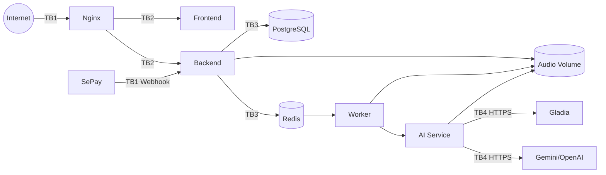

# MÔ HÌNH ĐE DỌA THEO IMPLEMENTATION HIỆN TẠI

**Cập nhật:** 16/11/2026  
**Phương pháp:** STRIDE, phân biệt kiểm soát đã có và cần làm

## 1. Tài sản

- Audio gốc và giọng nói cá nhân.
- Transcript, summary, action items, chat/citations.
- Hồ sơ user, password hash, JWT và share token.
- Thông tin ngân hàng, payment order và raw SePay webhook.
- Provider keys, DB password, JWT signing key.
- PostgreSQL/audio volume và backup.

## 2. Trust boundaries

Production Compose chỉ public Nginx; internal service và data store ở Docker network.

## 3. STRIDE matrix

| ID | Loại | Đe dọa | Kiểm soát hiện có | Gap/hành động |
|---|---|---|---|---|
| S-01 | Spoofing | Đánh cắp JWT trong browser | JWT expiry, bcrypt, `token_version`, refresh rotation + phát hiện reuse | Token vẫn ở localStorage; chuyển HttpOnly Secure cookie, CSP/XSS hardening |
| S-02 | Spoofing | Đoán/lộ share token | Token URL-safe ngẫu nhiên, so sánh constant-time, áp dụng cho mọi route con, không bao giờ MANAGE | Chưa expiry/revoke/audit |
| S-03 | Spoofing | Webhook SePay giả | API key bắt buộc (thiếu/sai trả 401, `compare_digest`), order hết hạn bị từ chối | Rate limit, IP/signature validation theo khả năng provider |
| T-01 | Tampering | Sửa transcript/action item trái quyền | `MeetingAccessPolicy` cho mọi route con, kiểm tra segment thuộc đúng meeting; ma trận `tests/test_authorization.py` | Đã xử lý; thêm revision/audit ở Phase 3 |
| T-02 | Tampering | Ghi đè/xóa audio | Volume không public | Chưa checksum/version/immutable storage/audit |
| T-03 | Tampering | Webhook trùng | Transaction ID unique làm cổng idempotency, `SELECT ... FOR UPDATE` trên order; `tests/test_payments_concurrency.py` (PostgreSQL) | Đã xử lý |
| R-01 | Repudiation | Phủ nhận sửa/xóa dữ liệu | Timestamp cơ bản | Chưa audit log/version history |
| I-01 | Disclosure | Truy cập transcript/audio bằng UUID | `MeetingAccessPolicy`; stream audio cần VIEW hoặc URL ký 10 phút; order code ngẫu nhiên và chỉ chủ đơn xem được | Đã xử lý |
| I-02 | Disclosure | Provider nhận nội dung nhạy cảm | HTTPS provider | Cần consent, retention/DPA, redact PII theo chính sách |
| I-03 | Disclosure | Secret trong repo/log | `.env` ignored, production required vars | Rotate secret cũ nếu từng lộ; dùng secret manager khi production |
| I-04 | Disclosure | Raw webhook chứa PII/tài chính | DB nội bộ | Giới hạn retention và quyền truy cập |
| D-01 | DoS | Upload lớn | Nginx 500 MB, giới hạn `MAX_UPLOAD_MB` khi streaming (xóa file dở), kiểm tra extension + magic bytes, quota 402 trước khi lưu | Duration validation (ffprobe), rate limit |
| D-02 | DoS | Spam auth/chat/payment | Pydantic validation | Chưa rate limit/account lockout |
| D-03 | DoS | Queue/provider treo | Timeout, healthcheck | Retry/backoff/dead-letter/stale task recovery |
| E-01 | Privilege | Viewer gọi write endpoint | Policy thống nhất VIEW/EDIT/MANAGE trên mọi route | Đã xử lý |
| E-02 | Privilege | Liên kết meeting người khác vào project | Role project + yêu cầu EDIT trên meeting khi link | Đã xử lý |
| E-03 | Privilege | Đọc file cục bộ qua ai-service (`audio_path` tùy ý) | Route nhận storage key, resolve trong `STORAGE_ROOT` có kiểm tra containment; `X-Service-Token`; port 8001 không publish | Đã xử lý |

## 4. LLM-specific risks

### Prompt injection

Transcript là dữ liệu không tin cậy. Prompt generator có đánh dấu excerpts, và LLM không có shell/DB tool. Tuy vậy cần test câu lệnh độc hại trong transcript và xác minh output không tiết lộ system prompt/secret.

### Hallucination/citation

- Retriever trả top segments và generator trả citation metadata.
- Code chưa có threshold từ chối hoặc server-side claim-to-citation verifier đầy đủ.
- UI cho phép người dùng click timestamp để tự kiểm tra.

### Model/provider lifecycle

Model name hardcode có thể bị đổi/deprecate. Cần cấu hình model qua env, pin test và giám sát error/cost.

### Unsafe fallback

Đã loại bỏ: khi provider/key lỗi, meeting chuyển `failed` kèm `failure_stage`/`failure_reason`, không ghi transcript/summary giả và không tính quota. Chỉ có engine `mock` ở môi trường development (`ENVIRONMENT=development` và `AUDIO_PIPELINE_ENGINE=mock`), meeting được gắn `is_demo`. Cấu hình production từ chối khởi động với engine mock hoặc secret mặc định.

## 5. Dữ liệu và privacy

- Thu âm cần sự đồng ý của người tham gia theo quy định áp dụng.
- Encryption at rest phụ thuộc EBS encryption; Docker volume tự nó không mã hóa.
- TLS chỉ có sau khi chủ dự án bật cấu hình Certbot/domain.
- Delete meeting hiện là soft-delete và không xóa file audio; không được tuyên bố đã hỗ trợ right-to-erasure hoàn chỉnh.
- Provider retention/training policy phải được kiểm tra theo account/contract thực tế.

## 6. Security release gate

Trước public production:

1. Hoàn thiện authorization cho transcript, summary, chat, audio, export.
2. Tắt production fallback và có retry/failure workflow.
3. Cookie HttpOnly + CSRF strategy hoặc threat model tương đương.
4. CORS allowlist, CSP, rate limiting và upload validation sâu.
5. Alembic constraints; backup/restore; audit log.
6. HTTPS, secret rotation, dependency/image scan.
7. Pen-test IDOR bằng meeting/project/segment UUID của user khác.
8. Test webhook replay/concurrency và payment amount/order matching.

## 7. Kiểm thử bảo mật tối thiểu

- User A không đọc/sửa/xóa tài nguyên của User B bằng UUID.
- Viewer token không gọi write operation.
- Token sai/hết hạn bị từ chối.
- File giả extension/MIME, file > limit và zip bomb bị từ chối.
- Webhook sai key, thiếu tiền, order code sai, replay bị từ chối/idempotent.
- Transcript chứa prompt injection không làm lộ secret hoặc tạo hành động ngoài văn bản.
- Provider failure không sinh false-success production.
