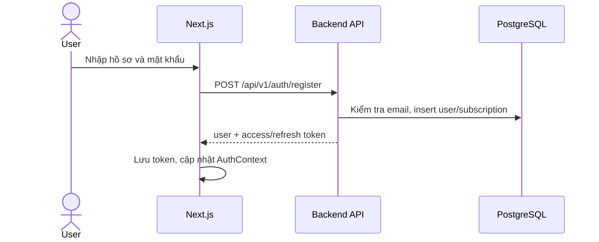
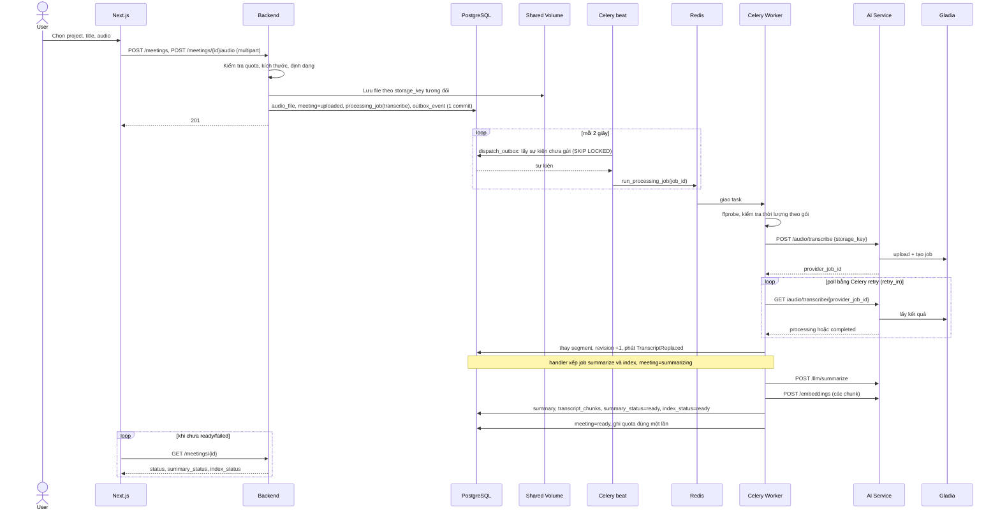
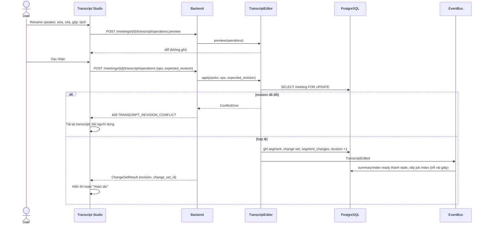
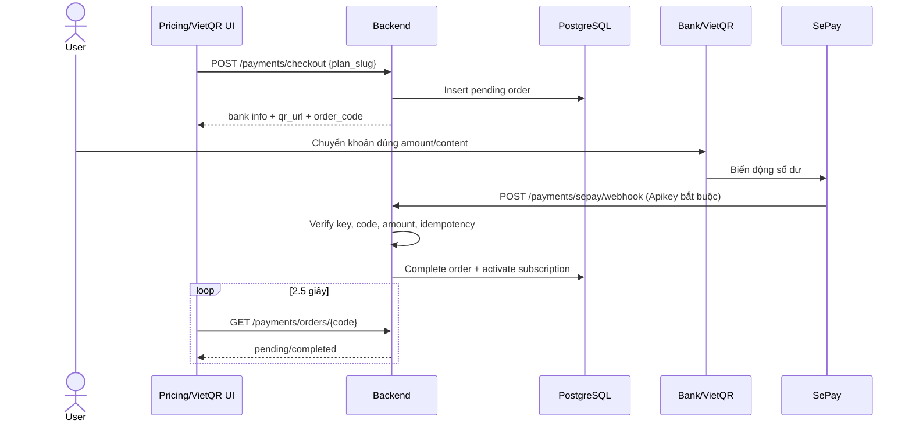
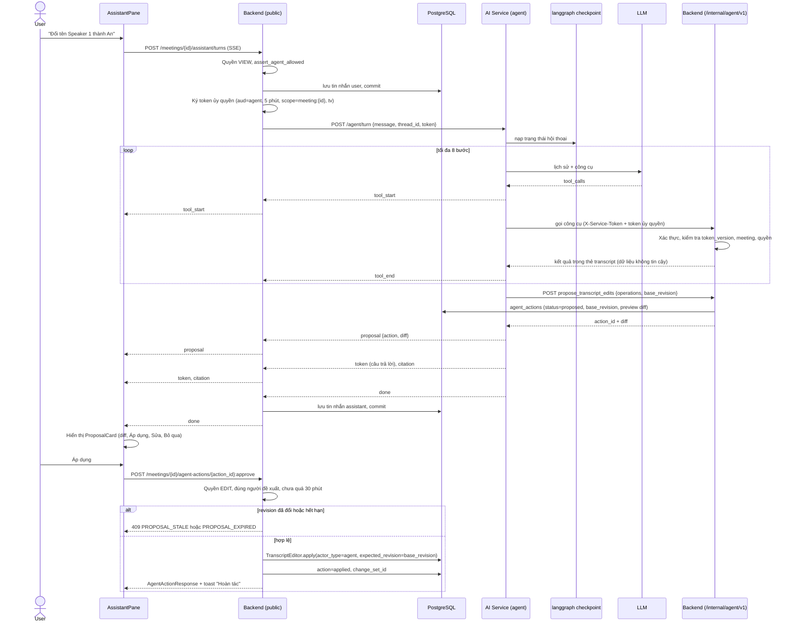
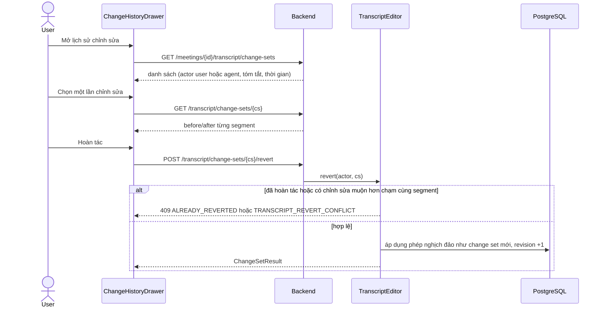
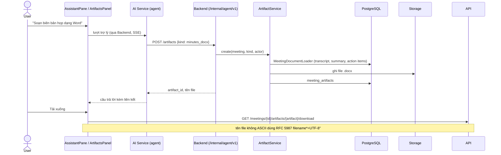

# SƠ ĐỒ TUẦN TỰ THEO CODE HIỆN TẠI

**Phiên bản:** 3.0 — đối chiếu code ngày 17/11/2026

## 1. UC-01 — Đăng ký



## 2. UC-03 — Upload và xử lý audio

Việc gửi task nằm trong transaction của request thông qua outbox; tiến trình API không còn tự chạy tác vụ nền.



Lỗi tạm thời (AI Service, Gladia 5xx, timeout) khiến bước tự retry với backoff luỹ thừa, tối đa `job_max_attempts = 3`. Hết lượt, job và meeting chuyển `failed` kèm `failure_reason`; người dùng thử lại bằng `POST /meetings/{id}/reprocess`.

## 3. UC-04 — Biên tập transcript

Mọi thao tác ghi đi qua `TranscriptEditor`. Client gửi `expected_revision` để tránh ghi đè chỉnh sửa của người khác.



Các endpoint cũ (`PATCH /transcripts/segments/{id}`, `rename-speaker`, `delete-segments`) vẫn hoạt động, được đánh dấu deprecated và cùng gọi `TranscriptEditor`.

## 4. UC-06 — Hỏi đáp có trích dẫn

```mermaid
sequenceDiagram
    actor U as User
    participant UI as AssistantPane
    participant API as Backend
    participant DB as PostgreSQL + pgvector
    participant AI as AI Service
    participant L as Gemini/OpenAI

    U->>UI: Nhập câu hỏi
    UI->>API: POST /meetings/{id}/chat {query}
    API->>API: check_can_ask (gói, giới hạn câu hỏi)
    API->>AI: POST /embeddings (câu hỏi)
    AI-->>API: vector 384 chiều
    API->>DB: Một câu SQL: cosine HNSW + ts_rank GIN, hợp nhất RRF, WHERE meeting_id
    DB-->>API: top-k chunk kèm khoảng thời gian
    API->>AI: POST /rag/answer {query, chunks, history}
    AI->>L: Câu hỏi + ngữ cảnh đã chọn
    L-->>AI: Câu trả lời
    AI-->>API: answer + citations
    API->>DB: Lưu agent_messages (user và assistant)
    API-->>UI: ChatMessageResponse
    U->>UI: Bấm trích dẫn
    UI->>UI: audio.currentTime = start_time; play()
```

Khi meeting chưa có chỉ mục (`index_status` là `none`, `pending` hoặc `failed`), Backend trả `INDEX_NOT_READY` thay vì trả lời bằng dữ liệu không đầy đủ.

## 5. UC-10 — VietQR/SePay



## 6. Lượt trợ lý với đề xuất và phê duyệt

Chỉ gói có `features.agent_tools` (Pro, Business) dùng được; gói khác nhận `PLAN_FEATURE_REQUIRED` và vẫn dùng hỏi đáp thuần ở mục 4.



Tóm tắt các bất biến bảo mật: token ủy quyền không do mô hình nhìn thấy; mọi công cụ dùng quyền của User khởi tạo lượt, không phải của share token; công cụ ghi chỉ tạo đề xuất; duyệt luôn do con người thực hiện qua endpoint công khai; `/internal/*` không được nginx chuyển ra ngoài.

## 7. UC-11 — Xem lịch sử và hoàn tác



## 8. UC-12 — Tạo biên bản và tài liệu



## 9. UC-S01 — Ghi microphone rồi xử lý batch


Luồng này không có transcript live và hệ thống không còn kênh WebSocket nào; Nginx cũng không cấu hình WebSocket upgrade nữa.
