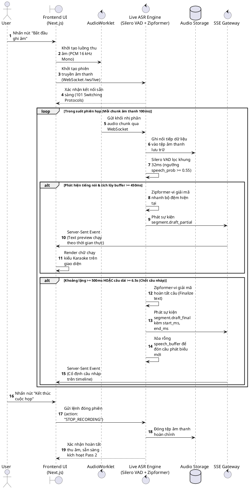
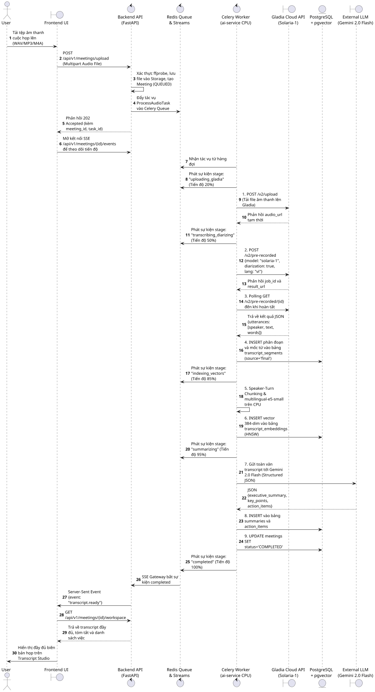
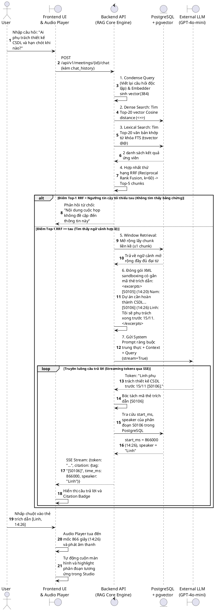
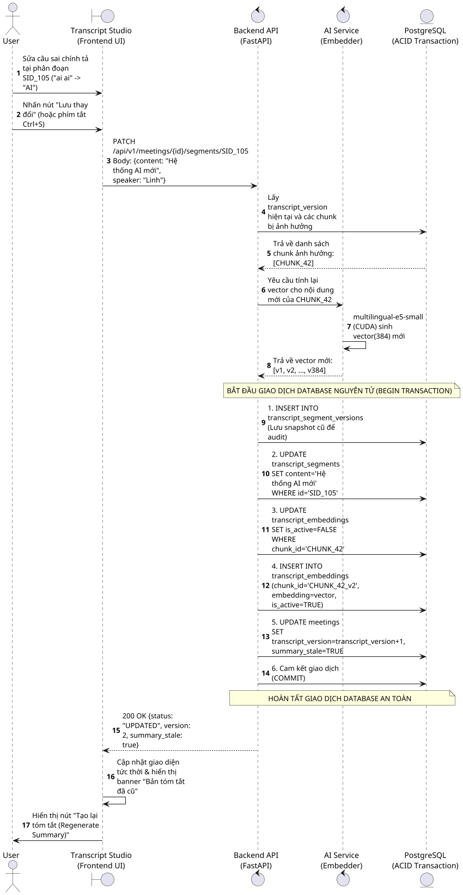
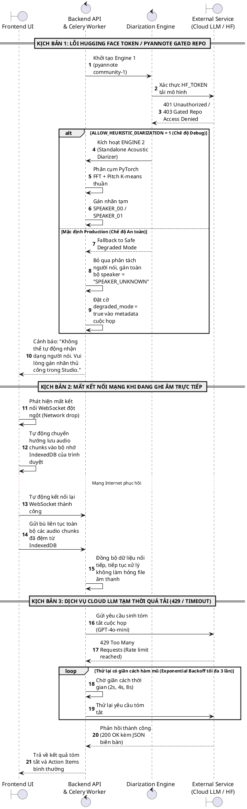
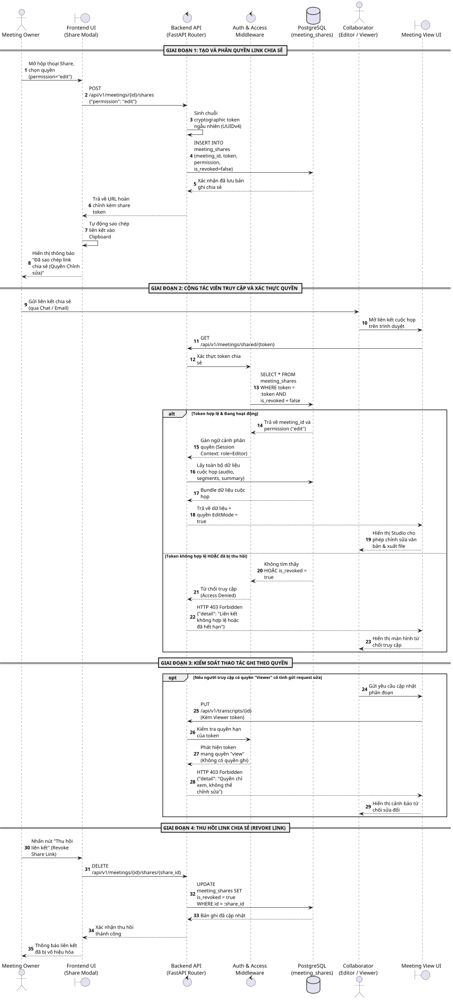

# Sơ Đồ Tuần Tự Hệ Thống (Runtime View - Sequence Diagrams)

**Dự án:** Hệ thống phiên âm, tóm tắt và hỏi đáp nội dung cuộc họp (Meeting Voice Assistant)  
**Tiêu chuẩn áp dụng:** arc42 Mục 6 (Runtime View), UML 2.5 Sequence Specification (Analysis Level)  
**Tài liệu liên quan:** [docs/03-architecture/system-architecture.md](file:///Users/plxg/workspace/meeting-voice-assistant/docs/03-architecture/system-architecture.md), [docs/02-research-tech/asr-diarization-survey.md](file:///Users/plxg/workspace/meeting-voice-assistant/docs/02-research-tech/asr-diarization-survey.md), [docs/02-research-tech/rag-evaluation-framework.md](file:///Users/plxg/workspace/meeting-voice-assistant/docs/02-research-tech/rag-evaluation-framework.md)  
**Phiên bản:** 2.2 · **Ngày cập nhật:** 2026-10-22  

---

## 1. Tổng Quan Runtime View (Analysis Level)

Tài liệu này đặc tả 6 luồng tương tác cốt lõi theo chuẩn UML quốc tế (Analysis Level):
1. **Luồng 1:** Ghi âm trực tiếp (UC-01: Live Recording)
2. **Luồng 2:** Xử lý tệp âm thanh (UC-02: Batch Processing)
3. **Luồng 3:** Hỏi đáp cuộc họp (UC-05: Meeting Q&A)
4. **Luồng 4:** Chỉnh sửa biên bản (UC-03: Transcript Editing)
5. **Luồng 5:** Xử lý sự cố & Phục hồi (Fault Recovery)
6. **Luồng 6:** Chia sẻ & Phân quyền qua Link (UC-07: Share Meeting & Access Control)

Các sơ đồ sử dụng thuật ngữ kỹ thuật chuyên ngành chuẩn hóa (Frontend UI, AudioWorklet, Backend API, Celery Worker, PostgreSQL + pgvector, Redis Streams, External LLM), tập trung vào các bước xử lý trọng yếu, loại bỏ việc chia lane/box rườm rà và được căn chỉnh layout để vừa vặn trên màn hình hiển thị.

---

## 2. Luồng 1: Ghi âm trực tiếp (UC-01: Live Recording)

Mô tả quá trình thu âm qua Microphone, phát hiện giọng nói (Silero VAD) và hiển thị văn bản nháp tức thời (Zipformer-vi) với độ trễ $\le 1.5$ giây.

---

## 3. Luồng 2: Xử lý tệp âm thanh (UC-02: Batch Processing)

Mô tả quy trình tải file ghi âm lên hệ thống: tự động bóc băng, phân tách người nói, tạo bản tóm tắt và trích xuất danh sách việc cần làm.

---

## 4. Luồng 3: Hỏi đáp cuộc họp (UC-05: Meeting Q&A)

Mô tả tính năng hỏi đáp nội dung cuộc thảo luận: tìm kiếm ngữ cảnh liên quan, sinh câu trả lời kèm mốc thời gian để người dùng bấm nghe lại âm thanh gốc.

---

## 5. Luồng 4: Chỉnh sửa biên bản (UC-03: Transcript Editing)

Mô tả tính năng sửa lời thoại hoặc đổi tên người nói: hệ thống lưu lịch sử phiên bản và đồng bộ ngay với dữ liệu tìm kiếm, tóm tắt.

---

## 6. Luồng 5: Xử lý sự cố & Phục hồi (Fault Recovery)

Mô tả phản ứng tự động khi gặp trục trặc: rớt mạng khi ghi âm (đệm dữ liệu vào trình duyệt), lỗi phân tách người nói, hoặc dịch vụ AI ngoài quá tải.

---

## 7. Luồng 6: Chia sẻ & Phân quyền qua Link (UC-07: Share Meeting & Access Control)

Mô tả quá trình Chủ cuộc họp (Owner) phát hành liên kết chia sẻ bảo mật với lựa chọn quyền (`Viewer` hoặc `Editor`), cách hệ thống kiểm soát quyền truy cập tại API Middleware và quy trình thu hồi liên kết (Revoke).

