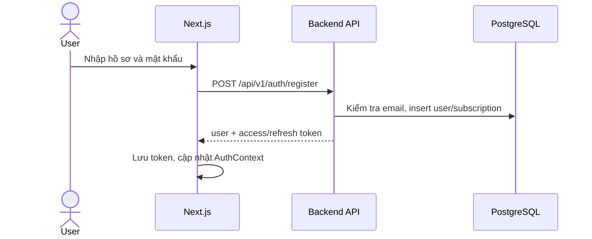
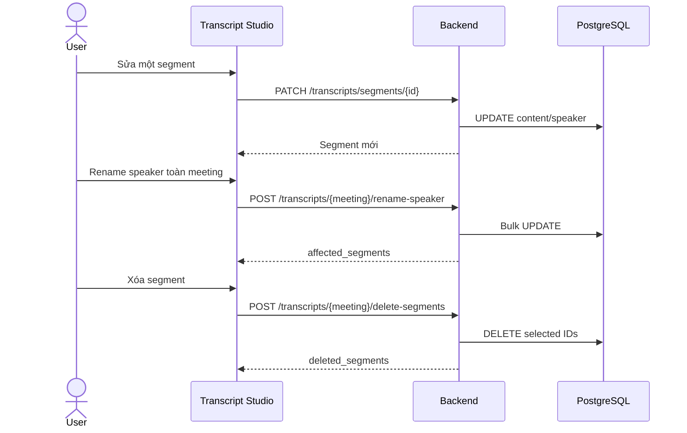
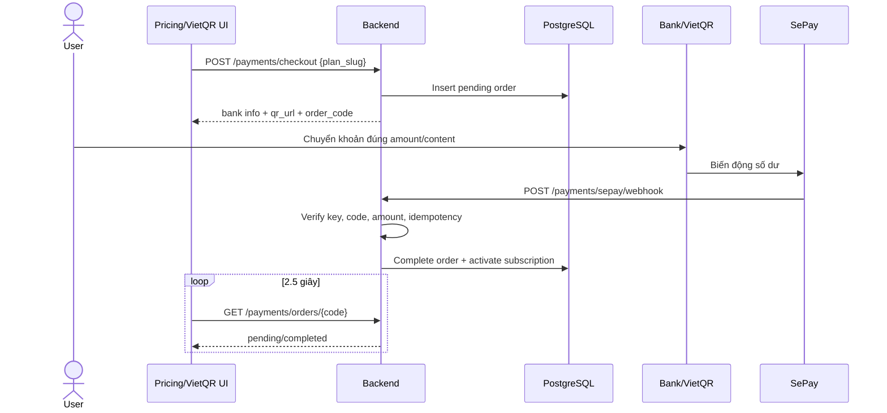
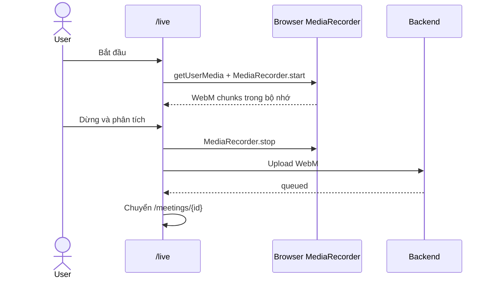

# SƠ ĐỒ TUẦN TỰ THEO CODE HIỆN TẠI

## 1. UC-01 — Đăng ký



## 2. UC-03 — Upload và xử lý audio

```mermaid
sequenceDiagram
    actor U as User
    participant UI as Next.js
    participant API as Backend
    participant FS as Shared Volume
    participant Q as Redis
    participant W as Celery
    participant AI as AI Service
    participant G as Gladia
    participant L as Gemini/OpenAI
    participant DB as PostgreSQL

    U->>UI: Chọn project, title, audio
    UI->>API: POST /meetings
    API->>DB: meeting=created
    API-->>UI: meeting_id
    opt Có project
        UI->>API: POST /projects/{project}/meetings/{meeting}
        API->>DB: insert project_meetings
    end
    UI->>API: POST /audio/meetings/{id}/upload
    API->>FS: Lưu file
    API->>DB: audio metadata, meeting=processing
    API->>Q: process_audio_task
    API-->>UI: 201
    Q->>W: Deliver task
    W->>AI: POST /audio/process(path)
    AI->>G: Upload/create job/poll
    G-->>AI: Utterances
    AI-->>W: Segments
    W->>DB: Insert transcript segments
    W->>AI: POST /rag/summarize
    AI->>L: Chat completion
    L-->>AI: Structured text
    AI-->>W: Summary/action items
    W->>DB: Save result, usage, status=completed
    loop Mỗi 4 giây khi processing
        UI->>API: GET /meetings/{id}
        API-->>UI: status
    end
```



## 3. UC-04 — Biên tập transcript



## 4. UC-06 — Hỏi đáp RAG

```mermaid
sequenceDiagram
    actor U as User
    participant UI as AssistantChatPane
    participant API as Backend
    participant DB as PostgreSQL
    participant AI as AI Service
    participant E as E5 Retriever
    participant L as Gemini/OpenAI
    U->>UI: Nhập câu hỏi
    UI->>API: POST /chat/{meeting} {query}
    API->>DB: Load segments + recent chat; save user message
    API->>AI: POST /rag/query
    AI->>E: Rank lexical + embeddings
    AI->>L: Query + top segments + history
    L-->>AI: Answer
    AI-->>API: answer + citations
    API->>DB: Save assistant message
    API-->>UI: ChatMessageResponse
    U->>UI: Click citation
    UI->>UI: audio.currentTime=start_time; play()
```

## 5. UC-10 — VietQR/SePay



## 6. UC-S01 — Ghi microphone rồi xử lý batch



Luồng này không dùng WebSocket và không có transcript live. WebSocket hiện tại chỉ là interface thử nghiệm sinh segment mô phỏng.
