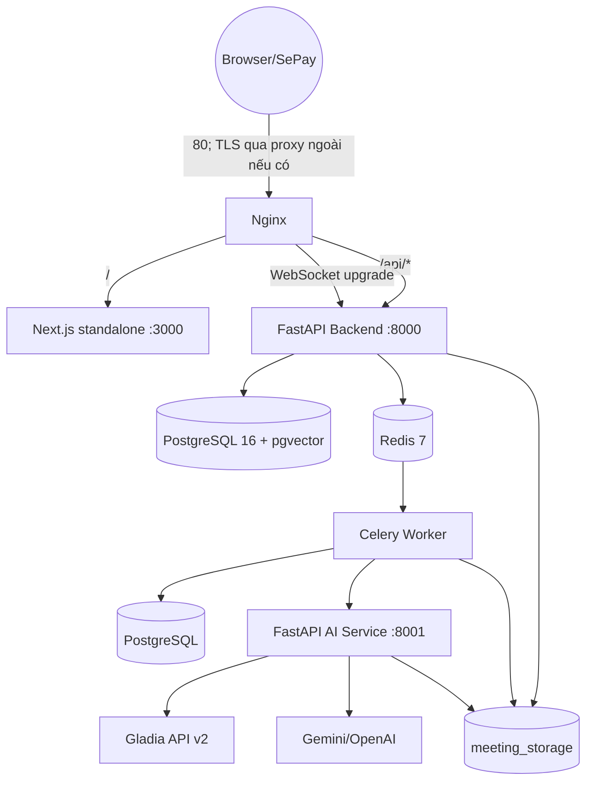
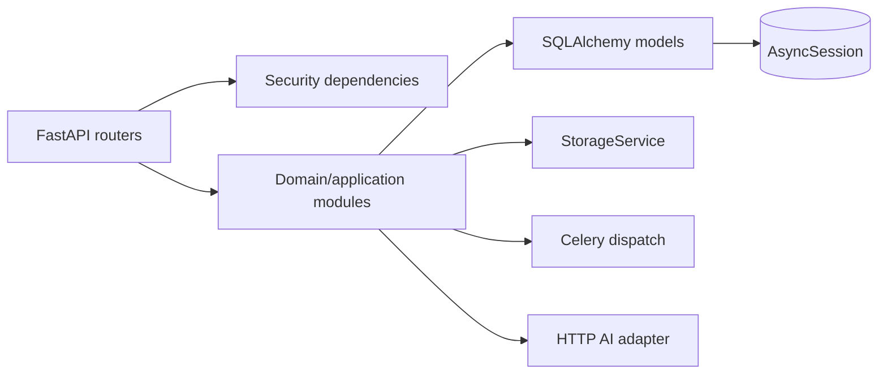
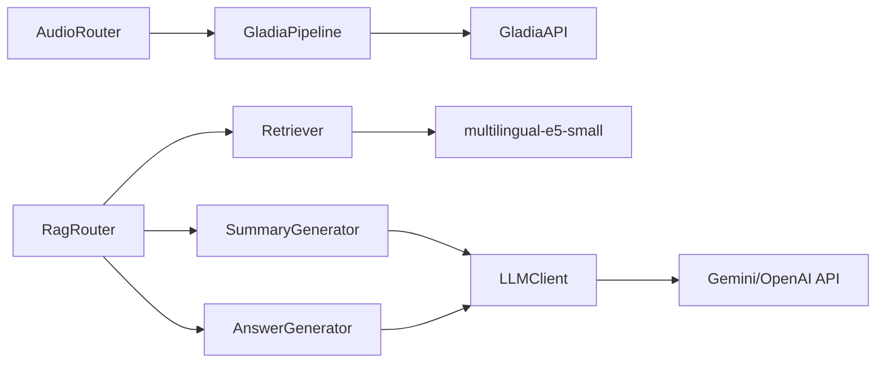
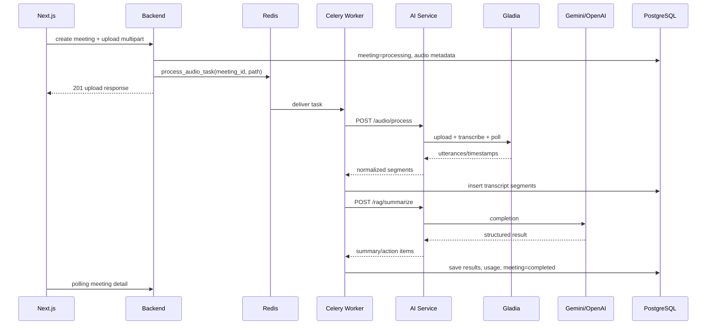
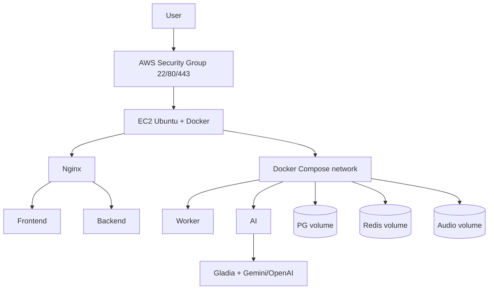

# KIẾN TRÚC HỆ THỐNG HIỆN HÀNH

**Phiên bản:** 2.0 — đối chiếu code ngày 16/11/2026

## 1. Mục tiêu và ràng buộc

- Một máy EC2 CPU có thể chạy toàn bộ phần self-host bằng Docker Compose.
- Tác vụ audio dài không giữ request HTTP; Redis/Celery xử lý nền.
- Audio file được chia sẻ giữa Backend, Worker và AI Service bằng cùng named volume.
- Gladia đảm nhiệm ASR/diarization; Gemini/OpenAI đảm nhiệm generation.
- PostgreSQL là nguồn dữ liệu bền vững; Redis là broker/result backend.
- Nginx là ingress production duy nhất.

## 2. Container view

| Container | Trách nhiệm | Interface chính |
|---|---|---|
| Nginx | Ingress, upload limit, proxy REST/WebSocket, security headers | `:80` |
| Frontend | UI, auth state, upload, polling, transcript studio | Next.js App Router |
| Backend API | Auth, nghiệp vụ, persistence, export, billing | `/api/v1`, `/docs`, `/health` |
| Celery Worker | Điều phối ASR → persistence → summary → quota | Redis task `process_audio_task` |
| AI Service | Adapter Gladia, embedding/retrieval, LLM generation | `/audio/process`, `/rag/*`, `/health` |
| PostgreSQL | Dữ liệu quan hệ | asyncpg |
| Redis | Broker/result backend | Redis protocol |
| meeting_storage | File audio gốc | filesystem volume |

## 3. Module view

### 3.1. Backend API

Các module có interface đáng chú ý:

- `AuthService`: register/login/refresh.
- `ProjectService`: project, membership, meeting link.
- `MeetingService`: lifecycle, access check, share token.
- `AudioService`: validation, storage và task dispatch.
- `TranscriptService`: segment edit/bulk operations.
- `ChatService`: history, retrieval request, fallback lexical.
- `ExportService`: render TXT/SRT/VTT/JSON/DOCX.
- `PlanService`, `QuotaService`, `PaymentService`: commercial flow.

Friction hiện tại: kiểm tra quyền meeting chưa tập trung thành một dependency dùng lại cho transcript, chat, summary, audio và export. Đây là seam cần ưu tiên làm sâu trước public production.

### 3.2. AI Service

`AudioProcessorProtocol`, `LLMClientProtocol` và `EmbeddingProviderProtocol` là các seam có adapter mock trong test. Retriever hiện nhận toàn bộ segment qua request, không truy vấn vector table.

## 4. Runtime view

### 4.1. Upload và xử lý batch

### 4.2. RAG question

Backend tải transcript và recent chat, AI Service tính lexical + embedding ranking, LLM sinh câu trả lời, backend lưu cả user/assistant message rồi trả assistant message có citations. Click citation chỉ là thao tác seek audio phía client.

## 5. Dữ liệu và persistence

- PostgreSQL, Redis và audio đều nằm trên named volumes trong production Compose.
- `Base.metadata.create_all` tạo bảng khi startup; chưa có migration history.
- `CREATE EXTENSION IF NOT EXISTS vector` được chạy dù model hiện chưa có cột vector.
- Xóa meeting là soft-delete; xóa project là hard-delete cascade các link/membership.
- Audio storage path là đường dẫn trong shared volume, vì vậy Worker và AI Service phải mount cùng path `/tmp/meeting_storage`.

## 6. Deployment view trên EC2

Khuyến nghị tối thiểu cho demo thật: 4 vCPU, 8 GB RAM, 40–80 GB gp3 và swap 4 GB. Đây là khuyến nghị vận hành, không phải benchmark. Sentence-transformers/PyTorch làm image AI lớn và có thể dùng nhiều RAM khi tải model lần đầu.

## 7. Health và failure modes

| Failure | Hành vi hiện tại | Cần giám sát |
|---|---|---|
| PostgreSQL không sẵn sàng | Backend production fail startup | backend health/log |
| Redis không sẵn sàng | Dispatch thất bại; backend thử in-process fallback | Redis/worker log |
| AI Service không sẵn sàng | Worker dùng transcript/summary demo | Nội dung fallback, worker warning |
| Gladia/Gemini key thiếu | AI Service dùng fallback | Startup checklist, E2E content check |
| Worker dừng | Meeting giữ `processing` | queue depth, stale processing |
| Volume mất | Playback 404 | volume mount/disk usage |

Fallback làm demo dễ hơn nhưng có nguy cơ tạo “false success”. Trước production cần biến cấu hình để tắt fallback và đặt meeting thành `failed`.

## 8. Bảo mật

- JWT Bearer cho user endpoint.
- Bcrypt hash cho mật khẩu.
- Share token ngẫu nhiên URL-safe.
- SePay webhook key.
- Nginx không public database/cache/internal service trong production.
- Secret nằm trong `.env` không commit.

Khoảng trống đã biết: token trong `localStorage`, CORS rộng, authorization tài nguyên meeting chưa đồng nhất, chưa có rate limit, TLS không nằm trong Compose mặc định.

## 9. Quyết định kiến trúc hiện hành

| Quyết định | Lý do |
|---|---|
| API-first cloud AI | Không cần GPU EC2, giảm vận hành model ASR/LLM |
| Celery/Redis | Tách request upload khỏi tác vụ dài |
| Shared local volume | Đơn giản cho single-host demo |
| Same-origin frontend API production | Tránh đóng cứng `NEXT_PUBLIC_*` tại build time |
| Next.js standalone image | Image runtime nhỏ hơn và chạy production server |
| SQLAlchemy `create_all` | Nhanh cho prototype; cần thay bằng Alembic khi schema ổn định |

## 10. Tham chiếu

- [SRS](../01-requirements/srs.md)
- [API-first architecture](api-first-architecture.md)
- [Database ERD](../04-design/database-erd.md)
- [EC2 runbook](../deployment/huong-dan-trien-khai-ec2-va-chay-end-to-end.md)
