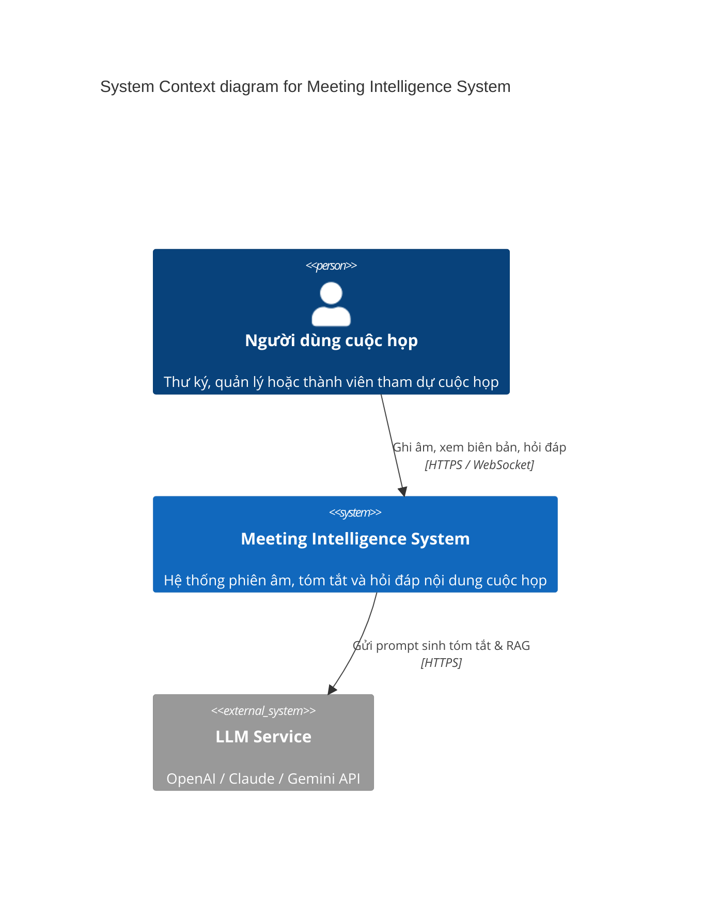
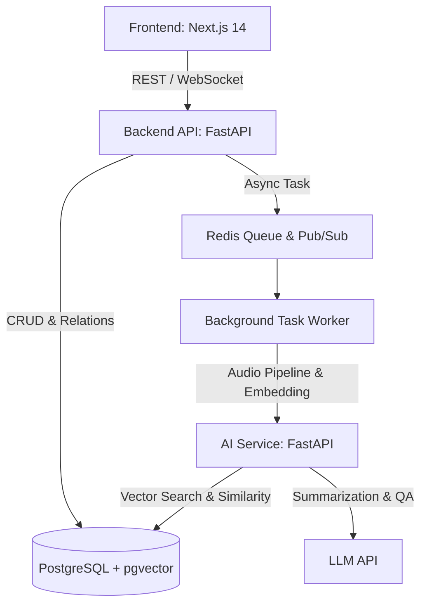

# Kiến Trúc Hệ Thống (C4 Model)

## 1. Level 1: System Context Diagram
Hệ thống tương tác với Người dùng cuộc họp và các dịch vụ AI bên ngoài.

## 2. Level 2: Container Diagram
Kiến trúc phân rã thành các dịch vụ độc lập:

