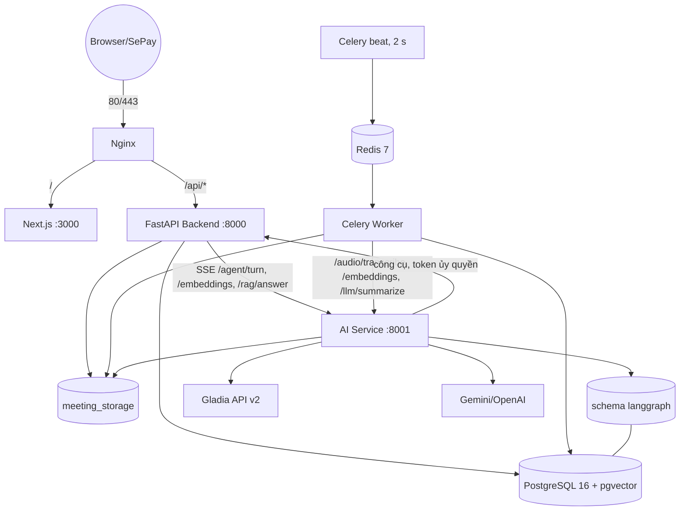
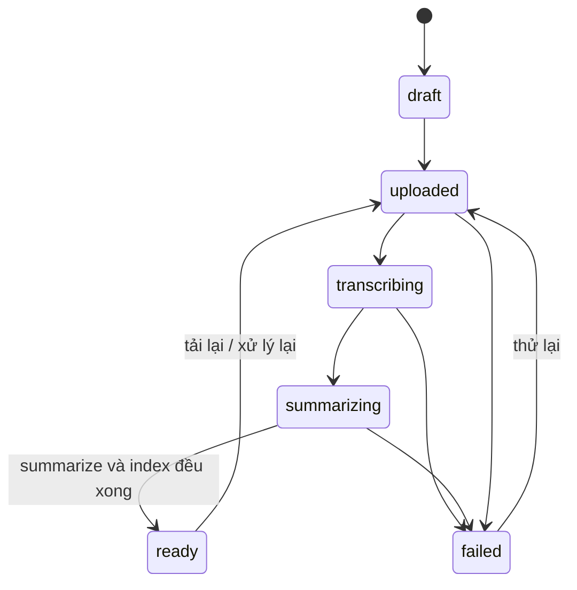
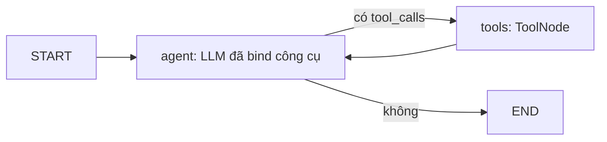
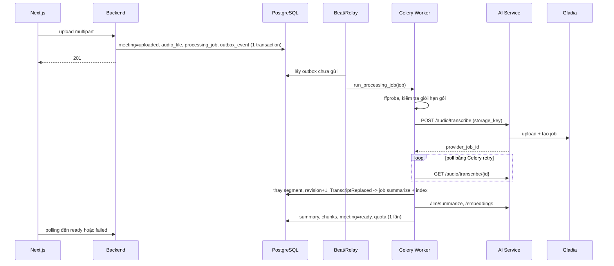
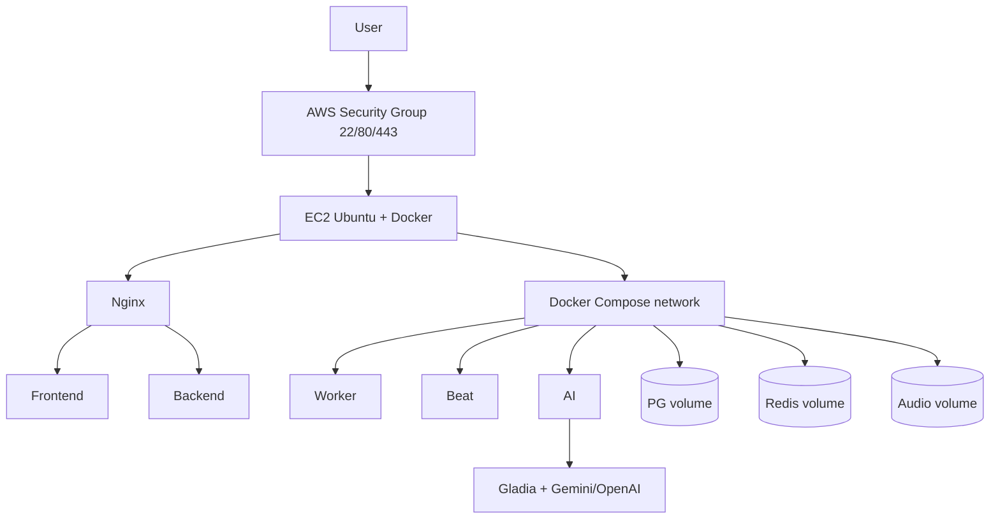

# KIẾN TRÚC HỆ THỐNG HIỆN HÀNH

**Phiên bản:** 3.0 — đối chiếu code ngày 17/11/2026

## 1. Mục tiêu và ràng buộc

- Một máy EC2 CPU có thể chạy toàn bộ phần self-host bằng Docker Compose.
- Tác vụ audio dài không giữ request HTTP; Redis/Celery xử lý nền, công việc được ghi bền vững qua transactional outbox.
- **Backend sở hữu dữ liệu và phân quyền. AI Service là tính toán không trạng thái nghiệp vụ** (ASR adapter, embedding, sinh văn bản, agent). AI Service không bao giờ ghi vào cơ sở dữ liệu nghiệp vụ.
- Audio file được chia sẻ giữa Backend, Worker và AI Service bằng cùng named volume (AI Service chỉ đọc).
- Gladia đảm nhiệm ASR/diarization; Gemini/OpenAI đảm nhiệm generation.
- PostgreSQL (kèm pgvector) là nguồn dữ liệu bền vững; Redis là broker.
- Nginx là ingress production duy nhất; `/internal/*` bị chặn ở ingress.
- **Không có dữ liệu giả trong luồng production**: lỗi là trạng thái `failed` hiển thị cho người dùng.

## 2. Container view



| Container | Trách nhiệm | Interface chính |
|---|---|---|
| Nginx | Ingress, upload limit, proxy REST/SSE, security headers, chặn `/internal` | `:80/:443` |
| Frontend | UI, React Query, upload, polling, Transcript Studio, trợ lý | Next.js App Router |
| Backend API | Xác thực, phân quyền, nghiệp vụ, transcript editor, billing, export, API công cụ cho agent | `/api/v1`, `/internal/agent/v1`, `/health` |
| Celery Worker | Chạy job `transcribe`, `summarize`, `index` (idempotent, retry) | Task `run_processing_job` |
| Celery beat | Mỗi 2 giây phát hành các sự kiện outbox chưa gửi | Task `dispatch_outbox` |
| AI Service | Adapter Gladia, embedding, sinh tóm tắt/trả lời, agent LangGraph | `/audio/transcribe`, `/embeddings`, `/rag/answer`, `/llm/summarize`, `/agent/turn`, `/health` |
| PostgreSQL | Dữ liệu quan hệ, vector, trạng thái hội thoại riêng của agent (schema `langgraph`) | asyncpg / psycopg |
| Redis | Broker | Redis protocol |
| meeting_storage | Audio gốc và tài liệu sinh ra | filesystem volume |

## 3. Module view

### 3.1. Backend API

```
backend-api/app/
  core/        config, database, security (JWT, token ủy quyền), errors, clock, logging
  domain/      enums, actor, events (thuần Python, không SQLAlchemy/FastAPI)
  api/         deps.py (DbSession, CurrentUser, Actor, meeting_for), error_handlers.py,
               internal_deps.py (xác thực công cụ agent), v1/endpoints/* (mỏng)
  services/    access_policy, transcript_editor, transcript_ops, event_bus, retrieval_service,
               chat_service, assistant_service, agent_actions, agent_tools, artifact_service,
               export/ (registry + renderers), processing/ (state, pipeline, jobs, outbox, handlers),
               billing/ (plan, subscription, quota, payment)
  clients/     AIServiceClient (Protocol + adapter HTTP), AgentStreamClient (SSE)
  workers/     celery_app, container (runtime, composition root), tasks
  models/      SQLAlchemy models, UTCDateTime (timestamptz)
```

Quy tắc phụ thuộc: `endpoints → services → models`. Service chỉ ném `DomainError`, không import FastAPI. Chỉ `get_db_session` (request) hoặc task runner (worker) commit; ngoại lệ có chủ đích là `AssistantService`, commit hội thoại trước khi gọi AI Service vì agent gọi ngược về API trong các request khác.

#### Authorization seam

`MeetingAccessPolicy.require(actor, meeting_id, permission)` là nơi duy nhất quyết định quyền VIEW/EDIT/MANAGE. Quyền cao nhất trong các nguồn sẽ thắng: creator → MANAGE; owner/editor project → EDIT; viewer project → VIEW; share token → VIEW hoặc EDIT theo `share_permission`, so sánh `compare_digest`, không bao giờ MANAGE; agent dùng quyền của User và không dùng share token. REST, worker và agent đều đi qua cùng một seam này.

#### Command layer và domain events

`TranscriptEditor` là module sâu cho mọi thay đổi transcript: `apply` (khóa meeting `FOR UPDATE`, kiểm tra `expected_revision`, ghi segment + change set trong một transaction, tăng revision), `preview` (không ghi) và `revert` (áp dụng phép nghịch đảo như change set mới, từ chối nếu đã hoàn tác hoặc có chỉnh sửa muộn hơn). Bộ lập kế hoạch thao tác là hàm thuần (`TranscriptPlanner`).

Sự kiện chạy đồng bộ trong cùng transaction qua `EventBus`:

| Sự kiện | Handler |
|---|---|
| `TranscriptEdited` | summary `ready → stale`, index `ready → stale`, xếp job `index` trễ vài giây (khóa theo revision; bước `index` luôn dựng lại từ transcript mới nhất nên một loạt sửa gộp thành một lần dựng) |
| `TranscriptReplaced` | summary/index `pending`, xếp job `summarize` và `index` |

#### Máy trạng thái xử lý



Chuyển trạng thái sai bị `transition()` từ chối (409). Tóm tắt (`summary_status`) và chỉ mục (`index_status`) có trạng thái riêng `none | pending | ready | stale | failed`; lỗi của một trong hai không làm hỏng transcript.

#### Quy trình nền

Upload ghi `processing_jobs` + `outbox_events` trong cùng transaction. Beat gọi `dispatch_outbox` mỗi 2 giây (`FOR UPDATE SKIP LOCKED`); Redis ngừng hoạt động chỉ làm chậm, không làm mất việc. `run_processing_job` chạy một bước; bước trả `StepOutcome(retry_in)` để task tự đặt lịch poll ASR hoặc retry lỗi tạm thời (backoff luỹ thừa, tối đa 3 lần); giới hạn nằm trong dòng job, không nằm trong Celery.

### 3.2. AI Service

```
ai-service/app/
  core/       config (validator production), auth (X-Service-Token), errors, logging
  deps.py     provider Depends: processor, LLM, embedder; resolve_storage_key (containment)
  pipelines/  protocols (submit/get_result), gladia, fake (chỉ development)
  rag/        embeddings, generator, llm_client, fake
  agent/      state, tools, backend_client, prompts, graph, runner, llm, checkpoint
  routers/    audio, embeddings, rag, agent
```

Tài nguyên dùng chung (HTTP client, mô hình embedding, runner của agent) được tạo một lần trong `lifespan`. Thiếu mô hình hoặc key không làm service chết: `/health` trả `degraded` kèm lý do và request cần chúng báo `PROVIDER_NOT_CONFIGURED` (503).

#### Agent runtime



- Công cụ đọc: `get_meeting_overview`, `search_transcript`, `read_segments`, `find_text`, `get_summary`. Công cụ ghi: `propose_transcript_edits`, `propose_action_item_changes`, `request_summary_regeneration` (chỉ tạo đề xuất) và `create_artifact` (không phá huỷ).
- Mỗi công cụ là một HTTP call tới `/internal/agent/v1` bằng `X-Service-Token` **và** token ủy quyền; token chỉ tồn tại trong `HttpBackendToolClient`, không đi vào trạng thái hay tin nhắn mà mô hình nhìn thấy.
- Kết quả có nội dung cuộc họp luôn được bao trong `<transcript>` kèm cảnh báo "dữ liệu không tin cậy".
- Giới hạn đệ quy 8 bước; lỗi quyền/gói trả về mô hình dưới dạng văn bản để nó giải thích cho người dùng; lỗi kết nối chưa tới backend được retry một lần, lỗi khác kết thúc lượt bằng sự kiện `error` (không bao giờ retry thao tác ghi).
- Trạng thái hội thoại được lưu bằng `AsyncPostgresSaver` trong schema riêng `langgraph` (không phải dữ liệu nghiệp vụ), khoá theo `thread_id`.

## 4. Runtime view

### 4.1. Upload và xử lý



### 4.2. Hỏi đáp thuần (Free, Guest)

Backend nhúng câu hỏi qua `/embeddings`, chạy **một câu SQL** hợp nhất hạng cosine (HNSW) và `ts_rank` (GIN) bằng RRF, lọc theo `meeting_id`; chỉ top-k đoạn được gửi tới `/rag/answer`, nên độ trễ không tăng tuyến tính theo độ dài transcript.

### 4.3. Lượt trợ lý (Pro/Business)

Xem sơ đồ trong [sequence-diagrams.md](sequence-diagrams.md#6-lượt-trợ-lý-với-đề-xuất-và-phê-duyệt).

## 5. Dữ liệu và persistence

- PostgreSQL, Redis và audio nằm trên named volumes trong production Compose.
- Schema do **Alembic** quản lý (`alembic upgrade head` chạy trước khi khởi động API); CI chạy `alembic check`.
- Timestamp là `timestamptz` (kiểu `UTCDateTime`), tiền là `Numeric(12,2)`, trạng thái có CHECK constraint.
- Xóa meeting là soft-delete; xóa project là hard-delete cascade các link/membership.
- `storage_key` là khóa tương đối (`<meeting_id>/<audio_file_id>.<ext>`); đường dẫn tuyệt đối chỉ sinh ra trong `StorageService.resolve` và `resolve_storage_key`, nơi kiểm tra không thoát khỏi `STORAGE_ROOT`.

## 6. Deployment view trên EC2



PostgreSQL, Redis và AI Service không publish cổng ra ngoài (dev chỉ bind `127.0.0.1`). Khuyến nghị tối thiểu cho demo thật: 4 vCPU, 8 GB RAM, 40–80 GB gp3 và swap 4 GB. Đây là khuyến nghị vận hành, không phải benchmark.

## 7. Health và failure modes

| Failure | Hành vi | Cần giám sát |
|---|---|---|
| PostgreSQL không sẵn sàng | Backend production fail startup | backend health/log |
| Redis không sẵn sàng | Outbox giữ sự kiện, tự gửi lại khi Redis về | số sự kiện outbox chưa gửi |
| AI Service không sẵn sàng | Job retry backoff; hết lượt thì `failed` kèm lý do | log job, `failure_reason` |
| Thiếu key Gladia/LLM/model | Meeting `failed` hoặc `summary_status=failed`; `/health` `degraded` | `/health` của AI Service |
| Worker dừng giữa chừng | Job được giao lại (`acks_late`), bước idempotent | queue depth |
| Crash không lường trước | Rollback, job và meeting `failed` ("Internal processing error") | log `processing_job_crashed` |
| Volume mất | Playback 404 | volume mount/disk usage |

## 8. Bảo mật

Xem [security-threat-model.md](security-threat-model.md). Tóm tắt: JWT có `token_version` và refresh rotation; phân quyền tập trung; webhook SePay bắt buộc key; AI Service chỉ nhận `X-Service-Token`; token ủy quyền cho agent giới hạn 5 phút, một meeting; secret production bị validator từ chối nếu là mặc định; CORS theo danh sách.

## 9. Quyết định kiến trúc (ADR)

| ADR | Quyết định | Lý do |
|---|---|---|
| API-first cloud AI | Gladia + Gemini/OpenAI thay cho mô hình tự host | Không cần GPU EC2, giảm vận hành |
| Celery/Redis | Tách request khỏi tác vụ dài | Upload không giữ kết nối |
| Shared local volume | Đơn giản cho single-host | Cần S3 khi mở rộng nhiều node |
| **ADR-agent-in-ai-service** | Agent LangGraph chạy trong AI Service, gọi công cụ qua HTTP tới Backend bằng token ủy quyền | Backend không phụ thuộc thư viện LLM; quyền được thực thi một lần ở `MeetingAccessPolicy`, nên agent bị prompt-injection cũng không vượt quá quyền của người dùng; tránh thêm một service riêng |
| **ADR-proposal-before-write** | Công cụ ghi chỉ tạo đề xuất (`agent_actions`); duyệt mới chạy `TranscriptEditor.apply` | Bền qua nhiều request, không cần interrupt dài hạn của LangGraph; có diff, hết hạn, kiểm tra revision và hoàn tác |
| **ADR-outbox-dispatch** | Ghi sự kiện outbox cùng transaction, relay mỗi 2 giây | Không gửi task trước commit, sống sót khi Redis ngừng, loại bỏ `asyncio.create_task` trong tiến trình API |
| **ADR-backend-owns-vectors** | `transcript_chunks` (pgvector + tsvector) nằm trong DB của Backend; AI Service chỉ tính embedding | Lọc theo meeting/project bằng SQL, AI Service không cần transcript, payload trả lời không đổi theo độ dài cuộc họp |
| Alembic | Thay `create_all` | Nâng schema an toàn, kiểm `alembic check` trong CI |
| Same-origin frontend API | Tránh đóng cứng `NEXT_PUBLIC_*` | Cùng bundle chạy local và production |

## 10. Tham chiếu

- [SRS](../01-requirements/srs.md)
- [API-first architecture](api-first-architecture.md)
- [Sequence diagrams](sequence-diagrams.md)
- [Database ERD](../04-design/database-erd.md)
- [EC2 runbook](../deployment/huong-dan-trien-khai-ec2-va-chay-end-to-end.md)
