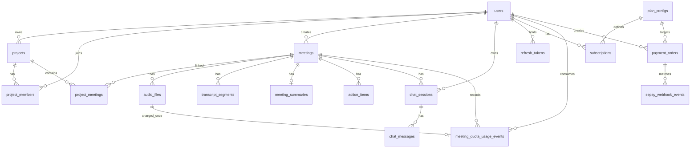

# THIẾT KẾ CƠ SỞ DỮ LIỆU HIỆN HÀNH

**Nền tảng:** PostgreSQL 16 + pgvector  
**Nguồn chuẩn:** `backend-api/app/models` ngày 16/11/2026

## 1. ERD

## 2. Bảng và trường cốt lõi

| Bảng | Trường chính | Ghi chú |
|---|---|---|
| `users` | `id`, `email`, `full_name`, `password_hash`, `role`, `is_active`, `token_version` | `email` unique/indexed; `token_version` tăng khi đổi mật khẩu để vô hiệu hóa token cũ |
| `refresh_tokens` | `jti`, `family_id`, `user_id`, `expires_at`, `revoked_at` | Mỗi refresh token dùng một lần; dùng lại token đã thu hồi sẽ thu hồi cả `family_id` |
| `projects` | `id`, `name`, `description`, `owner_id` | Owner FK user |
| `project_members` | `project_id`, `user_id`, `role` | Unique `(project_id, user_id)`; CHECK role owner/editor/viewer |
| `project_meetings` | `project_id`, `meeting_id`, `added_by` | Unique `(project_id, meeting_id)` |
| `meetings` | `title`, `status`, `summary_status`, `failure_stage`, `failure_reason`, `is_demo`, `duration_seconds`, `created_by`, `share_token`, `share_permission`, `is_deleted` | Soft delete; `share_token` unique/indexed; CHECK cho `status`, `summary_status`, `share_permission` |
| `audio_files` | `meeting_id`, `file_name`, `storage_key`, `mime_type`, `duration_seconds`, `file_size_bytes`, `upload_status` | `storage_key` tương đối dạng `<meeting_id>/<audio_file_id><ext>`; tên gốc chỉ nằm trong DB |
| `transcript_segments` | `meeting_id`, `speaker_label`, `start_time`, `end_time`, `content`, `sequence_order` | Unique `(meeting_id, sequence_order)`; index `meeting_id` |
| `meeting_summaries` | `meeting_id`, `executive_summary`, `key_points` | `meeting_id` unique; pipeline upsert |
| `action_items` | `meeting_id`, `description`, `assignee`, `status`, `due_date`, `source` | `source` ai/user: tóm tắt lại chỉ thay các mục `ai` |
| `chat_sessions` | `meeting_id`, `user_id`, `created_at` | Một session cho mỗi (meeting, user); khách share-link dùng `user_id` NULL |
| `chat_messages` | `session_id`, `role`, `content`, `citations`, `status` | `status` ok/error; citations JSONB |
| `plan_configs` | `slug`, `price_amount` (Numeric 12,2), `duration_limit`, `features` | `slug` unique; plan: `free`, `pro`, `business` |
| `subscriptions` | `user_id`, `plan_config_id`, `status`, period, `plan_snapshot` | Giữ lịch sử: kích hoạt gói mới chèn dòng mới, dòng cũ chuyển `replaced`; Free lăn theo chu kỳ 30 ngày |
| `meeting_quota_usage_events` | `user_id`, `meeting_id`, `audio_file_id`, `duration_seconds`, `usage_at` | `audio_file_id` unique: xử lý lại cùng file không tính quota hai lần |
| `payment_orders` | `order_code`, user, plan, amount (Numeric 12,2), status, QR, expiry | `order_code` dạng `MVA` + 10 ký tự hex, unique |
| `sepay_webhook_events` | transaction ID, order, amount (Numeric 12,2), raw payload, processing status | Transaction ID unique là cổng idempotency |

## 3. Trạng thái và ràng buộc

Các cột trạng thái dùng `String` kèm CHECK constraint (tên theo naming convention `ck_<bảng>_<tên>`):

- Meeting `status`: `draft`, `uploaded`, `transcribing`, `summarizing`, `indexing`, `ready`, `failed`. Chuyển trạng thái chỉ qua `services/processing/state.py`.
- Meeting `summary_status`: `none`, `pending`, `ready`, `stale`, `failed`.
- Share permission: `viewer`, `editor`.
- Project membership: `owner`, `editor`, `viewer`.
- Action item: status `pending`/`completed`, source `ai`/`user`.
- Subscription: `active`, `expired`, `replaced`, `cancelled`.
- Payment order: `pending`, `completed`, `expired`, `failed`.
- Webhook event: `pending`, `processed`, `ignored`, `duplicate`, `partial_amount`, `expired_order`.

## 4. Index/constraint

### Đã có (migration `0001_baseline`)

- Unique/index: `users.email`, `meetings.share_token`, `plan_configs.slug`, `payment_orders.order_code`, `sepay_webhook_events.sepay_transaction_id`, `refresh_tokens.jti`.
- Index khóa ngoại: `meetings.created_by`, `audio_files.meeting_id`, `transcript_segments.meeting_id`, `action_items.meeting_id`, `chat_sessions.meeting_id`, `chat_messages.session_id`, `project_members.project_id/user_id`, `project_meetings.project_id/meeting_id`, `subscriptions.user_id`, `payment_orders.user_id`, `meeting_quota_usage_events.user_id`.
- Foreign key có `ON DELETE CASCADE` ở các quan hệ phụ thuộc chính.

### Còn thiếu

- Timestamp vẫn là `DateTime` naive UTC; chưa chuyển `timezone=True` với `server_default=now()`.
- CHECK `start_time >= 0`, `end_time >= start_time` cho transcript.
- Index `(user_id, usage_at)` cho quota và `(status, created_at)` cho meeting/payment.
- Bảng `processing_jobs`, `outbox_events`, `transcript_chunks`, revision/change set và các bảng agent (xem roadmap).

## 5. pgvector

Migration baseline tạo extension `vector`, nhưng model chưa có bảng/cột vector. Retrieval hiện chạy in-memory trong ai-service. Không mô tả HNSW/IVFFlat là implementation hiện tại cho đến khi có migration và query tương ứng (roadmap T2.6).

## 6. Schema lifecycle

Schema do Alembic quản lý (`backend-api/alembic`). Container `backend-api` chạy `alembic upgrade head` trước khi khởi động; ứng dụng không còn gọi `create_all`. Quy trình thay đổi schema:

1. Sửa model, chạy `alembic revision --autogenerate -m "<mô tả>"` rồi rà soát file sinh ra.
2. CI chạy `alembic upgrade head` và `alembic check` trên PostgreSQL để bảo đảm migration khớp model.
3. Backup database trước mỗi migration production và diễn tập restore.

Database dev tạo bằng `create_all` trước đây thiếu các cột mới; tạo lại database dev (`docker compose down -v`) hoặc dựng schema bằng `alembic upgrade head` trên database trống.

## 7. Backup

Cần backup đồng thời:

- PostgreSQL bằng `pg_dump`.
- Volume `meeting_storage` chứa audio.

Backup DB không chứa file audio; backup volume không chứa transcript/summary. Hai bản phải dùng cùng mốc thời gian để restore nhất quán.
