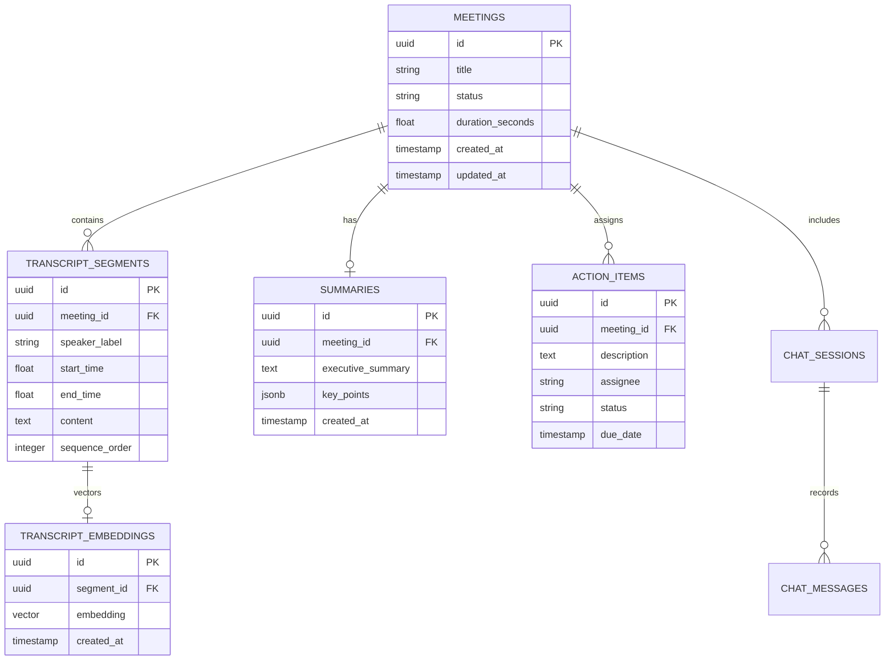

# Thiết Kế Cơ Sở Dữ Liệu (PostgreSQL + pgvector)

## 1. Sơ Đồ Thực Thể Liên Kết (ERD)

## 2. Kỹ Thuật Chỉ Mục (Indexing)
- Khóa chính và khóa ngoại: B-tree index tiêu chuẩn.
- Bảng `transcript_embeddings`: Chỉ mục HNSW (Hierarchical Navigable Small World) sử dụng khoảng cách Cosine `vector_cosine_ops` để tối ưu tìm kiếm lân cận tốc độ cao.
