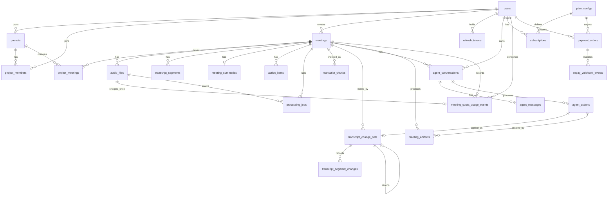

# THIẾT KẾ CƠ SỞ DỮ LIỆU HIỆN HÀNH

**Nền tảng:** PostgreSQL 16 + pgvector  
**Nguồn chuẩn:** `backend-api/app/models` và `backend-api/alembic/versions/0001..0005`, ngày 17/11/2026

## 1. ERD

`outbox_events` không có khóa ngoại: đó là hàng đợi gửi task, độc lập với các bảng nghiệp vụ.

## 2. Bảng và trường cốt lõi

### 2.1. Người dùng, dự án, cuộc họp

| Bảng | Trường chính | Ghi chú |
|---|---|---|
| `users` | `id`, `email`, `full_name`, `password_hash`, `role`, `is_active`, `token_version` | `email` unique/indexed; `token_version` tăng khi đổi mật khẩu để vô hiệu hóa token cũ (kể cả token ủy quyền của agent) |
| `refresh_tokens` | `jti`, `family_id`, `user_id`, `expires_at`, `revoked_at` | Mỗi refresh token dùng một lần; dùng lại token đã thu hồi sẽ thu hồi cả `family_id` |
| `projects` | `id`, `name`, `description`, `owner_id` | Owner FK user |
| `project_members` | `project_id`, `user_id`, `role` | Unique `(project_id, user_id)`; CHECK role owner/editor/viewer |
| `project_meetings` | `project_id`, `meeting_id`, `added_by` | Unique `(project_id, meeting_id)` |
| `meetings` | `title`, `status`, `summary_status`, `index_status`, `transcript_revision`, `failure_stage`, `failure_reason`, `is_demo`, `duration_seconds`, `created_by`, `share_token`, `share_permission`, `is_deleted` | Soft delete; `share_token` unique/indexed; `transcript_revision` tăng mỗi lần transcript đổi, là cơ sở của khóa lạc quan; CHECK cho `status`, `summary_status`, `index_status`, `share_permission` |
| `audio_files` | `meeting_id`, `file_name`, `storage_key`, `mime_type`, `duration_seconds`, `file_size_bytes`, `upload_status` | `storage_key` tương đối `<meeting_id>/<audio_file_id><ext>`; tên gốc chỉ nằm trong DB |
| `transcript_segments` | `meeting_id`, `speaker_label`, `start_time`, `end_time`, `content`, `sequence_order`, `version` | Unique `(meeting_id, sequence_order)`; `version` tăng khi segment đổi |
| `meeting_summaries` | `meeting_id`, `executive_summary`, `key_points` | `meeting_id` unique; pipeline upsert |
| `action_items` | `meeting_id`, `description`, `assignee`, `status`, `due_date`, `source` | `source` ai/user: tóm tắt lại chỉ thay các mục `ai` |

### 2.2. Xử lý nền và truy xuất

| Bảng | Trường chính | Ghi chú |
|---|---|---|
| `processing_jobs` | `meeting_id`, `audio_file_id`, `kind`, `status`, `attempts`, `error`, `provider_job_id`, `idempotency_key`, `started_at`, `finished_at` | `kind`: `transcribe`, `summarize`, `index`, `agent_artifact`; `status`: `pending`, `running`, `succeeded`, `failed`; `idempotency_key` unique chặn job trùng; `attempts` là bộ đếm retry nằm trong DB |
| `outbox_events` | `task_name`, `payload` (JSONB), `attempts`, `created_at`, `available_at`, `dispatched_at` | Partial index `ix_outbox_events_pending` trên `created_at` với `dispatched_at IS NULL`; `available_at` cho phép trì hoãn (job `index` sau khi sửa) |
| `transcript_chunks` | `meeting_id`, `chunk_index`, `speaker_label`, `start_time`, `end_time`, `text`, `segment_ids` (UUID[]), `embedding` `vector(384)`, `tsv` (cột sinh `tsvector`), `transcript_revision` | Unique `(meeting_id, chunk_index)`; HNSW cosine trên `embedding`, GIN trên `tsv`; dựng lại toàn bộ khi chỉ mục chạy |

### 2.3. Lịch sử chỉnh sửa

| Bảng | Trường chính | Ghi chú |
|---|---|---|
| `transcript_change_sets` | `meeting_id`, `revision`, `actor_type`, `actor_user_id`, `agent_run_id`, `reverts_change_set_id`, `summary`, `operations` (JSONB), `created_at` | Unique `(meeting_id, revision)`; `actor_type`: `user`, `share`, `agent`; `reverts_change_set_id` trỏ tới change set bị hoàn tác (mỗi change set chỉ hoàn tác được một lần) |
| `transcript_segment_changes` | `change_set_id`, `segment_id`, `op`, `before` (JSONB), `after` (JSONB) | `op`: `insert`, `update`, `delete`; `before`/`after` đủ để dựng lại và đảo ngược; `segment_id` không có FK vì segment có thể đã bị xóa |

### 2.4. Trợ lý

| Bảng | Trường chính | Ghi chú |
|---|---|---|
| `agent_conversations` | `meeting_id`, `user_id`, `langgraph_thread_id`, `created_at` | Unique `(meeting_id, user_id)`; khách share-link có hội thoại với `user_id` NULL và chỉ dùng hỏi đáp thuần, không dùng công cụ của agent |
| `agent_messages` | `conversation_id`, `role`, `content`, `citations` (JSONB), `tool_calls` (JSONB), `status`, `created_at` | `role`: `user`, `assistant`, `tool`; `status`: `ok`, `error` |
| `agent_actions` | `conversation_id`, `meeting_id`, `user_id`, `kind`, `payload`, `preview`, `base_revision`, `status`, `result`, `change_set_id`, `created_at`, `decided_at` | `kind`: `transcript_ops`, `action_item_ops`, `summary_regenerate`; `status`: `proposed`, `approved`, `rejected`, `applied`, `failed`, `expired`; hạn 30 phút tính từ `created_at` ở tầng service; `change_set_id` trỏ tới change set khi được áp dụng |
| `meeting_artifacts` | `meeting_id`, `created_by`, `kind`, `title`, `storage_key`, `mime_type`, `size_bytes`, `source_revision`, `agent_action_id`, `created_at` | `kind`: `minutes_docx`, `email_draft`, `srt`, `custom_md`; `source_revision` ghi lại revision transcript dùng để sinh |

Hai bảng `chat_sessions` và `chat_messages` đã được thay bằng `agent_conversations` và `agent_messages`; migration `0005` sao chép dữ liệu cũ sang (và sao chép ngược khi downgrade). Trạng thái hội thoại nội bộ của LangGraph nằm ở schema riêng `langgraph` do `AsyncPostgresSaver` tự tạo, không thuộc schema Alembic của Backend.

### 2.5. Gói và thanh toán

| Bảng | Trường chính | Ghi chú |
|---|---|---|
| `plan_configs` | `slug`, `price_amount` (Numeric 12,2), `duration_limit`, `features` | `slug` unique; plan: `free`, `pro`, `business`; `features` chứa cờ như `agent_tools`, giới hạn câu hỏi; seed bổ sung các khóa mới nhưng không ghi đè giá trị đã chỉnh |
| `subscriptions` | `user_id`, `plan_config_id`, `status`, period, `plan_snapshot` | Giữ lịch sử: kích hoạt gói mới chèn dòng mới, dòng cũ chuyển `replaced`; Free lăn theo chu kỳ 30 ngày |
| `meeting_quota_usage_events` | `user_id`, `meeting_id`, `audio_file_id`, `duration_seconds`, `usage_at` | `audio_file_id` unique: xử lý lại cùng file không tính quota hai lần |
| `payment_orders` | `order_code`, user, plan, amount (Numeric 12,2), status, QR, expiry | `order_code` dạng `MVA` + 10 ký tự hex, unique |
| `sepay_webhook_events` | transaction ID, order, amount (Numeric 12,2), raw payload, processing status | Transaction ID unique là cổng idempotency |

## 3. Trạng thái và ràng buộc

Các cột trạng thái dùng `String` kèm CHECK constraint (tên theo naming convention `ck_<bảng>_<tên>`):

- Meeting `status`: `draft`, `uploaded`, `transcribing`, `summarizing`, `indexing`, `ready`, `failed`. Chuyển trạng thái chỉ qua `services/processing/state.py`.
- Meeting `summary_status` và `index_status`: `none`, `pending`, `ready`, `stale`, `failed`.
- Share permission: `viewer`, `editor`.
- Project membership: `owner`, `editor`, `viewer`.
- Action item: status `pending`/`completed`, source `ai`/`user`.
- Subscription: `active`, `expired`, `replaced`, `cancelled`.
- Payment order: `pending`, `completed`, `expired`, `failed`.
- Webhook event: `pending`, `processed`, `ignored`, `duplicate`, `partial_amount`, `expired_order`.
- Agent: `agent_messages.role/status`, `agent_actions.kind/status`, `meeting_artifacts.kind` (liệt kê ở mục 2.4).

## 4. Index/constraint

### Đã có

- Unique/index: `users.email`, `meetings.share_token`, `plan_configs.slug`, `payment_orders.order_code`, `sepay_webhook_events.sepay_transaction_id`, `refresh_tokens.jti`, `processing_jobs.idempotency_key`, `(meeting_id, revision)` của change set, `(meeting_id, chunk_index)` của chunk, `(meeting_id, user_id)` của hội thoại.
- Index vector và văn bản: HNSW cosine trên `transcript_chunks.embedding`, GIN trên `transcript_chunks.tsv`.
- Partial index cho hàng đợi: `ix_outbox_events_pending`.
- Index khóa ngoại: `meetings.created_by`, `audio_files.meeting_id`, `transcript_segments.meeting_id`, `action_items.meeting_id`, `project_members.project_id/user_id`, `project_meetings.project_id/meeting_id`, `subscriptions.user_id`, `payment_orders.user_id`, `meeting_quota_usage_events.user_id`, `transcript_segment_changes.segment_id`, và khóa ngoại của các bảng agent.
- Foreign key có `ON DELETE CASCADE` ở các quan hệ phụ thuộc chính.
- Mọi timestamp là `timestamptz` (`UTCDateTime`) với `server_default=now()` (migration `0004`).

### Còn thiếu

- CHECK `start_time >= 0`, `end_time >= start_time` cho transcript.
- Index `(user_id, usage_at)` cho quota và `(status, created_at)` cho meeting/payment.
- Chưa có chính sách dọn dữ liệu (xóa chunk, hội thoại, change set khi xóa meeting; xóa `outbox_events` đã gửi).

## 5. pgvector

Migration `0001` tạo extension `vector`; migration `0002` tạo `transcript_chunks` với `embedding vector(384)` (khớp mô hình `multilingual-e5-small`) cùng HNSW cosine. Truy vấn lai chạy trong `RetrievalService`: hạng theo khoảng cách cosine và hạng theo `ts_rank` được hợp nhất bằng Reciprocal Rank Fusion trong một câu SQL, luôn lọc `meeting_id`. Đổi mô hình embedding đòi hỏi migration kích thước cột và dựng lại chỉ mục cho mọi meeting.

## 6. Schema lifecycle

Schema do Alembic quản lý (`backend-api/alembic`), hiện có năm revision:

| Revision | Nội dung |
|---|---|
| `0001_baseline` | Schema ban đầu và extension `vector` |
| `0002_processing_jobs_outbox_transcript_chunks` | `processing_jobs`, `outbox_events`, `transcript_chunks`, `meetings.index_status`, `meetings.transcript_revision` |
| `0003_transcript_revisions` | `transcript_change_sets`, `transcript_segment_changes`, `transcript_segments.version`, `outbox_events.available_at` |
| `0004_timezone_aware_timestamps` | Chuyển toàn bộ `DateTime` sang `timestamptz` |
| `0005_agent_conversations_actions_artifacts` | Bảng agent, sao chép dữ liệu chat cũ rồi bỏ `chat_sessions`/`chat_messages` |

Container `backend-api` chạy `alembic upgrade head` trước khi khởi động; ứng dụng không còn gọi `create_all`. Quy trình thay đổi schema:

1. Sửa model, chạy `alembic revision --autogenerate -m "<mô tả>"` rồi rà soát file sinh ra (autogenerate không biết giá trị mặc định của dữ liệu cũ và có thể sinh kiểu tùy biến; `env.py` đã có `render_item` cho `UTCDateTime`).
2. CI chạy `alembic upgrade head` và `alembic check` trên PostgreSQL để bảo đảm migration khớp model.
3. Backup database trước mỗi migration production và diễn tập restore.

Database dev tạo bằng `create_all` trước đây thiếu các cột mới; tạo lại database dev (`docker compose down -v`) hoặc dựng schema bằng `alembic upgrade head` trên database trống.

## 7. Backup

Cần backup đồng thời:

- PostgreSQL bằng `pg_dump` (bao gồm schema `langgraph` nếu cần giữ ngữ cảnh hội thoại của agent).
- Volume `meeting_storage` chứa audio và tài liệu sinh ra.

Backup DB không chứa file audio; backup volume không chứa transcript/summary. Hai bản phải dùng cùng mốc thời gian để restore nhất quán. Chỉ mục vector có thể dựng lại từ transcript bằng job `index`, nên không bắt buộc phải bảo toàn nếu thiếu dung lượng.
