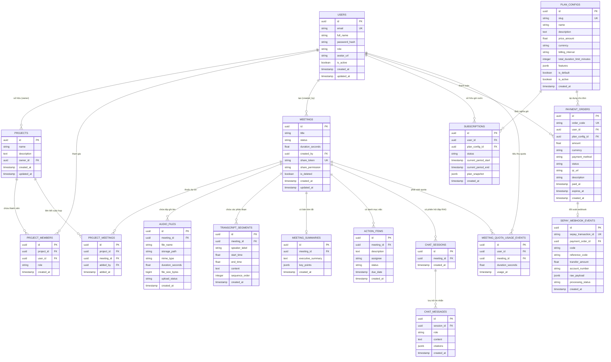

# THIẾT KẾ CƠ SỞ DỮ LIỆU (POSTGRESQL 16 + PGVECTOR)

**Dự án:** Hệ thống Trợ lý Giọng nói, Phiên âm, Tóm tắt và Hỏi đáp Cuộc họp Thông minh (Meeting Voice Assistant)  
**Công nghệ:** PostgreSQL 16, pgvector 0.5+, SQLAlchemy 2.0 Async, asyncpg  
**Phiên bản:** 2.1  
**Ngày cập nhật:** 2026-11-16  

---

## 1. Sơ đồ Thực thể Liên kết (Entity Relationship Diagram - ERD)

---

## 2. Chi tiết Đặc tả các Bảng Dữ liệu

### 2.1. Phân hệ Quản lý Người dùng & Dự án
1. **`users`:** Lưu trữ định danh, thông tin bảo mật và vai trò quản trị hệ thống. Khóa chính `id` (UUID), `email` có ràng buộc duy nhất (Unique Index).
2. **`projects`:** Quản lý không gian làm việc theo nhóm hoặc phòng ban. Liên kết với `users` qua `owner_id`.
3. **`project_members`:** Quan hệ n-n giữa người dùng và dự án, phân định vai trò `owner`, `editor`, `viewer`.
4. **`project_meetings`:** Bảng nối liên kết giữa các cuộc họp và dự án tương ứng.

### 2.2. Phân hệ Cuộc họp & Phiên âm
5. **`meetings`:** Quản lý vòng đời cuộc họp (`created`, `processing`, `completed`, `failed`), thời lượng tính bằng giây, mã `share_token` (Unique Index) và phân quyền link (`viewer`, `editor`).
6. **`audio_files`:** Quản lý tệp ghi âm nguồn, kích thước tệp, đường dẫn vật lý trên ổ cứng (`storage_path`) và trạng thái upload.
7. **`transcript_segments`:** Lưu trữ từng câu thoại đã gỡ băng kèm nhãn người nói (`speaker_label`), mốc thời gian bắt đầu (`start_time`), kết thúc (`end_time`), và số thứ tự hiển thị (`sequence_order`).

### 2.3. Phân hệ Trí tuệ Nhân tạo & RAG
8. **`meeting_summaries`:** Lưu trữ Tóm tắt điều hành (`executive_summary`) và danh sách các luận điểm chính dưới dạng `JSONB` (`key_points`).
9. **`action_items`:** Lưu danh mục công việc phát sinh, người phụ trách (`assignee`), trạng thái hoàn thành (`status`: `pending` hoặc `completed`).
10. **`chat_sessions`:** Phiên đàm thoại hỏi đáp RAG gắn với từng cuộc họp.
11. **`chat_messages`:** Lịch sử tin nhắn hỏi đáp, mảng trích dẫn âm thanh đối chứng (`citations`) lưu dưới dạng JSONB gồm `segment_id`, `speaker_label`, `start_time`, `end_time`, `quote`.

### 2.4. Phân hệ Gói cước & Cổng thanh toán VietQR
12. **`plan_configs`:** Cấu hình 3 gói cước dịch vụ (`free`, `pro`, `unlimited`), giá tiền VNĐ, hạn mức số phút ghi âm tối đa.
13. **`subscriptions`:** Quản lý gói cước đang có hiệu lực của người dùng, thời điểm bắt đầu và hết hạn gói.
14. **`meeting_quota_usage_events`:** Lưu vết chi tiết từng lần tiêu thụ hạn mức sau mỗi phiên xử lý âm thanh để tính tổng thời lượng trong chu kỳ 30 ngày.
15. **`payment_orders`:** Quản lý đơn hàng chuyển khoản nâng cấp gói, mã đơn duy nhất `order_code` (ví dụ `DH123456`), link mã VietQR động Napas247 và thời gian hết hạn 30 phút.
16. **`sepay_webhook_events`:** Nhật ký lưu vết toàn bộ payload webhook do SePay bắn về để đối soát giao dịch và chống gian lận.

---

## 3. Chiến lược Đánh Chỉ mục (Indexing Strategy)
- **B-tree Indexes:**
  - Khóa chính (PK) của tất cả 16 bảng là UUID ngẫu nhiên.
  - Khóa ngoại (FK) kết nối giữa các bảng: `user_id`, `meeting_id`, `project_id`, `session_id`, `plan_config_id`.
  - Các trường tra cứu tốc độ cao: `users.email`, `meetings.share_token`, `payment_orders.order_code`, `sepay_webhook_events.sepay_transaction_id`.
- **Composite Indexes:**
  - `(meeting_id, sequence_order ASC)` trên bảng `transcript_segments` để tải danh sách câu thoại theo thứ tự thời gian có độ trễ dưới 5ms.
  - `(user_id, usage_at DESC)` trên bảng `meeting_quota_usage_events` để tính tổng hạn mức tiêu thụ tức thì.
- **JSONB GIN Indexes:**
  - Đánh chỉ mục GIN trên `chat_messages.citations` và `meeting_summaries.key_points` để hỗ trợ truy vấn các phần tử trong mảng JSON tốc độ cao.
