# Kế Hoạch Chuyển Đổi Use Case Từ TECHTACK-VOICE Sang Meeting Voice Assistant (Bao Gồm Phân Quyền, Gói Cước & Thanh Toán VietQR)

Tài liệu này xác định phương án chuyển đổi toàn diện các Use Case từ dự án `TECHTACK-VOICE` sang dự án `meeting-voice-assistant`, bao gồm: Use case cốt lõi, Phân quyền người dùng & Dự án, Quản lý Gói dịch vụ & Hạn mức (Plans & Quotas), và Cổng thanh toán chuyển khoản ngân hàng qua mã QR (VietQR / SePay). Bỏ qua PayPal và Firebase.

---

## 1. Phân Loại Ranh Giới Chuyển Đổi Hệ Thống

```mermaid
flowchart TD
    subgraph TECHTACK[TECHTACK-VOICE Codebase]
        direction TB
        subgraph CORE_SRC[Core Audio & Meeting]
            A1[Audio Upload & Storage]
            A2[Meeting CRUD & Status]
            A3[Transcript Studio & Timeline]
            A4[Multi-format Exporters]
            A5[RAG Chat & Citations]
            A6[Realtime Audio WS]
        end
        subgraph AUTH_SRC[Auth & Access Control]
            B1[User Registration & Login]
            B2[JWT & Refresh Tokens]
            B3[Profile & Password Change]
            B4[Project & Member Roles]
            B5[Meeting-Project Association]
        end
        subgraph MONETIZATION_SRC[Monetization & Billing]
            C1[Plan Config & Subscriptions]
            C2[Meeting & AI Quota Tracking]
            C3[SePay VietQR Payment & Webhook]
            C4[PayPal Provider]
        end
        subgraph EXCLUDED[Thành phần Bị Loại Bỏ]
            D1[PayPal Provider & Webhook]
            D2[Firebase Cloud Messaging FCM]
            D3[Old ASR/Diarization Pipelines]
        end
    end

    subgraph TARGET[Meeting Voice Assistant]
        direction TB
        subgraph CORE_DEST[Core Use Cases]
            M1[UC-01: Ghi âm & Live WS]
            M2[UC-02: Upload tệp & Storage Stream]
            M3[UC-03: Biên tập & Timeline Scrubber]
            M4[UC-04: Tóm tắt & Action Items]
            M5[UC-05: RAG Chat kèm trích dẫn]
            M6[UC-06: Xuất DOCX/TXT/SRT/JSON]
            M7[UC-07: Shareable Link Token]
        end
        subgraph AUTH_DEST[Auth & Permission Use Cases]
            P1[UC-AUTH-01: Đăng ký tài khoản]
            P2[UC-AUTH-02: Đăng nhập JWT]
            P3[UC-AUTH-03: Hồ sơ & Đổi mật khẩu]
            P4[UC-PROJ-01: Quản trị Dự án Workspace]
            P5[UC-PROJ-02: Thành viên & Phân quyền]
            P6[UC-PERM-01: Ma trận quyền Cuộc họp]
        end
        subgraph BILLING_DEST[Plans, Quota & VietQR]
            Q1[UC-PLAN-01: Danh mục Gói cước Plans]
            Q2[UC-QUOTA-01: Kiểm soát Hạn mức Quota]
            Q3[UC-PAY-01: Tạo đơn & Thanh toán VietQR]
            Q4[UC-PAY-02: SePay Webhook tự động kích hoạt]
        end
        subgraph AI_PIPELINES[AI Service Giữ Nguyên]
            AI1[Faster-Whisper ASR]
            AI2[Pyannote Diarization]
            AI3[pgvector HNSW RAG]
        end
    end

    A1 --> M2
    A2 --> M2 & M7
    A3 --> M3
    A4 --> M6
    A5 --> M5
    A6 --> M1

    B1 --> P1
    B2 --> P2
    B3 --> P3
    B4 --> P4 & P5
    B5 --> P6

    C1 --> Q1
    C2 --> Q2
    C3 --> Q3 & Q4
    C4 -.->|LOẠI BỎ| D1
    
    D1 -.->|Bỏ PayPal| X[Không chuyển]
    D2 -.->|Bỏ Firebase| X
    D3 -.->|Giữ nguyên ai-service đích| AI_PIPELINES
```

---

## 2. User Review Required (Các Quyết Định Thiết Kế Cần Duyệt)

> [!IMPORTANT]
> **1. Ranh giới AI Pipeline**: Tuyệt đối giữ nguyên các pipeline trong `ai-service/app/pipelines/` (ASR, VAD, Diarization) và `ai-service/app/rag/` của dự án đích như người dùng đã chỉ đạo. Không ghi đè hay chuyển pipeline từ TECHTACK-VOICE sang.
> 
> **2. Thay thế BullMQ bằng Celery**: TECHTACK-VOICE dùng BullMQ (Node.js). Dự án đích sẽ sử dụng **Celery + Redis Broker** để xử lý các task nền (điều phối audio processing, tổng hợp biên bản, sinh file xuất DOCX/PDF).
> 
> **3. Phạm vi Monetization & Billing**:
> - **CHỈ GIỮ**: Gói dịch vụ (Plans), Hạn mức sử dụng (Quotas: phút cuộc họp, token AI), và Thanh toán chuyển khoản tự động qua mã **VietQR (SePay Gateway)**.
> - **LOẠI BỎ HOÀN TOÀN**: PayPal Gateway và Firebase Push/Notifications.
> 
> **4. Bộ nhận diện và bảng màu Frontend mới**: TECHTACK-VOICE dùng tone xanh biển `#0069a8`. Dự án đích chuyển đổi sang **hệ màu Slate Tối Giản kết hợp Điểm Nhấn Ngọc Lục Bảo (Emerald `#059669` / `#10b981`)**, tuân thủ 100% kỹ năng `clean-minimalist-frontend` (không emoji, độ tương phản cao, điều hướng phẳng 3 tab).

---

## 3. Danh Mục Các Use Case Đầy Đủ

### 3.1. Nhóm Use Cases Cốt Lõi (Core Meeting Use Cases)
- **UC-01 (Ghi âm & Phiên âm trực tiếp)**: FastAPI WebSocket endpoint `/api/v1/live/ws` tiếp nhận PCM audio chunks và broadcast live draft.
- **UC-02 (Tải lên tệp âm thanh & Quản lý file)**: Upload audio (mp3, wav, m4a, mp4), lưu trữ local, kiểm tra định dạng và đẩy task Celery.
- **UC-03 (Biên tập & Chỉnh sửa biên bản)**: Sửa câu thoại inline, đổi tên người nói hàng loạt (bulk rename), xóa câu; Frontend có trình phát `SpeakerTimeline` (audio scrubber, đa làn người nói) đồng bộ tua với `TranscriptFeed` (virtualized list).
- **UC-04 (Trích xuất tóm tắt & Việc cần làm)**: Quản lý bản tóm tắt có cấu trúc (executive summary, key points) và checklist action items (assignee, due date, status).
- **UC-05 (Hỏi đáp RAG kèm trích dẫn nguồn)**: Chat RAG streaming qua SSE, danh sách trích dẫn `[Speaker, mm:ss]`. Nhấp trích dẫn tự động tua audio đến đúng mốc giây.
- **UC-06 (Xuất biên bản đa định dạng)**: Port logic sang Python (`python-docx`): xuất **DOCX** Word chuẩn mẫu có bảng biểu và màu người nói, **TXT**, **SRT / VTT**, **JSON**.
- **UC-07 (Chia sẻ cuộc họp qua Link)**: Tạo Share Token cho phép khách truy cập với quyền `viewer` hoặc `editor`.

### 3.2. Nhóm Use Cases Phụ: Xác Thực & Phân Quyền Dự Án (Auth & Projects)
- **UC-AUTH-01 (Đăng ký tài khoản)**: Endpoint `/api/v1/auth/register`, băm mật khẩu `bcrypt`, tạo người dùng trong bảng `users`, cấp JWT token.
- **UC-AUTH-02 (Đăng nhập)**: Endpoint `/api/v1/auth/login`, cấp phát cặp JWT `access_token` và `refresh_token`.
- **UC-AUTH-03 (Làm mới token & Đăng xuất)**: Endpoint `/api/v1/auth/refresh` và `/api/v1/auth/logout`.
- **UC-AUTH-04 (Quản lý hồ sơ & Đổi mật khẩu)**: Xem thông tin (`/auth/me`), cập nhật họ tên/avatar (`/users/me`), đổi mật khẩu.
- **UC-PROJ-01 (Quản trị Dự án Workspace)**: CRUD dự án (tạo mới, danh sách dự án, sửa, xóa).
- **UC-PROJ-02 (Quản trị Thành viên & Vai trò)**: Mời thành viên theo email, phân vai trò (`owner`, `editor`, `viewer`), sửa vai trò hoặc xóa thành viên.
- **UC-PROJ-03 (Gán Cuộc họp vào Dự án)**: Liên kết cuộc họp với dự án (`project_meetings`), kế thừa phân quyền của dự án.
- **UC-PERM-01 (Ma trận Phân quyền Tài nguyên)**: FastAPI Dependencies xác thực quyền truy cập (`Meeting Owner`, `Project Editor`, `Project Viewer`, `Share Link Viewer`).

### 3.3. Nhóm Use Cases Gói Cước, Hạn Mức & Thanh Toán VietQR (Plans, Quotas & Pay QR)
- **UC-PLAN-01 (Danh mục Gói Dịch Vụ - Plans)**:
  - Khởi tạo danh mục các gói cước mặc định trong hệ thống:
    - **Gói Miễn phí (Free)**: 60 phút ghi âm/tháng, tối đa 3 cuộc họp, tính năng RAG cơ bản.
    - **Gói Chuyên nghiệp (Pro - 99.000 VNĐ/tháng)**: 600 phút ghi âm/tháng, không giới hạn số cuộc họp, ưu tiên GPU ASR, hỏi đáp RAG nâng cao, xuất đầy đủ DOCX/SRT.
    - **Gói Vô Hạn (Unlimited - 299.000 VNĐ/tháng)**: Không giới hạn phút ghi âm, tính năng Diarization chuyên sâu, hỗ trợ dịch thuật đa ngôn ngữ.
  - Endpoint `GET /api/v1/plans`: Danh sách các gói đang mở cho người dùng.
- **UC-QUOTA-01 (Kiểm Soát Hạn Mức Sử Dụng - Quotas)**:
  - Kiểm tra hạn mức (`assert_within_quota`): Trước khi người dùng bấm ghi âm trực tiếp hoặc upload tệp âm thanh, hệ thống kiểm tra tổng thời lượng đã dùng trong tháng so với giới hạn gói của họ.
  - Ghi nhận tiêu thụ hạn mức (`record_quota_usage`): Khi cuộc họp xử lý xong, hệ thống cộng dồn số giây âm thanh vào bảng `meeting_quota_usage_events`.
  - Endpoint `GET /api/v1/subscriptions/current`: Lấy thông tin gói hiện tại của người dùng, % thời lượng đã dùng, số ngày còn lại.
- **UC-PAY-01 (Tạo Đơn Hàng & Thanh Toán VietQR)**:
  - Người dùng chọn gói muốn nâng cấp -> Gửi yêu cầu `POST /api/v1/payments/checkout`.
  - Backend tạo một bản ghi `PaymentOrder` với mã đơn duy nhất (ví dụ: `MVA83921`) ở trạng thái `pending`.
  - Backend sinh đường dẫn ảnh mã QR theo chuẩn VietQR thông qua SePay:
    `https://qr.sepay.vn/img?bank={BANK_CODE}&acc={ACCOUNT_NUMBER}&template=compact&amount={AMOUNT}&des={ORDER_CODE}`
  - Frontend hiển thị Modal thanh toán QR: Ảnh mã QR VietQR, thông tin tài khoản ngân hàng, số tiền, cú pháp chuyển khoản chính xác, và đồng hồ đếm ngược chờ thanh toán (polling trạng thái đơn hàng).
- **UC-PAY-02 (SePay Webhook Kích Hoạt Tự Động)**:
  - Khi người dùng quét mã VietQR và chuyển khoản thành công từ bất kỳ ứng dụng ngân hàng nào (MB Bank, Techcombank, Vietcombank, Momo...), SePay gửi webhook đến:
    `POST /api/v1/payments/sepay/webhook`
  - Backend kiểm tra tính hợp lệ của Webhook, trích xuất mã đơn hàng `ORDER_CODE` trong nội dung chuyển tiền, tìm `PaymentOrder` tương ứng.
  - Nếu số tiền chuyển $\ge$ giá trị đơn hàng:
    - Cập nhật trạng thái `PaymentOrder` thành `completed`.
    - Tạo hoặc gia hạn bản ghi `Subscription` của người dùng tương ứng với gói cước vừa mua.
    - Làm mới hạn mức quota cuộc họp của người dùng.
  - Frontend đang ở màn hình chờ thanh toán nhận được tín hiệu hoàn tất và hiển thị thông báo chúc mừng nâng cấp thành công.

---

## 4. Chi Tiết Thay Đổi Kỹ Thuật (Proposed Changes)

### Component 1: Database Models (SQLAlchemy 2.0 Async)

#### [NEW] [user.py](file:///Users/plxg/workspace/meeting-voice-assistant/backend-api/app/models/user.py)
- `UserModel`: id, email, full_name, password_hash, role (`admin`, `user`), avatar_url, is_active, created_at.

#### [NEW] [project.py](file:///Users/plxg/workspace/meeting-voice-assistant/backend-api/app/models/project.py)
- `ProjectModel`: id, name, description, owner_id (FK users.id), created_at.
- `ProjectMemberModel`: id, project_id, user_id, role (`owner`, `editor`, `viewer`).
- `ProjectMeetingModel`: id, project_id, meeting_id, added_by, added_at.

#### [NEW] [billing.py](file:///Users/plxg/workspace/meeting-voice-assistant/backend-api/app/models/billing.py)
- `PlanConfigModel`:
  - `id`: UUID primary key.
  - `slug`: String (`free`, `pro`, `unlimited`).
  - `name`: Tên gói hiển thị ("Miễn phí", "Chuyên nghiệp").
  - `price_amount`: Số tiền (VND, Decimal).
  - `billing_interval`: `monthly`, `yearly`, `one_time`.
  - `total_duration_limit_minutes`: Giới hạn tổng số phút ghi âm/tháng.
  - `features`: JSON danh sách các tính năng.
  - `is_default`, `is_active`: Boolean.
- `SubscriptionModel`:
  - `id`: UUID.
  - `user_id`: FK `users.id`.
  - `plan_config_id`: FK `plan_configs.id`.
  - `status`: `active`, `expired`, `cancelled`.
  - `current_period_start`, `current_period_end`: Datetime.
  - `plan_snapshot`: JSON lưu cấu hình gói tại thời điểm mua.
- `MeetingQuotaUsageModel`:
  - `id`: UUID.
  - `user_id`: FK `users.id`.
  - `meeting_id`: FK `meetings.id` (nullable).
  - `duration_seconds`: Số giây đã sử dụng.
  - `usage_at`: Datetime.
- `PaymentOrderModel`:
  - `id`: UUID.
  - `order_code`: Mã đơn duy nhất dạng `MVA<random>` để đối chiếu nội dung chuyển khoản.
  - `user_id`: FK `users.id`.
  - `plan_config_id`: FK `plan_configs.id`.
  - `amount`: Số tiền thanh toán.
  - `status`: `pending`, `completed`, `expired`, `failed`.
  - `qr_url`: Đường dẫn VietQR sinh từ SePay.
  - `paid_at`, `expires_at`: Datetime.
- `SepayWebhookEventModel`:
  - `id`: UUID.
  - `sepay_transaction_id`: Mã giao dịch SePay (unique).
  - `payment_order_id`: FK `payment_orders.id` (nullable).
  - `transfer_amount`: Số tiền chuyển khoản thực tế.
  - `raw_payload`: JSON lưu vết giao dịch.
  - `processing_status`: `pending`, `processed`, `ignored`.

#### [MODIFY] [meeting.py](file:///Users/plxg/workspace/meeting-voice-assistant/backend-api/app/models/meeting.py)
- Bổ sung `created_by` (FK `users.id`) để liên kết quyền sở hữu cuộc họp.
- Bổ sung quan hệ với `project_meetings` và `meeting_quota_usage`.

---

### Component 2: Backend API Endpoints & Services (FastAPI + Celery)

#### [MODIFY] `requirements.txt`
- Thêm: `passlib[bcrypt]>=1.7.4`, `python-jose[cryptography]>=3.3.0`, `python-docx>=1.1.2`, `aiofiles>=24.1.0`.

#### [MODIFY] [security.py](file:///Users/plxg/workspace/meeting-voice-assistant/backend-api/app/core/security.py)
- Quản lý JWT token, băm mật khẩu `bcrypt`.
- Dependencies phân quyền: `get_current_user`, `require_meeting_access("editor"|"viewer")`.

#### [NEW] `api/v1/endpoints/auth.py` & `api/v1/endpoints/users.py`
- Đăng ký, đăng nhập, làm mới token, lấy thông tin cá nhân và đổi mật khẩu.

#### [NEW] `api/v1/endpoints/projects.py`
- Quản lý dự án, danh sách thành viên, mời thành viên và gán cuộc họp.

#### [NEW] `api/v1/endpoints/plans.py` & `services/plan_service.py`
- `GET /api/v1/plans`: Lấy danh sách các gói cước đang kích hoạt.
- `GET /api/v1/subscriptions/me`: Lấy thông tin gói hiện tại và hạn mức quota còn lại của user.

#### [NEW] `api/v1/endpoints/payments.py` & `services/payment_service.py`
- `POST /api/v1/payments/checkout`: Tạo đơn hàng và sinh link VietQR.
- `GET /api/v1/payments/orders/{order_code}`: Kiểm tra trạng thái đơn hàng (cho frontend polling).
- `POST /api/v1/payments/sepay/webhook`: Nhận webhook từ SePay khi có biến động số dư, tự động khớp đơn và kích hoạt Subscription.

#### [NEW] `services/storage_service.py` & `api/v1/endpoints/audio.py`
- Lưu trữ tệp âm thanh tải lên (local filesystem), stream audio playback cho timeline scrubber.

#### [NEW] `services/export_service.py` & [MODIFY] `api/v1/endpoints/exports.py`
- Xuất tài liệu DOCX (Word có bìa, tóm tắt, bảng hành động, biên bản có mốc giờ và màu người nói), TXT, SRT, JSON.

#### [MODIFY] `workers/celery_worker.py`
- Điều phối Celery Tasks thay thế BullMQ:
  - `process_audio_task`: Xử lý âm thanh, gọi ASR & Diarization, tóm tắt và ghi nhận thời lượng quota.
  - `generate_export_task`: Kết xuất tài liệu ở chế độ nền.

---

### Component 3: Frontend (Next.js 14 App Router + Tailwind CSS)

#### 1. Hệ thống Auth & Context
- Thêm `AuthContext` / `useAuth`: Lưu trữ token trong `localStorage`/cookie, bảo vệ routes.
- Trang `/login` và `/signup` phong cách Clean Minimalist, không emoji.
- Trang `/settings/profile`: Xem hồ sơ, chỉnh sửa thông tin và đổi mật khẩu.

#### 2. Phân hệ Gói Cước & Thanh Toán VietQR
- **Thanh trạng thái Quota (Quota Usage Bar)**:
  - Hiển thị trực quan tại góc phải header hoặc trang tổng quan: `Đã dùng 45 / 60 phút ghi âm`.
  - Nút nhanh `Nâng cấp gói`.
- **Trang / Modal Bảng Giá Gói Cước (Pricing / Plans Modal)**:
  - Bảng so sánh 3 gói: Miễn phí, Chuyên nghiệp (99k), Vô hạn (299k) với danh sách tính năng tích hợp SVG icon `<Check />`.
  - Nút hành động: `Nâng Cấp Ngay`.
- **Modal Thanh Toán VietQR (VietQR Checkout Modal)**:
  - Hiển thị ảnh mã QR VietQR chất lượng cao sinh từ SePay.
  - Hiển thị rõ ràng: Tên ngân hàng, Số tài khoản, Chủ tài khoản, Số tiền, và Nội dung chuyển khoản (có nút 1-click Copy tiện lợi).
  - Trạng thái chờ: Hiển thị bộ đếm thời gian hiệu lực của đơn hàng (15 phút) và biểu tượng `<Loader2 className="animate-spin" />` tự động cập nhật khi tiền vào tài khoản.

#### 3. Bộ nhận diện & Bảng màu mới (Khác biệt hoàn toàn với TECHTACK)
- Chuyển từ tone xanh biển `#0069a8` sang:
  - **Màu thương hiệu chính**: Slate đen than sang trọng (`slate-900` / `slate-800`).
  - **Màu điểm nhấn (Accent)**: Ngọc Lục Bảo (Emerald `#059669` / `#10b981`), nền nhẹ `emerald-50`.
  - **Màu phân biệt Speaker**: `emerald-500`, `indigo-500`, `teal-500`, `violet-500`, `amber-500`.
- Tuân thủ `clean-minimalist-frontend`:
  - 100% SVG icon từ Lucide React, **tuyệt đối không dùng emoji**.
  - Cỡ chữ tối thiểu `text-xs` (12px bold) cho thẻ/nhãn, `text-sm` (14px) cho nội dung, tiêu đề `text-slate-900`.

#### 4. Thành phần Meeting Studio Hoàn Chỉnh
- `SpeakerTimeline`: Scrubber đa làn, phím Play/Pause, tua 5s, zoom slider, chọn tốc độ phát (0.75x, 1x, 1.25x, 1.5x, 2x).
- `TranscriptFeed`: Danh sách ảo hóa (`@tanstack/react-virtual`), sửa văn bản inline, đổi tên speaker toàn cuộc họp, tô sáng câu thoại theo audio.
- `AssistantChatPane` & `CitationPills`: Trợ lý RAG streaming với các viên thuốc trích dẫn `[Speaker 1, 01:25]`, nhấp vào tự tua audio.
- `ExportDropdown`: Menu thả xuống xuất DOCX, TXT, SRT, JSON.

---

## 5. Kế Hoạch Xác Minh & Kiểm Thử (Verification Plan)

### Automated Tests
1. **Kiểm thử Auth & Phân quyền**:
   - `pytest tests/test_auth.py`: Đăng ký, đăng nhập thành công, đăng nhập sai mật khẩu, refresh token.
   - `pytest tests/test_permissions.py`: Kiểm tra quyền Owner, Editor, Viewer trên Meeting và Project.
2. **Kiểm thử Gói cước, Quota & VietQR Payment**:
   - `pytest tests/test_plans_quota.py`: Kiểm tra lấy danh sách plan, chặn khi vượt quota thời lượng cuộc họp, cộng dồn quota sau khi hoàn tất cuộc họp.
   - `pytest tests/test_sepay_webhook.py`: Giả lập Webhook SePay gửi dữ liệu chuyển khoản, kiểm tra khớp đơn `order_code`, kích hoạt đúng gói `Subscription` và xử lý chống duplicate webhook.
3. **Kiểm thử Nghiệp vụ Cuộc họp & Xuất File**:
   - `pytest tests/test_transcripts.py`: Sửa nội dung câu thoại, đổi tên người nói hàng loạt.
   - `pytest tests/test_exports.py`: Sinh file Word `.docx`, `.txt`, `.srt`, xác thực cấu trúc tệp.
4. **Kiểm thử Frontend**:
   - `pnpm lint` và `pnpm build`: Xác nhận không có lỗi kiểu TypeScript và cấu trúc JSX hợp lệ.

### Manual Verification
1. **Kiểm thử Thanh toán VietQR & Kích hoạt Gói**:
   - Mở màn hình Nâng cấp gói, chọn gói Pro (99.000 VNĐ).
   - Kiểm tra mã VietQR hiển thị đầy đủ thông tin chuyển khoản kèm mã đơn `MVA...`.
   - Giả lập gọi Webhook SePay với mã đơn đó -> Kiểm tra giao diện tự động chuyển trạng thái thành công và thanh Quota tăng từ 60 phút lên 600 phút.
2. **Kiểm thử Phân quyền & Giới hạn Quota**:
   - Thử tải lên file âm thanh khi tài khoản hết quota -> Kiểm tra thông báo cảnh báo yêu cầu nâng cấp gói.
   - Mời thành viên với quyền `viewer` -> Kiểm tra thành viên chỉ xem được biên bản, không thấy nút chỉnh sửa.
3. **Kiểm thử Studio Biên bản & Đồng bộ Audio**:
   - Phát audio trên `SpeakerTimeline`, kiểm tra câu thoại tô sáng theo thời gian thực.
   - Hỏi đáp RAG, bấm vào trích dẫn `[Speaker, 00:45]`, kiểm tra trình phát tự động tua về giây 45.
   - Bấm xuất DOCX, mở file Word kiểm tra bảng biểu, thông tin cuộc họp, tóm tắt và màu người nói.
