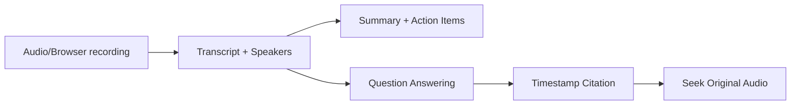
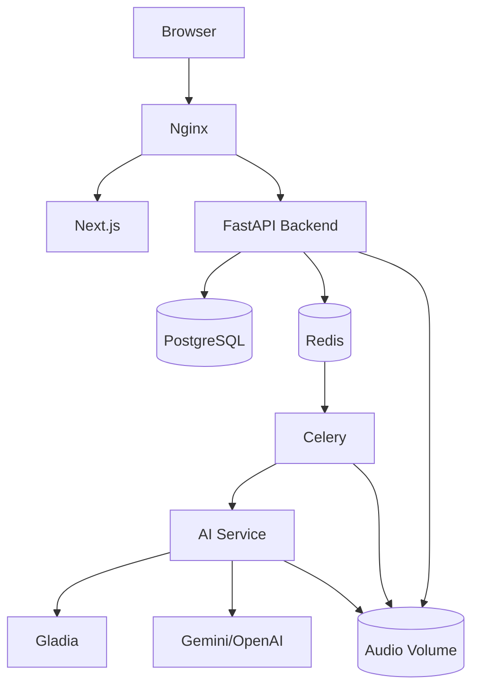
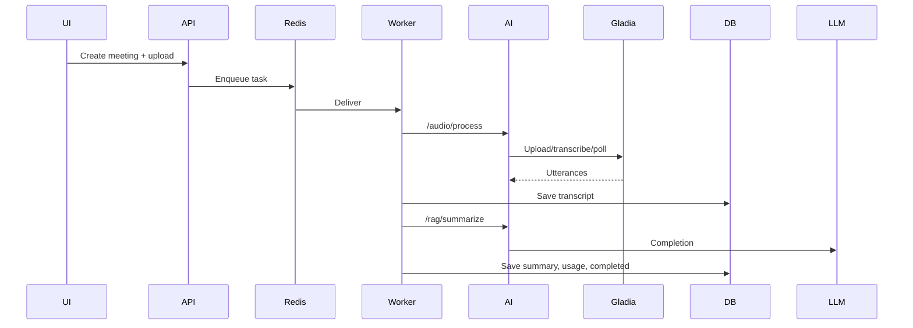
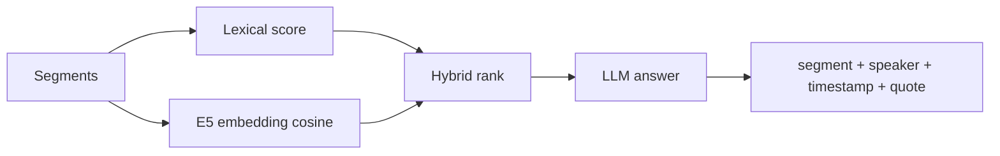
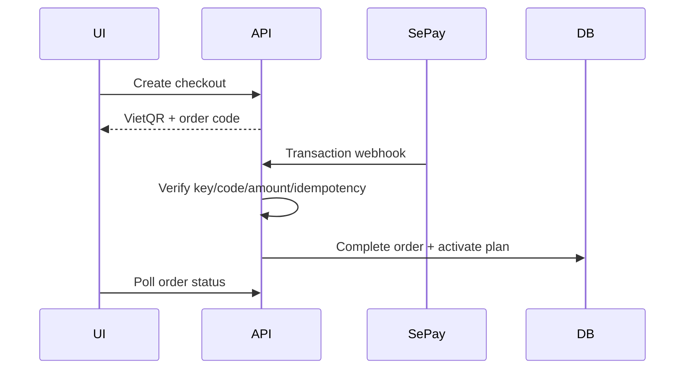

# BÁO CÁO TIẾN ĐỘ — KỊCH BẢN 20 SLIDE

**Đề tài:** Meeting Voice Assistant  
**Sinh viên:** Nguyễn Phương Linh — 20224871 — IT1-02  
**GVHD:** TS. Cao Tuấn Dũng  
**Cập nhật implementation:** 16/11/2026

> Tài liệu này thay thế mô tả two-pass PhoWhisper/Pyannote/GPU cũ. Runtime hiện tại là API-first: Gladia cho ASR/diarization, Gemini/OpenAI cho generation, EC2 CPU cho phần self-host.

## Slide 01 — Tên đề tài và mục tiêu

- Phiên âm cuộc họp tiếng Việt đa người nói.
- Tóm tắt và trích xuất action items.
- Hỏi đáp có citation timestamp để nghe kiểm chứng.
- Triển khai web single-host trên AWS EC2.

## Slide 02 — Bài toán

- Ghi biên bản thủ công tốn thời gian và dễ bỏ sót quyết định.
- Muốn kiểm chứng phải nghe lại file dài.
- Nội dung cuộc họp nhạy cảm, cần quyền truy cập và vận hành rõ ràng.
- AI chỉ hữu ích khi kết quả gắn với audio evidence.

## Slide 03 — Giá trị sản phẩm

North Star: rút ngắn thời gian tạo và kiểm tra biên bản; số liệu phải được đo thực nghiệm, không dùng giá trị mục tiêu chưa kiểm chứng.

## Slide 04 — Tác nhân

- User/Project Owner.
- Project Editor/Viewer.
- Guest có share token.
- Gladia API, Gemini/OpenAI, SePay.

Các quyền share tài nguyên con đang là gap cần hardening trước public production.

## Slide 05 — 10 use case chính

| ID | Use case |
|---|---|
| UC-01 | Xác thực |
| UC-02 | Project và thành viên |
| UC-03 | Upload và xử lý audio |
| UC-04 | Transcript Studio |
| UC-05 | Summary/action item |
| UC-06 | RAG có citation |
| UC-07 | Export đa định dạng |
| UC-08 | Share token |
| UC-09 | Plan/quota |
| UC-10 | VietQR/SePay |

Use case phụ: ghi microphone rồi xử lý batch, profile/password, search/filter, timeline seek.

## Slide 06 — Kiến trúc tổng thể

## Slide 07 — Tại sao API-first

- Không cần GPU EC2.
- Giảm độ phức tạp triển khai model ASR/LLM.
- Đổi lại: phụ thuộc mạng, quota, chi phí và chính sách dữ liệu provider.
- Embedding E5 vẫn chạy CPU trong AI Service.

## Slide 08 — Pipeline audio

1. Validate extension và lưu shared volume.
2. Đặt meeting `processing`, dispatch Celery.
3. AI Service upload Gladia, tạo job, poll result.
4. Chuẩn hóa utterance: speaker/start/end/text.
5. Worker lưu transcript, gọi summary và ghi quota.
6. Meeting chuyển `completed`.

Nếu thiếu key, code trả fallback demo; acceptance test thật phải phát hiện và loại trừ trường hợp này.

## Slide 09 — Sequence upload

## Slide 10 — Transcript Studio

- Speaker timeline và HTML audio playback.
- Segment feed theo thứ tự.
- Sửa text, bulk rename speaker, delete segment.
- Click segment/citation để seek audio.
- Gap: sửa transcript chưa tự regenerate summary/RAG.

## Slide 11 — RAG có citation

Retrieval chạy in-memory; pgvector extension có nhưng chưa có persistent vector index.

## Slide 12 — Cơ sở dữ liệu

- User/project: users, projects, members, links.
- Meeting: meetings, audio_files, transcript_segments.
- AI: summaries, action_items, chat_sessions/messages.
- Billing: plans, subscriptions, quota events, payment orders, webhook events.
- Hiện dùng `create_all`; cần Alembic và constraint/index production.

## Slide 13 — Auth và share

- JWT access/refresh, bcrypt password.
- Project owner/editor/viewer.
- Share token viewer/editor ở meeting metadata.
- Gap: authorization chưa tập trung cho mọi transcript/chat/audio/export endpoint.
- Token frontend hiện ở localStorage; cần cookie HttpOnly trước public production.

## Slide 14 — Subscription/payment

## Slide 15 — Frontend

- Dashboard meeting/project/upload.
- `/live`: MediaRecorder, upload WebM sau khi dừng; không phải live ASR.
- Meeting workspace: timeline + transcript + summary/chat.
- Pricing/VietQR/profile.
- Same-origin `/api/v1` trong production để tránh đóng cứng env tại build.

## Slide 16 — Deployment AWS EC2

- Docker Compose: Nginx, Frontend, Backend, Worker, AI, PostgreSQL, Redis.
- Named volumes cho DB/cache/audio/certificate.
- Chỉ public 80/443; SSH giới hạn IP.
- HTTPS qua Certbot webroot; bắt buộc để browser cho phép microphone.
- Tham chiếu demo: 4 vCPU, 8 GB RAM, 40–80 GB gp3 + swap.

## Slide 17 — Kiểm thử hiện có

- Backend: auth, chat, export, payments, health.
- AI: Gladia parser/fallback, VAD, chunking, retriever, generator, routers/protocol injection.
- Frontend: strict TypeScript + production build.
- Compose syntax/health.
- Gap: browser E2E, project/transcript/share/quota integration và load/cost test.

## Slide 18 — Đánh giá AI cần thực hiện

- ASR: WER/CER, timestamp error.
- Diarization: DER/JER.
- Summary: coverage/factual consistency/action item precision-recall.
- RAG: Recall@k/MRR, citation precision/recall, faithfulness.
- Vận hành: latency percentile, failure rate, queue wait, cost/hour audio.

Không dùng fallback demo để tính metric.

## Slide 19 — Tiến độ và khoảng trống

| Hạng mục | Trạng thái |
|---|---|
| Core UI/API/DB/queue/AI adapters | Đã cài đặt |
| Contract frontend–backend | Đã đồng bộ lại |
| Production images/health/TLS scaffold | Đã bổ sung |
| E2E thật với provider/account | Chủ dự án cần chạy |
| Authorization hardening/fallback off/migrations | P0 còn lại |
| Browser automation/observability/backups | P1 còn lại |

## Slide 20 — Kế hoạch tiếp theo

1. Điền key thật và chạy full E2E theo runbook.
2. Thu thập bộ dữ liệu và metric thật.
3. Hoàn thiện P0 security + Alembic + fail/retry workflow.
4. Thêm browser E2E và CI/CD.
5. Cập nhật chương thực nghiệm bằng số đo, ảnh và log bằng chứng.

## Phụ lục — nguồn chuẩn

- `docs/01-requirements/srs.md`
- `docs/01-requirements/use-cases.md`
- `docs/03-architecture/system-architecture.md`
- `docs/04-design/database-erd.md`
- `docs/deployment/huong-dan-trien-khai-ec2-va-chay-end-to-end.md`
