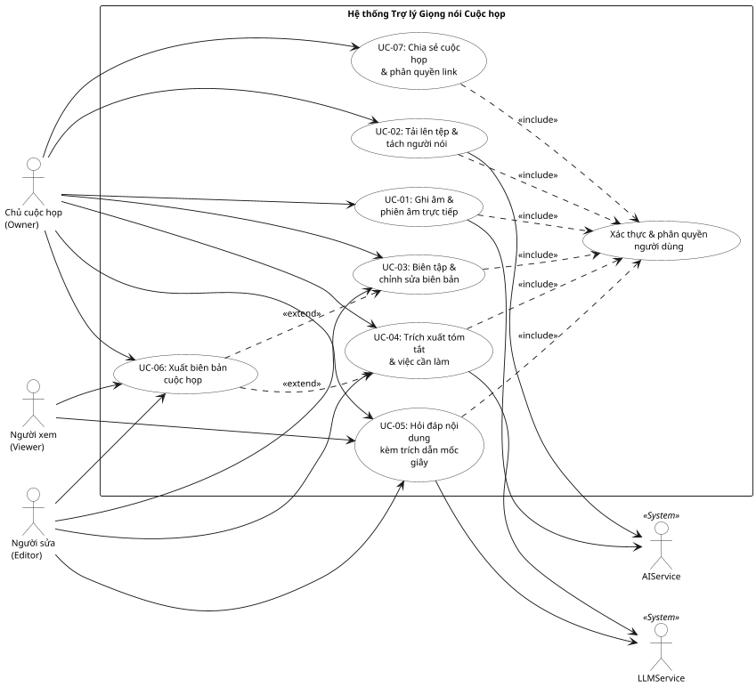
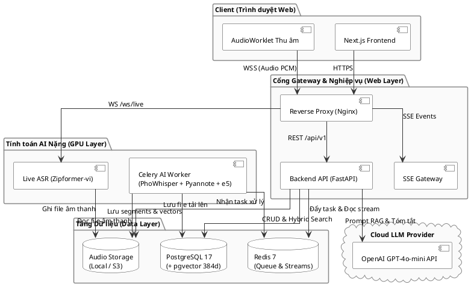
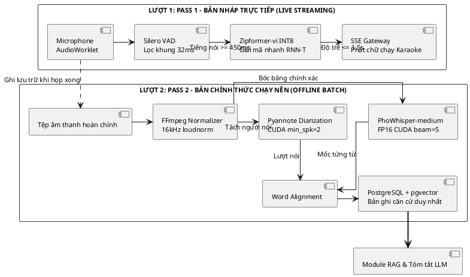
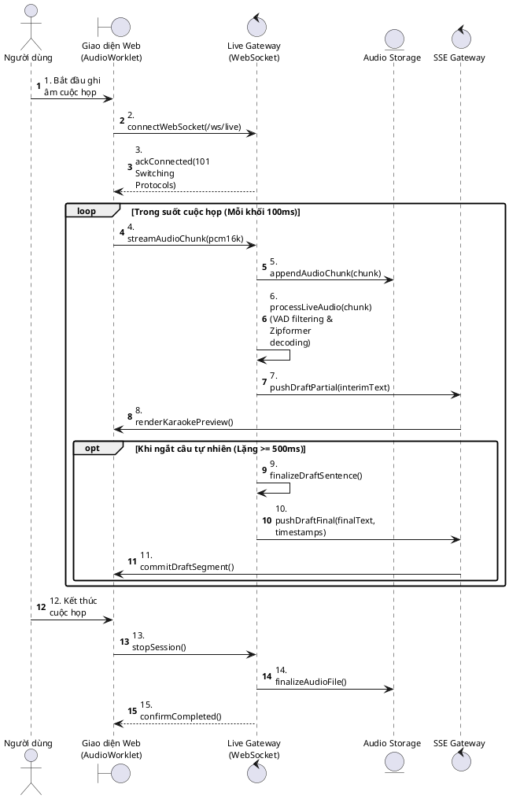
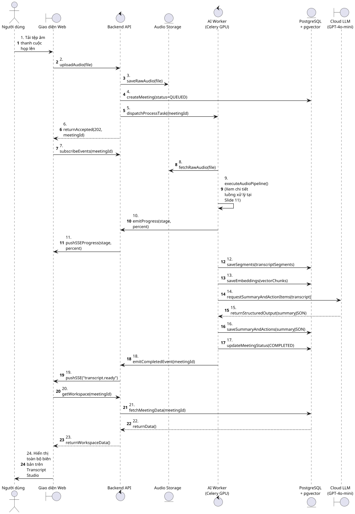
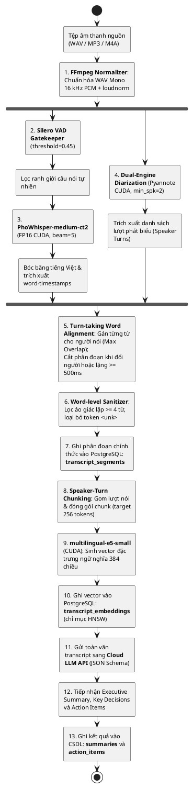
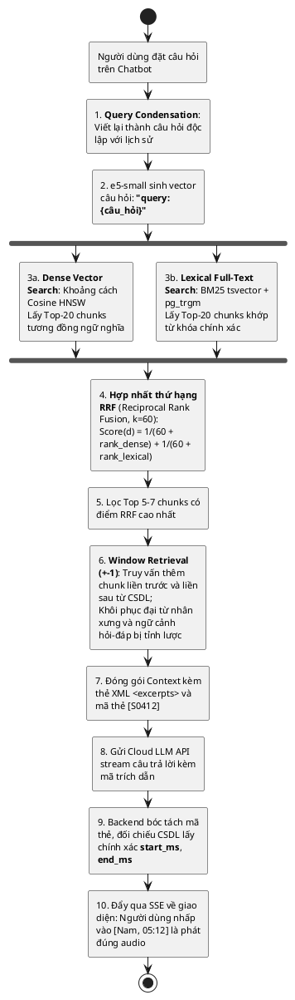
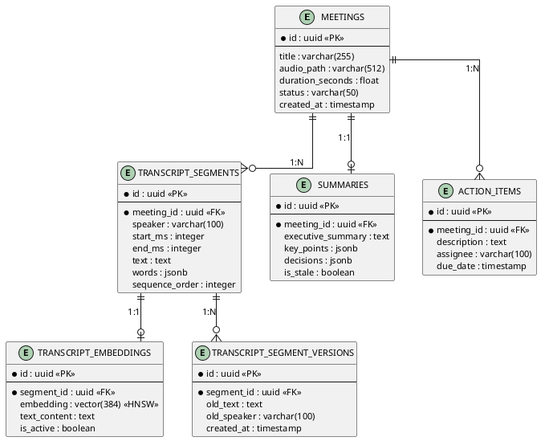

# BÁO CÁO TIẾN ĐỘ NGHIÊN CỨU & THIẾT KẾ KIẾN TRÚC HỆ THỐNG
## HỆ THỐNG PHIÊN ÂM, TÓM TẮT VÀ HỎI ĐÁP NỘI DUNG CUỘC HỌP THÔNG MINH (MEETING VOICE ASSISTANT)

- **Sinh viên thực hiện:** Nguyễn Phương Linh — MSSV: 20224871 — Lớp: IT1-02
- **Giảng viên hướng dẫn:** TS. Cao Tuấn Dũng
- **Phạm vi báo cáo:** Tổng hợp giai đoạn 1 — Yêu cầu nghiệp vụ (PRD, SRS), Khảo sát công nghệ & mô hình AI, Thiết kế kiến trúc hệ thống (C4 Model, CSDL, Sequence Analysis)
- **Tài liệu căn cứ:** `docs/01-requirements/`, `docs/02-research-tech/`, `docs/03-architecture/`, `docs/04-design/`

---

## MỤC LỤC KHUNG BÁO CÁO (15 SLIDE TINH GỌN)

| Slide | Nội dung báo cáo | Trọng tâm trình bày |
|:---:|---|---|
| **01** | Giới thiệu đề tài | Tên đề tài, sinh viên, GVHD, mục tiêu nghiên cứu tổng quát |
| **02** | Khái quát PRD: Bài toán & Phạm vi | Vấn đề lập biên bản thủ công, dữ liệu đầu vào và sản phẩm đầu ra |
| **03** | Mục tiêu hệ thống & Chỉ số kỹ thuật | Rút ngắn thời gian biên bản, Two-pass ASR, RAG mốc giây, tính toàn vẹn ACID |
| **04** | Mô hình Use Case & Phân quyền Actor | Sơ đồ Use Case tổng thể, 3 nhóm người dùng và 2 actor hệ thống |
| **05** | Danh mục chức năng nghiệp vụ (7 Use Cases) | Bảng tóm tắt nghiệp vụ từ UC-01 đến UC-07 |
| **06** | Kiến trúc hệ thống tổng thể | Sơ đồ khối kiến trúc phân tầng tối giản, các luồng kết nối chính |
| **07** | Kiến trúc xử lý hai lượt (Two-Pass Architecture) | So sánh bản chất luồng Pass 1 (Trực tiếp) và Pass 2 (Chính thức) |
| **08** | Luận giải lựa chọn mô hình AI (Tại sao chọn model đó?) | Đánh đổi WER/VRAM, lý do chọn PhoWhisper-medium, Zipformer, Pyannote, e5-small |
| **09** | Sơ đồ tuần tự phân tích: Xử lý tệp âm thanh (UC-02) | Sequence diagram chuẩn quốc tế (Analysis Level / mô hình BCE) |
| **10** | Luồng chi tiết: Pipeline xử lý âm thanh AI (Pass 2) | Chi tiết: FFmpeg $\to$ VAD Gatekeeper $\to$ PhoWhisper $\to$ Diarization $\to$ Alignment $\to$ Sanitizer |
| **11** | Luồng chi tiết: Nghiệp vụ RAG & Trích dẫn mốc giây | Speaker-Turn Chunking $\to$ e5-small $\to$ Hybrid Search (RRF $k=60$) $\to$ Trích dẫn audio |
| **12** | Thiết kế Cơ sở dữ liệu (ERD) & Cơ chế an toàn ACID | Sơ đồ ERD chuẩn và cơ chế Compute-then-Commit khi sửa văn bản |
| **13** | Kiến trúc triển khai hạ tầng & Phân bổ VRAM | Đóng gói Docker Compose, bảng phân bổ VRAM an toàn trên GPU 24GB / Kaggle T4 |
| **14** | An toàn bảo mật & Ranh giới tin cậy (STRIDE) | 4 ranh giới tin cậy, phòng vệ Prompt Injection và kiểm soát link chia sẻ |
| **15** | Tổng kết giai đoạn 1 & Kế hoạch tiếp theo | Đánh giá hoàn thành 01-02-03, kế hoạch thực thi giai đoạn tiếp theo |

---

## CHI TIẾT NỘI DUNG VÀ BIỂU ĐỒ BÁO CÁO

### SLIDE 01: GIỚI THIỆU ĐỀ TÀI
- **Tên đề tài:** Hệ thống phiên âm, tóm tắt và hỏi đáp nội dung cuộc họp thông minh (Meeting Voice Assistant).
- **Sinh viên thực hiện:** Nguyễn Phương Linh (MSSV: 20224871, Lớp IT1-02).
- **Giảng viên hướng dẫn:** TS. Cao Tuấn Dũng.
- **Đơn vị đào tạo:** Trường Công nghệ Thông tin & Truyền thông — Đại học Bách khoa Hà Nội.
- **Mục tiêu cốt lõi:** Xây dựng giải pháp tự động hóa quy trình ghi chép biên bản cuộc họp tiếng Việt đa người nói: nhận diện trực tiếp thời gian thực, bóc băng chính xác cao kèm định danh người nói, tóm tắt tự động và hỗ trợ hỏi đáp nội dung có trích dẫn mốc thời gian kiểm chứng.

---

### SLIDE 02: KHÁI QUÁT PRD: BÀI TOÁN & PHẠM VI DỰ ÁN
- **Vấn đề thực tế:**
  - Lập biên bản thủ công tốn 45–60 phút cho một cuộc họp 1 giờ; dễ bỏ sót quyết định quan trọng và danh sách việc cần làm (Action Items).
  - Tra cứu lại nội dung thảo luận yêu cầu nghe lại toàn bộ file ghi âm rất mất thời gian.
- **Đặc tả dữ liệu đầu vào:**
  - Thu âm trực tiếp từ micro trình duyệt (PCM 16 kHz Mono).
  - Tải lên tệp âm thanh/video ghi sẵn (`.wav`, `.mp3`, `.m4a`, `.mp4`).
  - Đặc thù: Hội thoại tiếng Việt 2–4 người, có nói ngắt lời, âm đệm, tiếng ồn phòng họp nhẹ.
- **Sản phẩm đầu ra có cấu trúc:**
  - Toàn văn phiên âm phân đoạn (`transcript_segments`) có mốc thời gian bắt đầu/kết thúc (`start_ms`, `end_ms`), nhãn người nói (`speaker`) và danh sách mốc từng từ (`words`).
  - Bản tóm tắt biên bản: Tóm tắt điều hành (Executive Summary), quyết định chính (Decisions), danh sách việc cần làm (Action Items: người nhận việc, hạn chót).
  - Giao diện chat RAG: Trả lời câu hỏi kèm liên kết trích dẫn mốc giây bấm vào là nghe lại đúng đoạn audio.

---

### SLIDE 03: MỤC TIÊU HỆ THỐNG & CHỈ SỐ KỸ THUẬT
- **North Star Metric:** Rút ngắn thời gian hoàn thành biên bản cuộc họp 60 phút từ 45 phút xuống dưới 10 phút.
- **Độ trễ hiển thị trực tiếp (Pass 1 Streaming):** $\le 1.5$ giây từ lúc nói xong đến khi chữ xuất hiện trên màn hình.
- **Tốc độ xử lý ngoại tuyến (Pass 2 Batch RTF):** Real-Time Factor $\le 0.15$ trên GPU (10 phút âm thanh xử lý trong $\le 90$ giây; thực tế PhoWhisper đạt ~0.03x tương đương 18–22 giây).
- **Độ chính xác hỏi đáp (RAG Faithfulness):** 100% câu trả lời nghiệp vụ có trích dẫn mốc thời gian `[Speaker, mm:ss]` có thể kiểm chứng bằng âm thanh gốc.
- **Toàn vẹn dữ liệu (ACID):** Đảm bảo đồng bộ tuyệt đối giữa văn bản và vector ngữ nghĩa khi người dùng chỉnh sửa lời thoại.

---

### SLIDE 04: MÔ HÌNH USE CASE & PHÂN QUYỀN ACTOR

---

### SLIDE 05: DANH MỤC CHỨC NĂNG NGHIỆP VỤ (7 USE CASES)

| Mã Use Case | Tên nghiệp vụ | Tác nhân chính | Mục tiêu & Kết quả nghiệp vụ |
|---|---|---|---|
| **UC-01** | Ghi âm & Phiên âm trực tiếp | Chủ cuộc họp | Thu âm qua micro, hiển thị văn bản nháp tức thời (chữ chạy Karaoke, trễ $\le 1.5$s). |
| **UC-02** | Tải lên tệp & Tách người nói | Chủ cuộc họp | Tải tệp âm thanh, bóc băng chính thức kèm định danh người nói (`SPEAKER_00`, `SPEAKER_01`). |
| **UC-03** | Biên tập & Chỉnh sửa biên bản | Owner, Editor | Sửa nội dung câu chữ, đổi tên người nói; CSDL tự động đồng bộ lại vector tìm kiếm. |
| **UC-04** | Trích xuất tóm tắt & Việc cần làm | Owner, Editor | LLM tạo tóm tắt, quyết định chính và danh sách việc cần làm (kèm người nhận việc, deadline). |
| **UC-05** | Hỏi đáp nội dung kèm trích dẫn | Owner, Editor, Viewer | Tra cứu nội dung qua Chatbot; câu trả lời gắn kèm mốc giây bấm vào là phát đúng audio. |
| **UC-06** | Xuất biên bản cuộc họp | Owner, Editor, Viewer | Xuất dữ liệu biên bản ra các định dạng chuẩn văn phòng: DOCX, TXT, JSON, phụ đề SRT. |
| **UC-07** | Chia sẻ cuộc họp & Phân quyền link | Chủ cuộc họp | Tạo liên kết bảo mật có quyền Editor/Viewer, tùy chọn mật khẩu bảo vệ hoặc ngày hết hạn. |

---

### SLIDE 06: KIẾN TRÚC HỆ THỐNG TỔNG THỂ

Sơ đồ phân tầng tối giản, trực quan hóa luồng dữ liệu giữa các phân hệ:

---

### SLIDE 07: KIẾN TRÚC XỬ LÝ HAI LƯỢT (TWO-PASS ARCHITECTURE)

Giải quyết xung đột kỹ thuật: **"Độ trễ tức thời khi đang họp"** đối đầu với **"Độ chính xác cao & Tách người nói để lưu trữ lâu dài"**:

#### Bảng so sánh cốt lõi:
- **Pass 1 (Zipformer-vi):** Tối ưu cho **tốc độ thời gian thực** (RTF ~0.01, trễ $\le 1.5$s, nhẹ ~75MB), phát sóng bản nháp chữ chạy tức thời.
- **Pass 2 (PhoWhisper-medium):** Tối ưu cho **độ chính xác và cấu trúc** (WER 26.85% hội thoại khó, đủ dấu câu, đủ word-timestamps), ghi đè bản nháp và là dữ liệu duy nhất cho RAG.

---

### SLIDE 08: LUẬN GIẢI LỰA CHỌN MÔ HÌNH AI (TẠI SAO CHỌN MODEL ĐÓ?)

#### 1. Dữ liệu thực nghiệm ASR (PhoWhisper - VinAI ICLR 2024)

| Mô hình ASR | Số tham số | VRAM FP16 | WER (%) VIVOS | WER (%) VLSP Task-2 (Hội thoại khó) | Đánh giá kỹ thuật |
|---|---|---|---|---|---|
| wav2vec2-large-vi | 317M | ~1.2 GB | 8.61% | 36.75% | CTC, không có dấu câu, cần mô hình LM rời rạc |
| PhoWhisper-small | 244M | ~0.8 GB | 6.33% | 32.96% | Mức khá, nhưng còn sai nhiều từ chuyên ngành |
| **PhoWhisper-medium** | **769M** | **~2.0 GB** | **4.97%** | **26.85%** | **Điểm tối ưu: Giảm mạnh 6.11% WER so với bản small** |
| PhoWhisper-large | 1550M | ~3.5 GB | 4.67% | 26.68% | Chỉ giảm thêm 0.17% WER nhưng gấp đôi tham số |

#### 2. Lý do lựa chọn từng mô hình trong hệ thống
- **ASR Pass 2 (`PhoWhisper-medium-ct2`):**
  - **Điểm cân bằng tối ưu (Sweet Spot):** Nâng từ `small` lên `medium` giảm mạnh 6.11% WER; nâng lên `large` chỉ giảm thêm 0.17% nhưng tốn gấp đôi tài nguyên.
  - **Tối ưu GPU qua CTranslate2:** Chạy FP16 trên nhân Tensor Cores GPU NVIDIA, tiêu thụ chỉ **~1.8 – 2.0 GB VRAM**, tốc độ **RTF ~0.03x** (10 phút audio xử lý trong ~20 giây).
  - **Đủ dấu câu & mốc từ:** Tự sinh dấu chấm phẩy và trích xuất mốc `word_timestamps` chuẩn xác để căn chỉnh người nói.
- **ASR Pass 1 (`sherpa-onnx Zipformer-vi INT8`):**
  - Siêu nhẹ (~75MB), độ trễ $\le 1.5$s, RTF ~0.01; không bị lặp ảo giác (hallucination loop) khi gặp khoảng lặng như Whisper.
- **Diarization (`pyannote community-1`):**
  - Mô hình nơ-ron sâu chạy trên GPU, ép `min_speakers=2` tránh lỗi gom cuộc họp về 1 người. Có cơ chế dự phòng Standalone Acoustic K-means khi mất token.
- **Embedding (`multilingual-e5-small`):**
  - Siêu nhẹ (118M params), sinh vector 384 chiều khớp chính xác chỉ mục `vector(384)` của PostgreSQL, tính toán cực nhanh ($< 5$ms/chunk).
- **LLM Tóm tắt & RAG (`Cloud API GPT-4o-mini` qua Adapter):**
  - **Không tự host LLM:** Tiết kiệm 10–18 GB VRAM để dành trọn vẹn GPU cho ASR/Diarization; hỗ trợ Structured Outputs chuẩn 100% JSON Schema.

---

### SLIDE 09: SƠ ĐỒ TUẦN TỰ PHÂN TÍCH: GHI ÂM TRỰC TIẾP (UC-01)
*Sơ đồ tuần tự mức phân tích (Analysis Level / Mô hình BCE chuẩn quốc tế):*

---

### SLIDE 10: SƠ ĐỒ TUẦN TỰ PHÂN TÍCH: XỬ LÝ TỆP ÂM THANH (UC-02)
*Trừu tượng hóa nghiệp vụ tính toán nội bộ của AI Engine để làm rõ luồng tương tác hệ thống:*

---

### SLIDE 11: LUỒNG CHI TIẾT: PIPELINE XỬ LÝ ÂM THANH AI (PASS 2)
*Chi tiết các bước biến đổi dữ liệu tuần tự bên trong Celery Worker AI Service (GPU):*

---

### SLIDE 12: LUỒNG CHI TIẾT: NGHIỆP VỤ RAG & TRÍCH DẪN MỐC GIÂY
*Giải quyết bài toán hội thoại: Lượt nói ngắn, đại từ thay thế và trích dẫn kiểm chứng:*

---

### SLIDE 13: THIẾT KẾ CƠ SỞ DỮ LIỆU (ERD) & CƠ CHẾ AN TOÀN ACID

#### 1. Sơ đồ Thực thể Liên kết (ERD) - 1 CSDL PostgreSQL Duy nhất

#### 2. Cơ chế Đồng bộ An toàn khi Sửa Văn bản (Compute-then-Commit)
- **Vấn đề:** Tránh tình trạng người dùng sửa văn bản nhưng vector tìm kiếm RAG vẫn mang nghĩa cũ.
- **Giải pháp 2 pha:**
  1. **Pha 1 (Compute):** Backend tính toán trước vector embedding mới cho các chunk bị ảnh hưởng ngoài transaction.
  2. **Pha 2 (Commit):** Mở duy nhất 1 **PostgreSQL Transaction**:
     - Lưu bản ghi cũ vào `transcript_segment_versions`.
     - Cập nhật text mới vào `transcript_segments`.
     - Vô hiệu hóa vector cũ (`is_active = false`) và chèn vector mới.
     - Đánh dấu bản tóm tắt cũ `is_stale = true`.
  3. Thực thi `COMMIT`. Nếu có lỗi, rollback hoàn toàn, bảo đảm văn bản và vector luôn nhất quán tuyệt đối.

---

### SLIDE 14: KIẾN TRÚC TRIỂN KHAI HẠ TẦNG & PHÂN BỔ VRAM

#### 1. Bảng Phân Bổ VRAM trên Máy Chủ GPU 24GB (RTX 3090 / 4090 / A10G)

| Tiến trình / Mô hình hoạt động | Chiếm dụng VRAM | Tỷ lệ trên 24GB | Ghi chú vận hành |
|---|---|---|---|
| CUDA Runtime & PyTorch Context | ~0.8 – 1.0 GB | ~3.8% | Khởi tạo môi trường runtime CUDA |
| Silero VAD v6 Gatekeeper | ~0.1 – 0.2 GB | ~0.8% | Lọc khung tiếng nói siêu nhẹ |
| sherpa-onnx Zipformer-vi INT8 | ~0.2 – 0.3 GB | ~1.2% | Phục vụ Pass 1 Live Streaming |
| PhoWhisper-medium-ct2 (FP16) | ~1.8 – 2.0 GB | ~8.3% | Pass 2 Batch ASR giải mã Tensor Cores |
| pyannote community-1 (CUDA) | ~2.2 – 2.8 GB | ~10.4% | Phân tách người nói Dual-Engine 1 |
| multilingual-e5-small (CUDA) | ~0.4 – 0.5 GB | ~1.9% | Tính vector 384-dim cho từng chunk |
| **TỔNG ĐỈNH VRAM (1 PIPELINE)** | **~5.5 – 6.8 GB** | **~26.5%** | **Chiếm chưa tới 30% tổng VRAM máy chủ** |
| **VRAM DỰ PHÒNG KHẢ DỤNG** | **~17.2 – 18.5 GB** | **~73.5%** | **Cho phép chạy song song 2–3 worker đồng thời** |

*(Ghi chú: Pipeline tương thích hoàn toàn trên Kaggle GPU Tesla T4 15GB VRAM với tổng đỉnh chỉ chiếm ~45% VRAM).*

#### 2. Chiến lược Đóng gói & An toàn Bảo mật
- **Đóng gói Docker Compose:** Toàn bộ thành phần (`proxy`, `frontend`, `backend`, `ai-service`, `postgres`, `redis`, `storage`) được đóng gói qua Docker Compose, tích hợp NVIDIA Container Toolkit.
- **4 Ranh giới kiểm soát an ninh (STRIDE):**
  - **TB-1 (Internet Boundary):** Nginx kết thúc TLS 1.3, rate limit, chống DDoS.
  - **TB-2 (Application Boundary):** Backend FastAPI kiểm tra Pydantic schema, xác thực JWT, RBAC.
  - **TB-3 (Data Persistence Boundary):** CSDL và Storage cô lập trong mạng Docker nội bộ; cấp quyền truy cập file audio qua Presigned URL ($\le 15$ phút).
  - **TB-4 (Third-Party Boundary):** Đóng gói trích đoạn cuộc họp trong thẻ XML `<excerpts>`, chỉ thị LLM xem dữ liệu là quan sát thụ động để triệt tiêu nguy cơ Prompt Injection từ phát biểu cuộc họp.

---

### SLIDE 15: TỔNG KẾT GIAI ĐOẠN 1 & KẾ HOẠCH TIẾP THEO

#### 1. Đánh giá kết quả đã hoàn thành (Giai đoạn 1)
- **Folder 01 (Requirements):** Hoàn thành PRD, SRS theo tiêu chuẩn IEEE 830, Ma trận truy vết và đặc tả 7 Use Cases cốt lõi.
- **Folder 02 (Research Tech):**
  - Khảo sát thực nghiệm ASR & Diarization trên notebook Kaggle GPU; xác lập cấu hình tối ưu `PhoWhisper-medium-ct2`.
  - Khung RAG hội thoại: Speaker-Turn Chunking, e5-small, PostgreSQL Hybrid Search RRF $k=60$ và trích dẫn mốc giây.
  - Luận giải toàn diện Tech Stack, bảng đối chiếu GPU 24GB vs Kaggle T4.
- **Folder 03 (Architecture):**
  - Tài liệu arc42, kiến trúc phân tầng C4 Container.
  - Sơ đồ tuần tự chuẩn Analysis Level (mô hình BCE) cho các Use Cases cốt lõi.
  - Mô hình đe dọa an toàn thông tin STRIDE và cơ chế ACID Compute-then-Commit.

#### 2. Kế hoạch triển khai giai đoạn tiếp theo
- **Pha 04 (Design):** Thiết kế chi tiết lược đồ vật lý PostgreSQL DDL (chỉ mục HNSW/GIN); Đặc tả API chuẩn OpenAPI 3.0 (Swagger); Thiết kế wireframe giao diện Transcript Studio.
- **Pha 05 (Implementation & Testing):** Cài đặt lõi `ai-service` (Celery GPU Worker) $\to$ `backend-api` (FastAPI SSE Gateway, RAG Engine) $\to$ `frontend` (Next.js 14, wavesurfer.js) $\to$ Kiểm thử đánh giá độ chính xác (WER/CER, DER, RAG Triad Metrics).
