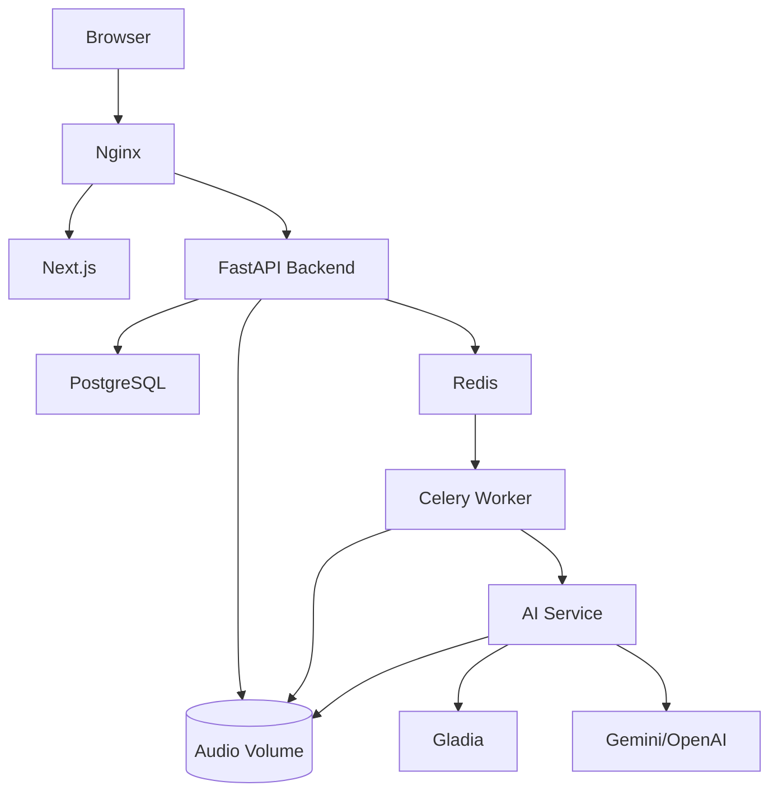

# BÁO CÁO TIẾN ĐỘ GIAI ĐOẠN 01–03

**Đề tài:** Meeting Voice Assistant  
**Sinh viên:** Nguyễn Phương Linh — 20224871 — IT1-02  
**GVHD:** TS. Cao Tuấn Dũng  
**Ngày đồng bộ với code:** 16/11/2026

## 1. Mục tiêu

Xây dựng hệ thống web xử lý cuộc họp tiếng Việt: nhận audio, ASR/diarization, biên tập transcript, tóm tắt/action items, hỏi đáp có citation timestamp, export và tổ chức dữ liệu theo project.

## 2. Kết quả yêu cầu

- SRS xác định 10 use case chính và 5 use case phụ.
- Phân biệt rõ `Implemented`, `Partial`, `Experimental`, `Planned`.
- Live page hiện là thu microphone rồi xử lý batch; WebSocket chỉ mô phỏng và không thuộc acceptance.
- Xác định các gap production: authorization tài nguyên con, fallback demo, migrations, token storage và quota boundary.

## 3. Kết quả nghiên cứu công nghệ

### Phương án runtime được chọn

| Bài toán | Lựa chọn hiện tại |
|---|---|
| ASR + diarization | Gladia API v2 |
| Summary/RAG generation | Gemini/OpenAI compatible client |
| Embedding | multilingual-e5-small chạy CPU |
| Hybrid retrieval | Lexical + embedding cosine trong memory |
| Backend | FastAPI + SQLAlchemy async |
| Background task | Redis + Celery |
| Persistence | PostgreSQL 16 + shared audio volume |
| Frontend | Next.js 14/React 18 |

Các khảo sát PhoWhisper/Pyannote/GPU được giữ làm phương án nghiên cứu, không còn là runtime implementation.

## 4. Kết quả kiến trúc

- Single-host EC2 CPU, không yêu cầu GPU.
- Request upload tách khỏi task dài.
- Production dùng same-origin API qua Nginx.
- Named volume bảo toàn DB/cache/audio khi restart container.
- Healthcheck cho service production và Certbot/TLS scaffold.

## 5. Kết quả implementation liên quan

- Auth/profile, project/member, meeting/audio.
- Gladia pipeline, Celery orchestration, summary/action item.
- Transcript Studio, RAG chat/citation, export.
- Plan/quota, VietQR/SePay.
- Production Dockerfile Next standalone; Backend/AI không chạy `--reload`.
- Đồng bộ các contract frontend từng bị lệch: transcript, summary, chat, quota, project meetings và audio URL.

## 6. Dữ liệu

15 bảng hiện hành thuộc bốn nhóm user/project, meeting, AI và billing. Extension pgvector được bật nhưng chưa có vector column/index; retrieval vẫn in-memory. Startup dùng `create_all`, vì vậy Alembic là hạng mục P0 trước production dài hạn.

## 7. Kiểm thử

| Tầng | Hiện có | Còn thiếu |
|---|---|---|
| Backend | auth/chat/export/payment/health | project/transcript/share/quota đầy đủ |
| AI | parser, VAD, chunking, retriever, generation, router | provider contract thật |
| Frontend | strict type + production build | component/browser E2E |
| Deployment | Compose config/health scaffold | E2E EC2 thật, backup restore |
| Evaluation | metric/dataset spec | WER/DER/RAG số đo thật |

## 8. Rủi ro

- Fallback demo có thể che provider/key lỗi.
- Authorization share chưa đồng nhất cho tài nguyên con.
- Không có Alembic migration.
- Token trình duyệt ở localStorage.
- Model name provider hardcode có thể hết vòng đời.
- Audio local volume cần backup hoặc chuyển S3.

## 9. Kế hoạch tiếp theo

1. Chủ dự án lấy/điền Gladia, Gemini/OpenAI, SePay/bank và AWS/domain.
2. Chạy full E2E thật theo runbook, lưu log/ảnh/kết quả.
3. Hoàn thành P0 security, tắt fallback production và Alembic.
4. Bổ sung test thiếu và browser automation.
5. Thu dataset, tính WER/DER/citation/faithfulness và cost.
6. Cập nhật luận văn bằng số liệu đo thực tế.

## 10. Tài liệu chuẩn

- [SRS](01-requirements/srs.md)
- [Use cases](01-requirements/use-cases.md)
- [Architecture](03-architecture/system-architecture.md)
- [ERD](04-design/database-erd.md)
- [Runbook EC2/E2E](deployment/huong-dan-trien-khai-ec2-va-chay-end-to-end.md)
